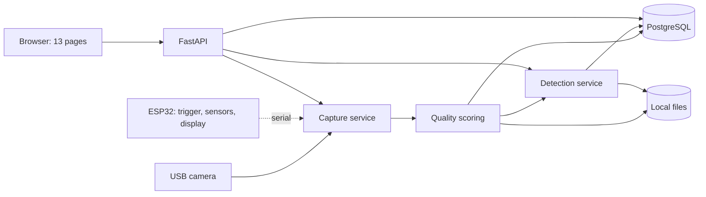
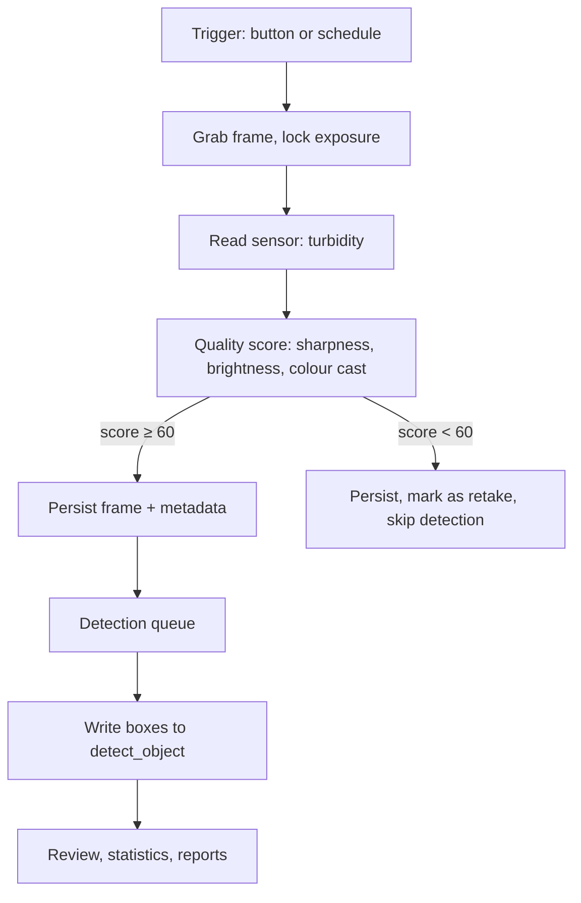

# Architecture

> Chinese version: [architecture-zh.md](architecture-zh.md). This file is the source of truth.

> Owner: @FrozenYty · Revisit when: the layering or the dependency rule changes

## 1. Purpose

The system turns a live camera feed into structured observations: species, count, position and
confidence. It runs as a single FastAPI process on one machine, with the camera attached by USB.

Design goals, in order:

1. **Compliant** — images can only enter through the camera; there is no upload-to-detect path.
2. **Provable** — every result traces back to a frame, a model version and a parameter set.
3. **Demoable** — works offline, on a laptop, without network configuration.

## 2. System context



## 3. Layers and the dependency rule

```
routers/  →  serializers/  →  SQLAlchemy session  →  models/
                  ↓
               vision/
```

**Target:** `api/ → services/ → repo/ → models/`, with `services` between routing and data access.
**Today** is one level below that: routing, validation and business logic all live in
`server/app/routers/`, `models.py` holds the table definitions, and the `repo/` and `services/`
packages do not exist. **A layer that does not exist must not be drawn as if it did** — this section
says where the code is going and why; the rule below is what keeps that move possible.

**Dependencies flow one way only.** Routers do not execute raw SQL, business logic does not build HTTP
responses, and `vision` is called by the routers and never calls back.

| Layer | Responsibility | Must not |
|---|---|---|
| `api/` | Routing, request validation, response envelope | Contain business rules |
| `services/` | Business logic: quality, scheduling, review, statistics | Write SQL or open the camera directly |
| `repo/` | Data access, one module per table | Contain business branching |
| `vision/` | Capture, preprocessing, inference, scoring | Know about HTTP or the database |
| `models/` | SQLAlchemy table definitions | Contain queries |

This rule exists so a layer can be replaced without touching the others. Breaking it is the
single most expensive mistake in a project this size.

## 4. Directory layout

The tree below is today's layout; the names in parentheses are the target §3 describes.

```
server/
  app/
    main.py            FastAPI entry point, router registration, lifespan
    routers/           the API surface, one module per domain (target: api/)
    vision/            capture, quality, inference
    rig/               the serial link to the ESP32 and the verdict it produces
    models.py          SQLAlchemy definitions (target: models/)
    db.py              engine and session factory
    security.py        hashing, tokens, dependencies
    serializers.py     row-to-JSON shapes
    worker.py          the detection thread pool
    config.py          settings, read once
    envelope.py        the one response shape
web/
  static/              css, js, fonts, vendor (pinned libraries), mock (fixtures for api.js)
  templates/           html pages
firmware/
  main/                ESP32 sketch
docs/
scripts/               dataset prep, training, evaluation
tests/
```

## 5. Runtime model

One process, five concerns:

| Concern | How it runs | Why |
|---|---|---|
| Capture | On demand: one frame per `POST /api/capture/sessions/{id}/frames` request, or a stream while a `/ws/capture` client asks for one | No background grabber runs when nobody is asking; the socket's feed captures in the thread pool, so it does not block the event loop |
| Detection | On demand: one frame from `POST /api/detect/frames/{id}`, a batch through the worker pool, or the live socket at its `detect_interval_ms` | The live socket keeps capture and inference at their own rates; see ADR 03 |
| Batch jobs | Fixed thread pool, 2 workers | No Celery, no Redis; task state lives in PostgreSQL |
| API | Sync `def` handlers, run by FastAPI in its thread pool, plus one WebSocket route | Serves REST; `/ws/capture` streams the live feed as api-contract §7 defines it, and polling is only the fallback when the socket cannot be served |
| Rig link | One reader thread plus one keepalive thread, started only when `AV_RIG_PORT` is set | The board is optional; a machine without one is not degraded. The link's states and the keepalive rule are in `docs/rig-state-machine-en.md` §9 |

**Detection rate is not the display rate on the live socket.** The page asks for a frame rate in its
`start` message (10 fps in the client) and a detection interval (`detect_interval_ms`, 300 ms by
default); capture keeps producing while inference runs in the thread pool, and every result carries the
`frame_id` it belongs to, so a late result is dropped rather than drawn against a newer frame
(api-contract §8). The REST and batch paths have no rate of their own: they run when a request or a
queued task asks for them. On a GPU both live rates run at full speed; on a CPU the preview stays
smooth instead of degrading to 3 fps.

## 6. Frame lifecycle



Every frame carries `frame_id`, `session_id` and `captured_at`. These three identifiers tie
together the file on disk, the database row and the detection result.

## 7. Storage

| What | Where | Why |
|---|---|---|
| Frames | `data/frames/<site>/<YYYYMMDD>/<session>/<digest[:16]>.jpg` | Thousands per day, so day and session are directories. The filename is the content-hash prefix deduplication already computed (AC-05), not `frame_id`; that id lives in the `media_asset` row |
| Dataset manifests | `data/datasets/<snapshot_name>/manifest.json` | A human-readable copy beside the rows, which remain the record (FR-M4-04) |
| Runtime parameters | `sys_param` | The operator changes them through `PATCH /api/params`, audited with the before and after values; a consumer reads the value **when it needs it**, and `Settings` supplies the default when no row exists (ADR 15) |
| Reports | `data/reports/<report_code>.md` | The document is the file; the history and its figures are the `report` row (FR-M5-04) |
| Runtime database | `data/app.db` for the SQLite development default, or the server named by `DB_DSN` | Everything queryable |
| Delivered weights | `models/<version_name>/` at the repository root, tracked: `best.pt`, `labels.txt`, `metrics.json` | ADR 13: a delivered artefact must not live under `data/`, whose location is a configuration value. `model_version.weight_path` is relative to the repository root |

`data/` is the runtime root: git-ignored, located by `AV_DATA_DIR`, and not part of the deliverable.
The repository holds code and documents **and each delivered model version** under `models/`. The code
writes only `frames/`, `datasets/` and `reports/` under `data/` (plus the SQLite file); there are no
`thumbs/`, `results/` or `exports/` directories, because nothing generates them.

## 8. Configuration

Everything environmental lives in `.env`, read through `pydantic-settings`. The names below are the
ones `server/app/config.py` actually reads - an earlier version of this table listed three of them
without their prefix and one that does not exist at all, and because the settings model ignores unknown
keys, following it produced a server that started and silently ignored its configuration:

```
DB_DSN=postgresql://...            # no AV_ prefix: scripts/init_db.py reads the same name
AV_JWT_SECRET=<long random string> # default is public; /api/health reports whether it is still default
AV_JWT_HOURS=8
AV_DATA_DIR=data
AV_TIMEZONE=Asia/Shanghai          # the zone every calendar question is answered in (ADR 14)
AV_RETENTION_DAYS=30
AV_MAX_CONCURRENCY=2
AV_DETECT_INTERVAL_MS=300
AV_QUALITY_THRESHOLD=60
AV_CAMERA_INDEX=0
AV_RIG_PORT=                        # empty turns the rig link off; the board is optional
AV_RIG_BAUD=115200
AV_RIG_KEEPALIVE_SECONDS=2.0
AV_WORKER_ENABLED=1
AV_WORKER_POLL_SECONDS=1.0
```

Two things `.env` does not do, both learned the hard way: the file is resolved against the **process
working directory**, so a `.env` at the repository root is invisible to a server started from `server/`;
and `scripts/init_db.py` does not read it at all, only the process environment. Set the variables in the
shell instead if that is simpler.

No path, port or threshold is hard-coded in business code. Relative SQLite paths are anchored to the
repository root by `app.db.resolve_dsn`, so the database is one file per repository rather than one file
per working directory.

## 9. Non-goals

- No microservices, no message broker, no container orchestration.
- No mobile app; the browser is the only client.
- No multi-tenant isolation; one deployment, one team.
- No online model serving; all inference is local.

## 10. Decisions

| ID | Decision |
|---|---|
| [01](adr/01-camera-via-usb.md) | Camera connects by USB to the server; no on-board capture |
| [02](adr/02-drop-pan-tilt.md) | No pan-tilt; fixed camera, moving targets |
| [03](adr/03-single-process.md) | Single FastAPI process, no microservices |
| [04](adr/04-static-frontend.md) | Static frontend with fetch, no framework or build step |
| [05](adr/05-vendored-frontend-assets.md) | Frontend libraries and fonts vendored, no CDN at runtime |
| [06](adr/06-dataset-duo.md) | Training data comes from DUO, not URPC |
| [07](adr/07-local-first-verification.md) | Checks run locally before a push; CI confirms, it does not discover |
| [08](adr/08-four-tables-added.md) | Nine tables become thirteen: snapshots, reports and parameters had nowhere to live |
| [09](adr/09-led-fill-light.md) | ~~Fill light becomes a 12 V strip driven by a MOSFET~~ — **superseded by 10** |
| [10](adr/10-desk-lamp-fill-light.md) | Fill light is the existing lamp: USB-powered DC, no visible flicker, nothing to buy |
| [11](adr/11-pytest-runs-locally.md) | Tests run on every workstation: a suite that only runs in CI is a suite people push past |
| [12](adr/12-detect-task-items.md) | A task is assigned its frames when it is created, not discovered by a query; `detect_task_item` makes fourteen tables |
| [14](adr/14-the-time-basis.md) | Storage stays UTC and one configured zone answers every calendar question: `AV_TIMEZONE`, Beijing by default, a day from 00:00 to 23:59 in that zone, and every emitted timestamp carrying its offset |
| [15](adr/15-parameters-take-effect-live.md) | A parameter the operator can change takes effect at the next decision point - one accessor, a short TTL, a declared range - not at the next restart |
| [13](adr/13-weights-in-the-repository.md) | The delivered model is tracked in the repository; datasets, frames and training runs stay out |
