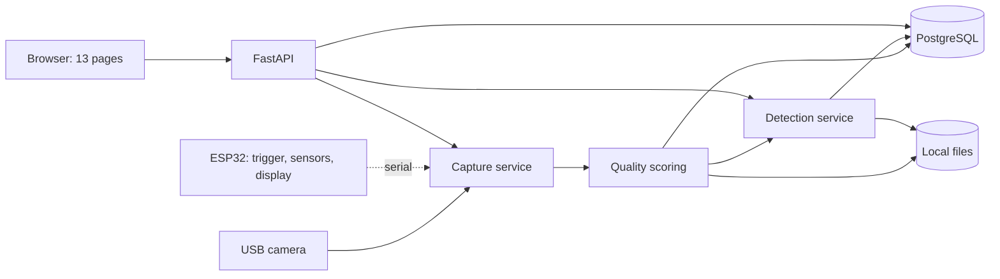
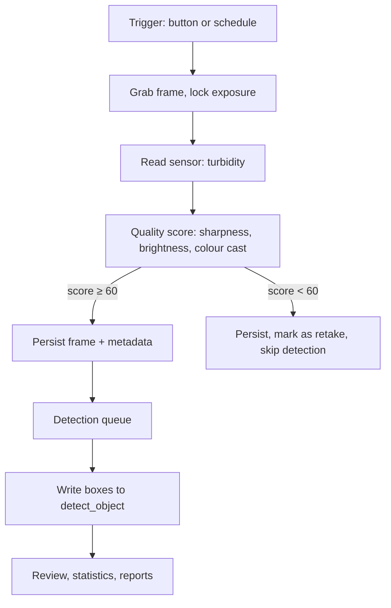

# Architecture

> Chinese version: [architecture-zh.md](architecture-zh.md). This file is the source of truth.

> Owner: @FrozenYty · Revisit when: the layering or the dependency rule changes

## 1. Purpose

The system turns a live camera feed into structured observations: species, count, position and
confidence. It runs as a single FastAPI process on one machine, with the camera attached by USB.

Design goals, in order:

1. **Compliant** — images can only enter through the camera; there is no upload-to-detect path.
2. **Provable** — every result traces back to a frame, a model version and a parameter set.
3. **Demoable** — works offline, on a laptop, without network configuration.

## 2. System context



## 3. Layers and the dependency rule

```
api/  →  services/  →  repo/  →  models/
              ↓
           vision/
```

**Dependencies flow one way only.** `api` never touches SQL, `services` never touches HTTP,
`vision` is called by `services` and never calls back.

| Layer | Responsibility | Must not |
|---|---|---|
| `api/` | Routing, request validation, response envelope | Contain business rules |
| `services/` | Business logic: quality, scheduling, review, statistics | Write SQL or open the camera directly |
| `repo/` | Data access, one module per table | Contain business branching |
| `vision/` | Capture, preprocessing, inference, scoring | Know about HTTP or the database |
| `models/` | SQLAlchemy table definitions | Contain queries |

This rule exists so a layer can be replaced without touching the others. Breaking it is the
single most expensive mistake in a project this size.

## 4. Directory layout

```
server/
  app/
    main.py            FastAPI entry point, router registration, camera startup
    api/               auth, capture, detect, review, stats, model
    services/          quality, tasks, review, statistics
    repo/              one module per table
    vision/            capture, preprocess, detect, quality
    models/            SQLAlchemy definitions
    core/              config, auth, logging, errors
web/
  static/              css, js, fonts, vendor (pinned libraries), mock (fixtures for api.js)
  templates/           html pages
firmware/
  main/                ESP32 sketch
docs/
scripts/               dataset prep, training, evaluation
tests/
```

## 5. Runtime model

One process, four concerns:

| Concern | How it runs | Why |
|---|---|---|
| Capture | Background thread, 10 fps | Keeps the latest frame without blocking requests |
| Detection | Inference every ~300 ms | Decoupled from display rate; see ADR 03 |
| Batch jobs | Fixed thread pool, 2 workers | No Celery, no Redis; task state lives in PostgreSQL |
| API | Async FastAPI handlers | Serves REST and one WebSocket endpoint |

**Detection rate is not the display rate.** The camera pushes frames at 10 fps; detection runs
every 300 ms and the newest boxes are reused for intermediate frames. On a GPU both run at full
rate; on a CPU this keeps the preview smooth instead of degrading to 3 fps.

## 6. Frame lifecycle



Every frame carries `frame_id`, `session_id` and `captured_at`. These three identifiers tie
together the file on disk, the database row and the detection result.

## 7. Storage

| What | Where | Why |
|---|---|---|
| Frames | `data/frames/YYYY/MM/DD/<session>/<frame_id>.jpg` | Thousands per day; a flat folder stalls the file browser |
| Thumbnails | `data/thumbs/...` | List views never load full images |
| Results | `data/results/<frame_id>.json` | Lets a result be re-read without the database |
| Weights | `data/models/<version>/` | Versioned, never overwritten |
| Records | PostgreSQL | Everything queryable |

`data/` is git-ignored. The repository holds code and documents only.

## 8. Configuration

Everything environmental lives in `.env`, read through `pydantic-settings`:

```
CAMERA_INDEX=0
DETECT_INTERVAL_MS=300
QUALITY_THRESHOLD=60
DB_DSN=postgresql://...
MODEL_DIR=data/models
```

No path, port or threshold is hard-coded in business code.

## 9. Non-goals

- No microservices, no message broker, no container orchestration.
- No mobile app; the browser is the only client.
- No multi-tenant isolation; one deployment, one team.
- No online model serving; all inference is local.

## 10. Decisions

| ID | Decision |
|---|---|
| [01](adr/01-camera-via-usb.md) | Camera connects by USB to the server; no on-board capture |
| [02](adr/02-drop-pan-tilt.md) | No pan-tilt; fixed camera, moving targets |
| [03](adr/03-single-process.md) | Single FastAPI process, no microservices |
| [04](adr/04-static-frontend.md) | Static frontend with fetch, no framework or build step |
| [05](adr/05-vendored-frontend-assets.md) | Frontend libraries and fonts vendored, no CDN at runtime |
| [06](adr/06-dataset-duo.md) | Training data comes from DUO, not URPC |
| [07](adr/07-local-first-verification.md) | Checks run locally before a push; CI confirms, it does not discover |
