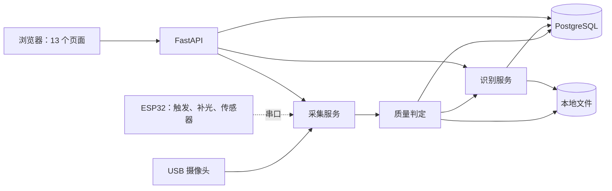
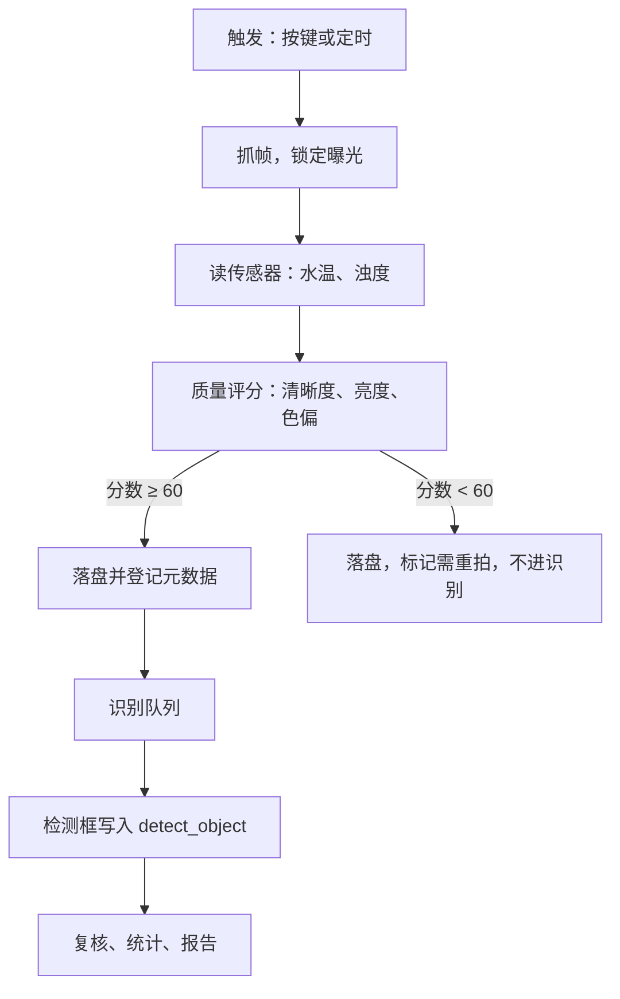

# 总体架构

> 本文为 `architecture-en.md` 的中文对照版，以英文版为准。
> 同步于：2026-11-03

## 一、目标

系统把实时摄像头画面转成结构化观测结果：物种、数量、位置与置信度。整套系统以单个
FastAPI 进程运行在一台机器上，摄像头通过 USB 连接。

设计目标按优先级排列：

1. **合规**——图像只能从摄像头进入，系统没有“上传文件再识别”的入口。
2. **可证**——每个结果都能追溯回某一帧、某个模型版本、某组参数。
3. **可演示**——离线可跑，笔记本上能起，不需要配网络。

## 二、系统上下文



## 三、分层与依赖规则

```
api/  →  services/  →  repo/  →  models/
              ↓
           vision/
```

**依赖只能单向流动。** `api` 不碰 SQL，`services` 不碰 HTTP，`vision` 被 `services` 调用，
不反向回调。

| 层 | 职责 | 不许做 |
|---|---|---|
| `api/` | 路由、入参校验、响应封装 | 写业务规则 |
| `services/` | 质量判定、任务调度、复核、统计 | 直接写 SQL 或打开摄像头 |
| `repo/` | 数据访问，一表一模块 | 写业务分支 |
| `vision/` | 采集、预处理、推理、评分 | 知道 HTTP 与数据库的存在 |
| `models/` | SQLAlchemy 表定义 | 写查询 |

这条规则的意义是：任何一层都能被替换而不牵连其他层。在这个规模的团队里，破坏它是
最昂贵的错误。

## 四、目录结构

```
server/
  app/
    main.py            FastAPI 入口，注册路由，启动采集
    api/               auth、capture、detect、review、stats、model
    services/          quality、tasks、review、statistics
    repo/              一表一模块
    vision/            capture、preprocess、detect、quality
    models/            SQLAlchemy 定义
    core/              配置、鉴权、日志、异常
web/
  static/              css、js、字体、vendor（锁定版本的第三方库）、mock（api.js 的模拟数据）
  templates/           html 页面
firmware/
  main/                ESP32 工程
docs/
scripts/               数据准备、训练、评估
tests/
```

## 五、运行时模型

一个进程，四件事：

| 关注点 | 运行方式 | 原因 |
|---|---|---|
| 采集 | 后台线程，10 fps | 保证取到最新帧，且不阻塞请求 |
| 识别 | 每约 300 ms 推理一次 | 与显示帧率解耦，见 ADR 03 |
| 批量任务 | 固定线程池，2 个工作线程 | 不引 Celery 与 Redis，任务状态存 PostgreSQL |
| 接口 | FastAPI 异步处理 | 同时提供 REST 与一个 WebSocket |

**识别频率不等于显示帧率。** 摄像头按 10 fps 推帧，识别每 300 ms 跑一次，中间帧复用
最新的框。有独显时两者都跑满；在 CPU 上这样能保住画面流畅，而不是掉到 3 fps。

## 六、一帧的生命周期



每一帧都带 `frame_id`、`session_id`、`captured_at` 三个标识，把磁盘文件、数据库记录
与识别结果串在一起。

## 七、存储

| 内容 | 位置 | 原因 |
|---|---|---|
| 原始帧 | `data/frames/年/月/日/<会话>/<frame_id>.jpg` | 一天几千帧，平铺目录会把文件浏览器卡死 |
| 缩略图 | `data/thumbs/...` | 列表页永远不加载原图 |
| 识别结果 | `data/results/<frame_id>.json` | 不查库也能直读某帧结果 |
| 模型权重 | `data/models/<版本>/` | 按版本存放，永不覆盖 |
| 业务记录 | PostgreSQL | 一切需要检索的东西 |

`data/` 已被 git 忽略，仓库只放代码与文档。

## 八、配置

所有环境相关的东西放 `.env`，经 `pydantic-settings` 读取：

```
CAMERA_INDEX=0
DETECT_INTERVAL_MS=300
QUALITY_THRESHOLD=60
DB_DSN=postgresql://...
MODEL_DIR=data/models
```

业务代码里不允许出现硬编码的路径、端口与阈值。

## 九、不做什么

- 不拆微服务，不引消息队列，不做容器编排。
- 不做移动端，浏览器是唯一客户端。
- 不做多租户隔离，一次部署只服务一个团队。
- 不做在线模型服务，推理全部本地完成。

## 十、决策记录

| 编号 | 决定 |
|---|---|
| [01](adr/01-camera-via-usb.md) | 摄像头经 USB 接到服务端，不做板载采集 |
| [02](adr/02-drop-pan-tilt.md) | 不做云台，固定机位、移动靶标 |
| [03](adr/03-single-process.md) | 单个 FastAPI 进程，不拆微服务 |
| [04](adr/04-static-frontend.md) | 前端纯静态 + fetch，不引框架与构建工具 |
| [05](adr/05-vendored-frontend-assets.md) | 前端第三方库与字体放在本地，运行时不依赖 CDN |
