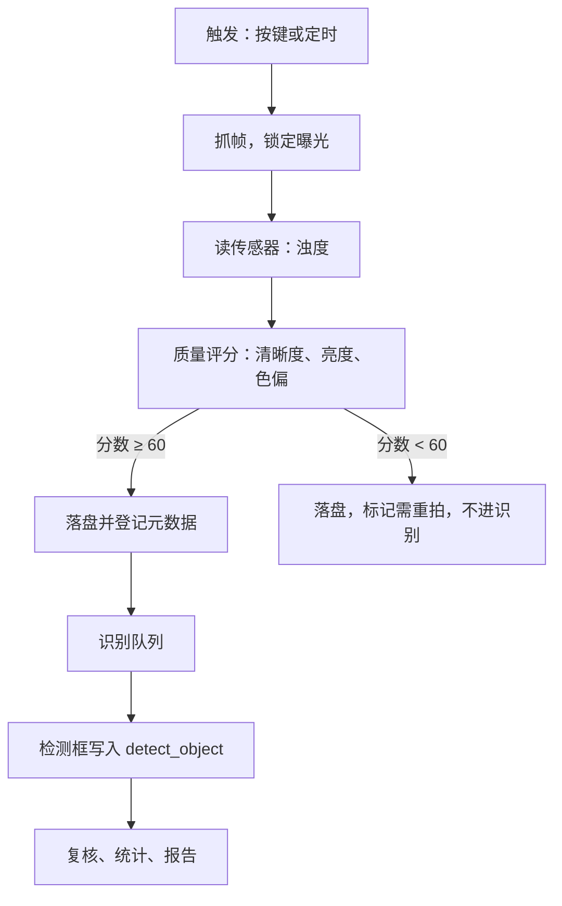

# 总体架构

> 本文为 `architecture-en.md` 的中文对照版，以英文版为准。
> 同步于：2026-11-03

> 维护人：@FrozenYty · 重审时机：分层或依赖规则变化时

## 一、目标

系统把实时摄像头画面转成结构化观测结果：物种、数量、位置与置信度。整套系统以单个
FastAPI 进程运行在一台机器上，摄像头通过 USB 连接。

设计目标按优先级排列：

1. **合规**——图像只能从摄像头进入，系统没有“上传文件再识别”的入口。
2. **可证**——每个结果都能追溯回某一帧、某个模型版本、某组参数。
3. **可演示**——离线可跑，笔记本上能起，不需要配网络。

## 二、系统上下文


## 三、分层与依赖规则

```
routers/  →  serializers/  →  SQLAlchemy 会话  →  models/
                  ↓
               vision/
```

**目标**：`api/ → services/ → repo/ → models/`，`services` 位于路由与数据访问之间。
**现状**比目标低一层：路由、校验与业务逻辑都在 `server/app/routers/` 里，`models.py` 承载表定义，
`repo/` 与 `services/` 这两个包还不存在。**不存在的层不能画成存在**——本节既说明代码要往哪走，
也说明为什么；下面的规则正是让这次移动仍然可能的前提。

**依赖只能单向流动。** 路由不直接执行裸 SQL，业务逻辑不构造 HTTP 响应，`vision` 由路由调用，
不反向回调。

| 层 | 职责 | 不许做 |
|---|---|---|
| `api/` | 路由、入参校验、响应封装 | 写业务规则 |
| `services/` | 质量判定、任务调度、复核、统计 | 直接写 SQL 或打开摄像头 |
| `repo/` | 数据访问，一表一模块 | 写业务分支 |
| `vision/` | 采集、预处理、推理、评分 | 知道 HTTP 与数据库的存在 |
| `models/` | SQLAlchemy 表定义 | 写查询 |

这条规则的意义是：任何一层都能被替换而不牵连其他层。在这个规模的团队里，破坏它是
最昂贵的错误。

## 四、目录结构

下图是**今天**的目录结构；括号里写的是第三节所述的目标。

```
server/
  app/
    main.py            FastAPI 入口，注册路由，生命周期
    routers/           接口层，按领域一模块（目标：api/）
    vision/            采集、质量、推理
    rig/               到 ESP32 的串口链路，以及它产出的判定
    models.py          SQLAlchemy 定义（目标：models/）
    db.py              引擎与会话工厂
    security.py        哈希、令牌、依赖
    serializers.py     行到 JSON 的形状
    worker.py          检测线程池
    config.py          配置，只读一次
    envelope.py        唯一的响应形状
web/
  static/              css、js、字体、vendor（锁定版本的第三方库）、mock（api.js 的模拟数据）
  templates/           html 页面
firmware/
  main/                ESP32 工程
docs/
scripts/               数据准备、训练、评估
tests/
```

## 五、运行时模型

一个进程，五件事：

| 关注点 | 运行方式 | 原因 |
|---|---|---|
| 采集 | 按需：`POST /api/capture/sessions/{id}/frames` 每次抓一帧；`/ws/capture` 客户端在连接期间由 feed 协程持续抓帧 | 没有后台抓帧线程：没人请求时什么都不跑；socket 的抓帧在线程池里执行，不阻塞事件循环 |
| 识别 | 按需：`POST /api/detect/frames/{id}` 单帧、批量任务由工作线程池执行、实时 socket 按 `detect_interval_ms` 推理 | 实时 socket 让抓帧与推理各按自己的节奏走；见 ADR 03 |
| 批量任务 | 固定线程池，2 个工作线程 | 不引 Celery 与 Redis，任务状态存 PostgreSQL |
| 接口 | 同步 `def` 处理函数由 FastAPI 线程池执行，另有一个 WebSocket 路由 | 提供 REST；`/ws/capture` 按 api-contract 第七节推送实时画面，轮询只是 socket 无法提供时的兜底 |
| 装置链路 | 一个读线程加一个保活线程，仅在设置了 `AV_RIG_PORT` 时启动 | 板子是可选的；没有板子的机器不是「降级状态」。链路的状态与保活规则见 `docs/rig-state-machine-zh.md` 第九节 |

**识别频率与显示帧率不同，这一点只在实时 socket 上成立。** 页面在 `start` 消息里给出帧率
（客户端为 10 fps）与识别间隔（`detect_interval_ms`，默认 300 ms）；抓帧持续进行，推理在线程池里跑，
每条结果都带着所属的 `frame_id`，迟到的结果会被丢弃，而不会画到更新的帧上（api-contract 第八节）。
REST 与批量路径没有自己的固定节奏：请求或排队的任务来了才跑。有独显时实时链路的两个速率都能跑满；
在 CPU 上画面仍保持流畅，而不是掉到 3 fps。

## 六、一帧的生命周期



每一帧都带 `frame_id`、`session_id`、`captured_at` 三个标识，把磁盘文件、数据库记录
与识别结果串在一起。

## 七、存储

| 内容 | 位置 | 原因 |
|---|---|---|
| 原始帧 | `data/frames/<站点>/<年月日>/<会话>/<digest 前 16 位>.jpg` | 一天几千帧，按日与会话分目录。文件名是去重时算出的内容哈希前缀（AC-05），不是 `frame_id`；后者存在 `media_asset` 行里 |
| 数据集清单 | `data/datasets/<快照名>/manifest.json` | 与数据库行并存的、给人看的副本；记录仍以行为准（FR-M4-04） |
| 运行时参数 | `sys_param` | 操作员通过 `PATCH /api/params` 修改，并记录修改前后的审计值；消费方**在使用的那一刻**读，没有对应行时用 `Settings` 的默认值（ADR 15） |
| 巡检报告 | `data/reports/<报告编号>.md` | 文档本身就是文件；历史与数字在 `report` 行里（FR-M5-04） |
| 运行数据库 | SQLite 开发默认 `data/app.db`，或 `DB_DSN` 指定的服务器 | 一切需要检索的东西 |
| 交付的模型权重 | 仓库根的 `models/<版本名>/`，纳入版本库：`best.pt`、`labels.txt`、`metrics.json` | ADR 13：交付物不能放在位置由配置决定的 `data/` 下；`model_version.weight_path` 相对仓库根解析 |

`data/` 是运行时根目录：被 git 忽略，由 `AV_DATA_DIR` 指定，不属于交付物。仓库里除了代码与文档，
还有**每个交付版本的模型**（`models/`）。代码只会在 `data/` 下写 `frames/`、`datasets/`、`reports/`
（以及 SQLite 文件）；没有 `thumbs/`、`results/`、`exports/` 这些目录，因为没有代码生成它们。

## 八、配置

所有环境相关的东西放 `.env`，经 `pydantic-settings` 读取。**下面这些才是 `server/app/config.py`
真正读取的名字**——本表早先的版本有三个少了前缀、还有一个根本不存在；而设置模型会忽略未知键，
所以照着旧表配置会得到一个「能启动、但静默忽略配置」的服务：

```
DB_DSN=postgresql://...            # 不带 AV_ 前缀：scripts/init_db.py 读的是同一个名字
AV_JWT_SECRET=<足够长的随机串>      # 默认值公开；/api/health 会报告它是否仍是默认值
AV_JWT_HOURS=8
AV_DATA_DIR=data
AV_TIMEZONE=Asia/Shanghai          # 所有日历问题按这个时区回答（ADR 14）
AV_RETENTION_DAYS=30
AV_MAX_CONCURRENCY=2
AV_DETECT_INTERVAL_MS=300
AV_QUALITY_THRESHOLD=60
AV_CAMERA_INDEX=0
AV_RIG_PORT=                        # 留空即不启用装置链路；板子是可选的
AV_RIG_BAUD=115200
AV_RIG_KEEPALIVE_SECONDS=2.0
AV_WORKER_ENABLED=1
AV_WORKER_POLL_SECONDS=1.0
```

`.env` 有两件它做不到的事，都是踩过才知道的：文件是相对**进程工作目录**解析的，所以放在仓库根目录
的 `.env` 对从 `server/` 启动的服务是不可见的；而 `scripts/init_db.py` 根本不读它，只读进程环境变量。
嫌麻烦就直接在 shell 里设。

业务代码里不允许出现硬编码的路径、端口与阈值。相对 SQLite 路径由 `app.db.resolve_dsn` 锚定到
仓库根目录，所以数据库是「每个仓库一个文件」，而不是「每个工作目录一个文件」。

## 九、不做什么

- 不拆微服务，不引消息队列，不做容器编排。
- 不做移动端，浏览器是唯一客户端。
- 不做多租户隔离，一次部署只服务一个团队。
- 不做在线模型服务，推理全部本地完成。

## 十、决策记录

| 编号 | 决定 |
|---|---|
| [01](adr/01-camera-via-usb.md) | 摄像头经 USB 接到服务端，不做板载采集 |
| [02](adr/02-drop-pan-tilt.md) | 不做云台，固定机位、移动靶标 |
| [03](adr/03-single-process.md) | 单个 FastAPI 进程，不拆微服务 |
| [04](adr/04-static-frontend.md) | 前端纯静态 + fetch，不引框架与构建工具 |
| [05](adr/05-vendored-frontend-assets.md) | 前端第三方库与字体放在本地，运行时不依赖 CDN |
| [06](adr/06-dataset-duo.md) | 训练数据使用 DUO，不使用 URPC |
| [07](adr/07-local-first-verification.md) | 检查在本地跑完再推送；CI 是确认，不是发现 |
| [08](adr/08-four-tables-added.md) | 九张表扩到十三张：快照、报告与参数原先没有落点 |
| [09](adr/09-led-fill-light.md) | ~~补光改用 12V 灯条 + MOS 管~~ —— **已被 10 取代** |
| [10](adr/10-desk-lamp-fill-light.md) | 补光用现有台灯：USB 直流供电、无频闪，不必另买光源 |
| [11](adr/11-pytest-runs-locally.md) | 测试在每个工作站本地跑：只在 CI 跑的测试，人推的时候会绕过去 |
| [12](adr/12-detect-task-items.md) | 任务的帧在创建时分配，不再由查询临时发现；`detect_task_item` 使表增至十四张 |
| [14](adr/14-the-time-basis.md) | 存储仍是 UTC，所有日历问题由一个配置的时区回答：`AV_TIMEZONE`，默认北京，一天为该时区的 00:00 至 23:59，且所有发出的时间戳都带偏移 |
| [15](adr/15-parameters-take-effect-live.md) | 操作员可改的参数在下一次做决定的时刻生效——单一读取入口、短 TTL、声明取值范围——而不是等下次重启 |
| [13](adr/13-weights-in-the-repository.md) | 交付的模型权重进仓库；数据集、采集帧与训练产物仍在外 |
