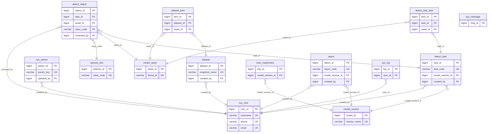

# Design overview

> Chinese version: [design-zh.md](design-zh.md). This file is the source of truth.

> Owner: @FrozenYty · Revisit when: a module boundary or the table set changes

This page holds the outline design that the other documents do not carry: how the API surface is grouped
into modules, which document answers which design question, and the entity-relationship model in one
diagram. It does not repeat the requirements (`srs-en.md`), the layering (`architecture-en.md`), the
endpoint shapes (`api-contract-en.md`) or the columns (`data-model-en.md`); it says where each of them is.

## 1. The eight modules

The 16 router modules are one API surface, but the design, the test plan and the course deliverable all
speak of eight business modules. The mapping below is the single place it is written down: 48 REST
endpoints in total, plus `/ws/capture` and `/api/health`.

| # | Module | Routers | REST endpoints | Responsibility |
|---|---|---|---|---|
| 1 | Users and authentication | `auth`, `users` | 6 | Login, tokens, accounts and roles; the entry point of every other call |
| 2 | Capture and live preview | `capture`, `live` | 8 + socket | Camera enumeration, capture sessions, frames and their quality verdict; the live socket |
| 3 | Detection and batch tasks | `detect`, `tasks` | 6 | One-frame detection, batch task creation, progress, cancel and retry |
| 4 | Review and hard samples | `review`, `hard_samples` | 5 | Correcting detections with a version history, rollback, the hard-sample pool |
| 5 | Datasets and experiments | `datasets`, `experiments` | 4 | Reproducible dataset snapshots and the training-experiment record |
| 6 | Models and reports | `models`, `reports` | 6 | Model versions and activation; report generation, history, download |
| 7 | Statistics and species | `stats`, `species` | 6 | Quality, species, trend and correction statistics; the class dictionary |
| 8 | Parameters, logs and demo | `system`, `demo` | 7 | Runtime parameters, monitoring, messages, the audit log and the demo reset |

## 2. Where a design question is answered

Each question has exactly one owner document. A reader who gets a different answer from another page has
found a defect in that page, not a second opinion.

| Question | Document |
|---|---|
| What must the system do, and how is it accepted? | `srs-en.md` |
| How is the code layered, and which way may dependencies point? | `architecture-en.md` |
| What is the shape of an endpoint, an envelope or an error? | `api-contract-en.md` |
| Which table, column, index and file layout holds the data? | `data-model-en.md` |
| Why was a decision taken, and when should it be revisited? | `adr/` |
| What does the rig do in a given state, and how does it reach the PC? | `rig-state-machine-en.md`, `rig-transport-en.md` |

## 3. The entity-relationship model

Fourteen tables, sixteen foreign keys, keys only — the column detail is `data-model-en.md` §3. The
diagram is Mermaid because the repository draws diagrams as code (CONTRIBUTING §6), so a table that moves
is a change to this block.

## 4. The database script the design phase delivered

The design deliverable carries a MySQL 8 script (fourteen `CREATE TABLE` statements, the keys and indices,
and the four species rows). It is generated from `server/app/models.py`, not hand-written, because the
repository has no second source of truth for the schema: `scripts/init_db.py` creates tables from the
SQLAlchemy metadata and upgrades them by adding columns, and no `.sql` file is tracked.

The script is a course deliverable and stays outside the repository; the repository keeps the models as the
only definition. When a table changes, the script is regenerated from the models — never edited. The
running check of the script is **P4-13** in `PLAN.md`.

## 5. Known discrepancies between this design and `data-model-en.md`

The design phase rebuilt the field list from the code and found six places where `data-model-en.md` does
not describe the implemented schema. They are recorded here so no reader is misled, and they are queued
for that document's owner rather than edited from the design work:

1. Forty non-null columns are documented with only `DEFAULT x`, with no `NOT NULL`; a DDL copied from the
   document would make them nullable.
2. §4's index table omits `dataset_item`'s unique constraint `uq_dataset_item_asset` and its index
   `ix_dataset_item_dataset_split`, which §3.12 states and the code declares.
3. The foreign-key naming rule ("same name as the referenced key") is contradicted by the three
   `model_version_id → model_version.model_id` keys; the code names foreign keys after the entity.
4. "Primary keys are `BIGINT AUTO_INCREMENT`" is dialect-conditional in the code: `BIGINT` on PostgreSQL,
   `INTEGER PRIMARY KEY` on SQLite.
5. §6's lifecycle claims — soft delete for seven days, a retention job, 180-day logs — have no column and
   no code behind them.
6. `media_asset.thumb_path` is never written and `media_asset.is_retake` is only ever written as `0`.
