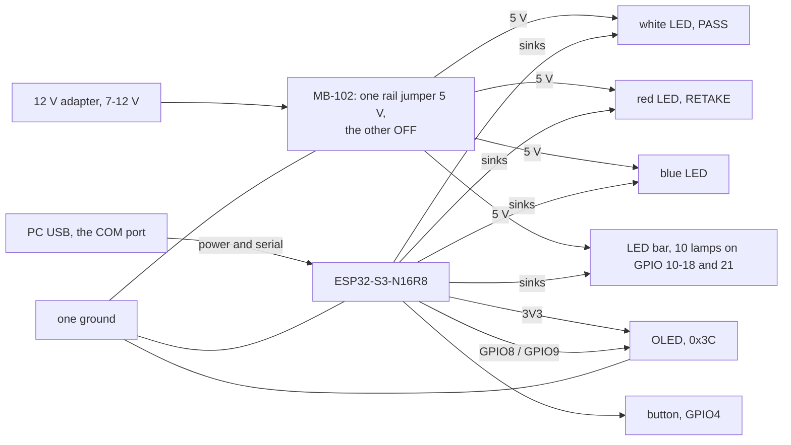

# Procurement

> Chinese version: [procurement-zh.md](procurement-zh.md). This file is the source of truth.

> Owner: @FrozenYty · Revisit when: the hardware changes

Final bill of materials: nine items were ordered on 2026-11-05 (¥377.42), and the 330 ohm resistors and the trigger button joined the list on 2026-11-10, making eleven items and ¥388.32. The turbidity sensor, its cable and the level shifter left the list on 2026-11-14, which makes eight items and ¥354.56. This is the list the
rig is built from; changing it means changing PLAN.md P0-03 and this document together. Brand names
and the Chinese search strings are listed in the Chinese version; this file describes the same parts
in English.

## 1. Final list

| # | Item | Model / part | Qty | Unit ¥ | Channel | Purpose |
|---|---|---|---|---|---|---|
| 1 | USB camera | 1080P UVC module, 3.6 mm low-distortion lens, metal housing | 1 | 200.60 | JD | Image capture |
| 2 | Glass tank | Low-iron ultra-clear glass, 300×170×200 mm, 5 mm walls, bare tank | 1 | 48.90 | JD | Capture chamber |
| 3 | Linear polariser | FINNER PL sheet, gloss finish, no adhesive, 200×200 mm, 0.2 mm | 1 | 35.60 | JD | Cross-polarisation, two pieces cut from one sheet |
| 4 | MCU board | DZYJ ESP32-S3 N16R8 DevKitC, headers pre-soldered | 1 | 26.60 | JD | Trigger, panel, I2C master |
| 5 | Jumper wires | DZYJ 40-pin ribbon, male-male / male-female / female-female, 120 pcs | 1 | 8.26 | JD | All wiring |
| 6 | Breadboard | DZYJ MB-102, 1660 tie points, with power rails | 1 | 23.70 | JD | Solderless assembly; the 405-hole board is too small once the ESP32 is seated |
| 7 | Resistors | LR1F330R metal film 330 Ω ±1% 600 mW, through-hole, 10 pieces | 1 | 5.10 | LCSC | LED current limiting; thirteen are needed now - three lamps and ten bar lamps - so the one lot of ten is three short |
| 8 | Trigger button | XKB8080-W 8×8 through-hole **momentary** switch, blue cap, 13.65 mm tall, 5 pieces | 1 | 5.80 | LCSC | Panel mount; the larger cap and height fix the kit's hard-to-hit small switch |

**Total ¥354.56.** The status display (0.96" OLED) and the white and red LEDs come from the STM32 kit on hand and are not bought. The fill light is the Midea MT-10T4 lamp already on hand: 10 W, 4000 K, Ra90,
USB-powered (DC) and advertised as flicker-free. A strip was planned on 11-07 and withdrawn the same
day after the lamp was checked — ADR 10.

## 2. Deliberately not bought

| Item | Why not |
|---|---|
| Capture light | The team's existing Midea MT-10T4 desk lamp: 10 W, 4000 K, USB-powered, no visible flicker. Buying a light is only revisited if the acceptance numbers are not met (ADR 10). |
| Acrylic tank | Ultra-clear glass is cheaper, has no stress birefringence, and keeps cross-polarisation working. |
| Target models | Real seafood bought on the day. Natural colour, natural sinking, naturally wet and specular — which is what the polariser exists for. |
| Scenery | Stones and plants found on site. One dark stone shaped like a sea cucumber is enough to stage a false positive. |
| Water level sensor | The tank level is constant and nothing depends on it. It is not in the SRS. |
| Water temperature probe | It fills one field and drives no decision. The SRS states that missing sensor fields stay empty and are excluded from statistics. |
| Turbidity sensor | It was bought and is now withdrawn: a full register sweep on a clean bus found only configuration registers, none of which changed value in response to light, and the vendor states the part has no register map. P3-37 records the evidence, and ten lamps on GPIO 10-18 and 21 do the panel's job instead. |
| Second lamp | Only if the left/right brightness ratio fails; see `PROGRESS.md` 2026-11-05. |

## 3. Things to verify before assembly

- **Camera exposure lock — verified on arrival, 11-10.** `python scripts/test_exposure.py --index 1` exits
  0: 1080p, exposure controllable, lock holds a 0.5 % frame-to-frame spread, 5 fps. Three things the unit
  taught us that no datasheet said:
  - **It is index 1**, not 0 — index 0 is the laptop's built-in camera.
  - **Never use 720p on this unit**: that mode stalls at 1 fps. 1080p gives 5 fps (the USB 2.0 ceiling
    for uncompressed video) and 640×480 gives 30 fps. MJPEG is ignored.
  - **Exposure must be set explicitly** — the device opens at whatever auto-exposure last chose, which
    was dark enough that every frame failed the quality gate. Use
    `python -m app.vision.capture --camera 1 --exposure -6` from `server/`.
  - **White balance must stay automatic.** Manual balance on this driver is a lie: it echoes the
    temperature back without acting on it, and the colour cast score drops from 83 to 0.
- **Button.** The XKB8080-W must be the **momentary** version. A latching one stays closed after the
  press and needs a second press to release, while the firmware triggers on the closing edge once —
  the result is one frame per two presses. Check the listing says momentary before ordering. Six pins
  are internally paired: **find the pair that closes with a multimeter**, do not guess from the
  layout; a wrong pair shows up as "the button does nothing".
- **Panel hole.** Drill for the cap only, about 5 mm; the 8×8 mm body sits behind the panel. An 8 mm
  hole leaves the switch loose. Check its legs are straight: the
  PCB-mount parts with bent legs bought earlier will not seat in a breadboard. A latching switch would
  not work here — the firmware expects a falling edge per press.

## 4. Assembly order

Assemble and power on in four steps, one at a time, so a fault is localised immediately:

1. ESP32 + tactile switch - serial prints a line on each press. **Debounce first**: one press, one line.
   **A press must never disturb the panel.** If pressing dims the OLED or restarts the board, a leg is on a
   power rail: a momentary switch is a dead short when it spans two supplies, and the board reports it as
   `BOD: Brownout detector was triggered` in the serial log. Power off and check: one leg to `4`, the other
   to `GND`, and **neither leg touching a red or a blue rail**. The six-pin `XKB8080-W` makes this easy to
   get wrong - find the pair that closes with a multimeter, as section 3 says. A 330 Ohm series resistor
   from the switch to `4` turns a future mistake into "nothing happens" instead of a brownout, and the pin
   still reads a solid LOW because its internal pull-up is 45 kOhm.
2. Fill light — run the lamp **on USB, not on its battery**: falling charge drifts the brightness.
   Set one touch-dimming level and **tape over the touch area**. Tape the polariser flat to the lamp
   head, corners taut, no warp.
3. Display, LEDs and the bar — an I2C scan shows `0x3C` (the OLED) and nothing else; the screen boots to
   `AQUAVISION` then settles on `READY`; **the LEDs answer a verdict, not the button** - with the server
   attached, press the button and the white or the red one **stays lit** while the verdict is on the
   screen, with the blue one going dark for as long as it is. **With no PC on the link, a button press lights neither, and that is not a fault**: the button
   only starts a capture, and the firmware pulses a lamp when `CMD RESULT` answers it. **The blue lamp is
   already steady the moment power arrives** - check that first, because no blue at all points at the
   supply rather than at the firmware. **The lamps are fed from 5 V and the pin switches the low side, so
   LOW lights one and HIGH puts it out** - anode to 5 V, cathode through its 330 Ohm to the pin. Wired the
   other way round it will not light at all, and the pin never sees more than the LED's forward drop.
   **A lead too short to reach is a mechanical problem with a mechanical fix** - a 2 cm jumper makes up the
   distance - and not a reason to fit a lamp of another colour, because the colour is part of what the lamps
   mean.
   **The ten bar lamps answer the screen the same way**: one dot sweeping out and back on `READY`, a bar
   filling one lamp at a time on `CAPTURING`, the score as a level of 0-10 lit on `PASS` and `RETAKE`, all
   ten dark on `OFFLINE`. They are wired exactly like the lamps - anode to 5 V through its own 330 Ohm,
   cathode on its own pin, GPIO 10 to 18 and then 21 - so a bar lamp that never lights is a reversed one
   before it is a dead pin. **GPIO 21 is not in the left column**: it is on the right header, beside the USB
   pair, which is why the table below lists it after `18` and why the bar's pins are not contiguous.
4. Camera — exposure lock, `python scripts/test_exposure.py` exits 0; then `python scripts/test_rig.py`
   exits 0, which measures the left/right brightness ratio, the 5 cm target width and the brightness
   drift of a ten-minute run under a fixed light level. **Both are required**: the first asks whether
   the camera can be used, the second whether the picture is good enough to detect on.

## 5. Power and wiring

One 12 V adapter feeds an MB-102 breadboard supply, and **that supply powers only the 5 V side of the
rig**. The controller keeps its own: the USB cable to the PC carries both power and the serial link, and
the board's own regulator makes the 3.3 V that the OLED runs on. Two supplies,
one ground.

| Rail | Source | Loads |
|---|---|---|
| 5 V | 12 V adapter into the MB-102, one rail jumper on 5 V and **the other on OFF** | the anodes of the three lamps and of the ten bar lamps |
| 3.3 V | the controller board's `3V3` pin, which its own USB cable feeds | OLED VCC, the ESP32's own logic |
| ground | one, shared | every part, including the adapter's negative lead |

**The rail that is not used is switched OFF, not parked at 3.3 V.** The module has a jumper position for
each rail; we use 5 V on one and OFF on the other. Two live regulators on one breadboard is how a board's
own 3.3 V ends up fighting the module's, and the OFF position is what prevents it.

The board is an **ESP32-S3-N16R8**: terminal names below are the ones silkscreened on it, and the `R8`
matters - 8 MB of octal PSRAM takes **GPIO33 to GPIO37**, so those five pins are not free. Nothing this
project uses is among them. Wire it from the **COM** USB-C port, the one behind the CH343 bridge, because
the firmware is built with `ARDUINO_USB_CDC_ON_BOOT=0` and sends `Serial` to UART0.

| From | To | Colour | Why |
|---|---|---|---|
| ESP32 `8` | OLED SDA | yellow | the bus data line |
| ESP32 `9` | OLED SCL | green | the same, on the clock |
| ESP32 `3V3` | OLED VCC | orange | the control side only |
| MB-102 `5V` | the anodes of the three lamps and of the ten bar lamps | red | the LED side only: every cathode goes to its own pin, so the rail carries no signal |
| MB-102 `GND` | ESP32 `GND`, OLED `GND` | black | one ground: split grounds are the intermittent-I2C fault that hides longest |
| ESP32 `4` | button, other leg to GND | purple | momentary part only - a latching one gives one frame per two presses |
| ESP32 `5` | 330 Ohm from the white LED's cathode | white | the PASS lamp: anode on 5 V, pin sinks it, so **LOW lights it** |
| ESP32 `6` | 330 Ohm from the red LED's cathode | grey | the RETAKE lamp, the same |
| ESP32 `7` | 330 Ohm from the blue LED's cathode | blue | the state lamp: steady when idle, blinking when busy or lost, dark while a verdict is shown |
| ESP32 `10` | 330 Ohm from bar lamp 1's cathode | brown | level 1: yellow, the first lamp of the bar |
| ESP32 `11` | 330 Ohm from bar lamp 2's cathode | brown | level 2, the same wiring one step along |
| ESP32 `12` | 330 Ohm from bar lamp 3's cathode | brown | level 3, the same |
| ESP32 `13` | 330 Ohm from bar lamp 4's cathode | brown | level 4, the same |
| ESP32 `14` | 330 Ohm from bar lamp 5's cathode | brown | level 5, the same |
| ESP32 `15` | 330 Ohm from bar lamp 6's cathode | brown | level 6, the same |
| ESP32 `16` | 330 Ohm from bar lamp 7's cathode | brown | level 7: the last yellow lamp |
| ESP32 `17` | 330 Ohm from bar lamp 8's cathode | brown | level 8: the first white lamp, the top band |
| ESP32 `18` | 330 Ohm from bar lamp 9's cathode | brown | level 9, the same |
| ESP32 `21` | 330 Ohm from bar lamp 10's cathode | brown | level 10: a score of 100. The only bar pin that is not in the left column - GPIO 21 is on the right header, beside the USB pair |

The same wiring as a picture is `rig-wiring.svg`, in this directory: the pin column keeps the order printed
on the board, which is what makes it usable with a jumper wire in hand. Table and picture are generated from
the same numbers, so they cannot disagree without a test saying so.

**SDA and SCL are one bus, and the OLED is now its only device.** The address is `0x3C`; a scan that reports
anything else is reporting a part this rig does not have. The pair runs straight from the header to the
module, and nothing on it is a 5 V part any more, so there is no shifter to check and no second device to
unplug before believing a screen that has stopped answering.

**One consequence is worth knowing before it bites.** The OLED module carries its own pull-ups, so with the
power off, SDA to `3V3` should read a few kOhm; well under 1 kOhm means too many of them are stacked. The rig
no longer has another board to blame: if the scan finds nothing, the module, its four wires and the header
are the whole list.

**Check two things before the first power-on.** Measure the MB-102's 5 V rail with nothing else
connected. This module does carry its own 5 V regulator, so the pass-through risk that ruins sensors on
other boards is smaller here - but the check costs ten seconds and thirteen LED anodes hang off that rail.
Then check one bar lamp end to end with the power off: 330 Ohm from its anode to the 5 V rail, its cathode
on its own pin, and **no lamp the other way round** - a reversed one never lights, which reads as a dead pin
rather than as a wiring mistake.

## 6. Acceptance numbers

| Check | Pass |
|---|---|
| Exposure | `CAP_PROP_EXPOSURE` writes and reads back a different value |
| Frame stability | 20 consecutive frames, mean brightness spread < 10 % |
| Lighting | Left/right half brightness ratio ≥ 0.7, no hot spot on the tank wall |
| Flicker | Filmed by a phone camera, no rolling bars |
| Light stability | Ten minutes of capture on USB: mean brightness of the first and last frame differ by < 5 % |
| Polariser flatness | No visible warp; the lens-side sheet locked at the darkest orientation |
| Target size | A 5 cm object ≥ 45 px wide at 640 input |
| LED bar | Each of the ten lights with its pin LOW and goes out with it HIGH; the level matches the score on `PASS` and `RETAKE`, and `OFFLINE` leaves the bar dark |
| Tank | 24 h filled, no seepage, front wall without scratches or tint |