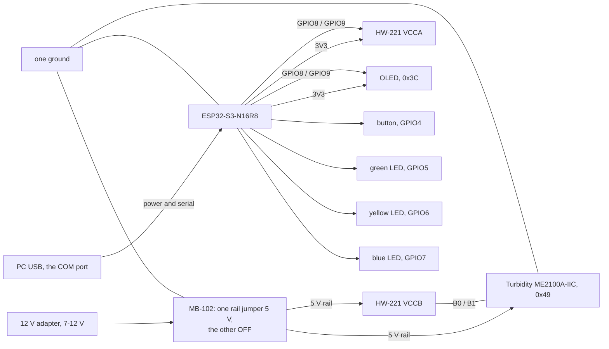

# Procurement

> Chinese version: [procurement-zh.md](procurement-zh.md). This file is the source of truth.

> Owner: @FrozenYty · Revisit when: the hardware changes

Final bill of materials: nine items were ordered on 2026-11-05 (¥377.42), and the 330 ohm resistors and the trigger button joined the list on 2026-11-10, making eleven items and ¥388.32. This is the list the
rig is built from; changing it means changing PLAN.md P0-03 and this document together. Brand names
and the Chinese search strings are listed in the Chinese version; this file describes the same parts
in English.

## 1. Final list

| # | Item | Model / part | Qty | Unit ¥ | Channel | Purpose |
|---|---|---|---|---|---|---|
| 1 | USB camera | 1080P UVC module, 3.6 mm low-distortion lens, metal housing | 1 | 200.60 | JD | Image capture |
| 2 | Glass tank | Low-iron ultra-clear glass, 300×170×200 mm, 5 mm walls, bare tank | 1 | 48.90 | JD | Capture chamber |
| 3 | Linear polariser | FINNER PL sheet, gloss finish, no adhesive, 200×200 mm, 0.2 mm | 1 | 35.60 | JD | Cross-polarisation, two pieces cut from one sheet |
| 4 | MCU board | DZYJ ESP32-S3 N16R8 DevKitC, headers pre-soldered | 1 | 26.60 | JD | Trigger, I2C master |
| 5 | Level shifter | 8-channel bidirectional 3.3 V ↔ 5 V, headers pre-soldered | 1 | 7.10 | JD | Bridges the 5 V sensor to 3.3 V GPIO |
| 6 | Jumper wires | DZYJ 40-pin ribbon, male-male / male-female / female-female, 120 pcs | 1 | 8.26 | JD | All wiring |
| 7 | Breadboard | DZYJ MB-102, 1660 tie points, with power rails | 1 | 23.70 | JD | Solderless assembly; the 405-hole board is too small once the ESP32 and shifter are seated |
| 8 | Turbidity sensor | LIGHT ME2100A-IIC, I2C, reflective | 1 | 18.82 | LCSC | Reads water clarity |
| 9 | Sensor cable | WHEELTEC GH1.25 4-pin to Dupont female, 200 mm | 1 | 7.84 | JD | Turbidity sensor to the level shifter pins |
| 10 | Resistors | LR1F330R metal film 330 Ω ±1% 600 mW, through-hole, 10 pieces | 1 | 5.10 | LCSC | LED current limiting; the rig needs two, the rest are spares |
| 11 | Trigger button | XKB8080-W 8×8 through-hole **momentary** switch, blue cap, 13.65 mm tall, 5 pieces | 1 | 5.80 | LCSC | Panel mount; the larger cap and height fix the kit's hard-to-hit small switch |

**Total ¥388.32.** The status display (0.96" OLED) and the green and yellow LEDs come from the STM32 kit on hand and are not bought. The fill light is the Midea MT-10T4 lamp already on hand: 10 W, 4000 K, Ra90,
USB-powered (DC) and advertised as flicker-free. A strip was planned on 11-07 and withdrawn the same
day after the lamp was checked — ADR 10.

## 2. Deliberately not bought

| Item | Why not |
|---|---|
| Capture light | The team's existing Midea MT-10T4 desk lamp: 10 W, 4000 K, USB-powered, no visible flicker. Buying a light is only revisited if the acceptance numbers are not met (ADR 10). |
| Acrylic tank | Ultra-clear glass is cheaper, has no stress birefringence, and keeps cross-polarisation working. |
| Target models | Real seafood bought on the day. Natural colour, natural sinking, naturally wet and specular — which is what the polariser exists for. |
| Scenery | Stones and plants found on site. One dark stone shaped like a sea cucumber is enough to stage a false positive. |
| Water level sensor | The tank level is constant and nothing depends on it. It is not in the SRS. |
| Water temperature probe | It fills one field and drives no decision. The SRS states that missing sensor fields stay empty and are excluded from statistics. |
| Second lamp | Only if the left/right brightness ratio fails; see `PROGRESS.md` 2026-11-05. |

## 3. Things to verify before assembly

- **Camera exposure lock — verified on arrival, 11-10.** `python scripts/test_exposure.py --index 1` exits
  0: 1080p, exposure controllable, lock holds a 0.5 % frame-to-frame spread, 5 fps. Three things the unit
  taught us that no datasheet said:
  - **It is index 1**, not 0 — index 0 is the laptop's built-in camera.
  - **Never use 720p on this unit**: that mode stalls at 1 fps. 1080p gives 5 fps (the USB 2.0 ceiling
    for uncompressed video) and 640×480 gives 30 fps. MJPEG is ignored.
  - **Exposure must be set explicitly** — the device opens at whatever auto-exposure last chose, which
    was dark enough that every frame failed the quality gate. Use
    `python -m app.vision.capture --camera 1 --exposure -6` from `server/`.
  - **White balance must stay automatic.** Manual balance on this driver is a lie: it echoes the
    temperature back without acting on it, and the colour cast score drops from 83 to 0.
- **Button.** The XKB8080-W must be the **momentary** version. A latching one stays closed after the
  press and needs a second press to release, while the firmware triggers on the closing edge once —
  the result is one frame per two presses. Check the listing says momentary before ordering. Six pins
  are internally paired: **find the pair that closes with a multimeter**, do not guess from the
  layout; a wrong pair shows up as "the button does nothing".
- **Panel hole.** Drill for the cap only, about 5 mm; the 8×8 mm body sits behind the panel. An 8 mm
  hole leaves the switch loose. Check its legs are straight: the
  PCB-mount parts with bent legs bought earlier will not seat in a breadboard. A latching switch would
  not work here — the firmware expects a falling edge per press.
- **Sensor cable.** GH1.25 to Dupont female. A single-ended tinned cable has nothing to plug into.

## 4. Assembly order

Assemble and power on in six steps, one at a time, so a fault is localised immediately:

1. ESP32 + tactile switch — serial prints a line on each press. **Debounce first**: one press, one line.
2. Level shifter — measure 3.3 V on VCCA and 5 V on VCCB. **This board cannot be skipped:** rev A3 of the
   ME2100A-IIC datasheet dropped the 3.3 V specification, so the part runs at 4.5-5.5 V and its I2C
   lines are pulled up to 5 V, which the ESP32 does not tolerate. Low side to the ESP32's 3V3 and
   GPIO8/9; high side to 5 V and the sensor's SDA/SCL.
3. Turbidity sensor — I2C scan finds address `0x49`; clear water reads high, cloudy reads low. Confirm a
   4.7 kΩ pull-up on both SDA and SCL; without them the reads are intermittent, which is the hardest
   fault to diagnose.
4. Fill light — run the lamp **on USB, not on its battery**: falling charge drifts the brightness.
   Set one touch-dimming level and **tape over the touch area**. Tape the polariser flat to the lamp
   head, corners taut, no warp.
5. Display and LEDs — an I2C scan shows both `0x3C` (OLED) and `0x49` (turbidity); the screen boots to
   `AQUAVISION` then settles on `READY`; **the LEDs answer a verdict, not the button** - with the server
   attached, press the button and the green or the yellow one pulses for 300 ms once the verdict comes
   back. **With no PC on the link, a button press lights neither, and that is not a fault**: the button
   only starts a capture, and the firmware pulses a lamp when `CMD RESULT` answers it. **The blue lamp is
   already steady the moment power arrives** - check that first, because no blue at all points at the
   supply rather than at the firmware.
6. Camera — exposure lock, `python scripts/test_exposure.py` exits 0; then `python scripts/test_rig.py`
   exits 0, which measures the left/right brightness ratio, the 5 cm target width and the brightness
   drift of a ten-minute run under a fixed light level. **Both are required**: the first asks whether
   the camera can be used, the second whether the picture is good enough to detect on.

## 5. Power and wiring

One 12 V adapter feeds an MB-102 breadboard supply, and **that supply powers only the 5 V side of the
rig**. The controller keeps its own: the USB cable to the PC carries both power and the serial link, and
the board's own regulator makes the 3.3 V that the OLED and the shifter's low side run on. Two supplies,
one ground.

| Rail | Source | Loads |
|---|---|---|
| 5 V | 12 V adapter into the MB-102, one rail jumper on 5 V and **the other on OFF** | turbidity sensor VCC, shifter VCCB |
| 3.3 V | the controller board's `3V3` pin, which its own USB cable feeds | OLED VCC, shifter VCCA, the ESP32's own logic |
| ground | one, shared | every part, including the adapter's negative lead |

**The rail that is not used is switched OFF, not parked at 3.3 V.** The module has a jumper position for
each rail; we use 5 V on one and OFF on the other. Two live regulators on one breadboard is how a board's
own 3.3 V ends up fighting the module's, and the OFF position is what prevents it.

The board is an **ESP32-S3-N16R8**: terminal names below are the ones silkscreened on it, and the `R8`
matters - 8 MB of octal PSRAM takes **GPIO33 to GPIO37**, so those five pins are not free. Nothing this
project uses is among them. Wire it from the **COM** USB-C port, the one behind the CH343 bridge, because
the firmware is built with `ARDUINO_USB_CDC_ON_BOOT=0` and sends `Serial` to UART0.

| From | To | Colour | Why |
|---|---|---|---|
| ESP32 `8` | OLED SDA and shifter `A0` | yellow | one GPIO, two loads: fan it out on the breadboard, not by twisting wires |
| ESP32 `9` | OLED SCL and shifter `A1` | green | the same, on the clock |
| shifter `B0` | sensor SDA | yellow | the 5 V side of the bus |
| shifter `B1` | sensor SCL | green | the same |
| ESP32 `3V3` | OLED VCC and shifter `VCCA` | orange | the control side only |
| MB-102 `5V` | sensor VCC and shifter `VCCB` | red | the sensor side only |
| MB-102 `GND` | ESP32 `GND`, sensor GND, shifter `GND` | black | one ground: split grounds are the intermittent-I2C fault that hides longest |
| ESP32 `4` | button, other leg to GND | purple | momentary part only - a latching one gives one frame per two presses |
| ESP32 `5` | 330 Ohm into the green LED | white | one per LED, as the SRS specifies; only one is ever lit |
| ESP32 `6` | 330 Ohm into the yellow LED | grey | the same |
| ESP32 `7` | 330 Ohm into the blue LED | blue | the state lamp: steady whenever the rig is powered, blinking when busy or lost |

**SDA and SCL are one bus, not one wire per device.** The OLED and the shifter sit on the same pair, and
the protocol separates them by address - `0x3C` and `0x49`, which do not collide. That is what I2C is for, and
the level question has already been answered by the shifter: both loads are 3.3 V from the ESP32's side,
because the 5 V part is beyond it.

Two consequences are worth knowing before they bite. **A fault on the 5 V side can pull the whole pair
low**, so an OLED that stops answering may be reporting the sensor's problem: unplug `A0` and `A1`, rescan,
and if the OLED returns, the fault is beyond the shifter. And **the pull-ups from both boards hang on the
same 3.3 V net** - measure from SDA to `3V3` with the power off and expect a few kOhm; well under 1 kOhm
means too many of them are stacked.

**Check three things before the first power-on.** Measure the MB-102's 5 V rail with nothing else
connected. This module does carry its own 5 V regulator, so the pass-through risk that ruins sensors on
other boards is smaller here - but the check costs ten seconds and the sensor does not survive 12 V. Then
measure from shifter `B0` to `VCCB` with the power off: the `HW-221` board is populated with `R1` to `R8`,
and if those are the 10 kOhm pull-ups they look like, **no 4.7 kOhm resistors are needed** - adding them
beside 10 kOhm leaves 3.2 kOhm, which works at 100 kHz but is not worth stacking. And the register that
holds the turbidity reading is still unknown, so the first reading is an experiment: a bare read, then
reads after writing commands `0x00` to `0x03`, and keep the one whose value falls as the water gets turbid.

## 6. Acceptance numbers

| Check | Pass |
|---|---|
| Exposure | `CAP_PROP_EXPOSURE` writes and reads back a different value |
| Frame stability | 20 consecutive frames, mean brightness spread < 10 % |
| Lighting | Left/right half brightness ratio ≥ 0.7, no hot spot on the tank wall |
| Flicker | Filmed by a phone camera, no rolling bars |
| Light stability | Ten minutes of capture on USB: mean brightness of the first and last frame differ by < 5 % |
| Polariser flatness | No visible warp; the lens-side sheet locked at the darkest orientation |
| Target size | A 5 cm object ≥ 45 px wide at 640 input |
| Turbidity | Clear water reads higher than water with a spoon of milk |
| Tank | 24 h filled, no seepage, front wall without scratches or tint |