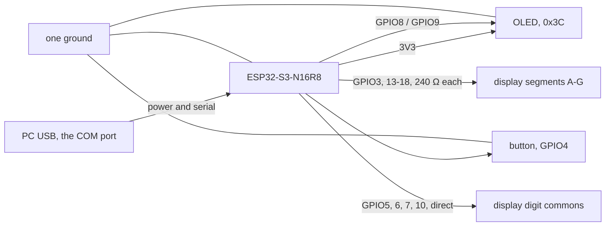

# Procurement

> Chinese version: [procurement-zh.md](procurement-zh.md). This file is the source of truth.

> Owner: @FrozenYty · Revisit when: the hardware changes

Final bill of materials: nine items were ordered on 2026-11-05 (¥377.42), and the 330 ohm resistors and the trigger button joined the list on 2026-11-10, making eleven items and ¥388.32. The turbidity sensor, its cable and the level shifter left the list on 2026-11-14, which makes eight items and ¥354.56. This is the list the
rig is built from; changing it means changing PLAN.md P0-03 and this document together. Brand names
and the Chinese search strings are listed in the Chinese version; this file describes the same parts
in English.

## 1. Final list

| # | Item | Model / part | Qty | Unit ¥ | Channel | Purpose |
|---|---|---|---|---|---|---|
| 1 | USB camera | 1080P UVC module, 3.6 mm low-distortion lens, metal housing | 1 | 200.60 | JD | Image capture |
| 2 | Glass tank | Low-iron ultra-clear glass, 300×170×200 mm, 5 mm walls, bare tank | 1 | 48.90 | JD | Capture chamber |
| 3 | Linear polariser | FINNER PL sheet, gloss finish, no adhesive, 200×200 mm, 0.2 mm | 1 | 35.60 | JD | Cross-polarisation, two pieces cut from one sheet |
| 4 | MCU board | DZYJ ESP32-S3 N16R8 DevKitC, headers pre-soldered | 1 | 26.60 | JD | Trigger, panel, I2C master |
| 5 | Jumper wires | DZYJ 40-pin ribbon, male-male / male-female / female-female, 120 pcs | 1 | 8.26 | JD | All wiring |
| 6 | Breadboard | DZYJ MB-102, 1660 tie points, with power rails | 1 | 23.70 | JD | Solderless assembly; the 405-hole board is too small once the ESP32 is seated |
| 7 | Resistors | LR1F330R metal film 330 Ω ±1% 600 mW, through-hole, 10 pieces | 1 | 5.10 | LCSC | Segment current limiting on the display. Seven 240 Ω are needed, one per segment, and this lot's value is 330 Ω |
| 8 | Trigger button | XKB8080-W 8×8 through-hole **momentary** switch, blue cap, 13.65 mm tall, 5 pieces | 1 | 5.80 | LCSC | Panel mount; the larger cap and height fix the kit's hard-to-hit small switch |

**Total ¥354.56.** The status display (0.96" OLED) comes from the STM32 kit on hand and is not bought, and
the four-digit display is not on this list either. The fill light is the Midea MT-10T4 lamp already on hand: 10 W, 4000 K, Ra90,
USB-powered (DC) and advertised as flicker-free. A strip was planned on 11-07 and withdrawn the same
day after the lamp was checked — ADR 10.

## 2. Deliberately not bought

| Item | Why not |
|---|---|
| Capture light | The team's existing Midea MT-10T4 desk lamp: 10 W, 4000 K, USB-powered, no visible flicker. Buying a light is only revisited if the acceptance numbers are not met (ADR 10). |
| Acrylic tank | Ultra-clear glass is cheaper, has no stress birefringence, and keeps cross-polarisation working. |
| Target models | Real seafood bought on the day. Natural colour, natural sinking, naturally wet and specular — which is what the polariser exists for. |
| Scenery | Stones and plants found on site. One dark stone shaped like a sea cucumber is enough to stage a false positive. |
| Water level sensor | The tank level is constant and nothing depends on it. It is not in the SRS. |
| Water temperature probe | It fills one field and drives no decision. The SRS states that missing sensor fields stay empty and are excluded from statistics. |
| Turbidity sensor | It was bought and is now withdrawn: a full register sweep on a clean bus found only configuration registers, none of which changed value in response to light, and the vendor states the part has no register map. P3-37 records the evidence, and the four-digit display does the panel's job instead. |
| Second lamp | Only if the left/right brightness ratio fails; see `PROGRESS.md` 2026-11-05. |

## 3. Things to verify before assembly

- **Camera exposure lock — verified on arrival, 11-10.** `python scripts/test_exposure.py --index 1` exits
  0: 1080p, exposure controllable, lock holds a 0.5 % frame-to-frame spread, 5 fps. Three things the unit
  taught us that no datasheet said:
  - **It is index 1**, not 0 — index 0 is the laptop's built-in camera.
  - **Never use 720p on this unit**: that mode stalls at 1 fps. 1080p gives 5 fps (the USB 2.0 ceiling
    for uncompressed video) and 640×480 gives 30 fps. MJPEG is ignored.
  - **Exposure must be set explicitly** — the device opens at whatever auto-exposure last chose, which
    was dark enough that every frame failed the quality gate. Use
    `python -m app.vision.capture --camera 1 --exposure -6` from `server/`.
  - **White balance must stay automatic.** Manual balance on this driver is a lie: it echoes the
    temperature back without acting on it, and the colour cast score drops from 83 to 0.
- **Button.** The XKB8080-W must be the **momentary** version. A latching one stays closed after the
  press and needs a second press to release, while the firmware triggers on the closing edge once —
  the result is one frame per two presses. Check the listing says momentary before ordering. Six pins
  are internally paired: **find the pair that closes with a multimeter**, do not guess from the
  layout; a wrong pair shows up as "the button does nothing".
- **Panel hole.** Drill for the cap only, about 5 mm; the 8×8 mm body sits behind the panel. An 8 mm
  hole leaves the switch loose. Check its legs are straight: the
  PCB-mount parts with bent legs bought earlier will not seat in a breadboard. A latching switch would
  not work here — the firmware expects a falling edge per press.

## 4. Assembly order

Assemble and power on in four steps, one at a time, so a fault is localised immediately:

1. ESP32 + tactile switch - serial prints a line on each press. **Debounce first**: one press, one line.
   **A press must never disturb the panel.** If pressing dims the OLED or restarts the board, a leg is on a
   power rail: a momentary switch is a dead short when it spans two supplies, and the board reports it as
   `BOD: Brownout detector was triggered` in the serial log. Power off and check: one leg to `4`, the other
   to `GND`, and **neither leg touching a red or a blue rail**. The six-pin `XKB8080-W` makes this easy to
   get wrong - find the pair that closes with a multimeter, as section 3 says. A 330 Ohm series resistor
   from the switch to `4` turns a future mistake into "nothing happens" instead of a brownout, and the pin
   still reads a solid LOW because its internal pull-up is 45 kOhm.
2. Fill light — run the lamp **on USB, not on its battery**: falling charge drifts the brightness.
   Set one touch-dimming level and **tape over the touch area**. Tape the polariser flat to the lamp
   head, corners taut, no warp.
3. Display, button and panel — an I2C scan shows `0x3C` (the OLED) and nothing else; the screen boots to
   `AQUAVISION` then settles on `READY`, and the four-digit panel runs its self-test (`8888` for 400 ms) and
   then the idle face. **The panel answers a verdict, not the button**: a press starts a capture, and with
   the server attached the panel shows `CAP` until `CMD RESULT` answers it. **With no PC on the link, a press
   does nothing and the rig goes `OFFLINE` ten seconds after power-up**, and the panel reads `E0` - that is
   not a fault.
   **The panel is common anode, so a segment is lit by pulling its pin LOW**, and a segment that never lights
   is a reversed resistor or a wrong segment long before it is a dead pin. **A lead too short to reach is a
   mechanical problem with a mechanical fix** - a 2 cm jumper makes up the distance - and not a reason to
   rearrange the segment order, because the order is what the firmware writes.
   **The lamps and the bar are gone**; the eight faces that matter now are the self-test, `READY`,
   `CAPTURING`, `PASS`, `RETAKE`, `E1`, `E2` and `E3`, and **holding the button for six seconds from `READY`
   walks all eight in order** - which is how the fault faces are seen on a bench where nothing is failing.
4. Camera — exposure lock, `python scripts/test_exposure.py` exits 0; then `python scripts/test_rig.py`
   exits 0, which measures the left/right brightness ratio, the 5 cm target width and the brightness
   drift of a ten-minute run under a fixed light level. **Both are required**: the first asks whether
   the camera can be used, the second whether the picture is good enough to detect on.

## 5. Power and wiring

The controller keeps its own supply: the USB cable to the PC carries both power and the serial link, and the
board's own regulator makes the 3.3 V that the OLED and the display run on. **Nothing in this build draws
from a 5 V rail.** The lamps and the bar were its only loads; every pin the four-digit display uses is a
GPIO, and its segment resistors go to those pins rather than to a rail. The 12 V adapter and the MB-102 stay
on the parts list - the breadboard is where the rig is built - but the panel no longer has a second supply.

| Rail | Source | Loads |
|---|---|---|
| 3.3 V | the controller board's `3V3` pin, which its own USB cable feeds | OLED VCC, the display's segments and commons, the ESP32's own logic |
| ground | one, shared | every part |
| 5 V | the 12 V adapter into the MB-102, one rail jumper on 5 V and **the other on OFF** | **none in this build**: the rail is measured once and left alone |

**The rail that is not used is switched OFF, not parked at 3.3 V.** The module has a jumper position for
each rail; we use 5 V on one and OFF on the other. Two live regulators on one breadboard is how a board's
own 3.3 V ends up fighting the module's, and the OFF position is what prevents it.

The board is an **ESP32-S3-N16R8**: terminal names below are the ones silkscreened on it, and the `R8`
matters - 8 MB of octal PSRAM takes **GPIO33 to GPIO37**, so those five pins are not free. Nothing this
project uses is among them. Wire it from the **COM** USB-C port, the one behind the CH343 bridge, because
the firmware is built with `ARDUINO_USB_CDC_ON_BOOT=0` and sends `Serial` to UART0.

| From | To | Colour | Why |
|---|---|---|---|
| ESP32 `3` | 240 Ω to display segment A | brown | a segment is lit by pulling its pin LOW, so a dark segment is a HIGH pin |
| ESP32 `13` | 240 Ω to display segment B | brown | the same, one segment along |
| ESP32 `14` | 240 Ω to display segment C | brown | the same |
| ESP32 `15` | 240 Ω to display segment D | brown | the same |
| ESP32 `16` | 240 Ω to display segment E | brown | the same |
| ESP32 `17` | 240 Ω to display segment F | brown | the same |
| ESP32 `18` | 240 Ω to display segment G | brown | the middle bar: the one segment `READY` lights, alone |
| ESP32 `5` | display digit 1 common (left) | blue | a common is driven HIGH to select its digit, and carries the sum of that digit's segments: **no resistor** |
| ESP32 `6` | display digit 2 common | blue | the same |
| ESP32 `7` | display digit 3 common | blue | the same |
| ESP32 `10` | display digit 4 common (right) | blue | the same |
| ESP32 `4` | button, other leg to GND | purple | momentary part only - a latching one gives one frame per two presses |
| ESP32 `8` | OLED SDA | yellow | the bus data line |
| ESP32 `9` | OLED SCL | green | the same, on the clock |
| ESP32 `3V3` | OLED VCC | orange | the control side only |
| ESP32 `GND` | OLED `GND` | black | one ground: split grounds are the intermittent-I2C fault that hides longest |

The same wiring as a picture is `rig-wiring.svg`, in this directory: the pin column keeps the order printed
on the board, which is what makes it usable with a jumper wire in hand. Table and picture are generated from
the same numbers, so they cannot disagree without a test saying so.

**SDA and SCL are one bus, and the OLED is its only device.** The address is `0x3C`; a scan that reports
anything else is reporting a part this rig does not have. The pair runs straight from the header to the
module, and nothing on it is a 5 V part any more, so there is no shifter to check and no second device to
unplug before believing a screen that has stopped answering.

**One consequence is worth knowing before it bites.** The OLED module carries its own pull-ups, so with
the power off, SDA to `3V3` should read a few kOhm; well under 1 kOhm means too many of them are stacked. The rig
no longer has another board to blame: if the scan finds nothing, the module, its four wires and the header
are the whole list.

**Check the panel's resistors before the first power-on.** Seven of them, one per segment, each 240 Ω and
each between the pin and its segment - none shared, and **none on a common**. A common with a resistor on
it, or two commons joined, is a panel that lights two digits dimly and reads as a smear. Then confirm the
commons are on the four pins the table names, because a common swapped with a segment is a digit that never
lights rather than a segment that is wrong.

**A common carries a digit's whole segment current, so only one may be high at a time.** That is the
multiplexer's job, and it is the one rule of this panel a person can check with a meter: with the firmware
running, four pins alternate and never two at once.

## 6. Acceptance numbers

| Check | Pass |
|---|---|
| Exposure | `CAP_PROP_EXPOSURE` writes and reads back a different value |
| Frame stability | 20 consecutive frames, mean brightness spread < 10 % |
| Lighting | Left/right half brightness ratio ≥ 0.7, no hot spot on the tank wall |
| Flicker | Filmed by a phone camera, no rolling bars |
| Light stability | Ten minutes of capture on USB: mean brightness of the first and last frame differ by < 5 % |
| Polariser flatness | No visible warp; the lens-side sheet locked at the darkest orientation |
| Target size | A 5 cm object ≥ 45 px wide at 640 input |
| Display | The boot self-test lights every segment of all four digits; a six-second hold on the button from `READY` walks the eight rehearsal faces in order; and `E0` appears within ten seconds of the PC falling silent |
| Tank | 24 h filled, no seepage, front wall without scratches or tint |