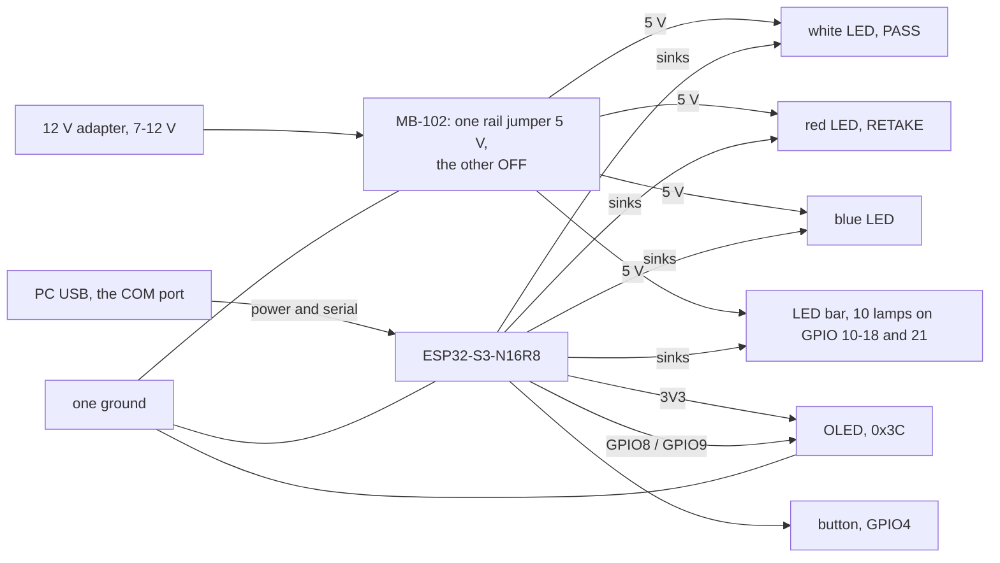

# 采购清单

> 本文为 `procurement-en.md` 的中文对照版，以英文版为准。
> 同步于：2026-11-05

> 维护人：@FrozenYty · 重审时机：换硬件时

最终物料清单，2026-11-05 冻结：共十一项，两个渠道，含税 ¥388.32。11-14 浊度传感器、传感器线与电平转换板
退出清单，现为八项、¥354.56。装置的搭建以此为准；改动它要同时改
`PLAN.md` 的 P0-03 和本文档。品牌名与淘宝/京东的搜索词列在本文档中，英文版只描述部件本身。

## 一、最终清单

| # | 件 | 型号 / 物料 | 数量 | 单价 ¥ | 渠道 | 用途 |
|---|---|---|---|---|---|---|
| 1 | USB 摄像头 | 柏立 1080P UVC 模组，3.6mm 无畸变镜头，带外壳 | 1 | 200.60 | 京东 | 图像采集 |
| 2 | 玻璃鱼缸 | 坤宁王 超白玻璃 300×170×200 mm，壁厚 5 mm，裸缸 | 1 | 48.90 | 京东 | 拍摄容器 |
| 3 | 线偏振片 | FINNER 无胶光面 PL，200×200 mm，0.2 mm | 1 | 35.60 | 京东 | 正交偏振，一张裁两块 |
| 4 | 主控板 | DZYJ ESP32-S3 N16R8 DevKitC，已焊排针 | 1 | 26.60 | 京东 | 触发、面板、I2C 主机 |
| 5 | 杜邦线 | DZYJ 40 针排线，公对公 / 公对母 / 母对母，共 120 根 | 1 | 8.26 | 京东 | 全部接线 |
| 6 | 面包板 | DZYJ MB-102，1660 孔，带电源轨 | 1 | 23.70 | 京东 | 免焊组装；ESP32 就位后 405 孔那块摆不开 |
| 7 | 电阻 | LR1F330R 金属膜 330Ω ±1% 600mW，插件，10 只 | 1 | 5.10 | 立创 | LED 限流，现需 13 只——三盏灯加十只灯排——10 只差三只 |
| 8 | 触发按键 | XKB8080-W 8×8 插件**无锁**开关（蓝白黑，带方形大帽，总高 13.65mm），5 只 | 1 | 5.80 | 立创 | 面板安装；大帽和高度解决套件里小开关按不准的问题 |

**合计 ¥354.56。** 状态指示屏（0.96 寸 OLED）与白/红 LED 来自组内已有的 STM32 套件，不计入采购。 补光用组内现有的美的 MT-10T4 台灯：10W、4000K、Ra90、USB 直流供电、标注无可视频闪。11-07 曾计划购买灯条，实查该台灯后撤回，见 ADR 10。 另外退掉了一块 405 孔面包板——ESP32 带排针加走线，只有 1660 孔那块摆得开。

## 二、刻意不买的

| 件 | 为什么 |
|---|---|
| 补光灯 | 用组内现有的美的 MT-10T4 台灯：10W、4000K、USB 直流供电、无可视频闪。达不到验收数字时才考虑另买光源。 |
| 亚克力水箱 | 超白玻璃更便宜，且没有应力双折射，正交偏振才成立。 |
| 仿真靶标 | 当天买真海鲜。颜色真实、天然沉底、表面湿滑反光——正是偏振片要对付的。 |
| 造景 | 现场找石头和水草。一块像海参的深色石头就够制造误检。 |
| 水位传感器 | 水箱水位恒定，没有任何逻辑依赖它，SRS 里也没有这个字段。 |
| 水温探头 | 只填一个字段，不驱动任何判断。SRS 已写明传感器字段可空、缺失不参与统计。 |
| 浊度传感器 | 已买过、现已撤掉：在干净总线上扫遍全部寄存器，只找到配置寄存器，没有一只随光照变化，厂商也明确说没有寄存器表。证据记在 P3-37，改由 GPIO 10-18 与 21 上的 10 只灯承担面板上的那份工作。 |
| 第二盏灯 | 仅在左右亮度比不达标时才加，见 `PROGRESS.md` 2026-11-05。 |

## 三、装配前必须确认的三件事

- **摄像头曝光锁定——11-10 到货已实测。** `python scripts/test_exposure.py --index 1` 退出码 0：1080p、
  曝光可控、锁定后帧间波动 0.5%、5 fps。这台设备教了三件说明书上没写的事：
  - **它是索引 1**，不是 0——索引 0 是笔记本内置摄像头。
  - **绝对不要用 720p**：这个模式卡在 1 fps。1080p 是 5 fps（未压缩视频的 USB 2.0 上限），
    640×480 是 30 fps。MJPG 会被忽略。
  - **曝光必须显式设置**——设备打开时停在自动曝光上一次选的值，实测暗到每一帧都过不了质量门禁。
    在 `server/` 下用 `python -m app.vision.capture --camera 1 --exposure -6`。
  - **白平衡必须保持自动。** 这台驱动的手动白平衡是假的：回读温度值但不生效，色偏分从 83 掉到 0。
- **按键。** XKB8080-W 必须选**无锁（自复位）**版本：自锁款按下后锁住，要再按一下才弹起，而固件只认「按下」那一次，结果是按两下才拍一张。下单前确认标题写着「无锁」。6 脚内部两两相连，**用万用表通断档找出导通的那一对**，不要按位置猜；接错了表现为「按了没反应」。
- **面板开孔。** 只给帽顶开孔，约 5mm；本体 8×8mm 藏在面板背面。按 8mm 开会让开关在面板里晃动。

## 四、装配顺序

分四步上电，一次只加一样，出问题能立刻定位：

1. ESP32 + 轻触开关——每按一次串口打印一行。**先做消抖**，一次按下只能出一行。
   **按一下绝不能扰动面板。** 若按下时 OLED 变暗或板子重启，说明有脚落在电源轨上：瞬时开关一旦跨在
   两条电源之间就是直接短路，板子会在串口日志里报 `BOD: Brownout detector was triggered`。断电检查：
   一只脚接 `4`，另一只接 `GND`，**两只脚都不得碰到红轨或蓝轨**。六脚的 `XKB8080-W` 特别容易接错——
   按第三节说的，用万用表找出真正闭合的那一对。在开关与 `4` 之间串一只 330 Ω，能把将来接错变成
   "什么都不发生"而不是欠压复位；内部上拉是 45 kΩ，串上之后仍然读到可靠的 LOW。
2. 补光——台灯**插着 USB 用，不要用电池**（电量下降会让亮度漂移）；触摸调光固定一档后**用胶带封住触摸区**；偏振片平贴灯头，四角绷紧不翘。
3. 显示屏、灯与灯排——I2C 扫描应只看到 `0x3C`（屏）；开机显示 `AQUAVISION` 后进入 `READY`。
   **灯回答的是结论，不是按键**：接上服务端后按一次按键，结论在屏幕上期间**白灯或红灯一直亮**，同时蓝灯熄灭。
   **链路上没有 PC 时，按按键两盏都不会亮，那不是故障**——按键只发起一次采集，灯要等 `CMD RESULT` 回来才亮。
   **蓝灯在上电那一刻就该常亮**：先看它，因为完全不见蓝灯说明问题在供电，不在固件。
   **三盏灯改由 5 V 供电、引脚做接地开关，所以低电平点亮、高电平熄灭**——阳极接 5 V，阴极经各自
   330 Ω 接引脚。接反了完全不亮；引脚任何时刻只承受灯自身的正向压降。
   **引脚短了够不着，是机械问题、用机械办法解决**——补一根 2 cm 跳线即可，不要因此换一颗别的颜色的灯，
   因为颜色是这套灯含义的一部分。
   **十只灯排按屏幕给出同样的回答**：`READY` 上一个单点扫出再扫回，`CAPTURING` 上逐格填充，`PASS` 与
   `RETAKE` 上以 0-10 只点亮的电平显示分数，`OFFLINE` 上十只全灭。接线与三盏灯完全一致——阳极各经
   330 Ω 接 5 V，阴极接各自的引脚，按 GPIO 10 到 18、再到 21——所以一只不亮的灯排，先怀疑接反，
   再怀疑引脚坏了。**GPIO 21 不在左列**：它在右排针上、紧挨 USB 那一对，所以下表把它排在 `18`
   之后，灯排的引脚也不是连号。
4. 摄像头——锁定曝光，`python scripts/test_exposure.py` 退出码 0；然后 `python scripts/test_rig.py` 退出码 0，它量的是台灯固定亮度下的左右亮度比、5cm 靶标像素宽和 10 分钟亮度漂移。**两件事必须都做**：前者问相机能不能用，后者问画面够不够好。

## 五、供电与接线

一路 12 V 适配器进 MB-102 面包板电源，**它只供装置的 5 V 那一侧**。控制器保持自己的供电：接电脑的 USB
线既走数据也是串口通道，板载稳压器产出 3.3 V，供 OLED 使用。两路供电，一个地。

| 电源轨 | 来源 | 负载 |
|---|---|---|
| 5 V | 12 V 适配器进 MB-102，一轨跳线置 5 V、**另一轨置 OFF** | 三盏灯与十只灯排的阳极 |
| 3.3 V | 控制器板的 `3V3` 引脚，由其自身 USB 供电 | OLED VCC、ESP32 自身逻辑 |
| 地 | 唯一且共用 | 所有器件，含适配器负极 |

**不用的那一轨拨到 OFF，不是停在 3.3 V。** 该模块每一轨都有跳线位；我们一轨用 5 V，另一轨用 OFF。
同一块面包板上两个工作中的稳压器，就是开发板自身 3.3 V 与模块互相顶牛的成因，而 OFF 档正是用来
避免它的。

开发板是 **ESP32-S3-N16R8**：下表端子名取自板上丝印，而 `R8` 这一项有实际后果——8 MB 八线 PSRAM 占用
**GPIO33 到 GPIO37**，这五个引脚不可他用。本项目没有用到它们中的任何一个。请从 **COM** 那个 USB-C
口接线，也就是 CH343 桥后面的那个：固件以 `ARDUINO_USB_CDC_ON_BOOT=0` 编译，`Serial` 走 UART0。

| 从 | 到 | 线色 | 为什么 |
|---|---|---|---|
| ESP32 `8` | OLED SDA | 黄 | 总线的数据线 |
| ESP32 `9` | OLED SCL | 绿 | 时钟线同理 |
| ESP32 `3V3` | OLED VCC | 橙 | 只供控制侧 |
| MB-102 `5V` | 三盏灯与十只灯排的阳极 | 红 | 只供 LED 侧：每只的阴极各接自己的引脚，这条轨上没有任何信号 |
| MB-102 `GND` | ESP32 `GND`、OLED `GND` | 黑 | 只能有一个地：地分开就是最难查的 I²C 时好时坏 |
| ESP32 `4` | 按键一端，另一端接 GND | 紫 | 只能用瞬时型——自锁型按一次出两帧 |
| ESP32 `5` | 白灯阴极串 330 Ω | 白 | PASS 灯：阳极接 5 V、引脚做接地开关，**低电平点亮** |
| ESP32 `6` | 红灯阴极串 330 Ω | 灰 | RETAKE 灯，同上 |
| ESP32 `7` | 蓝灯阴极串 330 Ω | 蓝 | 状态灯：空闲常亮，忙或失联时闪，显示结论时熄灭 |
| ESP32 `10` | 灯排第 1 只阴极串 330 Ω | 棕 | 第 1 格：黄色，灯排的第一只 |
| ESP32 `11` | 灯排第 2 只阴极串 330 Ω | 棕 | 第 2 格，接线同上顺延 |
| ESP32 `12` | 灯排第 3 只阴极串 330 Ω | 棕 | 第 3 格，同上 |
| ESP32 `13` | 灯排第 4 只阴极串 330 Ω | 棕 | 第 4 格，同上 |
| ESP32 `14` | 灯排第 5 只阴极串 330 Ω | 棕 | 第 5 格，同上 |
| ESP32 `15` | 灯排第 6 只阴极串 330 Ω | 棕 | 第 6 格，同上 |
| ESP32 `16` | 灯排第 7 只阴极串 330 Ω | 棕 | 第 7 格：最后一只黄灯 |
| ESP32 `17` | 灯排第 8 只阴极串 330 Ω | 棕 | 第 8 格：第一只白灯，最高一档 |
| ESP32 `18` | 灯排第 9 只阴极串 330 Ω | 棕 | 第 9 格，同上 |
| ESP32 `21` | 灯排第 10 只阴极串 330 Ω | 棕 | 第 10 格：满分的那一只。它是唯一不在左列的灯排引脚——GPIO 21 在右排针上、紧挨 USB 那一对 |

同一份接线以图片形式放在本目录的 `rig-wiring.svg`：引脚列保持板上丝印的顺序，这正是拿着杜邦线时能用的原因。
表格与图片由同一组数字生成，若两者不一致，测试会先说话。

**SDA 与 SCL 是一条总线，而现在这条线上只有 OLED。** 地址是 `0x3C`；扫描报出别的地址，就是报出了这台装置
没有的器件。这对线从排针直连模块，线上再没有 5 V 器件，所以既没有转换器要量，也没有第二个器件可以先拔掉
再判断一块不答话的屏。

**有一件事提前知道能省下时间。** OLED 模块自带其上拉，所以断电后量 SDA 到 `3V3` 应为几 kΩ；明显低于
1 kΩ 说明上拉堆多了。装置再没有第二块板子可以怪：扫描什么都找不到时，可疑的只有模块、它的四根线和排针。

**首次上电前先确认两件事。** 空载量 MB-102 的 5 V 轨。这块模块自带 5 V 稳压器，所以别家板子上那种
直通输入烧器件的风险在这里较小——但这个检查只花十秒，而那条轨上挂着十三个 LED 阳极。然后在断电状态下
端到端查一只灯排：330 Ω 从阳极到 5 V 轨，阴极接它自己的引脚，**没有一只 LED 是接反的**——接反的那只
永远不亮，读起来像引脚坏了，而不像线接错了。

## 六、验收数字

| 检查 | 通过标准 |
|---|---|
| 曝光 | 写 `CAP_PROP_EXPOSURE` 后读回值确实变化 |
| 帧稳定 | 连续 20 帧，平均亮度差 < 10% |
| 布光 | 左右半亮度比 ≥ 0.7，箱壁无亮斑 |
| 频闪 | 手机摄像头拍摄无横条纹 |
| 补光稳定 | 插 USB 连续采集 10 分钟，首尾两帧的平均亮度差 < 5% |
| 偏振片平整 | 目视无翘曲；镜头前那块转到最暗位置后锁死 |
| 目标尺寸 | 5cm 目标在 640 输入下 ≥ 45 像素宽 |
| 灯排 | 十只都在引脚为低时点亮、为高时熄灭；`PASS`／`RETAKE` 上电平与分数一致，`OFFLINE` 上灯排全灭 |
| 水箱 | 注水 24 小时不渗，前壁无划痕、不偏色 |