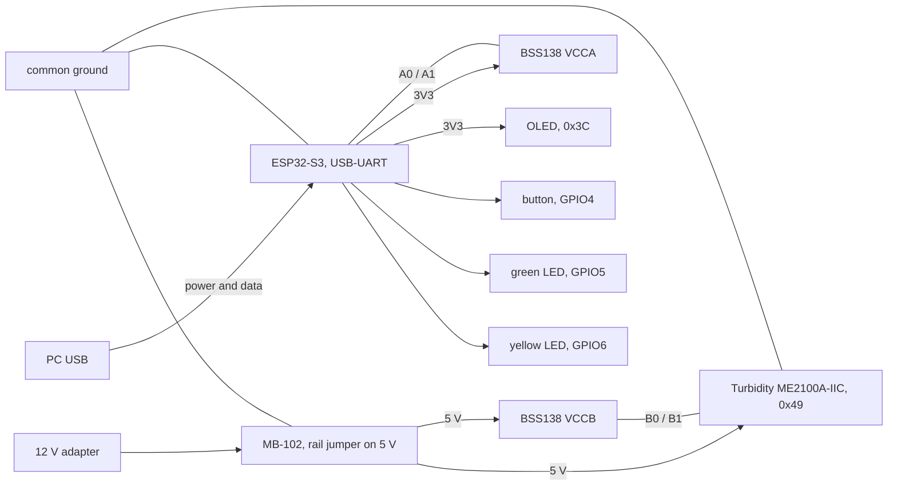

# 采购清单

> 本文为 `procurement-en.md` 的中文对照版，以英文版为准。
> 同步于：2026-11-05

> 维护人：@FrozenYty · 重审时机：换硬件时

最终物料清单，2026-11-05 冻结：共十一项，两个渠道，含税 ¥388.32。装置的搭建以此为准；改动它要同时改
`PLAN.md` 的 P0-03 和本文档。品牌名与淘宝/京东的搜索词列在本文档中，英文版只描述部件本身。

## 一、最终清单

| # | 件 | 型号 / 物料 | 数量 | 单价 ¥ | 渠道 | 用途 |
|---|---|---|---|---|---|---|
| 1 | USB 摄像头 | 柏立 1080P UVC 模组，3.6mm 无畸变镜头，带外壳 | 1 | 200.60 | 京东 | 图像采集 |
| 2 | 玻璃鱼缸 | 坤宁王 超白玻璃 300×170×200 mm，壁厚 5 mm，裸缸 | 1 | 48.90 | 京东 | 拍摄容器 |
| 3 | 线偏振片 | FINNER 无胶光面 PL，200×200 mm，0.2 mm | 1 | 35.60 | 京东 | 正交偏振，一张裁两块 |
| 4 | 主控板 | DZYJ ESP32-S3 N16R8 DevKitC，已焊排针 | 1 | 26.60 | 京东 | 触发、I2C 主机 |
| 5 | 电平转换 | 大富瑞 8 路双向 3.3V ↔ 5V，已焊排针 | 1 | 7.10 | 京东 | 桥接 5V 传感器与 3.3V GPIO |
| 6 | 杜邦线 | DZYJ 40 针排线，公对公 / 公对母 / 母对母，共 120 根 | 1 | 8.26 | 京东 | 全部接线 |
| 7 | 面包板 | DZYJ MB-102，1660 孔，带电源轨 | 1 | 23.70 | 京东 | 免焊组装；ESP32 与电平转换板就位后 405 孔那块摆不开 |
| 8 | 浊度传感器 | 莱特 ME2100A-IIC，I2C，反射式 | 1 | 18.82 | 立创 | 读取水体浑浊度 |
| 9 | 传感器线 | WHEELTEC GH1.25 4 针 转 杜邦母头，200 mm | 1 | 7.84 | 京东 | 浊度传感器接电平转换板排针 |
| 10 | 电阻 | LR1F330R 金属膜 330Ω ±1% 600mW，插件，10 只 | 1 | 5.10 | 立创 | LED 限流，装置只需 2 只，其余备用 |
| 11 | 触发按键 | XKB8080-W 8×8 插件**无锁**开关（蓝白黑，带方形大帽，总高 13.65mm），5 只 | 1 | 5.80 | 立创 | 面板安装；大帽和高度解决套件里小开关按不准的问题 |

**合计 ¥388.32。** 状态指示屏（0.96 寸 OLED）与绿/黄 LED 来自组内已有的 STM32 套件，不计入采购。 补光用组内现有的美的 MT-10T4 台灯：10W、4000K、Ra90、USB 直流供电、标注无可视频闪。11-07 曾计划购买灯条，实查该台灯后撤回，见 ADR 10。 另外退掉了一块 405 孔面包板——ESP32 带排针加电平转换板加走线，只有 1660 孔那块摆得开。

## 二、刻意不买的

| 件 | 为什么 |
|---|---|
| 补光灯 | 用组内现有的美的 MT-10T4 台灯：10W、4000K、USB 直流供电、无可视频闪。达不到验收数字时才考虑另买光源。 |
| 亚克力水箱 | 超白玻璃更便宜，且没有应力双折射，正交偏振才成立。 |
| 仿真靶标 | 当天买真海鲜。颜色真实、天然沉底、表面湿滑反光——正是偏振片要对付的。 |
| 造景 | 现场找石头和水草。一块像海参的深色石头就够制造误检。 |
| 水位传感器 | 水箱水位恒定，没有任何逻辑依赖它，SRS 里也没有这个字段。 |
| 水温探头 | 只填一个字段，不驱动任何判断。SRS 已写明传感器字段可空、缺失不参与统计。 |
| 第二盏灯 | 仅在左右亮度比不达标时才加，见 `PROGRESS.md` 2026-11-05。 |

## 三、装配前必须确认的四件事

- **摄像头曝光锁定——11-10 到货已实测。** `python scripts/test_exposure.py --index 1` 退出码 0：1080p、
  曝光可控、锁定后帧间波动 0.5%、5 fps。这台设备教了三件说明书上没写的事：
  - **它是索引 1**，不是 0——索引 0 是笔记本内置摄像头。
  - **绝对不要用 720p**：这个模式卡在 1 fps。1080p 是 5 fps（未压缩视频的 USB 2.0 上限），
    640×480 是 30 fps。MJPG 会被忽略。
  - **曝光必须显式设置**——设备打开时停在自动曝光上一次选的值，实测暗到每一帧都过不了质量门禁。
    在 `server/` 下用 `python -m app.vision.capture --camera 1 --exposure -6`。
  - **白平衡必须保持自动。** 这台驱动的手动白平衡是假的：回读温度值但不生效，色偏分从 83 掉到 0。
- **按键。** XKB8080-W 必须选**无锁（自复位）**版本：自锁款按下后锁住，要再按一下才弹起，而固件只认「按下」那一次，结果是按两下才拍一张。下单前确认标题写着「无锁」。6 脚内部两两相连，**用万用表通断档找出导通的那一对**，不要按位置猜；接错了表现为「按了没反应」。
- **面板开孔。** 只给帽顶开孔，约 5mm；本体 8×8mm 藏在面板背面。按 8mm 开会让开关在面板里晃动。
- **传感器线。** 必须是「GH1.25 转杜邦母头」。单头镀锡线没有可以插的一端。

## 四、装配顺序

分六步上电，一次只加一样，出问题能立刻定位：

1. ESP32 + 轻触开关——每按一次串口打印一行。**先做消抖**，一次按下只能出一行。
2. 电平转换——量 VCCA 侧 3.3V、VCCB 侧 5V。**这一步不能跳过：ME2100A-IIC 规格书 A3 版取消了 3.3V 供电规格，只支持 4.5–5.5V，而它的 I2C 线会跟着上拉到 5V，ESP32 不是 5V 容忍的。** 接法：低压侧接 ESP32 的 3V3 与 GPIO8/9，高压侧接 5V 与传感器的 SDA/SCL。
3. 浊度传感器——I2C 扫描到地址 `0x49`；清水读数大，浑水读数小。SDA、SCL 各确认有 4.7kΩ 上拉。
4. 补光——台灯**插着 USB 用，不要用电池**（电量下降会让亮度漂移）；触摸调光固定一档后**用胶带封住触摸区**；偏振片平贴灯头，四角绷紧不翘。
5. 显示屏与灯——I2C 扫描应同时看到 `0x3C`（屏）与 `0x49`（浊度）；开机显示 `AQUAVISION` 后进入 `READY`；按下按键绿/黄灯各闪 300ms。
6. 摄像头——锁定曝光，`python scripts/test_exposure.py` 退出码 0；然后 `python scripts/test_rig.py` 退出码 0，它量的是台灯固定亮度下的左右亮度比、5cm 靶标像素宽和 10 分钟亮度漂移。**两件事必须都做**：前者问相机能不能用，后者问画面够不够好。

## 五、供电与接线

一路 12 V 适配器进 MB-102 面包板电源，**它只供装置的 5 V 那一侧**。控制器保持自己的供电：接电脑的 USB
线既走数据也是串口通道，板载稳压器产出 3.3 V，供 OLED 与转换器低压侧使用。两路供电，一个地。

| 电源轨 | 来源 | 负载 |
|---|---|---|
| 5 V | 12 V 适配器进 MB-102，跳线置于 5 V | 浊度传感器 VCC、转换器 VCCB、两只 4.7 kΩ 上拉 |
| 3.3 V | 控制器板的 `3V3` 引脚 | OLED VCC、转换器 VCCA、ESP32 自身逻辑 |
| 地 | 共地 | 所有器件，包括适配器的负极 |

| 从 | 到 | 为什么重要 |
|---|---|---|
| MB-102 的 5 V | 传感器 VCC | 该器件标称 4.5-5.5 V，rev A3 已删掉早期版本写的 3.3 V |
| MB-102 的 5 V | 转换器 VCCB | 总线远端是 5 V |
| 板载 `3V3` | 转换器 VCCA | 近端必须与 ESP32 的逻辑电平一致 |
| GPIO8 | 转换器 A0，B0 再接传感器 SDA | 传感器直连 GPIO8 就是把 5 V 送到 3.3 V 引脚上 |
| GPIO9 | 转换器 A1，B1 再接传感器 SCL | 时钟线同理 |
| 传感器 SDA 与 SCL | 经 4.7 kΩ 上拉到 **5 V** | 上拉必须在高压侧 |
| GPIO4 | 按键一端，另一端接 GND | 必须是瞬时型：自锁型按一次会出两帧 |
| GPIO5、GPIO6 | 串 330 Ω 接 LED，阴极接 GND | 每个 LED 一只电阻，不共用 |

**首次上电前先确认三件事。** 空载量 MB-102 的 5 V 轨：不少板子这一轨是直通输入而非稳压，12 V 会
出现在印着 5 V 的排针上，传感器扛不住。再看转换板两侧是否已自带 10 kΩ 上拉，若已有，再并 4.7 kΩ
就只剩约 3.2 kΩ——100 kHz 下能用，但不该两侧都堆。最后，浊度读数所在寄存器仍属未知，第一次读是实验：
先裸读，再在写入 `0x00` 到 `0x03` 之后各读一次，取"水越浑读数越低"的那个。

## 六、验收数字

| 检查 | 通过标准 |
|---|---|
| 曝光 | 写 `CAP_PROP_EXPOSURE` 后读回值确实变化 |
| 帧稳定 | 连续 20 帧，平均亮度差 < 10% |
| 布光 | 左右半亮度比 ≥ 0.7，箱壁无亮斑 |
| 频闪 | 手机摄像头拍摄无横条纹 |
| 补光稳定 | 插 USB 连续采集 10 分钟，首尾两帧的平均亮度差 < 5% |
| 偏振片平整 | 目视无翘曲；镜头前那块转到最暗位置后锁死 |
| 目标尺寸 | 5cm 目标在 640 输入下 ≥ 45 像素宽 |
| 浊度 | 清水读数高于加一勺牛奶后的读数 |
| 水箱 | 注水 24 小时不渗，前壁无划痕、不偏色 |
