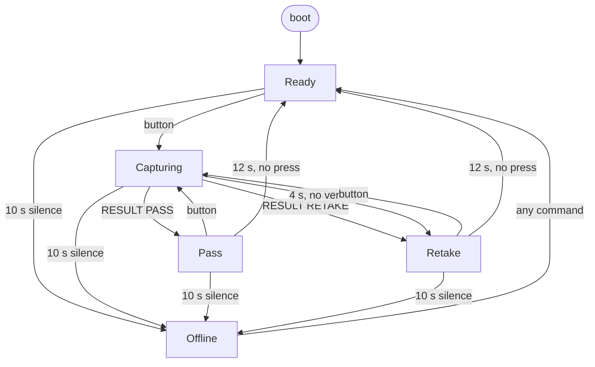

# Rig state machine

> Chinese version: [rig-state-machine-zh.md](rig-state-machine-zh.md). This file is the source of truth.
> Owner: @FrozenYty · Revisit when: a screen, a link state or an event is added

The rig controller has five screens and two link states. Every combination of them against every event
has a defined answer, because the combinations nobody wrote down are where a demo fails: a second button
press that shoots twice, a verdict that arrives after the operator has been told the shot failed, a link
that recovers and quietly wipes the result off the screen.

## 1. Screens

| Screen | Meaning |
|---|---|
| `Ready` | Idle, waiting for a press |
| `Capturing` | A capture is in flight; the verdict has not arrived |
| `Pass` | The PC returned PASS, with a score |
| `Retake` | The PC returned RETAKE with a reason, or the rig gave up waiting |
| `Offline` | No keepalive from the PC |

## 2. Link

Two states, and the rig boots in the first one with a ten-second grace.

| Link | Meaning |
|---|---|
| `Alive` | A command arrived within `cfg::OFFLINE_AFTER_MS` |
| `Gone` | Ten seconds of silence |

Boot counts as `Alive`: the timer starts at power-up and a PC on the other end of the cable sends its
first keepalive long before ten seconds are out. Booting `OFFLINE` would have the panel call itself dead
before anything had a chance to speak, which reads as a fault rather than as "waiting". **Losing a live
link is worth reporting; having no history yet is not.** The consequence is honest and visible: a rig on a
bench with no PC software goes `OFFLINE` ten seconds after power-up, because at that moment there really
is nobody to talk to.

## 3. Events

| # | Event | Source |
|---|---|---|
| E1 | Button pressed (falling edge, debounced 25 ms) | operator |
| E2 | `CMD PING` | PC |
| E3 | `CMD READY` | PC |
| E4 | A well-formed `CMD RESULT` (score and verdict present) | PC |
| E5 | A `CMD` line the firmware does not act on (unknown verb, or missing arguments) | PC |
| E6 | Ten seconds of silence | link timer |
| E7 | Heartbeat tick (1 s) | timer |
| E8 | Spinner tick (250 ms) | timer |
| E9 | Display face step (500 ms dash, 250 ms rotation, 300 ms sweep, 500 ms blink, 1 s `E0`) | timer |
| E10 | `CMD SCAN` | PC |
| E11 | Verdict face expired (12 s with no press) | timer |

Only a line that starts with `CMD` and names an action counts as the PC being alive. A line that is not a
`CMD` line, or a bare `CMD` with nothing after it, is ignored entirely: it does not refresh the link timer
and cannot recover `Offline`.

**`CMD SCAN` is an assembly tool, not part of a run.** It makes the firmware walk addresses 1 to 126 and
print one `EVT I2C <address>` line for each device that answers, then stop. It has no completion marker, so
a reader waits a fixed window rather than a terminator, and **how long it waited belongs in what it
reports** - a short window that found nothing and a complete walk that found nothing are different facts.
Nothing in the state machine changes: it refreshes the link timer like any other `CMD` line and the panel is
untouched, so the screens below are the same with and without a board on the bus.

## 4. Composite states

Ten pairs, five of which must never exist. The right-hand column is the invariant that forbids them.

| Screen \ Link | `Alive` | `Gone` | Why the impossible one is impossible |
|---|---|---|---|
| `Ready` | reachable | **impossible** | `Ready` means the rig has a PC and is waiting for a button |
| `Capturing` | reachable | **impossible** | a capture needs a receiver |
| `Pass` | reachable | **impossible** | a verdict came from the PC, so the PC is there |
| `Retake` | reachable | **impossible** | same, and the `NO REPLY` timeout only runs while `Alive` |
| `Offline` | **impossible** | reachable | recovering from `Gone` raises `Ready` in the same loop |

**The invariant, stated once:**

```
Offline  <=>  Gone          and          everything else  =>  Alive
```

`rig::invariantHolds` encodes it, the loop checks it once per pass and reports `EVT INVARIANT` if it is
ever broken. It has never fired. Two earlier drafts got this wrong in opposite directions - one showed
`OFFLINE` ten seconds after every power-up because it measured the absence of a PC nobody had promised,
the other could leave the panel on `OFFLINE` while the link was alive, because recovery was handled in
the link timer instead of where the PC actually spoke.

## 5. Transitions

Rows are the five reachable composites. `-` means the state does not change; **rejected** means it does
not change *and* the event is reported.

| Composite \ Event | E1 button | E2 PING | E3 READY | E4 RESULT | E5 unknown | E6 silence | E7 heartbeat | E8 spinner | E9 display | E11 expired |
|---|---|---|---|---|---|---|---|---|---|---|
| Ready + Alive | Capturing | Ready | Ready | **rejected** | Ready | Offline | Ready | `-` | Ready | `-` |
| Capturing + Alive | **ignored** | Capturing | Ready | Pass / Retake | Capturing | Offline | Capturing | Capturing | Capturing | `-` |
| Pass + Alive | Capturing | Pass | Ready | **rejected** | Pass | Offline | Pass | `-` | `-` | Ready |
| Retake + Alive | Capturing | Retake | Ready | **rejected** | Retake | Offline | Retake | `-` | Retake | Ready |
| Offline + Gone | `-` | Ready | Ready | rejected, then Ready | Ready | `-` | `-` | `-` | Offline | `-` |

E7, E8 and E9 never change the screen; they redraw it. They are in the table because a redraw in the
wrong state is itself a visible defect - the spinner must not advance on a result screen, the fourth
digit must not turn once a verdict is on the panel, and a verdict's face must not appear without a
capture. E11 is the only timer in this table that changes the screen: a verdict is a conclusion, not a
permanent label.

## 6. The rules and why

**1. A capture in flight ignores the button.** `serviceButton` returns early unless the link is `Alive`
and the screen is not already `Capturing`. Without it, one press became two frames: the PC would shoot
twice and the operator would see one verdict for two pictures.

**2. A verdict is only accepted while a capture is in flight.** `handleResult` rejects a `RESULT` in any
other state and reports `EVT STRAY RESULT <score>`. Accepted elsewhere it would invent a result for a
shot that never happened, or overwrite a timeout the operator has already read. Reported, because a
silently dropped message leaves the PC believing the rig took it - the same reason TCP answers an
unexpected segment with a reset.

**3. A capture that gets no verdict within four seconds becomes a retake with reason `NO REPLY`.**
`serviceCaptureTimeout`, `cfg::CAPTURE_TIMEOUT_MS`. Without it the spinner turns forever whenever the PC
is healthy enough to keep the link alive but too busy to answer. Two keepalives is shorter than the five
keepalive link timeout on purpose: the operator should learn that this shot failed before the whole link is
declared dead.

**4. A keepalive does not touch the screen.** A `CMD PING` raises `Ready` only on the transition out of
`Gone`, and only when the screen is `Offline`. A `PING` that arrives while a verdict is being read
refreshes the link timer and changes nothing visible.

**5. Losing the PC overrides everything.** `serviceLink`. No screen can make progress without a PC, so
silence forces `Offline` from anywhere. The recovery lives where the PC actually speaks - in `poll` - and
resets exactly the `Offline` screen.

**6. The PC keeps the link alive.** The serial link has no carrier signal: the rig talks UART through a
bridge chip and cannot see whether the cable is plugged in. Liveness is therefore a protocol matter, and
the obligation is the PC's: **send `CMD PING` at least every two seconds; ten seconds of silence is five
missed keepalives and means the PC is gone.** An idle rig still has to be told so, which is why the
heartbeat is not decoration - and why the boot grace of the same ten seconds is enough for the PC's first
message to arrive and confirm that somebody is there.

**7. Every transition is reported.** `EVT SCREEN <name> <score>` on every state change the
firmware makes, including the ones the button, the link timer and boot cause. The capture timeout emits
`EVT TIMEOUT` first, saying why the screen moved, and then `EVT SCREEN RETAKE -1`, saying where it moved to
(§8) - a transition that for one afternoon was the single exception, and was fixed rather than documented.
Before the screen events existed, a wiring fault and a logic fault looked identical from the serial port.

**8. The invariant is checked, not assumed.** One comparison per loop pass; a violation is a serial line
rather than a panel that quietly lies.

## 7. Diagram



## 8. Serial events per transition

| Transition | Events |
|---|---|
| boot | `EVT HELLO <version>`, ..., `EVT SCREEN READY -1` |
| any command from `Offline` → Ready | `EVT SCREEN READY <score>` |
| `CMD READY` from any other screen → Ready | `EVT SCREEN READY <score>` |
| Ready → Capturing | `EVT SCREEN CAPTURING -1` then `EVT TRIGGER <millis>` |
| Capturing → Pass / Retake | `EVT SCREEN PASS\|RETAKE <score>` |
| Capturing → Retake (`NO REPLY`) | `EVT TIMEOUT <millis>` then `EVT SCREEN RETAKE -1` |
| Pass / Retake → Ready (verdict face expired) | `EVT SCREEN READY <score>` |
| any → Offline | `EVT SCREEN OFFLINE <score>` |
| rejected RESULT | `EVT STRAY RESULT <score>` |
| invariant broken (never observed) | `EVT INVARIANT <screen> <link>` |

A score of `-1` in `EVT SCREEN` means no verdict has been received yet, so the screen has no number to
draw. The field is not reset by a link transition or by `CMD READY`: on `READY` and `OFFLINE` it can still
carry the last verdict's score, which those screens do not draw.

## 9. The PC side of the link

The server holds the other end of the same cable, and it has a state machine of its own
(`server/app/rig/link.py`). It is smaller than the rig's, and it is written the same way, because the
failures here are the same shape: a port unplugged mid-read, a write attempted on a closed port, a
keepalive thread outliving the transport it was pinging.

| State \ Event | start | port opened | open failed | read failed | write failed | stop | keepalive tick | line in |
|---|---|---|---|---|---|---|---|---|
| `DOWN` | Opening | - | - | - | - | Stopping | - | - |
| `OPENING` | ignored | **Open** | stay, retry | - | - | Stopping | - | - |
| `OPEN` | ignored | - | - | **Opening**, retry | **Opening**, retry | Stopping | send `CMD PING` | dispatch |
| `STOPPING` | ignored | ignored | ignored | - | - | - | ignored | ignored |

**Two invariants, both enforced in the code:**

1. **A transport exists if and only if the state is `OPEN`.** A write on a closed port raises in
   whichever thread made it, and a keepalive thread that raises takes the process down.
2. **Only `OPEN` sends keepalives.** A reconnect loop that also pings is two writers on one port.

The matrix earned its place immediately: the first implementation set the *global* stop event when a
write failed, which ended the reader thread for good - one unlucky write and the link never came back.
The test that found it is `test_a_failed_write_takes_the_link_down_and_it_recovers`.

**The verdict path is not a separate state machine.** On `EVT TRIGGER` the server grabs a frame, scores
it with the same quality gate the rest of the product uses, and answers `CMD RESULT <score> <verdict>
<reason>`. If the capture fails - no camera, device busy, disk full - it answers **nothing**. The rig's
own four-second timeout then reports `RETAKE / NO REPLY` with no score, which is exactly true, and no
new message had to be invented for the rig to learn.

The keepalive obligation of §6 is discharged here: every two seconds, from `OPEN`, for as long as the
port is held.

## 10. The four-digit display

**The pacing is a rule rather than a set of numbers: what is working runs at a steady pace, what has failed
blinks at a warning pace, and nothing on a desk instrument exceeds about 1 Hz.** Every speed below follows
from it, including the one comparison that matters: `E0` at half a hertz against a `RETAKE` face at one.
A warning should be quicker than a fault report, and the two must not read alike.

**The panel is four digits, multiplexed, and it is where a person at the bench reads the rig without the
OLED.** A common-anode display takes segments A-G on GPIO 3, 13, 14, 15, 16, 17 and 18, each through its own
240 Ω resistor, and digit commons 1-4 on GPIO 5, 6, 7 and 10 directly. The button is on GPIO 4 and the OLED
on I2C GPIO 8 and 9. The ten-lamp bar and the three status lamps are gone: their pins are the commons now,
and a bar that never shipped was not worth maintaining.

**Only one common may be high at a time, and that is the whole driving rule.** A common HIGH selects its
digit and a segment LOW lights that segment, so the current leaves the common, crosses the LED and the
segment's own 240 Ω, and enters the segment pin. A common carries no resistor because it carries the sum of
its digit's segment currents - which is also why exactly one may be selected: two commons high would light
two digits through one resistor network at half brightness, and the panel would read as a smear rather than
as digits.

**The multiplexer lives in a hardware timer, not in the loop.** One digit every 250 µs, so the whole face is
refreshed at about 1 kHz. The first version drove the panel from the loop, and it flickered: an OLED transfer
blocks the loop for 20-25 ms, and for that whole time the last digit selected stayed lit at full duty while
the other three were dark. The loop now only publishes which mask each digit should show - four bytes,
copied under a critical section so the handler can never read a half-updated face - and the timer handler
turns one mask into four GPIO register writes. Nothing the loop does can stall the panel, and a slow loop
slows the motion down instead of freezing the face.

| Screen | Face | Timing |
|---|---|---|
| boot | `8888`, every segment lit, then all dark | 400 ms lit, 150 ms dark, once |
| `Ready` | one dash (segment G alone) at digit 1, 2, 3, 4, then all four dashes held | 500 ms per position, 1 s hold |
| `Capturing` | `CAP`, with one segment walking the rim of the fourth digit | 250 ms per step |
| `Pass` | a left-to-right sweep, then the score right-aligned in digits 1-3 and `P`: ` 95P` | 300 ms sweep on arrival, then steady |
| `Retake` | the score and `E`, the whole panel blinking | 1 Hz |
| `Offline` | the code `E0`: `E` on digit 1, `0` on digit 2 | 0.5 Hz, never expires |
| fault `E1` | a capture timeout | one keepalive |
| fault `E2` | a stray result | one keepalive |
| fault `E3` | a broken invariant | one keepalive |

**`Ready` fills its four positions and holds them.** The idle face adds one dash per half second and then
sits with all four for a second before starting again - about three seconds a cycle. Filling and holding
reads as breathing; filling and vanishing reads as a break. The hold is also what forced the `Offline` face
to change, because four dashes held for a second and four dashes blinking look alike.

**`E0` is a screen's code; `E1`-`E3` are fault events.** Losing the link is a fault, so numbering the
`Offline` screen is honest rather than a workaround: it carries `E0` for as long as the link is gone and it
never times out. A capture timeout, a stray result and a broken invariant are events rather than screens:
each one holds all four digits for one keepalive as `E1`, `E2` or `E3`, with the highest priority on the
panel, the most recent winning, and no screen change underneath. They are there because those three used to
produce a log line and nothing a person could see, which made a broken rig and an idle one look the same.

**A verdict is a conclusion, not a permanent label.** `Pass` and `Retake` return to `Ready` after 12 s with
no new press - six keepalives, which is `OFFLINE_AFTER_MS` plus one. That relationship is the point: a
verdict outlives the link-loss threshold on purpose, so a dead link is always reported before a verdict
clears on its own. Nothing is lost by moving on, because the OLED tally keeps the session and the PC keeps
the record; `Offline` is deliberately excluded, because a lost link is a fault rather than a completion.

**The rehearsal exists because the fault faces are otherwise unreachable.** Holding the button for three
keepalives (6 s) from `Ready` walks the eight faces - self-test, `Ready`, `Capturing`, `Pass`, `Retake`,
`E1`, `E2`, `E3` - one keepalive each, and a press ends it. A release before the hold completes is still a
capture, and the press that ends the rehearsal is spent ending it. `E0` is not among them: it belongs to the
`Offline` screen, and the rehearsal is display-only, so the rig stays `Ready` and nothing goes on the wire.

**Only the digits and the letters A, C, E, F, H, L, P and U can be drawn.** Anything else either collides
with a digit - `O` reads as `0`, `S` as `5`, `I` as `1`, `G` sits between `6` and `9` - or cannot be formed
at all, like M, W, K, V, X, Y and Z. A word therefore becomes a code, which is how the fault faces are named
and why a fault is `E1` rather than `TIME`. The table in `main.cpp` implements the digits, `A`, `C`, `E`,
`P` and the dash, because a glyph nothing displays is a glyph nothing can check.

**Every interval is an integer multiple of `cfg::PC_KEEPALIVE_MS`, 2 s.** They are written as products of it
on purpose - a keepalive that changes must move all of them with it, and that is the one number in
`config.h` that cannot be edited alone.

| Keepalives | Interval | What it times |
|---|---|---|
| 1 | 2 s | a fault face, one rehearsal step |
| 2 | 4 s | the capture timeout |
| 3 | 6 s | the rehearsal hold |
| 5 | 10 s | offline detection |
| 6 | 12 s | the verdict face |
