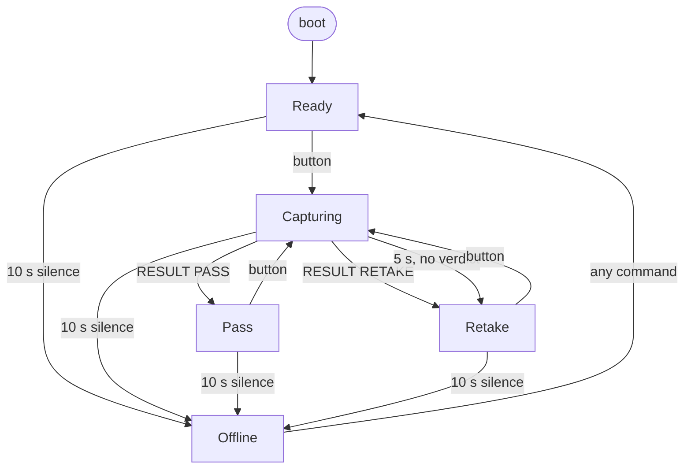

# Rig state machine

> Chinese version: [rig-state-machine-zh.md](rig-state-machine-zh.md). This file is the source of truth.
> Owner: @FrozenYty · Revisit when: a screen, a link state or an event is added

The rig controller has five screens and two link states. Every combination of them against every event
has a defined answer, because the combinations nobody wrote down are where a demo fails: a second button
press that shoots twice, a verdict that arrives after the operator has been told the shot failed, a link
that recovers and quietly wipes the result off the screen.

## 1. Screens

| Screen | Meaning |
|---|---|
| `Ready` | Idle, waiting for a press |
| `Capturing` | A capture is in flight; the verdict has not arrived |
| `Pass` | The PC returned PASS, with a score |
| `Retake` | The PC returned RETAKE with a reason, or the rig gave up waiting |
| `Offline` | No keepalive from the PC |

## 2. Link

Two states, and the rig boots in the first one with a ten-second grace.

| Link | Meaning |
|---|---|
| `Alive` | A command arrived within `cfg::OFFLINE_AFTER_MS` |
| `Gone` | Ten seconds of silence |

Boot counts as `Alive`: the timer starts at power-up and a PC on the other end of the cable sends its
first keepalive long before ten seconds are out. Booting `OFFLINE` would have the panel call itself dead
before anything had a chance to speak, which reads as a fault rather than as "waiting". **Losing a live
link is worth reporting; having no history yet is not.** The consequence is honest and visible: a rig on a
bench with no PC software goes `OFFLINE` ten seconds after power-up, because at that moment there really
is nobody to talk to.

## 3. Events

| # | Event | Source |
|---|---|---|
| E1 | Button pressed (falling edge, debounced 25 ms) | operator |
| E2 | `CMD PING` | PC |
| E3 | `CMD READY` | PC |
| E4 | A well-formed `CMD RESULT` (score and verdict present) | PC |
| E5 | A `CMD` line the firmware does not act on (unknown verb, or missing arguments) | PC |
| E6 | Ten seconds of silence | link timer |
| E7 | Turbidity reading (every 5 s) | sensor |
| E8 | Heartbeat tick (1 s) | timer |
| E9 | Spinner tick (250 ms) | timer |

Only a line that starts with `CMD` and names an action counts as the PC being alive. A line that is not a
`CMD` line, or a bare `CMD` with nothing after it, is ignored entirely: it does not refresh the link timer
and cannot recover `Offline`.

## 4. Composite states

Ten pairs, five of which must never exist. The right-hand column is the invariant that forbids them.

| Screen \ Link | `Alive` | `Gone` | Why the impossible one is impossible |
|---|---|---|---|
| `Ready` | reachable | **impossible** | `Ready` means the rig has a PC and is waiting for a button |
| `Capturing` | reachable | **impossible** | a capture needs a receiver |
| `Pass` | reachable | **impossible** | a verdict came from the PC, so the PC is there |
| `Retake` | reachable | **impossible** | same, and the `NO REPLY` timeout only runs while `Alive` |
| `Offline` | **impossible** | reachable | recovering from `Gone` raises `Ready` in the same loop |

**The invariant, stated once:**

```
Offline  <=>  Gone          and          everything else  =>  Alive
```

`rig::invariantHolds` encodes it, the loop checks it once per pass and reports `EVT INVARIANT` if it is
ever broken. It has never fired. Two earlier drafts got this wrong in opposite directions - one showed
`OFFLINE` ten seconds after every power-up because it measured the absence of a PC nobody had promised,
the other could leave the panel on `OFFLINE` while the link was alive, because recovery was handled in
the link timer instead of where the PC actually spoke.

## 5. Transitions

Rows are the five reachable composites. `-` means the state does not change; **rejected** means it does
not change *and* the event is reported.

| Composite \ Event | E1 button | E2 PING | E3 READY | E4 RESULT | E5 unknown | E6 silence | E7 turbidity | E8 heartbeat | E9 spinner |
|---|---|---|---|---|---|---|---|---|---|
| Ready + Alive | Capturing | Ready | Ready | **rejected** | Ready | Offline | Ready | Ready | `-` |
| Capturing + Alive | **ignored** | Capturing | Ready | Pass / Retake | Capturing | Offline | Capturing | Capturing | Capturing |
| Pass + Alive | Capturing | Pass | Ready | **rejected** | Pass | Offline | Pass | Pass | `-` |
| Retake + Alive | Capturing | Retake | Ready | **rejected** | Retake | Offline | Retake | Retake | `-` |
| Offline + Gone | `-` | Ready | Ready | rejected, then Ready | Ready | `-` | `-` | `-` | `-` |

E7, E8 and E9 never change the screen; they redraw it. They are in the table because a redraw in the
wrong state is itself a visible defect - the spinner must not advance on a result screen.

## 6. The rules and why

**1. A capture in flight ignores the button.** `serviceButton` returns early unless the link is `Alive`
and the screen is not already `Capturing`. Without it, one press became two frames: the PC would shoot
twice and the operator would see one verdict for two pictures.

**2. A verdict is only accepted while a capture is in flight.** `handleResult` rejects a `RESULT` in any
other state and reports `EVT STRAY RESULT <score>`. Accepted elsewhere it would invent a result for a
shot that never happened, or overwrite a timeout the operator has already read. Reported, because a
silently dropped message leaves the PC believing the rig took it - the same reason TCP answers an
unexpected segment with a reset.

**3. A capture that gets no verdict within five seconds becomes a retake with reason `NO REPLY`.**
`serviceCaptureTimeout`, `cfg::CAPTURE_TIMEOUT_MS`. Without it the spinner turns forever whenever the PC
is healthy enough to keep the link alive but too busy to answer. Five seconds is shorter than the ten
second link timeout on purpose: the operator should learn that this shot failed before the whole link is
declared dead.

**4. A keepalive does not touch the screen.** A `CMD PING` raises `Ready` only on the transition out of
`Gone`, and only when the screen is `Offline`. A `PING` that arrives while a verdict is being read
refreshes the link timer and changes nothing visible.

**5. Losing the PC overrides everything.** `serviceLink`. No screen can make progress without a PC, so
silence forces `Offline` from anywhere. The recovery lives where the PC actually speaks - in `poll` - and
resets exactly the `Offline` screen.

**6. The PC keeps the link alive.** The serial link has no carrier signal: the rig talks UART through a
bridge chip and cannot see whether the cable is plugged in. Liveness is therefore a protocol matter, and
the obligation is the PC's: **send `CMD PING` at least every two seconds; ten seconds of silence is five
missed keepalives and means the PC is gone.** An idle rig still has to be told so, which is why the
heartbeat is not decoration - and why the boot grace of the same ten seconds is enough for the PC's first
message to arrive and confirm that somebody is there.

**7. Every transition is reported.** `EVT SCREEN <name> <score>` on every state change the
firmware makes, including the ones the button, the link timer and boot cause. The capture timeout emits
`EVT TIMEOUT` first, saying why the screen moved, and then `EVT SCREEN RETAKE -1`, saying where it moved to
(§8) - a transition that for one afternoon was the single exception, and was fixed rather than documented.
Before the screen events existed, a wiring fault and a logic fault looked identical from the serial port.

**8. The invariant is checked, not assumed.** One comparison per loop pass; a violation is a serial line
rather than a panel that quietly lies.

## 7. Diagram



## 8. Serial events per transition

| Transition | Events |
|---|---|
| boot | `EVT HELLO <version>`, ..., `EVT SCREEN READY -1` |
| any command from `Offline` → Ready | `EVT SCREEN READY <score>` |
| `CMD READY` from any other screen → Ready | `EVT SCREEN READY <score>` |
| Ready → Capturing | `EVT SCREEN CAPTURING -1` then `EVT TRIGGER <millis>` |
| Capturing → Pass / Retake | `EVT SCREEN PASS\|RETAKE <score>` |
| Capturing → Retake (`NO REPLY`) | `EVT TIMEOUT <millis>` then `EVT SCREEN RETAKE -1` |
| any → Offline | `EVT SCREEN OFFLINE <score>` |
| rejected RESULT | `EVT STRAY RESULT <score>` |
| invariant broken (never observed) | `EVT INVARIANT <screen> <link>` |

A score of `-1` in `EVT SCREEN` means no verdict has been received yet, so the screen has no number to
draw. The field is not reset by a link transition or by `CMD READY`: on `READY` and `OFFLINE` it can still
carry the last verdict's score, which those screens do not draw.

## 9. The PC side of the link

The server holds the other end of the same cable, and it has a state machine of its own
(`server/app/rig/link.py`). It is smaller than the rig's, and it is written the same way, because the
failures here are the same shape: a port unplugged mid-read, a write attempted on a closed port, a
keepalive thread outliving the transport it was pinging.

| State \ Event | start | port opened | open failed | read failed | write failed | stop | keepalive tick | line in |
|---|---|---|---|---|---|---|---|---|
| `DOWN` | Opening | - | - | - | - | Stopping | - | - |
| `OPENING` | ignored | **Open** | stay, retry | - | - | Stopping | - | - |
| `OPEN` | ignored | - | - | **Opening**, retry | **Opening**, retry | Stopping | send `CMD PING` | dispatch |
| `STOPPING` | ignored | ignored | ignored | - | - | - | ignored | ignored |

**Two invariants, both enforced in the code:**

1. **A transport exists if and only if the state is `OPEN`.** A write on a closed port raises in
   whichever thread made it, and a keepalive thread that raises takes the process down.
2. **Only `OPEN` sends keepalives.** A reconnect loop that also pings is two writers on one port.

The matrix earned its place immediately: the first implementation set the *global* stop event when a
write failed, which ended the reader thread for good - one unlucky write and the link never came back.
The test that found it is `test_a_failed_write_takes_the_link_down_and_it_recovers`.

**The verdict path is not a separate state machine.** On `EVT TRIGGER` the server grabs a frame, scores
it with the same quality gate the rest of the product uses, and answers `CMD RESULT <score> <verdict>
<reason>`. If the capture fails - no camera, device busy, disk full - it answers **nothing**. The rig's
own five-second timeout then reports `RETAKE / NO REPLY` with no score, which is exactly true, and no
new message had to be invented for the rig to learn.

The keepalive obligation of §6 is discharged here: every two seconds, from `OPEN`, for as long as the
port is held.
