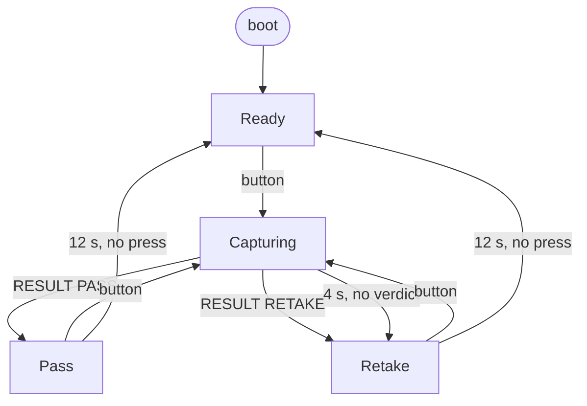

# Rig state machine

> Chinese version: [rig-state-machine-zh.md](rig-state-machine-zh.md). This file is the source of truth.
> Owner: @FrozenYty · Revisit when: a screen, a link state or an event is added

The rig controller has four screens and two link states. Every combination of them against every event
has a defined answer, because the combinations nobody wrote down are where a demo fails: a second button
press that shoots twice, a verdict that arrives after the operator has been told the shot failed, a link
that recovers and quietly wipes the result off the screen.

## 1. Screens

| Screen | Meaning |
|---|---|
| `Ready` | Idle, waiting for a press |
| `Capturing` | A capture is in flight; the verdict has not arrived |
| `Pass` | The PC returned PASS, with a score |
| `Retake` | The PC returned RETAKE with a reason, or the rig gave up waiting |

**There is no `Offline` screen.** The link flag below is not a screen: a quiet peer is still a peer, and
the rig stays on whatever it was doing.

## 2. Link

Two states, and the rig boots in the first one with a ten-second grace.

| Link | Meaning |
|---|---|
| `Alive` | A command arrived within `cfg::OFFLINE_AFTER_MS` |
| `Gone` | Ten seconds of silence |

Boot counts as `Alive`: the timer starts at power-up and a PC on the other end of the cable sends its
first keepalive long before ten seconds are out. **Losing a live link is worth reporting; having no history
yet is not.** The consequence is honest and invisible on the glass: a rig on a bench with no PC software
sets `Gone` ten seconds after power-up, because at that moment there really is nobody to talk to - but
`Gone` no longer draws anything, so the rig stays on `READY` and the button still works.

That is the protocol layer's own link flag. On `rig-ble` the screens are chosen by the presentation layer
(§11): with nobody listening it shows `APP` with a rotating fourth digit plus `WAITING` on the OLED; with a
subscriber listening - talking or quiet - it hands the glass back to the rig's own screen.

## 3. Events

| # | Event | Source |
|---|---|---|
| E1 | Button pressed (falling edge, debounced 25 ms) - the press is the whole gesture and the release is not an event | operator |
| E2 | `CMD PING` | PC |
| E3 | `CMD READY` | PC |
| E4 | A well-formed `CMD RESULT` (score and verdict present) | PC |
| E5 | A `CMD` line the firmware does not act on (unknown verb, or missing arguments) | PC |
| E6 | Ten seconds of silence | link timer |
| E7 | Heartbeat tick (1 s) | timer |
| E8 | Rotation step (250 ms), shared by the OLED's dot row and the panel's segment | timer |
| E9 | Display face step (25 ms boot sweep, 500 ms dash, 250 ms rotation and sweep, 500 ms blink) | timer |
| E10 | `CMD SCAN` | PC |
| E11 | Verdict face expired (12 s with no press) | timer |
| E12 | Capture timeout (4 s with no verdict) | timer |

Any line that starts with `CMD` and carries a word after it counts as the PC being alive, whether or not the
firmware acts on that verb. A line that is not a `CMD` line, or a bare `CMD` with nothing after it, is
ignored entirely: it does not refresh the link timer.

**`CMD SCAN` is an assembly tool, not part of a run.** It makes the firmware walk addresses 1 to 126 and
print one `EVT I2C <address>` line for each device that answers, then stop. It has no completion marker, so
a reader waits a fixed window rather than a terminator, and **how long it waited belongs in what it
reports** - a short window that found nothing and a complete walk that found nothing are different facts.
It changes nothing on the panel, at any link state: a command is the PC being alive, and the link has no
screen to recover (§5, E10).

## 4. Composite states

**There are none any more.** The screen used to report the link - `Offline` if and only if `Gone` - and that
pairing is what this section was for. The screen no longer carries the link: `Gone` is a flag on the
protocol layer, a quiet peer is still a peer, and every screen can be up with either link value. A capture
in flight with `Gone` is not a lie - the trigger went out and `Err1` will report the timeout.

The loop's invariant moved with the responsibility: it now guards the **verdict face timer**, not a
screen/link pairing - see §11 rule 11 and `rig::invariantHolds`.

## 5. Transitions

Rows are the four screens. `-` means the state does not change; **rejected** means it does not change *and*
the event is reported. `E6` (ten seconds of silence) changes the link flag only, so it is `-` everywhere.

| Screen \ Event | E1 button | E2 PING | E3 READY | E4 RESULT | E5 unknown | E6 silence | E7 heartbeat | E8 rotation | E9 display | E10 SCAN | E11 expired | E12 timeout |
|---|---|---|---|---|---|---|---|---|---|---|---|---|
| Ready | Capturing | Ready | Ready | **rejected** | Ready | `-` | Ready | `-` | Ready | `-` | `-` | `-` |
| Capturing | **ignored** | Capturing | Ready | Pass / Retake | Capturing | `-` | Capturing | Capturing | Capturing | `-` | `-` | Retake |
| Pass | Capturing | Pass | Ready | **rejected** | Pass | `-` | Pass | `-` | `-` | `-` | Ready | `-` |
| Retake | Capturing | Retake | Ready | **rejected** | Retake | `-` | Retake | `-` | Retake | `-` | Ready | `-` |

E7, E8, E9 and E10 never change the screen by themselves: they redraw it, or - for `CMD SCAN` - leave it
exactly as it was. They are in the table because a redraw in the wrong state is itself a visible defect:
the rotation must not advance on a result screen, the fourth digit must not turn once a verdict is on the
panel, and a verdict's face must not appear without a capture. E11 and E12 are the two timers that change a
screen on their own, and E12 fires in `Capturing` only. E3 (`CMD READY`) is the one command that moves any
screen to idle; **it does not touch the verdict timer**, which the capture start alone clears.

**The fault overlay has no column here.** It outranks every screen rather than competing with one, and what
that costs - a verdict arriving inside a fault window loses its arrival sweep - is in §10.

## 6. The rules and why

**1. A capture in flight ignores the button.** `serviceButton` returns early when the screen is already
`Capturing`. Without it, one press became two frames: the PC would shoot twice and the operator would see
one verdict for two pictures. The guard on the link is gone: a press in `Live` captures whatever the
protocol layer says, because `Gone` means an attached peer that has gone quiet, not "nobody" (§11 rule 7).

**2. A verdict is only accepted while a capture is in flight.** `handleResult` rejects a `RESULT` in any
other state and reports `EVT STRAY RESULT <score>`. Accepted elsewhere it would invent a result for a
shot that never happened, or overwrite a timeout the operator has already read. Reported, because a
silently dropped message leaves the PC believing the rig took it - the same reason TCP answers an
unexpected segment with a reset.

**3. A capture that gets no verdict within four seconds becomes a retake with reason `NO REPLY`.**
`serviceCaptureTimeout`, `cfg::CAPTURE_TIMEOUT_MS`. Without it the spinner turns forever whenever the PC
is healthy enough to keep the link alive but too busy to answer. Two keepalives is shorter than the five
keepalive link timeout on purpose: the operator should learn that this shot failed long before the link is
called quiet. This is also the answer a silent peer gets: the trigger goes out, `Err1` follows.

**4. A keepalive does not touch the screen.** A `CMD PING` refreshes the link timer and changes nothing
visible. There is no link screen for it to recover any more, so it cannot overwrite a verdict that is
being read.

**5. Silence no longer overrides anything.** `serviceLink` sets the protocol layer's `Gone` flag and stops
there; no screen can be forced because there is no link screen. The recovery is equally invisible: `poll`
sets `Alive`, and no screen is reset because none was taken away.

**6. The PC keeps the link alive.** The serial link has no carrier signal: the rig talks UART through a
bridge chip and cannot see whether the cable is plugged in. Liveness is therefore a protocol matter, and
the obligation is the PC's: **send `CMD PING` at least every two seconds; ten seconds of silence is five
missed keepalives and means the PC is gone.** An idle rig still has to be told so, which is why the
heartbeat is not decoration - and why the boot grace of the same ten seconds is enough for the PC's first
message to arrive and confirm that somebody is there.

**7. Every transition is reported.** `EVT SCREEN <name> <score>` on every state change the
firmware makes, including the ones the button, the link timer and boot cause. The capture timeout emits
`EVT TIMEOUT` first, saying why the screen moved, and then `EVT SCREEN RETAKE -1`, saying where it moved to
(§8) - a transition that for one afternoon was the single exception, and was fixed rather than documented.
Before the screen events existed, a wiring fault and a logic fault looked identical from the serial port.

**8. The invariant is checked, not assumed.** One comparison per loop pass, and one report per episode:
the flag is re-armed as soon as the pairing is sound again, so a monitor cannot fire once and then stay
quiet about the second violation. A violation is a serial line rather than a panel that quietly lies.

## 7. Diagram

The link flag is not in the diagram: silence used to lead every screen to `Offline`, and now it changes
nothing visible.

## 8. Serial events per transition

| Transition | Events |
|---|---|
| boot | `EVT HELLO <version>`, ..., `EVT SCREEN READY -1` |
| `CMD READY` from Ready, or from any other screen → Ready | `EVT SCREEN READY <score>` - emitted unconditionally, so a no-op `READY` is a broadcast of the screen the rig is already on |
| Ready → Capturing | `EVT SCREEN CAPTURING -1` then `EVT TRIGGER <millis>` |
| Capturing → Pass / Retake | `EVT SCREEN PASS\|RETAKE <score>` |
| Capturing → Retake (`NO REPLY`) | `EVT TIMEOUT <millis>` then `EVT SCREEN RETAKE -1` |
| Pass / Retake → Ready (verdict face expired) | `EVT SCREEN READY <score>` |
| rejected RESULT | `EVT STRAY RESULT <score>` |
| invariant broken (reports once per episode) | `EVT INVARIANT <screen> <link>` |

A score of `-1` in `EVT SCREEN` means no verdict has been received yet, so the screen has no number to
draw. The field is not reset by a link transition or by `CMD READY`: on `READY` it can still carry the last
verdict's score, which that screen does not draw.

## 9. The PC side of the link

The server holds the other end of the same cable, and it has a state machine of its own
(`server/app/rig/link.py`). It is smaller than the rig's, and it is written the same way, because the
failures here are the same shape: a port unplugged mid-read, a write attempted on a closed port, a
keepalive thread outliving the transport it was pinging.

| State \ Event | start | port opened | open failed | read failed | write failed | stop | keepalive tick | line in |
|---|---|---|---|---|---|---|---|---|
| `DOWN` | Opening | - | - | - | - | Stopping | - | - |
| `OPENING` | ignored | **Open** | stay, retry | - | - | Stopping | - | - |
| `OPEN` | ignored | - | - | **Opening**, retry | **Opening**, retry | Stopping | send `CMD PING` | dispatch |
| `STOPPING` | ignored | ignored | ignored | - | - | - | ignored | ignored |

**Two invariants, both enforced in the code:**

1. **A transport exists if and only if the state is `OPEN`.** A write on a closed port raises in
   whichever thread made it, and a keepalive thread that raises takes the process down.
2. **Only `OPEN` sends keepalives.** A reconnect loop that also pings is two writers on one port.

The matrix earned its place immediately: the first implementation set the *global* stop event when a
write failed, which ended the reader thread for good - one unlucky write and the link never came back.
The test that found it is `test_a_failed_write_takes_the_link_down_and_it_recovers`.

**The verdict path is not a separate state machine.** On `EVT TRIGGER` the server grabs a frame, scores
it with the same quality gate the rest of the product uses, and answers `CMD RESULT <score> <verdict>
<reason>`. If the capture fails - no camera, device busy, disk full - it answers **nothing**. The rig's
own four-second timeout then reports `RETAKE / NO REPLY` with no score, which is exactly true, and no
new message had to be invented for the rig to learn.

The keepalive obligation of §6 is discharged here: every two seconds, from `OPEN`, for as long as the
port is held.

## 10. The four-digit display

**The pacing is a rule rather than a set of numbers: what is working runs at a steady pace, what has failed
blinks at a warning pace, and nothing on a desk instrument exceeds about 1 Hz.** Every speed below follows
from it: a `RETAKE` and every one of the fault codes blink at one hertz, so a code is told from a score by
what it says rather than by its rhythm.

**The panel is four digits, multiplexed, and it is where a person at the bench reads the rig without the
OLED.** A common-anode display takes segments A-G on GPIO 3, 13, 14, 15, 16, 17 and 18, each through its own
330 Ω resistor, and digit commons 1-4 on GPIO 5, 6, 7 and 10 directly. The button is on GPIO 4 and the OLED
on I2C GPIO 8 and 9. The ten-lamp bar and the three status lamps are gone: their pins are the commons now,
and a bar that never shipped was not worth maintaining.

**Only one common may be high at a time, and that is the whole driving rule.** A common HIGH selects its
digit and a segment LOW lights that segment, so the current leaves the common, crosses the LED and the
segment's own 330 Ω, and enters the segment pin. A common carries no resistor because it carries the sum of
its digit's segment currents - which is also why exactly one may be selected: two commons high would light
two digits through one resistor network at half brightness, and the panel would read as a smear rather than
as digits.

**The multiplexer lives in a hardware timer, not in the loop.** One digit every 250 µs, so the whole face is
refreshed at about 1 kHz. The first version drove the panel from the loop, and it flickered: an OLED transfer
blocks the loop for 20-25 ms, and for that whole time the last digit selected stayed lit at full duty while
the other three were dark. The loop now only publishes which mask each digit should show - four bytes,
copied under a critical section so the handler can never read a half-updated face - and the timer handler
turns one mask into four GPIO register writes. Nothing the loop does can stall the panel, and a slow loop
slows the motion down instead of freezing the face.

**A face runs only on its own age.** The end of the boot sequence and any screen change both start that age
at zero, so nothing inherits a phase from what was on the panel a moment before; a fault's age is its own
phase too, so the blink starts with the fault. Both screens read one boot clock: the OLED holds its splash
card until the panel's two-second self-test ends, and the two arrive at `Ready` together. That clamp is there
because of a real defect: without it the idle cycle picked up wherever the self-test happened to stop, which
put the first dash on digit 2 instead of digit 1 after every power-up - and every other face inherited a
phase the same way.

| Screen | Face | Timing |
|---|---|---|
| boot | one segment at a time through all 28 positions, then `8888`, then dark | 25 ms per position (700 ms), 300 ms of eights, 1000 ms dark: two seconds, once |
| `Ready` | one dash (segment G alone) walking digit 1, 2, 3, 4 and starting over at 1 | 500 ms per position, 2 s a cycle |
| `Capturing` | `CAP`, with one segment walking the rim of the fourth digit | 250 ms per step |
| `Pass` | a left-to-right sweep, then the score right-aligned in digits 1-3 and `P`: ` 95P` | 250 ms sweep on arrival, then steady |
| `Retake` | the score and `F`, the whole panel blinking: ` 40F` | 1 Hz |
| fault `Err1` | a capture timeout, blinking | 1 Hz for 2 s |
| fault `Err2` | a stray result, blinking | 1 Hz for 2 s |
| fault `Err3` | a broken invariant, blinking | 1 Hz for 2 s |

**`Ready` is a one-way marquee: digits 1, 2, 3, 4 and straight back to 1, half a second at each position,
two seconds a cycle.** No frame is dark and no frame ever holds more than one dash, and that is structural
rather than tuned. **The wrap is deliberate**: the dash starts over at the first digit instead of turning
round, so the face is a conveyor with a visible break, and `config.h` carries a comment saying not to "fix"
it into a bounce. An earlier version held all four dashes for a second instead of wrapping; the marquee
replaced it.

**`Err1`-`Err3` are fault windows and all three look the same.** Each code blinks at one hertz - the code
is the identifier and the rhythm carries nothing, so there is no second rate. What differs is only how long
a face stays: they clear after two seconds. That is when it leaves, not how it looks. The three windows are
there because those events used to produce a log line and nothing a person could see, which made a broken
rig and an idle one look the same.

**A retake reads `F`, not `E`.** `E` begins every fault code, so ` 40E` and an `Err` face were one glance
apart; `F` is the left column with the top and middle bars, and no code contains it.

**A verdict is a conclusion, not a permanent label.** `Pass` and `Retake` return to `Ready` after 12 s with
no new press - six keepalives. Nothing is lost by moving on, because the PC keeps the record and the
operator's own eyes had the verdict for its whole twelve seconds. A capture started inside that window
cancels the timer outright, so the previous verdict can never pull the new capture back to idle.

**There is no rehearsal; the button has one meaning.** A press captures, on the pressing edge, and the
release is not an event at all, so a fault face appears only when its event happens: a bench where nothing
is failing never shows `Err1` to `Err3`. The serial log is the other place those events are visible -
`EVT TIMEOUT`, `EVT STRAY RESULT`, `EVT INVARIANT` - and that is why they are reported as well as drawn.

**Two things the matrix has no dimension for, both deliberate.** A fault window outranks every screen, so a
verdict that arrives inside one moves the screen underneath while the fault is drawn over it: by the time
the fault clears, the `Pass` sweep's 250 ms has already expired, and the arrival animation is **eaten rather
than deferred**. And an unknown score - `-1`, a capture that got no reply - is drawn as **blanks and the
verdict letter**, never as a zero: a `NO REPLY` retake reads `   F`, not `  0F`, because a zero beside a
timeout invents the very number the timeout says is missing. The OLED draws no number for the same score, so
the two screens agree.

**The alphabet is the digits, `A`, `C`, `E`, `F`, `P` and a lowercase `r`.** `r` is admitted for `Err`, the
one word the fault codes are built from, and it is the only lowercase letter drawn; `-` is segment G alone,
the idle dash. Every character in the table is shown by a face that exists, because an unused entry is how
the next person concludes a character is safe to draw. Anything outside the set either collides with a digit
- `O` is `0`, `S` is `5`, `I` is `1`, `G` resembles `6` and `9` - or cannot be formed at all, like M, W, K,
V, X, Y and Z. Transliterate the word into a code instead: that is why a fault is `Err1` and not `TIME`.

**Every state interval is an integer multiple of `cfg::PC_KEEPALIVE_MS`, 2 s.** They are written as products
of it on purpose - a keepalive that changes must move all of them with it, and that is the one number in
`config.h` that cannot be edited alone.

| Keepalives | Interval | What it times |
|---|---|---|
| 1 | 2 s | a fault window |
| 2 | 4 s | the capture timeout |
| 5 | 10 s | offline detection |
| 6 | 12 s | the verdict face |

**Every face interval is an integer multiple of `cfg::DISPLAY_UNIT_MS`, 25 ms**, and written as a product
for the same reason: each of them divides by twenty-five and gives a whole number. The 250 µs digit period is
a different domain - a hardware figure in microseconds, not a face interval - and the 25 ms button debounce
is not one either: the number matches by coincidence, not by construction.

| Units | Interval | What it times |
|---|---|---|
| 1 | 25 ms | one position of the boot sweep |
| 10 | 250 ms | the `Pass` arrival sweep, one `Capturing` rotation step |
| 12 | 300 ms | the settled `8888` |
| 20 | 500 ms | one `Ready` dash step, one `Retake` or code half-cycle |
| 28 | 700 ms | the whole 28-position boot sweep |
| 40 | 1000 ms | the dark blank after the eights |
| 80 | 2 s | one fault window, the whole `Ready` cycle |

## 11. The presentation layer: a third machine, not a merge

The rig now has **three** machines, and the third one exists because the first two cannot answer one
question between them: **is a PC expected right now?** The BLE layer knows whether a subscriber is listening
(`docs/rig-transport-en.md` §3-§5); the protocol layer knows whether one has spoken for ten seconds (§2).
"A subscriber that has gone quiet" is not the same fact as "nobody has arrived", and the protocol layer
cannot tell them apart because `Gone` is the word it uses for both. The presentation layer reads the two and
owns exactly one thing: which face the two screens draw. It is **not a merge** - the BLE layer and the
protocol layer keep their own states, their own clocks and their own matrices, and nothing on the wire
changes. It is the third reader §2 of the transport document asked for when it refused to join the first
two.

At power-up the rig has no carrier at all, and ten seconds later the protocol layer reports `Gone`.
Before this machine those two facts drew `Err0` - a fault face, blinking - on a rig where nothing was
wrong; then the first connection flipped the panel to `READY`, which read as the press having caused
something. **The rig cannot know during a scan that anyone is coming, so the honest label is "waiting",
not "broken".** `WAITING` says what is true: the rig is ready and there is no PC yet.

### 11.1 States and events

| State | Meaning |
|---|---|
| `Pairing` | Nobody is listening: no central, or a central that has not enabled notifications |
| `Live` | A subscriber is listening - whatever the protocol layer's `Alive`/`Gone` says at that moment |
| `RadioFault` | The radio would not start - its only cause (`docs/rig-transport-en.md` §5 rule 5) |

| # | Event | Source |
|---|---|---|
| B1 | A subscriber starts listening (BLE `Streaming`; the serial wire always is) | BLE layer |
| B2 | The notification subscription completes - the same edge as B1 on BLE | BLE layer |
| B3 | The subscriber stops listening | BLE layer |
| B4 | The radio would not start - its only cause | BLE layer |
| P1 | A command arrives | protocol layer |
| P2 | Ten seconds of silence | protocol layer |

`B1` moves `Pairing` straight to `Live`, and **the fact it reads is `Streaming`, not "attached"**: a central
that has connected but not enabled notifications cannot hear `EVT TRIGGER`, so a press there would start a
capture nobody receives and report `NO REPLY` four seconds later about a PC that never heard it. Keying
`Live` on the same condition the button reads puts that window in `Pairing`, where the refusal is visible.
`B2` is that same edge on this wire and in `Live` is ignored; `B1` there is rejected, because a second
subscriber must not repaint a screen. `P2` in `Live` is "already here": a subscriber that has gone quiet
does not change what the rig is doing.

### 11.2 The transition matrix

The four kinds of cell are the ones §4 of the transport document defines, and the vocabulary is shared on
purpose: **a bold state** is a transition; `—` is **ignored**, meaning the event cannot move this layer;
`handled in place` is consumed without a move; `rejected` keeps the state **and** reports, because the
sender has to learn that it was refused; and `already here` is a handled-in-place cell whose whole point
is that the state already says this.

| State \ Event | B1 listening | B2 subscribed | B3 stopped | B4 fault | P1 command | P2 silence |
|---|---|---|---|---|---|---|
| `Pairing` | **`Live`** | — | — | **`RadioFault`** | — | — |
| `Live` | rejected | — | **`Pairing`** | **`RadioFault`** | handled in place | already here |
| `RadioFault` | — | — | — | handled in place | — | — |

### 11.3 What each state draws

| State | OLED | Seven-segment panel |
|---|---|---|
| `Pairing` | the house status face with the headline `WAITING`, no animation | `APP`, the fourth digit rotating through its six rim segments |
| `Live` | the rig's own screen | the rig's own face |
| `RadioFault` | `RADIO FAULT` / `REFLASH RIG-SERIAL` | `Err4` |

**The `Pairing` panel face is the word `APP` and a rotating fourth digit.** `A`, `P` and `P` are all in the
character set, so the word is spelled without a new glyph, and it names the PC-side application the
operator is about to open - the action this state is waiting for. The fourth digit turns through its six
rim segments A-F at the same 250 ms step as `CAPTURING`, from the same `presentation::rotationStep`. Both
halves are things this panel already draws elsewhere, and that is the point: the word says what to do, and
the rotation says the rig is still working. It is deliberately the smaller design.

**The ring is gone because its table was wrong, and the way it was tested let it stay wrong.** The ring was
twelve (digit, segment) pairs in `RING_DIGIT`/`RING_SEGMENT`; two entries painted the fourth digit's bottom
and none painted the first digit's, so on the glass one position never appeared and another stayed lit too
long. The test compared the table with a transcription of the same table - a copy wrong in the same place
agrees with itself. The replacement has **no position table at all**: the step is `1u << step`, six single
bits, and a bit shift has no entry that can be wrong. The check now asserts the definition rather than a
golden copy - six positions, six distinct segments, no repeats, driven by a step computed from the face's
age.

**The OLED is the house status face with the words changed and no moving element.** `WAITING` is drawn by
the same `drawStatusFace` that draws `RADIO FAULT`: same inverted box, same `AQUAVISION` header, same title
baseline, same body line, and the same Helvetica bold 12 title. The twelve-cell progress row it replaces
implied an amount of progress that does not exist, and a misleading indicator is worse than none; this
screen cannot be made as strong as the rest by animating, so it borrows the language that is already
strong. **The title is `WAITING` and not `WAITING FOR PC` because of the character count, not the font**:
thirteen characters do not fit bold 12 on the 128 px panel, and shrinking the type to fit them is what made
this face read as empty. A seven-character title at the house size plus the body line `NO LINK TO PC` reads
as "waiting - nothing connected yet", which is the short-title-plus-body structure the status face already
uses.

**The rotation is read from the face's age, never accumulated.** `presentation::rotationStep` is
`(faceAge / cfg::DISPLAY_ROTATE_MS) % cfg::DISPLAY_ROTATE_STEPS`, computed every pass, so an iteration that
runs long catches up instead of losing a step. It is the same function `CAPTURING` calls, so the two faces
cannot end up on different steps or different clocks. There is no per-step work on the OLED: the waiting
face is static and is sent once when it is entered, and the panel's mask is published from `serviceDisplay`
as usual.

**`OFFLINE` and `Err0` are retired, and the `NoLink` state with them.** In BLE a link simply ends - the
connection closes and the rig is available again - and a subscriber that stays connected but stops talking
has the same remedy as one that never connected: wait. Two faces for one remedy made the operator think a
step further for nothing, and `Err0` called "waiting" a fault, which is exactly what this layer exists to
stop doing. So a listening-but-silent subscriber stays in `Live` and sees the rig's own screen, which is
true: the rig is ready and nothing is happening. **`Err0`'s number is not reused**; the remaining codes keep
`Err1`-`Err4`, and the gap costs nothing.

### 11.4 The rules

**1. The presentation layer outranks the screen.** A screen change made while it is not `Live` is
**dropped, not deferred**: the presentation face is drawn over the rig's screen, the change never
replays, and when `Live` returns the screens draw the rig's *current* screen - not the change that
happened while it was away. That is the same choice §10 already makes for a verdict that lands inside a
fault window - eaten, not deferred - and it is the honest one here too: a verdict that arrived while the
rig had no PC did not come from the PC that is here now. In particular, a `PASS` that arrives while
`Pairing` loses its arrival sweep and never paints a score over `WAITING`.

**2. `Pairing` draws `APP` with a rotating fourth digit, and that is the fix.** The rig really is ready;
only the link detail differs. The panel therefore no longer shows a fault code at a rig where nothing is
wrong, and the first connection no longer flips it to `READY` as though a press had caused it. The word
names what to open and the rotation says the rig is still working; both are shapes this panel already
draws. The first version tried walking the `Ready` marquee backwards and the bench rejected it, because two
dashes moving opposite ways are indistinguishable at a glance.

**3. A quiet subscriber is `Live`, not a face.** A subscriber is listening but the protocol layer is `Gone`:
the peer is still there and has simply stopped talking, which has the same remedy as a peer that never
connected - wait. `P2` in `Live` is therefore "already here": the event is consumed and nothing changes,
and the rig's own screen stays up because the rig is ready and nothing is happening. `P1` is proof that
somebody is on the other end and is handled in place for the same reason.

**4. Only `RadioFault` outranks the presentation layer.** `Err1` to `Err3` are the screen's fault windows
and are drawn only while the face is `Live`; a dead radio (`B4`) replaces every face with `Err4`/`RADIO
FAULT` and stays there, because waiting is the wrong response to it (§10 of the transport document).
`B4` is applied before the `B3` edge the same fault produces, so a radio that failed cannot land the
presentation back in `Pairing` behind its own fault.

**5. `B1` in `Live` is rejected, and the refusal is the BLE layer's.** A second subscriber must not repaint
a live screen; the BLE layer has already disconnected it (its rule 1), and this cell is what keeps the
presentation from following it. It is a defensive cell - the layer never sees a second attach - and it
exists so that the rule is in the table instead of in a comment. **The layer itself reports nothing**: it
has no wire, and the cell's `Rejected` records a refusal that happened one layer down.

**6. The serial build has no carrier signal, so it never shows `Pairing`.** A UART cannot see whether a
cable is plugged in (transport §2), so `transport::listening()` answers true always: `rig-serial` starts
`Live` and stays there whatever the protocol layer's link flag says. That is the honest limit of that wire,
not a missing state.

**7. A press is refused only while a face owns the screens, and the face is the condition.** `Pairing`
means nobody is listening: `EVT TRIGGER` would go nowhere, so the refusal is right - and it is **visible**,
because the same `Pairing` is what draws `WAITING` / `APP`. `RadioFault` means the radio is dead. In `Live`
a press **always** captures - including while the protocol layer is `Gone`, because `Gone` is a subscriber
that has gone quiet, not "nobody". If it really is silent the trigger goes out and `Err1` arrives four
seconds later, which is a visible, honest answer. **The same condition decides whether a press is accepted
and which face is drawn** - both read `presentation::state() == Live` - because two conditions is what
produced the two failures this rule exists to prevent: a capture reported `NO REPLY` about a PC that never
heard the trigger, and a refusal the operator could not see.

**8. The wire is untouched.** No event, no command and no line format changes. `EVT SCREEN` still names
`READY`, `CAPTURING`, `PASS` and `RETAKE`; a PC that knows the retired `OFFLINE` name simply stopped
receiving it, because the link no longer has a screen to report. The existing "tell the PC the current
screen when it subscribes" rule is unchanged, and it now has one more job: **a new subscription flushes the
input**. The carrier drops its rx ring and the parser drops any half-received line, because a partial line
left by the previous session must not be completed by the next session's first write into a command nobody
sent.

**9. `Pairing` is a word and a rotation, and neither has a position table.** The panel draws `APP` and
turns the fourth digit through six segments; the step is `1u << presentation::rotationStep(faceAge)`, the
same call `CAPTURING` makes, so the two faces cannot disagree about the step or the clock. The ring this
replaces was a twelve-entry table, and one wrong pair both duplicated a digit's bottom and dropped
another's; **a bit shift has no entry that can be wrong**, which is why the replacement is arithmetic rather
than a corrected table. The test asserts the definition - six positions, six distinct segments, no repeats,
computed from the face's age - not a transcription that can agree with its own mistake.

**10. Nothing else in the layer may repaint the frame.** The waiting face is static: it is drawn once when
`Pairing` is entered and never per step, so the only thing that could repaint it is a dirty flag from
elsewhere. The heartbeat marks the state dirty only while the presentation is `Live`, because the header
dot exists only on the rig's own screen; a dirty flag in `Pairing` would send the whole 1184-byte frame once
a second for a screen that has not changed. The same rule covers any future animation: if a face gains a
moving element, it must compute its phase from the clock and say what repaints it, and it must not be the
heartbeat.

**11. Starting a capture cancels the previous verdict's face timer.** A verdict face expires after
`cfg::VERDICT_FACE_MS`, and that timer belongs to the verdict it was armed for. `serviceButton` therefore
clears `state.verdictAt` when a capture begins, and `rig::verdictFaceExpired` refuses to fire while no timer
is armed. The invariant in `rig_state.h` states the same rule from the other side: **a capture in flight
carries no verdict timer, and a verdict face carries one**, so an armed timer during `CAPTURING` is reported
as `Err3` rather than silently mis-timing the screen.

**12. One event, one clock reading.** A verdict is stamped with the loop's own `now` - the same reading the
expiry compares against - and `rig::armVerdictFace` is the only writer. Two readings of one clock is not a
detail: on the bench a face promised twelve seconds lived about one, because the verdict was stamped with a
second `millis()` taken after the loop's reading, a millisecond boundary fell between them, and the unsigned
age `now - verdictAt` wrapped to about 4.29e9 - larger than any window, so the face expired on the pass it
appeared. `CAP` appearing and snapping to `READY` is that wrap. The age is now compared as a signed
difference, so a stamp even a millisecond ahead costs a millisecond instead of the whole face, and the check
measures the lifetime on a virtual clock (still up at eleven seconds, gone by thirteen) rather than only
asserting the boundary.

**13. `Err3` is a monitor, not a face an event can reach.** Nothing an operator or the PC does raises
`Err3` directly: it reports a state the firmware should never be in (a capture carrying a verdict timer, or
a verdict face without one), and the loop emits `EVT INVARIANT` once per episode. If you are looking for
the input that produces it, there is none - look for the state bug instead.

**14. A radio that cannot advertise is `Pairing`, not `RadioFault`.** `Advertising` retries forever, so a
rig that has not managed to advertise simply sits on `WAITING` with `APP` turning. That is honest - nobody
is listening yet - and it is why the face is a wait rather than a fault: the radio stack is alive, it just
has not got a message out. `Err4` is reserved for a stack that refused to start, which is its only cause
(`docs/rig-transport-en.md` §5 rule 5); a link that keeps dropping is answered by `Advertising` and
`WAITING`, not by a fault. The cost is that a permanently mute radio is invisible on the glass, which is
acceptable only because it is written down here.

**15. A press is acted on in the next loop pass, and that latency is accepted.** The button is read once
per iteration, after a possible full-frame OLED send of about 25 ms; the press lands in the following pass.
Reordering the loop to shave that would put the button ahead of the link and the verdict timer, and the
25 ms is far inside the debounce window and invisible to a person. It is written down so the next reader
does not "fix" the ordering.
