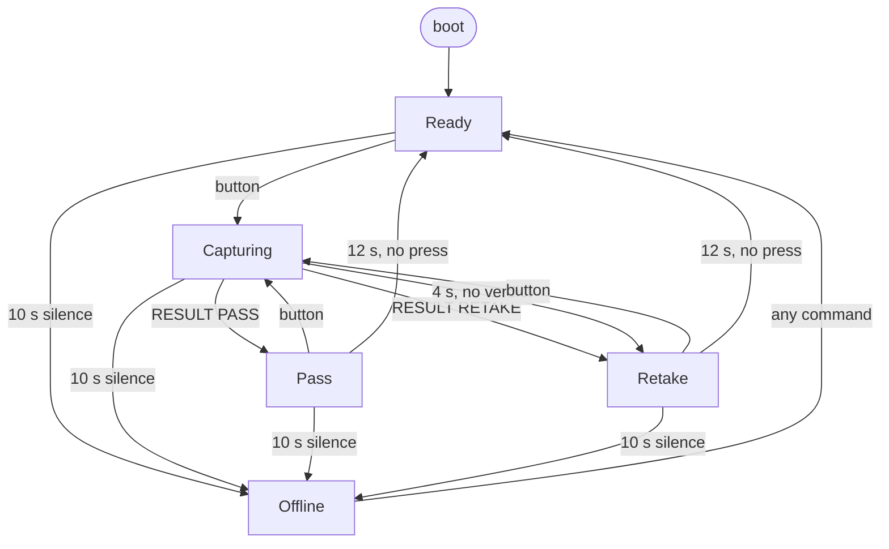

# Rig state machine

> Chinese version: [rig-state-machine-zh.md](rig-state-machine-zh.md). This file is the source of truth.
> Owner: @FrozenYty · Revisit when: a screen, a link state or an event is added

The rig controller has five screens and two link states. Every combination of them against every event
has a defined answer, because the combinations nobody wrote down are where a demo fails: a second button
press that shoots twice, a verdict that arrives after the operator has been told the shot failed, a link
that recovers and quietly wipes the result off the screen.

## 1. Screens

| Screen | Meaning |
|---|---|
| `Ready` | Idle, waiting for a press |
| `Capturing` | A capture is in flight; the verdict has not arrived |
| `Pass` | The PC returned PASS, with a score |
| `Retake` | The PC returned RETAKE with a reason, or the rig gave up waiting |
| `Offline` | No keepalive from the PC |

## 2. Link

Two states, and the rig boots in the first one with a ten-second grace.

| Link | Meaning |
|---|---|
| `Alive` | A command arrived within `cfg::OFFLINE_AFTER_MS` |
| `Gone` | Ten seconds of silence |

Boot counts as `Alive`: the timer starts at power-up and a PC on the other end of the cable sends its
first keepalive long before ten seconds are out. Booting `OFFLINE` would have the panel call itself dead
before anything had a chance to speak, which reads as a fault rather than as "waiting". **Losing a live
link is worth reporting; having no history yet is not.** The consequence is honest and visible: a rig on a
bench with no PC software goes `OFFLINE` ten seconds after power-up, because at that moment there really
is nobody to talk to.

That is the protocol layer's own screen. On `rig-ble` the panel no longer draws it when no central is
attached: the presentation layer (§11) calls that `Pairing` and shows `APP` with a rotating fourth digit
plus `WAITING` on the OLED, because a radio can tell "nobody has arrived" from "somebody left" and
the protocol's `Gone` cannot.

## 3. Events

| # | Event | Source |
|---|---|---|
| E1 | Button pressed (falling edge, debounced 25 ms) - the press is the whole gesture and the release is not an event | operator |
| E2 | `CMD PING` | PC |
| E3 | `CMD READY` | PC |
| E4 | A well-formed `CMD RESULT` (score and verdict present) | PC |
| E5 | A `CMD` line the firmware does not act on (unknown verb, or missing arguments) | PC |
| E6 | Ten seconds of silence | link timer |
| E7 | Heartbeat tick (1 s) | timer |
| E8 | Rotation step (250 ms), shared by the OLED's dot row and the panel's segment | timer |
| E9 | Display face step (25 ms boot sweep, 500 ms dash, 250 ms rotation and sweep, 500 ms blink) | timer |
| E10 | `CMD SCAN` | PC |
| E11 | Verdict face expired (12 s with no press) | timer |
| E12 | Capture timeout (4 s with no verdict) | timer |

Any line that starts with `CMD` and carries a word after it counts as the PC being alive, whether or not the
firmware acts on that verb. A line that is not a `CMD` line, or a bare `CMD` with nothing after it, is
ignored entirely: it does not refresh the link timer and cannot recover `Offline`.

**`CMD SCAN` is an assembly tool, not part of a run.** It makes the firmware walk addresses 1 to 126 and
print one `EVT I2C <address>` line for each device that answers, then stop. It has no completion marker, so
a reader waits a fixed window rather than a terminator, and **how long it waited belongs in what it
reports** - a short window that found nothing and a complete walk that found nothing are different facts.
While the link is alive it changes nothing on the panel; from `Offline` it recovers the link like every
other command, because a command *is* the PC being alive (§5, E10).

## 4. Composite states

Ten pairs, five of which must never exist. The right-hand column is the invariant that forbids them.

| Screen \ Link | `Alive` | `Gone` | Why the impossible one is impossible |
|---|---|---|---|
| `Ready` | reachable | **impossible** | `Ready` means the rig has a PC and is waiting for a button |
| `Capturing` | reachable | **impossible** | a capture needs a receiver |
| `Pass` | reachable | **impossible** | a verdict came from the PC, so the PC is there |
| `Retake` | reachable | **impossible** | same, and the `NO REPLY` timeout only runs while `Alive` |
| `Offline` | **impossible** | reachable | recovering from `Gone` raises `Ready` in the same loop |

**The invariant, stated once:**

```
Offline  <=>  Gone          and          everything else  =>  Alive
```

`rig::invariantHolds` encodes it, the loop checks it once per pass and reports `EVT INVARIANT` once per
episode, re-arming as soon as the pairing is sound again. It has never fired. Two earlier drafts got this
wrong in opposite directions - one showed `OFFLINE` ten seconds after every power-up because it measured the
absence of a PC nobody had promised, the other could leave the panel on `OFFLINE` while the link was alive,
because recovery was handled in the link timer instead of where the PC actually spoke.

## 5. Transitions

Rows are the five reachable composites. `-` means the state does not change; **rejected** means it does
not change *and* the event is reported.

| Composite \ Event | E1 button | E2 PING | E3 READY | E4 RESULT | E5 unknown | E6 silence | E7 heartbeat | E8 rotation | E9 display | E10 SCAN | E11 expired | E12 timeout |
|---|---|---|---|---|---|---|---|---|---|---|---|---|
| Ready + Alive | Capturing | Ready | Ready | **rejected** | Ready | Offline | Ready | `-` | Ready | `-` | `-` | `-` |
| Capturing + Alive | **ignored** | Capturing | Ready | Pass / Retake | Capturing | Offline | Capturing | Capturing | Capturing | `-` | `-` | Retake |
| Pass + Alive | Capturing | Pass | Ready | **rejected** | Pass | Offline | Pass | `-` | `-` | `-` | Ready | `-` |
| Retake + Alive | Capturing | Retake | Ready | **rejected** | Retake | Offline | Retake | `-` | Retake | `-` | Ready | `-` |
| Offline + Gone | `-` | Ready | Ready | rejected, then Ready | Ready | `-` | `-` | `-` | Offline | Ready | `-` | `-` |

E7, E8, E9 and E10 never change the screen by themselves: they redraw it, or - for `CMD SCAN` while the link
is alive - leave it exactly as it was. They are in the table because a redraw in the wrong state is itself a
visible defect: the rotation must not advance on a result screen, the fourth digit must not turn once a
verdict is on the panel, and a verdict's face must not appear without a capture. E10's one exception is
`Offline`, where a command is also the PC returning. E11 and E12 are the two timers that change a live
screen on their own, and E12 fires in `Capturing` only.

**The fault overlay has no column here.** It outranks every screen rather than competing with one, and what
that costs - a verdict arriving inside a fault window loses its arrival sweep - is in §10.

## 6. The rules and why

**1. A capture in flight ignores the button.** `serviceButton` returns early unless the link is `Alive`
and the screen is not already `Capturing`. Without it, one press became two frames: the PC would shoot
twice and the operator would see one verdict for two pictures.

**2. A verdict is only accepted while a capture is in flight.** `handleResult` rejects a `RESULT` in any
other state and reports `EVT STRAY RESULT <score>`. Accepted elsewhere it would invent a result for a
shot that never happened, or overwrite a timeout the operator has already read. Reported, because a
silently dropped message leaves the PC believing the rig took it - the same reason TCP answers an
unexpected segment with a reset.

**3. A capture that gets no verdict within four seconds becomes a retake with reason `NO REPLY`.**
`serviceCaptureTimeout`, `cfg::CAPTURE_TIMEOUT_MS`. Without it the spinner turns forever whenever the PC
is healthy enough to keep the link alive but too busy to answer. Two keepalives is shorter than the five
keepalive link timeout on purpose: the operator should learn that this shot failed before the whole link is
declared dead.

**4. A keepalive does not touch the screen.** A `CMD PING` raises `Ready` only on the transition out of
`Gone`, and only when the screen is `Offline`. A `PING` that arrives while a verdict is being read
refreshes the link timer and changes nothing visible.

**5. Losing the PC overrides everything.** `serviceLink`. No screen can make progress without a PC, so
silence forces `Offline` from anywhere. The recovery lives where the PC actually speaks - in `poll` - and
resets exactly the `Offline` screen.

**6. The PC keeps the link alive.** The serial link has no carrier signal: the rig talks UART through a
bridge chip and cannot see whether the cable is plugged in. Liveness is therefore a protocol matter, and
the obligation is the PC's: **send `CMD PING` at least every two seconds; ten seconds of silence is five
missed keepalives and means the PC is gone.** An idle rig still has to be told so, which is why the
heartbeat is not decoration - and why the boot grace of the same ten seconds is enough for the PC's first
message to arrive and confirm that somebody is there.

**7. Every transition is reported.** `EVT SCREEN <name> <score>` on every state change the
firmware makes, including the ones the button, the link timer and boot cause. The capture timeout emits
`EVT TIMEOUT` first, saying why the screen moved, and then `EVT SCREEN RETAKE -1`, saying where it moved to
(§8) - a transition that for one afternoon was the single exception, and was fixed rather than documented.
Before the screen events existed, a wiring fault and a logic fault looked identical from the serial port.

**8. The invariant is checked, not assumed.** One comparison per loop pass, and one report per episode:
the flag is re-armed as soon as the pairing is sound again, so a monitor cannot fire once and then stay
quiet about the second violation. A violation is a serial line rather than a panel that quietly lies.

## 7. Diagram



## 8. Serial events per transition

| Transition | Events |
|---|---|
| boot | `EVT HELLO <version>`, ..., `EVT SCREEN READY -1` |
| any command from `Offline` → Ready | `EVT SCREEN READY <score>` |
| `CMD READY` from Ready, or from any other screen → Ready | `EVT SCREEN READY <score>` - emitted unconditionally, so a no-op `READY` is a broadcast of the screen the rig is already on |
| Ready → Capturing | `EVT SCREEN CAPTURING -1` then `EVT TRIGGER <millis>` |
| Capturing → Pass / Retake | `EVT SCREEN PASS\|RETAKE <score>` |
| Capturing → Retake (`NO REPLY`) | `EVT TIMEOUT <millis>` then `EVT SCREEN RETAKE -1` |
| Pass / Retake → Ready (verdict face expired) | `EVT SCREEN READY <score>` |
| any → Offline | `EVT SCREEN OFFLINE <score>` |
| rejected RESULT | `EVT STRAY RESULT <score>` |
| invariant broken (reports once per episode) | `EVT INVARIANT <screen> <link>` |

A score of `-1` in `EVT SCREEN` means no verdict has been received yet, so the screen has no number to
draw. The field is not reset by a link transition or by `CMD READY`: on `READY` and `OFFLINE` it can still
carry the last verdict's score, which those screens do not draw.

## 9. The PC side of the link

The server holds the other end of the same cable, and it has a state machine of its own
(`server/app/rig/link.py`). It is smaller than the rig's, and it is written the same way, because the
failures here are the same shape: a port unplugged mid-read, a write attempted on a closed port, a
keepalive thread outliving the transport it was pinging.

| State \ Event | start | port opened | open failed | read failed | write failed | stop | keepalive tick | line in |
|---|---|---|---|---|---|---|---|---|
| `DOWN` | Opening | - | - | - | - | Stopping | - | - |
| `OPENING` | ignored | **Open** | stay, retry | - | - | Stopping | - | - |
| `OPEN` | ignored | - | - | **Opening**, retry | **Opening**, retry | Stopping | send `CMD PING` | dispatch |
| `STOPPING` | ignored | ignored | ignored | - | - | - | ignored | ignored |

**Two invariants, both enforced in the code:**

1. **A transport exists if and only if the state is `OPEN`.** A write on a closed port raises in
   whichever thread made it, and a keepalive thread that raises takes the process down.
2. **Only `OPEN` sends keepalives.** A reconnect loop that also pings is two writers on one port.

The matrix earned its place immediately: the first implementation set the *global* stop event when a
write failed, which ended the reader thread for good - one unlucky write and the link never came back.
The test that found it is `test_a_failed_write_takes_the_link_down_and_it_recovers`.

**The verdict path is not a separate state machine.** On `EVT TRIGGER` the server grabs a frame, scores
it with the same quality gate the rest of the product uses, and answers `CMD RESULT <score> <verdict>
<reason>`. If the capture fails - no camera, device busy, disk full - it answers **nothing**. The rig's
own four-second timeout then reports `RETAKE / NO REPLY` with no score, which is exactly true, and no
new message had to be invented for the rig to learn.

The keepalive obligation of §6 is discharged here: every two seconds, from `OPEN`, for as long as the
port is held.

## 10. The four-digit display

**The pacing is a rule rather than a set of numbers: what is working runs at a steady pace, what has failed
blinks at a warning pace, and nothing on a desk instrument exceeds about 1 Hz.** Every speed below follows
from it: a `RETAKE` and every one of the fault codes blink at one hertz, so a code is told from a score by
what it says rather than by its rhythm.

**The panel is four digits, multiplexed, and it is where a person at the bench reads the rig without the
OLED.** A common-anode display takes segments A-G on GPIO 3, 13, 14, 15, 16, 17 and 18, each through its own
240 Ω resistor, and digit commons 1-4 on GPIO 5, 6, 7 and 10 directly. The button is on GPIO 4 and the OLED
on I2C GPIO 8 and 9. The ten-lamp bar and the three status lamps are gone: their pins are the commons now,
and a bar that never shipped was not worth maintaining.

**Only one common may be high at a time, and that is the whole driving rule.** A common HIGH selects its
digit and a segment LOW lights that segment, so the current leaves the common, crosses the LED and the
segment's own 240 Ω, and enters the segment pin. A common carries no resistor because it carries the sum of
its digit's segment currents - which is also why exactly one may be selected: two commons high would light
two digits through one resistor network at half brightness, and the panel would read as a smear rather than
as digits.

**The multiplexer lives in a hardware timer, not in the loop.** One digit every 250 µs, so the whole face is
refreshed at about 1 kHz. The first version drove the panel from the loop, and it flickered: an OLED transfer
blocks the loop for 20-25 ms, and for that whole time the last digit selected stayed lit at full duty while
the other three were dark. The loop now only publishes which mask each digit should show - four bytes,
copied under a critical section so the handler can never read a half-updated face - and the timer handler
turns one mask into four GPIO register writes. Nothing the loop does can stall the panel, and a slow loop
slows the motion down instead of freezing the face.

**A face runs only on its own age.** The end of the boot sequence and any screen change both start that age
at zero, so nothing inherits a phase from what was on the panel a moment before; a fault's age is its own
phase too, so the blink starts with the fault. Both screens read one boot clock: the OLED holds its splash
card until the panel's two-second self-test ends, and the two arrive at `Ready` together. That clamp is there
because of a real defect: without it the idle cycle picked up wherever the self-test happened to stop, which
put the first dash on digit 2 instead of digit 1 after every power-up - and every other face inherited a
phase the same way.

| Screen | Face | Timing |
|---|---|---|
| boot | one segment at a time through all 28 positions, then `8888`, then dark | 25 ms per position (700 ms), 300 ms of eights, 1000 ms dark: two seconds, once |
| `Ready` | one dash (segment G alone) walking digit 1, 2, 3, 4 and starting over at 1 | 500 ms per position, 2 s a cycle |
| `Capturing` | `CAP`, with one segment walking the rim of the fourth digit | 250 ms per step |
| `Pass` | a left-to-right sweep, then the score right-aligned in digits 1-3 and `P`: ` 95P` | 250 ms sweep on arrival, then steady |
| `Retake` | the score and `F`, the whole panel blinking: ` 40F` | 1 Hz |
| `Offline` | the code `Err0`, blinking | 1 Hz, and no window: it lasts as long as the link is gone |
| fault `Err1` | a capture timeout, blinking | 1 Hz for 2 s |
| fault `Err2` | a stray result, blinking | 1 Hz for 2 s |
| fault `Err3` | a broken invariant, blinking | 1 Hz for 2 s |

**`Ready` is a one-way marquee: digits 1, 2, 3, 4 and straight back to 1, half a second at each position,
two seconds a cycle.** No frame is dark and no frame ever holds more than one dash, and that is structural
rather than tuned. **The wrap is deliberate**: the dash starts over at the first digit instead of turning
round, so the face is a conveyor with a visible break, and `config.h` carries a comment saying not to "fix"
it into a bounce. An earlier version held all four dashes for a second instead of wrapping; the marquee
replaced it. It cannot be mistaken for `Offline` either, because that face is a code.

**`Err0` is the `Offline` screen; `Err1`-`Err3` are fault windows, and all four look the same.** Each code
blinks at one hertz - the code is the identifier and the rhythm carries nothing, so there is no second rate
and no special case for the link. What differs is only how long a face stays: `Err0` has no window, because
a lost link lasts until the link comes back, while `Err1` to `Err3` clear after two seconds. That is when it
leaves, not how it looks. The three windows are there because those events used to produce a log line and
nothing a person could see, which made a broken rig and an idle one look the same - and losing the link is a
fault, so numbering its screen is honest rather than a workaround.

**A retake reads `F`, not `E`.** `E` begins every fault code, so ` 40E` and an `Err` face were one glance
apart; `F` is the left column with the top and middle bars, and no code contains it.

**A verdict is a conclusion, not a permanent label.** `Pass` and `Retake` return to `Ready` after 12 s with
no new press - six keepalives, which is `OFFLINE_AFTER_MS` plus one. That relationship is the point: a
verdict outlives the link-loss threshold on purpose, so a dead link is always reported before a verdict
clears on its own. Nothing is lost by moving on, because the PC keeps the record and the operator's own
eyes had the verdict for its whole twelve seconds; `Offline` is deliberately excluded, because a lost link
is a fault rather than a completion.

**There is no rehearsal; the button has one meaning.** A press captures, on the pressing edge, and the
release is not an event at all, so a fault face appears only when its event happens: a bench where nothing
is failing never shows `Err1` to `Err3`, and `Err0` needs the PC to fall silent for ten seconds. The serial
log is the other place those events are visible - `EVT TIMEOUT`, `EVT STRAY RESULT`, `EVT INVARIANT` - and
that is why they are reported as well as drawn.

**Two things the matrix has no dimension for, both deliberate.** A fault window outranks every screen, so a
verdict that arrives inside one moves the screen underneath while the fault is drawn over it: by the time
the fault clears, the `Pass` sweep's 250 ms has already expired, and the arrival animation is **eaten rather
than deferred**. And an unknown score - `-1`, a capture that got no reply - is drawn as **blanks and the
verdict letter**, never as a zero: a `NO REPLY` retake reads `   F`, not `  0F`, because a zero beside a
timeout invents the very number the timeout says is missing. The OLED draws no number for the same score, so
the two screens agree.

**The alphabet is the digits, `A`, `C`, `E`, `F`, `P` and a lowercase `r`.** `r` is admitted for `Err`, the
one word the fault codes are built from, and it is the only lowercase letter drawn; `-` is segment G alone,
the idle dash. Every character in the table is shown by a face that exists, because an unused entry is how
the next person concludes a character is safe to draw. Anything outside the set either collides with a digit
- `O` is `0`, `S` is `5`, `I` is `1`, `G` resembles `6` and `9` - or cannot be formed at all, like M, W, K,
V, X, Y and Z. Transliterate the word into a code instead: that is why a fault is `Err1` and not `TIME`.

**Every state interval is an integer multiple of `cfg::PC_KEEPALIVE_MS`, 2 s.** They are written as products
of it on purpose - a keepalive that changes must move all of them with it, and that is the one number in
`config.h` that cannot be edited alone.

| Keepalives | Interval | What it times |
|---|---|---|
| 1 | 2 s | a fault window |
| 2 | 4 s | the capture timeout |
| 5 | 10 s | offline detection |
| 6 | 12 s | the verdict face |

**Every face interval is an integer multiple of `cfg::DISPLAY_UNIT_MS`, 25 ms**, and written as a product
for the same reason: each of them divides by twenty-five and gives a whole number. The 250 µs digit period is
a different domain - a hardware figure in microseconds, not a face interval - and the 25 ms button debounce
is not one either: the number matches by coincidence, not by construction.

| Units | Interval | What it times |
|---|---|---|
| 1 | 25 ms | one position of the boot sweep |
| 10 | 250 ms | the `Pass` arrival sweep, one `Capturing` rotation step |
| 12 | 300 ms | the settled `8888` |
| 20 | 500 ms | one `Ready` dash step, one `Retake` or code half-cycle |
| 28 | 700 ms | the whole 28-position boot sweep |
| 40 | 1000 ms | the dark blank after the eights |
| 80 | 2 s | one fault window, the whole `Ready` cycle |

## 11. The presentation layer: a third machine, not a merge

The rig now has **three** machines, and the third one exists because the first two cannot answer one
question between them: **is a PC expected right now?** The BLE layer knows whether a central is attached
(`docs/rig-transport-en.md` §3-§5); the protocol layer knows whether one has spoken for ten seconds (§2).
"Attached and silent" is not the same fact as "nobody has arrived", and the protocol layer cannot tell
them apart because `Gone` is the word it uses for both. The presentation layer reads the two and owns
exactly one thing: which face the two screens draw. It is **not a merge** - the BLE layer and the
protocol layer keep their own states, their own clocks and their own matrices, and nothing on the wire
changes. It is the third reader §2 of the transport document asked for when it refused to join the first
two.

At power-up the rig has no carrier at all, and ten seconds later the protocol layer reports `Gone`.
Before this machine those two facts drew `Err0` - a fault face, blinking - on a rig where nothing was
wrong; then the first connection flipped the panel to `READY`, which read as the press having caused
something. **The rig cannot know during a scan that anyone is coming, so the honest label is "waiting",
not "broken".** `WAITING` says what is true: the rig is ready and there is no PC yet.

### 11.1 States and events

| State | Meaning |
|---|---|
| `Pairing` | No central is attached |
| `NoLink` | A central is attached but the protocol layer is `Gone`; `B2` has not made it `Live` |
| `Live` | A central is attached and the protocol layer is `Alive` |
| `RadioFault` | The radio would not start, or the drop storm reached `Fault` |

| # | Event | Source |
|---|---|---|
| B1 | A central attaches | BLE layer |
| B2 | The notification subscription completes | BLE layer |
| B3 | The central disconnects | BLE layer |
| B4 | The radio would not start, or the drop storm reached `Fault` | BLE layer |
| P1 | A command arrives | protocol layer |
| P2 | Ten seconds of silence | protocol layer |

`B1` enters `NoLink` and `B2` is what moves it to `Live`: a central that is attached but has not enabled
notifications has not proved that anyone will talk, so it does not get the `Live` face yet. `B2` in
`Live` is ignored - the subscription is already enabled - and `B1` there is rejected, because a second
central must not repaint a screen.

### 11.2 The transition matrix

The four kinds of cell are the ones §4 of the transport document defines, and the vocabulary is shared on
purpose: **a bold state** is a transition; `—` is **ignored**, meaning the event cannot move this layer;
`handled in place` is consumed without a move; `rejected` keeps the state **and** reports, because the
sender has to learn that it was refused; and `already here` is a handled-in-place cell whose whole point
is that the state already says this.

| State \ Event | B1 attached | B2 subscribed | B3 detached | B4 fault | P1 command | P2 silence |
|---|---|---|---|---|---|---|
| `Pairing` | **`NoLink`** | — | — | **`RadioFault`** | — | — |
| `NoLink` | — | **`Live`** | **`Pairing`** | **`RadioFault`** | **`Live`** | already here |
| `Live` | rejected | — | **`Pairing`** | **`RadioFault`** | handled in place | **`NoLink`** |
| `RadioFault` | — | — | — | handled in place | — | — |

### 11.3 What each state draws

| State | OLED | Seven-segment panel |
|---|---|---|
| `Pairing` | `OFFLINE`'s face with the headline `WAITING`, no animation | `APP`, the fourth digit rotating through its six rim segments |
| `NoLink` | the `OFFLINE` box | `Err0` |
| `Live` | the rig's own screen | the rig's own face |
| `RadioFault` | `RADIO FAULT` / `REFLASH RIG-SERIAL` | `Err4` |

**The `Pairing` panel face is the word `APP` and a rotating fourth digit.** `A`, `P` and `P` are all in the
character set, so the word is spelled without a new glyph, and it names the PC-side application the
operator is about to open - the action this state is waiting for. The fourth digit turns through its six
rim segments A-F at the same 250 ms step as `CAPTURING`, from the same `presentation::rotationStep`. Both
halves are things this panel already draws elsewhere, and that is the point: the word says what to do, and
the rotation says the rig is still working. It is deliberately the smaller design.

**The ring is gone because its table was wrong, and the way it was tested let it stay wrong.** The ring was
twelve (digit, segment) pairs in `RING_DIGIT`/`RING_SEGMENT`; two entries painted the fourth digit's bottom
and none painted the first digit's, so on the glass one position never appeared and another stayed lit too
long. The test compared the table with a transcription of the same table - a copy wrong in the same place
agrees with itself. The replacement has **no position table at all**: the step is `1u << step`, six single
bits, and a bit shift has no entry that can be wrong. The check now asserts the definition rather than a
golden copy - six positions, six distinct segments, no repeats, driven by a step computed from the face's
age.

**The OLED is `OFFLINE`'s face with the words changed and no moving element.** `WAITING` is drawn by
the same `drawStatusFace` that draws `OFFLINE` and `RADIO FAULT`: same inverted box, same `AQUAVISION`
header, same title baseline, same body line, and the same Helvetica bold 12 title. The twelve-cell progress
row it replaces implied an amount of progress that does not exist, and a misleading indicator is worse than
none; this screen cannot be made as strong as the rest by animating, so it borrows the language that is
already strong. **The title is `WAITING` and not `WAITING FOR PC` because of the character count, not the
font**: thirteen characters do not fit bold 12 on the 128 px panel, and shrinking the type to fit them is
what made this face read as empty beside `OFFLINE`. A seven-character title at the house size plus the body
line `NO LINK TO PC` reads as "waiting - nothing connected yet", which is the short-title-plus-body
structure `OFFLINE` already uses. This face and `OFFLINE` are therefore indistinguishable except for their
words, which is the point: two different facts, told in the same voice.

**The rotation is read from the face's age, never accumulated.** `presentation::rotationStep` is
`(faceAge / cfg::DISPLAY_ROTATE_MS) % cfg::DISPLAY_ROTATE_STEPS`, computed every pass, so an iteration that
runs long catches up instead of losing a step. It is the same function `CAPTURING` calls, so the two faces
cannot end up on different steps or different clocks. There is no per-step work on the OLED: the waiting
face is static and is sent once when it is entered, and the panel's mask is published from `serviceDisplay`
as usual.

`NoLink` is the old `Offline` face on both screens, because it means the old thing: **a PC was here and
left**. That is worth reporting, and it is a different fact from `Pairing` - where no PC has ever
attached. The second line of the `OFFLINE` box is build-dependent: `NO LINK TO PC` in `rig-ble` and
`CHECK USB CABLE` in `rig-serial` (§10 of the transport document).

### 11.4 The rules

**1. The presentation layer outranks the screen.** A screen change made while it is not `Live` is
**dropped, not deferred**: the presentation face is drawn over the rig's screen, the change never
replays, and when `Live` returns the screens draw the rig's *current* screen - not the change that
happened while it was away. That is the same choice §10 already makes for a verdict that lands inside a
fault window - eaten, not deferred - and it is the honest one here too: a verdict that arrived while the
rig had no PC did not come from the PC that is here now. In particular, a `PASS` that arrives while
`Pairing` loses its arrival sweep and never paints a score over `WAITING`.

**2. `Pairing` draws `APP` with a rotating fourth digit, and that is the fix.** The rig really is ready;
only the link detail differs. The panel therefore no longer shows `Err0` at a rig where nothing is wrong,
and the first connection no longer flips it to `READY` as though a press had caused it. The word says what
the state is and the rotation says the rig is still working; both are shapes this panel already draws. The
first version tried walking the `Ready` marquee backwards and the bench rejected it, because two dashes
moving opposite ways are indistinguishable at a glance.

**3. `NoLink` is a report, not a retry.** A central is attached but the protocol layer is `Gone`, so the
PC is there and not talking - the old `OFFLINE`/`Err0` face is exactly right. `P2` in `NoLink` is
"already here": the event is consumed and the face does not change. `P1` is the proof that somebody is on
the other end, and moves it to `Live`.

**4. Only `RadioFault` outranks the presentation layer.** `Err1` to `Err3` are the screen's fault windows
and are drawn only while the face is `Live`; a dead radio (`B4`) replaces every face with `Err4`/`RADIO
FAULT` and stays there, because waiting is the wrong response to it (§10 of the transport document).
`B4` is applied before the `B3` edge the same fault produces, so a radio that failed cannot land the
presentation back in `Pairing` behind its own fault.

**5. `B1` in `Live` is rejected, and the refusal is the BLE layer's.** A second central must not repaint
a live screen; the BLE layer has already disconnected it (its rule 1), and this cell is what keeps the
presentation from following it. It is a defensive cell - the layer never sees a second attach - and it
exists so that the rule is in the table instead of in a comment.

**6. The serial build has no carrier signal, so it never shows `Pairing`.** A UART cannot see whether a
cable is plugged in (transport §2), so `transport::attached()` answers true always: `rig-serial` starts
`Live` (or `NoLink` when the protocol is already `Gone`), goes `NoLink` after ten seconds of silence, and
keeps the old panel behaviour. That is the honest limit of that wire, not a missing state.

**7. A press while the presentation is not `Live` is refused.** A capture needs a PC to receive it, and
the protocol's boot grace would otherwise let a press start a frame with nobody attached and paint it on
whichever PC arrives first. Nothing happens, and nothing is drawn - which is what "there is nowhere to
send a trigger" should look like.

**8. The wire is untouched.** No event, no command and no line format changes. In `Pairing` the protocol
layer can still emit `EVT SCREEN OFFLINE` when its ten seconds expire; the panel draws `READY` anyway
because the presentation layer outranks the screen. No central is attached to read that line, and the
existing "tell the PC the current screen when it subscribes" rule is unchanged.

**9. `Pairing` is a word and a rotation, and neither has a position table.** The panel draws `APP` and
turns the fourth digit through six segments; the step is `1u << presentation::rotationStep(faceAge)`, the
same call `CAPTURING` makes, so the two faces cannot disagree about the step or the clock. The ring this
replaces was a twelve-entry table, and one wrong pair both duplicated a digit's bottom and dropped
another's; **a bit shift has no entry that can be wrong**, which is why the replacement is arithmetic rather
than a corrected table. The test asserts the definition - six positions, six distinct segments, no repeats,
computed from the face's age - not a transcription that can agree with its own mistake.

**10. Nothing else in the layer may repaint the frame.** The waiting face is static: it is drawn once when
`Pairing` is entered and never per step, so the only thing that could repaint it is a dirty flag from
elsewhere. The heartbeat marks the state dirty only while the presentation is `Live`, because the header
dot exists only on the rig's own screen; a dirty flag in `Pairing` would send the whole 1184-byte frame once
a second for a screen that has not changed. The same rule covers any future animation: if a face gains a
moving element, it must compute its phase from the clock and say what repaints it, and it must not be the
heartbeat.
