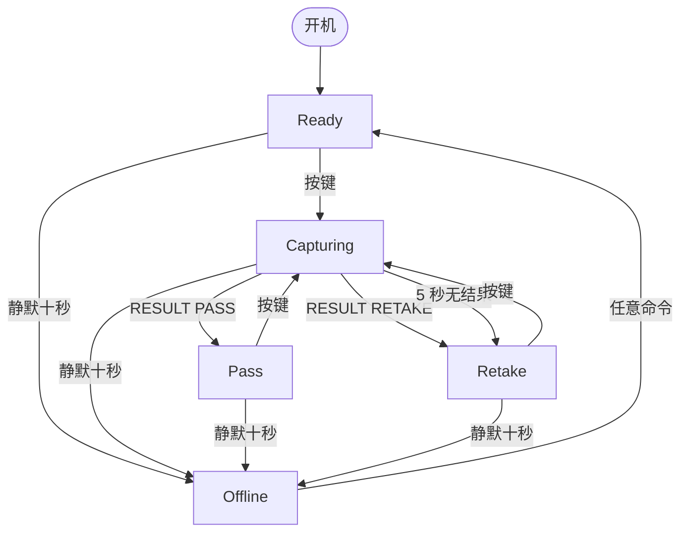

# 装置状态机

> 本文为 `rig-state-machine-en.md` 的中文对照版，以英文版为准。
> 维护人：@FrozenYty · 重审时机：新增屏幕、链路状态或事件时

装置控制器有五个屏幕、两个链路状态。**它们与每个事件的每一种组合都有明确答案**，因为没人写下来的组合正是演示会出问题的地方：第二次按键拍了两张、结果在操作员已经被告知失败之后才到达、链路恢复时把屏幕上的结果悄悄抹掉。

## 一、屏幕

| 屏幕 | 含义 |
|---|---|
| `Ready` | 空闲，等待按键 |
| `Capturing` | 一次采集已发出，结果未回 |
| `Pass` | PC 返回通过，带分数 |
| `Retake` | PC 返回重拍并给出原因，或装置自己放弃等待 |
| `Offline` | 收不到 PC 的保活 |

## 二、链路

两个状态，**装置开机时停在第一个，并带十秒宽限**。

| 链路 | 含义 |
|---|---|
| `Alive` | `cfg::OFFLINE_AFTER_MS` 之内收到过命令 |
| `Gone` | 静默十秒 |

**开机即视为 `Alive`**：计时从通电开始，而线那头的 PC 远在十秒之前就会发出第一次保活。开机就显示 `OFFLINE`，等于屏幕在任何东西有机会说话之前先宣布自己死了——**那看起来是故障，而不是「等待中」**。**丢掉一条活着的链路值得报告；还没有历史不值得。**

代价是诚实且可见的：**桌上那台没有 PC 软件的装置，上电十秒后会变成 `OFFLINE`**——因为那一刻确实没有人跟它说话。

## 三、事件

| # | 事件 | 来源 |
|---|---|---|
| E1 | 按键按下（下降沿，消抖 25ms） | 操作员 |
| E2 | `CMD PING` | PC |
| E3 | `CMD READY` | PC |
| E4 | 格式完整的 `CMD RESULT`（有分数与结论） | PC |
| E5 | 固件不执行的 `CMD` 行（未知动词或缺参数） | PC |
| E6 | 静默十秒 | 链路计时器 |
| E7 | 浊度读数（每 5 秒） | 传感器 |
| E8 | 心跳（1 秒） | 计时器 |
| E9 | 转圈动画（250ms） | 计时器 |

只有以 `CMD` 开头、并且后面带动作的行才算 PC 还活着。不是 `CMD` 开头的行，或只有 `CMD`、后面没有
动作的行，会被完全忽略：既不刷新链路计时器，也不能把 `Offline` 恢复成 `Ready`。

## 四、组合状态

十种组合，其中五种不该存在。右列是禁止它们的**不变式**。

| 屏幕 \ 链路 | `Alive` | `Gone` | 不可能的那种为什么不可能 |
|---|---|---|---|
| `Ready` | 可达 | **不可能** | `Ready` 意味着有 PC 在等按键 |
| `Capturing` | 可达 | **不可能** | 采集需要一个接收方 |
| `Pass` | 可达 | **不可能** | 结果来自 PC，PC 显然在场 |
| `Retake` | 可达 | **不可能** | 同上；而 `NO REPLY` 超时只在 `Alive` 时才会跑 |
| `Offline` | **不可能** | 可达 | 从 `Gone` 恢复会在同一个循环里抬到 `Ready` |

**不变式，只说一次：**

```
Offline  ⇔  Gone          并且          其余一切  ⇒  Alive
```

`rig::invariantHolds` 把它编码下来，主循环每轮检查一次，被破坏就上报 `EVT INVARIANT`。**它从未触发过。** 之前两版草稿在两个相反的方向上错过：一版每次上电十秒后显示 `OFFLINE`，因为它测的是一个从未承诺过的 PC 的缺席；另一版可能让屏幕停在 `OFFLINE` 而链路其实是活的，因为恢复被写在了链路计时器里，而不是 PC 真正说话的地方。

## 五、转移

行是五种可达组合。`-` 表示状态不变；**拒绝**表示状态不变**并且**该事件会上报。

| 组合 \ 事件 | E1 按键 | E2 PING | E3 READY | E4 RESULT | E5 未知 | E6 静默 | E7 浊度 | E8 心跳 | E9 动画 |
|---|---|---|---|---|---|---|---|---|---|
| Ready + Alive | Capturing | Ready | Ready | **拒绝** | Ready | Offline | Ready | Ready | `-` |
| Capturing + Alive | **忽略** | Capturing | Ready | Pass / Retake | Capturing | Offline | Capturing | Capturing | Capturing |
| Pass + Alive | Capturing | Pass | Ready | **拒绝** | Pass | Offline | Pass | Pass | `-` |
| Retake + Alive | Capturing | Retake | Ready | **拒绝** | Retake | Offline | Retake | Retake | `-` |
| Offline + Gone | `-` | Ready | Ready | 拒绝，然后 Ready | Ready | `-` | `-` | `-` | `-` |

E7、E8、E9 从不改变屏幕，只重画。它们列在表里，是因为**在错误的状态下重画本身就是可见缺陷**——结果页上转圈动画不该动。

## 六、规则与理由

**1. 采集在途时忽略按键。** `serviceButton` 只在链路 `Alive` 且屏幕不是 `Capturing` 时才继续。没有这一条，一次按下会变成两帧：PC 拍两张，而操作员只看到一个结果。

**2. 结果只在采集在途时接受。** `handleResult` 在其它任何状态拒绝 `RESULT`，并上报 `EVT STRAY RESULT <分数>`。接受在别处，等于给一张没拍过的照片编一个结果，或者覆盖操作员已经读过的超时提示。**要上报**，因为静默丢弃会让 PC 以为装置收下了——这正是 TCP 收到意外报文时回一个 reset 而非忽略的理由。

**3. 五秒内没有结果就变成重拍，原因 `NO REPLY`。** `serviceCaptureTimeout`、`cfg::CAPTURE_TIMEOUT_MS`。没有这一条，只要 PC 活着能保活但忙得顾不上回话，转圈就会一直转。五秒比十秒的链路超时短，是故意的：操作员该先知道这一张废了，而不是直接被告知整条链路断了。

**4. 保活不碰屏幕。** `CMD PING` 只在**从 `Gone` 转出**、且屏幕是 `Offline` 时才把屏幕抬到 `Ready`。
正在读结果时到达的 `PING` 只刷新链路计时器，不改变任何可见内容。

**5. 掉线覆盖一切。** `serviceLink`。没有 PC，任何屏幕都无法推进，所以静默会从任何状态强制进入 `Offline`。恢复写在 PC 真正说话的地方——`poll`——并且只重置 `Offline` 那一屏。

**6. PC 负责保活。** 串口链路没有载波信号：装置经桥接芯片走 UART，看不到线插没插。所以存活是协议层面的事，义务在 PC 一侧：**至少每两秒发一次 `CMD PING`；十秒静默等于漏掉五次保活，意味着 PC 不在了。** **空闲的装置同样需要被告知**——这就是保活不是装饰的原因；也正因为开机给了同样十秒的宽限，PC 的第一句话一定来得及证明它在。

**7. 每一次转移都上报。** 固件造成的每一次状态变化都发 `EVT SCREEN <名称> <分数>`，包括按键、链路计时器和
开机引起的那些。采集超时先发 `EVT TIMEOUT`（说明为什么换屏），再发 `EVT SCREEN RETAKE -1`（说明换到哪一屏）
——**它曾经是唯一一个例外，后来是被修掉的，而不是被写进文档的**。在这之前，接线问题和逻辑问题从串口上
看不出区别。

**8. 不变式是检查出来的，不是假设的。** 每轮一次比较；违反会变成一行串口日志，而不是一块悄悄撒谎的屏幕。

## 七、状态图



## 八、每次转移对应的串口事件

| 转移 | 事件 |
|---|---|
| 开机 | `EVT HELLO <版本>`、……、`EVT SCREEN READY -1` |
| Offline 收到任意命令 → Ready | `EVT SCREEN READY <分数>` |
| 其它任意屏幕收到 `CMD READY` → Ready | `EVT SCREEN READY <分数>` |
| Ready → Capturing | 先 `EVT SCREEN CAPTURING -1`，再 `EVT TRIGGER <毫秒>` |
| Capturing → Pass / Retake | `EVT SCREEN PASS\|RETAKE <分数>` |
| Capturing → Retake（`NO REPLY`） | 只发 `EVT TIMEOUT <毫秒>`——屏幕已切到 `RETAKE`，但这次转换不发 `EVT SCREEN` |
| 任意 → Offline | `EVT SCREEN OFFLINE <分数>` |
| 被拒绝的 RESULT | `EVT STRAY RESULT <分数>` |
| 不变式被破坏（从未观察到） | `EVT INVARIANT <屏幕> <链路>` |

`EVT SCREEN` 里的分数为 `-1`，表示还没有任何判定，屏幕**没有数字可显示**。链路转换与 `CMD READY` 都
不会重置这个字段：`READY` 与 `OFFLINE` 上它可能仍是上一次判定的分数，而这两屏并不画数字。

## 九、链路的 PC 端

服务端握着同一根线的另一端，**它也有自己的状态机**（`server/app/rig/link.py`）。它比装置那台小，
但写法一样——因为这里的故障是同一种形状：读一半被拔线、往已关闭的端口写、保活线程活过了它所打通的
那个连接。

| 状态 \ 事件 | start | 端口打开 | 打开失败 | 读失败 | 写失败 | stop | 保活 tick | 收到一行 |
|---|---|---|---|---|---|---|---|---|
| `DOWN` | Opening | - | - | - | - | Stopping | - | - |
| `OPENING` | 忽略 | **Open** | 停留并重试 | - | - | Stopping | - | - |
| `OPEN` | 忽略 | - | - | **Opening** 重试 | **Opening** 重试 | Stopping | 发 `CMD PING` | 分发 |
| `STOPPING` | 忽略 | 忽略 | 忽略 | - | - | - | 忽略 | 忽略 |

**两条不变式，都在代码里强制：**

1. **有传输当且仅当状态是 `OPEN`。** 往已关闭的端口写会在那个线程里抛异常，**而一个抛异常的保活线程
   会把整个进程带下去**。
2. **只有 `OPEN` 发保活。** 一个既重连又 ping 的循环，等于两个人往一个端口写。

**这张表当场就挣回了成本**：第一版在写失败时设置了**全局**停止事件，于是读线程被永久结束——**一次不走运
的写，链路再也回不来**。抓到它的是 `test_a_failed_write_takes_the_link_down_and_it_recovers`。

**判定路径不是另一个状态机。** 收到 `EVT TRIGGER` 时，服务端取一帧、用全项目同一个质量门评分，然后回
`CMD RESULT <分数> <结论> <原因>`。**如果采集失败**——没摄像头、设备忙、磁盘满——它**什么都不回**。
装置自己的五秒超时随后报 `RETAKE / NO REPLY`，没有分数，**而这正是事实**；也不需要为装置发明一条新消息。

§6 里 PC 的保活义务在这里兑现：从 `OPEN` 起，每两秒一次，只要端口还握着。
