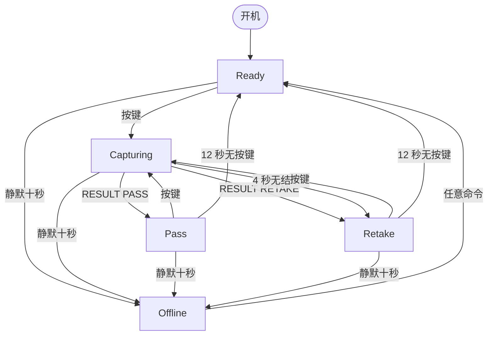

# 装置状态机

> 本文为 `rig-state-machine-en.md` 的中文对照版，以英文版为准。
> 维护人：@FrozenYty · 重审时机：新增屏幕、链路状态或事件时

装置控制器有五个屏幕、两个链路状态。**它们与每个事件的每一种组合都有明确答案**，因为没人写下来的组合正是演示会出问题的地方：第二次按键拍了两张、结果在操作员已经被告知失败之后才到达、链路恢复时把屏幕上的结果悄悄抹掉。

## 一、屏幕

| 屏幕 | 含义 |
|---|---|
| `Ready` | 空闲，等待按键 |
| `Capturing` | 一次采集已发出，结果未回 |
| `Pass` | PC 返回通过，带分数 |
| `Retake` | PC 返回重拍并给出原因，或装置自己放弃等待 |
| `Offline` | 收不到 PC 的保活 |

## 二、链路

两个状态，**装置开机时停在第一个，并带十秒宽限**。

| 链路 | 含义 |
|---|---|
| `Alive` | `cfg::OFFLINE_AFTER_MS` 之内收到过命令 |
| `Gone` | 静默十秒 |

**开机即视为 `Alive`**：计时从通电开始，而线那头的 PC 远在十秒之前就会发出第一次保活。开机就显示 `OFFLINE`，等于屏幕在任何东西有机会说话之前先宣布自己死了——**那看起来是故障，而不是「等待中」**。**丢掉一条活着的链路值得报告；还没有历史不值得。**

代价是诚实且可见的：**桌上那台没有 PC 软件的装置，上电十秒后会变成 `OFFLINE`**——因为那一刻确实没有人跟它说话。

那是协议层自己的屏幕。在 `rig-ble` 上，没有中心设备连着时面板不再画它：表现层（第十一节）把这种情形叫
`Pairing`，面板显示 `APP` 与旋转的第四位，OLED 显示 `WAITING`，因为射频分得开「还没有人来」和「有人来过又走
了」，而协议的 `Gone` 分不开。

## 三、事件

| # | 事件 | 来源 |
|---|---|---|
| E1 | 按键按下（下降沿，消抖 25ms）——按一下就是全部手势，松开不是事件 | 操作员 |
| E2 | `CMD PING` | PC |
| E3 | `CMD READY` | PC |
| E4 | 格式完整的 `CMD RESULT`（有分数与结论） | PC |
| E5 | 固件不执行的 `CMD` 行（未知动词或缺参数） | PC |
| E6 | 静默十秒 | 链路计时器 |
| E7 | 心跳（1 秒） | 计时器 |
| E8 | 旋转步进（250ms），OLED 的点列与面板的段共用同一个相位 | 计时器 |
| E9 | 面板画面步进（自检扫过 25ms、横杠 500ms、旋转与扫过 250ms、闪烁 500ms） | 计时器 |
| E10 | `CMD SCAN` | PC |
| E11 | 判定画面到期（12 秒无新按键） | 计时器 |
| E12 | 采集超时（4 秒无判定） | 计时器 |

只要以 `CMD` 开头、后面带一个词的行都算 PC 还活着，不论固件是否执行那个动词。不是 `CMD` 开头的行，
或只有 `CMD`、后面没有词的行，会被完全忽略：既不刷新链路计时器，也不能把 `Offline` 恢复成 `Ready`。

**`CMD SCAN` 是装配工具，不属于一次运行。** 它让固件从地址 1 走到 126，每有一个器件应答就打印一行
`EVT I2C <地址>`，然后结束。它没有结束标记，所以读取方等的是一个固定窗口而不是终止符，而
**等了多久必须写进它报告的结论里**——窗口太短什么都没找到，和走完整条总线什么都没找到，是两件不同的事。
链路活着时它不改动面板；从 `Offline` 它会像其他任何命令一样把链路恢复过来，因为一条命令**就是** PC
还活着（§5 的 E10）。

## 四、组合状态

十种组合，其中五种不该存在。右列是禁止它们的**不变式**。

| 屏幕 \ 链路 | `Alive` | `Gone` | 不可能的那种为什么不可能 |
|---|---|---|---|
| `Ready` | 可达 | **不可能** | `Ready` 意味着有 PC 在等按键 |
| `Capturing` | 可达 | **不可能** | 采集需要一个接收方 |
| `Pass` | 可达 | **不可能** | 结果来自 PC，PC 显然在场 |
| `Retake` | 可达 | **不可能** | 同上；而 `NO REPLY` 超时只在 `Alive` 时才会跑 |
| `Offline` | **不可能** | 可达 | 从 `Gone` 恢复会在同一个循环里抬到 `Ready` |

**不变式，只说一次：**

```
Offline  ⇔  Gone          并且          其余一切  ⇒  Alive
```

`rig::invariantHolds` 把它编码下来，主循环每轮检查一次，**每个回合只上报一次，一旦配对恢复正常就重新武装**。**它从未触发过。** 之前两版草稿在两个相反的方向上错过：一版每次上电十秒后显示 `OFFLINE`，因为它测的是一个从未承诺过的 PC 的缺席；另一版可能让屏幕停在 `OFFLINE` 而链路其实是活的，因为恢复被写在了链路计时器里，而不是 PC 真正说话的地方。

## 五、转移

行是五种可达组合。`-` 表示状态不变；**拒绝**表示状态不变**并且**该事件会上报。

| 组合 \ 事件 | E1 按键 | E2 PING | E3 READY | E4 RESULT | E5 未知 | E6 静默 | E7 心跳 | E8 旋转 | E9 面板 | E10 SCAN | E11 到期 | E12 超时 |
|---|---|---|---|---|---|---|---|---|---|---|---|---|
| Ready + Alive | Capturing | Ready | Ready | **拒绝** | Ready | Offline | Ready | `-` | Ready | `-` | `-` | `-` |
| Capturing + Alive | **忽略** | Capturing | Ready | Pass / Retake | Capturing | Offline | Capturing | Capturing | Capturing | `-` | `-` | Retake |
| Pass + Alive | Capturing | Pass | Ready | **拒绝** | Pass | Offline | Pass | `-` | `-` | `-` | Ready | `-` |
| Retake + Alive | Capturing | Retake | Ready | **拒绝** | Retake | Offline | Retake | `-` | Retake | `-` | Ready | `-` |
| Offline + Gone | `-` | Ready | Ready | 拒绝，然后 Ready | Ready | `-` | `-` | `-` | Offline | Ready | `-` | `-` |

E7、E8、E9、E10 本身从不改变屏幕：它们只重画，或者——链路活着时的 `CMD SCAN`——让它原样不动。它们
列在表里，是因为**在错误的状态下重画本身就是可见缺陷**——结果页上旋转不该动，判定已经在面板上之后
第四位不该再转，而没有采集也不该冒出判定画面。E10 唯一的例外是 `Offline`：那里一条命令同时就是 PC
回来了。E11 与 E12 是这张表里仅有的两个能自己改变在用屏幕的计时器，而 E12 只在 `Capturing` 里会响。

**故障叠加层在这张表里没有列。** 它压过每一个屏幕，而不是与某个屏幕并列；代价——故障窗口期间到达的
判定会丢掉它的进场动画——写在 §10。

## 六、规则与理由

**1. 采集在途时忽略按键。** `serviceButton` 只在链路 `Alive` 且屏幕不是 `Capturing` 时才继续。没有这一条，一次按下会变成两帧：PC 拍两张，而操作员只看到一个结果。

**2. 结果只在采集在途时接受。** `handleResult` 在其它任何状态拒绝 `RESULT`，并上报 `EVT STRAY RESULT <分数>`。接受在别处，等于给一张没拍过的照片编一个结果，或者覆盖操作员已经读过的超时提示。**要上报**，因为静默丢弃会让 PC 以为装置收下了——这正是 TCP 收到意外报文时回一个 reset 而非忽略的理由。

**3. 四秒内没有结果就变成重拍，原因 `NO REPLY`。** `serviceCaptureTimeout`、`cfg::CAPTURE_TIMEOUT_MS`。没有这一条，只要 PC 活着能保活但忙得顾不上回话，转圈就会一直转。两个保活比五个保活的链路超时短，是故意的：操作员该先知道这一张废了，而不是直接被告知整条链路断了。

**4. 保活不碰屏幕。** `CMD PING` 只在**从 `Gone` 转出**、且屏幕是 `Offline` 时才把屏幕抬到 `Ready`。
正在读结果时到达的 `PING` 只刷新链路计时器，不改变任何可见内容。

**5. 掉线覆盖一切。** `serviceLink`。没有 PC，任何屏幕都无法推进，所以静默会从任何状态强制进入 `Offline`。恢复写在 PC 真正说话的地方——`poll`——并且只重置 `Offline` 那一屏。

**6. PC 负责保活。** 串口链路没有载波信号：装置经桥接芯片走 UART，看不到线插没插。所以存活是协议层面的事，义务在 PC 一侧：**至少每两秒发一次 `CMD PING`；十秒静默等于漏掉五次保活，意味着 PC 不在了。** **空闲的装置同样需要被告知**——这就是保活不是装饰的原因；也正因为开机给了同样十秒的宽限，PC 的第一句话一定来得及证明它在。

**7. 每一次转移都上报。** 固件造成的每一次状态变化都发 `EVT SCREEN <名称> <分数>`，包括按键、链路计时器和
开机引起的那些。采集超时先发 `EVT TIMEOUT`（说明为什么换屏），再发 `EVT SCREEN RETAKE -1`（说明换到哪一屏）
——**它曾经是唯一一个例外，后来是被修掉的，而不是被写进文档的**。在这之前，接线问题和逻辑问题从串口上
看不出区别。

**8. 不变式是检查出来的，不是假设的。** 每轮一次比较，**每个回合只上报一次**：配对一恢复正常就重新
武装，所以这个监视器不会响过一声之后对第二次违反保持沉默。违反会变成一行串口日志，而不是一块悄悄撒谎的
屏幕。

## 七、状态图



## 八、每次转移对应的串口事件

| 转移 | 事件 |
|---|---|
| 开机 | `EVT HELLO <版本>`、……、`EVT SCREEN READY -1` |
| Offline 收到任意命令 → Ready | `EVT SCREEN READY <分数>` |
| 已停在 Ready 或其它任意屏幕收到 `CMD READY` → Ready | `EVT SCREEN READY <分数>`——**无条件发送**，所以一条不改变状态的 `READY` 会把装置已经停着的那一屏再广播一次 |
| Ready → Capturing | 先 `EVT SCREEN CAPTURING -1`，再 `EVT TRIGGER <毫秒>` |
| Capturing → Pass / Retake | `EVT SCREEN PASS\|RETAKE <分数>` |
| Capturing → Retake（`NO REPLY`） | 先 `EVT TIMEOUT <毫秒>`，再 `EVT SCREEN RETAKE -1` |
| Pass / Retake → Ready（判定画面到期） | `EVT SCREEN READY <分数>` |
| 任意 → Offline | `EVT SCREEN OFFLINE <分数>` |
| 被拒绝的 RESULT | `EVT STRAY RESULT <分数>` |
| 不变式被破坏（每个回合报一次） | `EVT INVARIANT <屏幕> <链路>` |

`EVT SCREEN` 里的分数为 `-1`，表示还没有任何判定，屏幕**没有数字可显示**。链路转换与 `CMD READY` 都
不会重置这个字段：`READY` 与 `OFFLINE` 上它可能仍是上一次判定的分数，而这两屏并不画数字。

## 九、链路的 PC 端

服务端握着同一根线的另一端，**它也有自己的状态机**（`server/app/rig/link.py`）。它比装置那台小，
但写法一样——因为这里的故障是同一种形状：读一半被拔线、往已关闭的端口写、保活线程活过了它所打通的
那个连接。

| 状态 \ 事件 | start | 端口打开 | 打开失败 | 读失败 | 写失败 | stop | 保活 tick | 收到一行 |
|---|---|---|---|---|---|---|---|---|
| `DOWN` | Opening | - | - | - | - | Stopping | - | - |
| `OPENING` | 忽略 | **Open** | 停留并重试 | - | - | Stopping | - | - |
| `OPEN` | 忽略 | - | - | **Opening** 重试 | **Opening** 重试 | Stopping | 发 `CMD PING` | 分发 |
| `STOPPING` | 忽略 | 忽略 | 忽略 | - | - | - | 忽略 | 忽略 |

**两条不变式，都在代码里强制：**

1. **有传输当且仅当状态是 `OPEN`。** 往已关闭的端口写会在那个线程里抛异常，**而一个抛异常的保活线程
   会把整个进程带下去**。
2. **只有 `OPEN` 发保活。** 一个既重连又 ping 的循环，等于两个人往一个端口写。

**这张表当场就挣回了成本**：第一版在写失败时设置了**全局**停止事件，于是读线程被永久结束——**一次不走运
的写，链路再也回不来**。抓到它的是 `test_a_failed_write_takes_the_link_down_and_it_recovers`。

**判定路径不是另一个状态机。** 收到 `EVT TRIGGER` 时，服务端取一帧、用全项目同一个质量门评分，然后回
`CMD RESULT <分数> <结论> <原因>`。**如果采集失败**——没摄像头、设备忙、磁盘满——它**什么都不回**。
装置自己的四秒超时随后报 `RETAKE / NO REPLY`，没有分数，**而这正是事实**；也不需要为装置发明一条新消息。

§6 里 PC 的保活义务在这里兑现：从 `OPEN` 起，每两秒一次，只要端口还握着。

## 十、四位数码管

**节奏是一条规则，而不是一组数字：正在工作的以稳定节奏走，失败了的以警示节奏闪，而台面仪器上的任何
东西都不超过大约 1 Hz。** 下面的每一个速度都从它推出来：`RETAKE` 与每一个故障代码都以 1 Hz 闪烁，所以
代码与分数是靠它写的内容分清的，不是靠节奏。

**面板是四位数字、复用驱动，也是台架前的人不看 OLED 时读装置的地方。** 共阳数码管把 A-G 段接在 GPIO 3、
13、14、15、16、17、18 上，每段各串一只 240 Ω；四位公共端直接接 GPIO 5、6、7、10。按键在 GPIO 4，
OLED 在 I2C 的 GPIO 8 与 9 上。十只灯排和三盏状态灯都已不在：它们占的引脚现在是这些公共端，而一条
从未出货的灯排不值得维护。

**任何时刻只能有一条公共端为高，这就是全部驱动规则。** 公共端为高选中它这一位，段引脚为低点亮该段，
所以电流从公共端流出、经过 LED 与该段自己的 240 Ω、进入段引脚。公共端不串电阻，是因为它承受的是这一位
上各段电流之和——也正因为如此，只能选中一条：两条公共端同时为高，会让两位数字经由同一组电阻以一半亮度
点亮，面板读起来就是一团糊，而不是数字。

**复用器住在硬件定时器里，不在主循环里。** 每 250 µs 一位，整个画面约 1 kHz 刷新。第一版由主循环驱动
面板，结果是闪：一次 OLED 传输会把主循环堵住 20-25 ms，在这整段时间里最后选中的那一位以满占空比亮着，
其余三位全黑。现在主循环只发布每一位该显示什么段码——四个字节，在临界区里复制，中断永远读不到写了一半的
画面——定时器中断把一份段码变成四次 GPIO 寄存器写。主循环做什么都堵不住面板，主循环慢下来只会让画面走
得慢，而不是把它冻住。

**画面只按自己的年龄走。** 开机序列结束与任何一次换屏都会把这个年龄从零开始，所以没有任何画面会继承
上一块面板的相位；故障的年龄也是它自己的相位，所以闪烁随故障开始。两块屏读同一个开机时钟：OLED 把开机
画面一直压到面板两秒自检结束，两者一起进入 `Ready`。这道钳位是因为一个真实缺陷才有的：没有它，空闲周期
会从自检停下的地方接着走，于是每次上电后的第一条横杠落在第 2 位而不是第 1 位——其他画面也会以同样的方式
继承相位。

| 屏幕 | 画面 | 时序 |
|---|---|---|
| 开机 | 逐段扫过全部 28 个位置，然后 `8888`，然后全灭 | 每位置 25 ms（共 700 ms）、300 ms 的 8、1000 ms 全灭：共 2 秒，只做一次 |
| `Ready` | 一条横杠（只有 G 段）走过第 1、2、3、4 位，然后从第 1 位重新开始 | 每位 500 ms，一周期 2 秒 |
| `Capturing` | `CAP`，第四位上有一段沿边框转圈 | 每步 250 ms |
| `Pass` | 从左到右扫过一次，然后分数右对齐占第 1-3 位、`P` 占第四位：` 95P` | 进场扫过 250 ms，随后常亮 |
| `Retake` | 分数与 `F`，整块面板闪烁：` 40F` | 1 Hz |
| `Offline` | 代码 `Err0`，闪烁 | 1 Hz，且没有窗口：链路不在多久它就多久 |
| 故障 `Err1` | 采集超时，闪烁 | 1 Hz，持续 2 s |
| 故障 `Err2` | 无对应采集的判定，闪烁 | 1 Hz，持续 2 s |
| 故障 `Err3` | 不变式被破坏，闪烁 | 1 Hz，持续 2 s |

**`Ready` 是一条单向走带：第 1、2、3、4 位，然后直接回到第 1 位，每位半秒，一周期两秒。** 没有任何一帧
是全黑的，也没有任何一帧同时亮着两条横杠——这是结构决定的，不是调出来的。**这个回绕是故意的**：横杠在
第 1 位重新开始，而不是掉头往回走，所以这一屏是一条带可见断点的传送带，`config.h` 里有一条注释写着不要
把它"修"成来回弹。更早的版本是四条横杠一起保持一秒；走带取代了它。它也不会被误认成 `Offline`，因为那一屏
是一个代码。

**`Err0` 是 `Offline` 这一屏，`Err1`-`Err3` 是故障窗口，而四个看起来一样。** 每个代码都以 1 Hz 闪烁
——代码就是标识，节奏不携带信息，所以没有第二种频率，链路也没有特例。不同的只有画面停留多久：`Err0`
没有窗口，因为掉线会一直持续到链路回来，而 `Err1` 到 `Err3` 在两秒后清除。那是它什么时候离开，不是它
长什么样。三个窗口存在，是因为那些事件过去只产生一行日志、人眼看不到任何东西，于是一台坏掉的装置和一台
空闲的装置长得一样——而掉线本来就是故障，所以给它的屏幕编号是诚实而不是绕路。

**重拍读 `F`，不是 `E`。** `E` 是每一个故障代码的开头，` 40E` 与一个 `Err` 画面只差一眼；`F` 是左列
加上上横与中横，任何代码里都没有它。

**判定是结论，不是永久标签。** `Pass` 与 `Retake` 在没有新按键 12 秒之后回到 `Ready`——六个保活，
也就是 `OFFLINE_AFTER_MS` 加一个。这个关系正是要点：判定有意活得比失联阈值更久，所以链路一定会先被
报出来，判定才会自己消失。往前走过什么都不丢，因为 OLED 的计数留着本次会话、PC 留着记录；`Offline`
被故意排除在外，因为掉线是故障，而不是完成。

**没有彩排了，按键只有一个含义。** 按一下就在按下沿发起一次采集，松开根本不是事件，所以故障画面只在它
的事件真的发生时出现：没有东西出故障的台架上永远看不到 `Err1` 到 `Err3`，而 `Err0` 需要 PC 静默十秒。
串口日志是这些事件另一个可见的地方——`EVT TIMEOUT`、`EVT STRAY RESULT`、`EVT INVARIANT`——这也是它们
既上报又显示的原因。

**有两件事这张表没有维度，两者都是故意的。** 故障窗口压过每一个屏幕，所以在窗口期间到达的判定会在底下
换屏、而故障画在它上面：等故障清掉，`Pass` 那 250 ms 的进场扫过早就过期了——进场动画是**被吃掉，而不是
被推迟**。而未知分数——`-1`，也就是一次没有回音的采集——画成**空白加结论字母**，绝不是零：一次
`NO REPLY` 重拍读作 `   F`，不是 `  0F`，因为在超时旁边写一个 0，恰好编造了这次超时声称缺失的那个数字。
同一个分数下 OLED 不画任何数字，所以两块屏是一致的。

**字母表是数字，加上 `A`、`C`、`E`、`F`、`P` 和一个小写 `r`。** `r` 只为 `Err` 这一个词而收，故障
代码就是由它拼成的，它也是唯一被画出来的小写字母；`-` 是只有 G 段的那条空闲横杠。表里的每一个字符都有
一个真实存在的画面在显示它，因为一个没人用的表项，就是下一个人断定「这个字符可以画」的依据。这个集合
之外的字符要么与数字混淆——`O` 是 `0`、`S` 是 `5`、`I` 是 `1`、`G` 像 `6` 和 `9`——要么根本画不出来，
比如 M、W、K、V、X、Y、Z。把词转写成代码：故障写成 `Err1` 而不是 `TIME`，就是这个原因。

**每一个状态间隔都是 `cfg::PC_KEEPALIVE_MS`（2 秒）的整数倍。** 它们被有意写成它的乘积：保活一变，
它们全都得跟着变，而那是 `config.h` 里唯一一个不能单独改的数字。

| 保活个数 | 间隔 | 计的是什么 |
|---|---|---|
| 1 | 2 s | 一个故障窗口 |
| 2 | 4 s | 采集超时 |
| 5 | 10 s | 失联判定 |
| 6 | 12 s | 判定画面 |

**每一个画面间隔都是 `cfg::DISPLAY_UNIT_MS`（25 毫秒）的整数倍**，同样写成乘积：每一个除以二十五都是
整数。250 µs 的位周期属于另一个域——那是微秒级的硬件数字，不是画面间隔——25 ms 的按键消抖也不是：那个
数字相同只是巧合，不是同一套东西。

| 单位数 | 间隔 | 计的是什么 |
|---|---|---|
| 1 | 25 ms | 自检扫过的一个位置 |
| 10 | 250 ms | `Pass` 的进场扫过、`Capturing` 的一次旋转步进 |
| 12 | 300 ms | 定格的 `8888` |
| 20 | 500 ms | `Ready` 的一步横杠、`Retake` 或代码的半个周期 |
| 28 | 700 ms | 完整 28 个位置的自检扫过 |
| 40 | 1000 ms | `8888` 之后的全灭 |
| 80 | 2 s | 一个故障窗口、完整的 `Ready` 周期 |

## 十一、表现层：第三台状态机，而不是合并

装置现在有**三台**状态机，第三台之所以存在，是因为前两台合起来也回答不了一个问题：**此刻应该有一个 PC 在吗？**
BLE 层知道是否有中心设备连着（`docs/rig-transport-zh.md` §3-§5）；协议层知道对方是否已经十秒没说话（§2）。
“连着但不说话”与“根本没人来过”不是同一件事，而协议层分不开它们，因为 `Gone` 是它给两者共用的词。表现层读这两台，
并且只拥有一样东西：两块屏该画哪张脸。它**不是合并**——BLE 层与协议层保留各自的状态、各自的时钟和各自的矩阵，
线上的东西一点没变。它就是传输文档 §2 拒绝合并前两层时，要求存在的那个第三方读者。

上电时装置根本没有载波，十秒后协议层报 `Gone`。在这台状态机之前，这两件事会在一切正常的装置上画出 `Err0`——
一张闪烁的故障脸；随后第一次连接又把面板翻成 `READY`，看起来像刚才那一下按键起了作用。**装置在扫描期间不可能知道
有没有人要来，所以诚实的标签是“等待”，不是“坏了”。** `WAITING` 说的就是事实：装置已经就绪，只是还没有 PC。

### 11.1 状态与事件

| 状态 | 含义 |
|---|---|
| `Pairing` | 没有中心设备连着 |
| `NoLink` | 中心设备已连接，但协议层是 `Gone`；`B2` 还没有把它变成 `Live` |
| `Live` | 中心设备已连接，且协议层是 `Alive` |
| `RadioFault` | 射频没能启动，或掉线风暴到达 `Fault` |

| # | 事件 | 来源 |
|---|---|---|
| B1 | 一个中心设备连上 | BLE 层 |
| B2 | 通知订阅完成 | BLE 层 |
| B3 | 中心设备断开 | BLE 层 |
| B4 | 射频没能启动，或掉线风暴到达 `Fault` | BLE 层 |
| P1 | 一条命令到达 | 协议层 |
| P2 | 十秒静默 | 协议层 |

`B1` 进入的是 `NoLink`，把它推进 `Live` 的是 `B2`：一个已经连上、但还没有打开通知的中心设备，还没有证明有人
会说话，所以它暂时拿不到 `Live` 那张脸。`Live` 里的 `B2` 被忽略——订阅本来就开着；那里的 `B1` 则被拒绝，因为
第二个中心设备不能重画一块屏幕。

### 11.2 迁移矩阵

四种单元格就是传输文档 §4 定义的那四种，词汇是刻意共用的：**加粗的状态**是一次迁移；`—` 是**忽略**，表示这个事件
动不了这一层；`handled in place` 是就地处理，消费掉但不换状态；`rejected` 保持状态**并且**上报，因为发送方必须知道
它被拒绝了；`already here` 是就地处理的一种，它的全部意义就是当前状态已经这么说了。

| 状态 \ 事件 | B1 连上 | B2 订阅 | B3 断开 | B4 故障 | P1 命令 | P2 静默 |
|---|---|---|---|---|---|---|
| `Pairing` | **`NoLink`** | — | — | **`RadioFault`** | — | — |
| `NoLink` | — | **`Live`** | **`Pairing`** | **`RadioFault`** | **`Live`** | already here |
| `Live` | rejected | — | **`Pairing`** | **`RadioFault`** | handled in place | **`NoLink`** |
| `RadioFault` | — | — | — | handled in place | — | — |

### 11.3 每个状态画什么

| 状态 | OLED | 七段数码管 |
|---|---|---|
| `Pairing` | `OFFLINE` 的脸换成标题 `WAITING`，没有任何动画 | `APP`，第四位在六段边框上旋转 |
| `NoLink` | `OFFLINE` 反色框 | `Err0` |
| `Live` | 装置自己的屏幕 | 装置自己的画面 |
| `RadioFault` | `RADIO FAULT` / `REFLASH RIG-SERIAL` | `Err4` |

**`Pairing` 的面板脸是 `APP` 加一个旋转的第四位。** `A`、`P`、`P` 都在字符集里，所以这个词不需要新字形，而且它
命名的是操作员即将打开的 PC 端应用——正是这个状态在等的动作。第四位以与 `CAPTURING` 相同的 250 ms 步长、通过同一个
`presentation::rotationStep` 走过边框六段 A-F。两半都是这块面板已经在别处画过的东西，这正是重点：词说明该做什么，
旋转说明装置还在工作。这是有意选的小设计。

**环被删掉，是因为它的表是错的，而它的测试方式让这个错留了下来。** 那个环是 `RING_DIGIT`/`RING_SEGMENT` 里的十二个
（位，段）对；其中两项画的是第四位的底边，没有任何一项画第一位底边，所以玻璃上一个位置从不出现、另一个停留过久。
测试拿这张表与同一张表的转写比对——在同一处错掉的副本会同意它自己。替代物**根本没有位置表**：步进来就是
`1u << step`，六个单独位，位移没有条目可以写错。检查现在断言定义而不是黄金副本——六个位置、六段互不相同、没有重复、
由从脸的年龄算出的步进驱动。

**OLED 就是 `OFFLINE` 的脸换了字，没有移动元素。** `WAITING` 与 `OFFLINE`、`RADIO FAULT` 由同一个
`drawStatusFace` 画出：同样的反色框、同样的 `AQUAVISION` 页眉、同样的标题基线、同样的正文行，以及同样的
Helvetica 粗体 12 标题。它取代的十二格进度行暗示了一种并不存在的进度，而误导性的指示比没有更糟；这块屏无法靠动画
变得像其余几张一样强，所以它借用已经很强的那套语言。**标题是 `WAITING` 而不是 `WAITING FOR PC`，原因是字符数，
不是字体**：十三个字符在 128 px 面板上放不进粗体 12，而为塞下它们缩小字号，正是这张脸在 `OFFLINE` 旁边显得空的
原因。七个字符的标题用房内字号，加上正文行 `NO LINK TO PC`，读作“在等——还没有连上”，与 `OFFLINE` 用的是同一种
短标题加正文的结构。于是这两张脸除文字外无法区分，这正是重点：两件不同的事，用同一种语气说。

**旋转从脸的年龄读出，绝不累加。** `presentation::rotationStep` 就是
`(faceAge / cfg::DISPLAY_ROTATE_MS) % cfg::DISPLAY_ROTATE_STEPS`，每轮重算，所以一次跑久的迭代会追上，而不是丢掉
一步。它与 `CAPTURING` 调用的是同一个函数，所以两张脸不可能落在不同的步或不同的时钟上。OLED 上没有任何逐步工作：
等待脸是静态的，进入时发一次；面板掩码照旧由 `serviceDisplay` 发布。

`NoLink` 在两块屏上就是原来的 `Offline` 脸，因为它表达的还是原来的事：**有 PC 来过，然后走了**。这值得上报，
而且它与 `Pairing`——从来没有 PC 连上——是不同的事实。`OFFLINE` 框的第二行随构建而变：`rig-ble` 是
`NO LINK TO PC`，`rig-serial` 是 `CHECK USB CABLE`（传输文档 §10）。

### 11.4 规则

**1. 表现层压过屏幕。** 在它不是 `Live` 时发生的换屏是**丢弃，不是推迟**：表现层的脸盖在装置屏幕之上，这次变化不会
重放；等回到 `Live` 时，两块屏画的是装置**当前**的屏幕，而不是它不在时发生的那次变化。这与 §10 对“故障窗口期间到达的
判定”所做的选择相同——被吃掉，而不是被推迟——在这里也是诚实的：装置没有 PC 时到达的判定，不是现在这个 PC 发来的。
尤其是，`Pairing` 期间到达的 `PASS` 会丢掉进场扫过，绝不会把分数画到 `WAITING` 上面。

**2. `Pairing` 画 `APP` 加一个旋转的第四位，这正是修复本身。** 装置确实已经就绪，不同的只是链路细节。于是面板不再在
一切正常的装置上显示 `Err0`，第一次连接也不再把它翻成 `READY`、像是刚才那一下按键造成的。词说出状态是什么，旋转说明
装置还在工作；两半都是这块面板已经画过的东西。第一版试过把 `Ready` 走带反过来走，台架否掉了，因为两条横杠朝相反方向
移动，一眼看去没有区别。

**3. `NoLink` 是一份报告，不是一次重试。** 中心设备连着，但协议层是 `Gone`，也就是 PC 在却不说话——原来的
`OFFLINE`/`Err0` 脸完全正确。`NoLink` 里的 `P2` 是 “already here”：事件被消费，脸不变。`P1` 是“另一端确实有人”的
证据，把它推进 `Live`。

**4. 只有 `RadioFault` 压过表现层。** `Err1` 到 `Err3` 是屏幕的故障窗口，只在脸是 `Live` 时画；射频死掉（`B4`）会
用 `Err4`/`RADIO FAULT` 替换每一张脸并留在那里，因为等待对它是错误的回应（传输文档 §10）。`B4` 在同一次故障产生的
`B3` 边沿之前应用，所以已经坏掉的射频不会在它自己的故障背后把表现层带回 `Pairing`。

**5. `Live` 里的 `B1` 是被拒绝的，而拒绝由 BLE 层上报。** 第二个中心设备不能重画一块正在工作的屏；BLE 层已经把它
断开了（它的规则 1），这个单元格保证表现层不会跟着它走。这是一个防御性单元格——这一层永远看不到第二次连接——它存在
是为了把规则放进表里，而不是放进注释里。

**6. 串口构建没有载波信号，所以永远不会出现 `Pairing`。** UART 看不到线有没有插上（传输文档 §2），所以
`transport::attached()` 永远回答真：`rig-serial` 以 `Live` 起步（协议层已经是 `Gone` 时则是 `NoLink`），静默十秒后
进入 `NoLink`，面板行为与以前一致。这是那条线诚实的边界，不是缺了一个状态。

**7. 表现层不是 `Live` 时，按键被拒绝。** 采集需要一个 PC 来接收；否则协议的开机宽限期会让一次按键在无人连接时启动
一帧，并把它画到之后先连上的那个 PC 上。什么都不发生，也什么都不画——这才应该是“没有地方可以发触发”的样子。

**8. 线上协议没有动。** 没有新事件、新命令或新行格式。`Pairing` 期间协议层仍可能在十秒到期时发出 `EVT SCREEN
OFFLINE`；面板照样画 `APP`，因为表现层压过屏幕。没有中心设备在读那一行，而“订阅时告诉 PC 当前屏幕”的既有规则也
没有变。

**9. `Pairing` 是一个词加一个旋转，两者都没有位置表。** 面板画 `APP`，第四位走过六段；步进就是
`1u << presentation::rotationStep(faceAge)`，与 `CAPTURING` 调用同一个函数，所以两张脸不可能在步或时钟上不一致。
它取代的环是十二项的表，一个错对同时让某一位的底边重复、另一位的底边消失；**位移没有条目可以写错**，所以替代物是
算术而不是修正过的表。测试断言定义——六个位置、六段互不相同、没有重复、由脸的年龄算出——而不是一份可能与自身错误
一致的转写。

**10. 这一层里别的任何东西都不许重画整帧。** 等待脸是静态的：进入 `Pairing` 时画一次，之后从不逐步重画，所以唯一
能重画它的就是别处来的脏标记。心跳只在表现层是 `Live` 时才标脏，因为页眉那个点只存在于装置自己的屏幕上；在
`Pairing` 里标脏会为一张根本没变的屏每秒发一次 1184 字节的整帧。这条规则覆盖以后任何动画：如果某张脸多了移动元素，
它必须从时钟算相位、说明由谁重画，而且绝不能是心跳。
