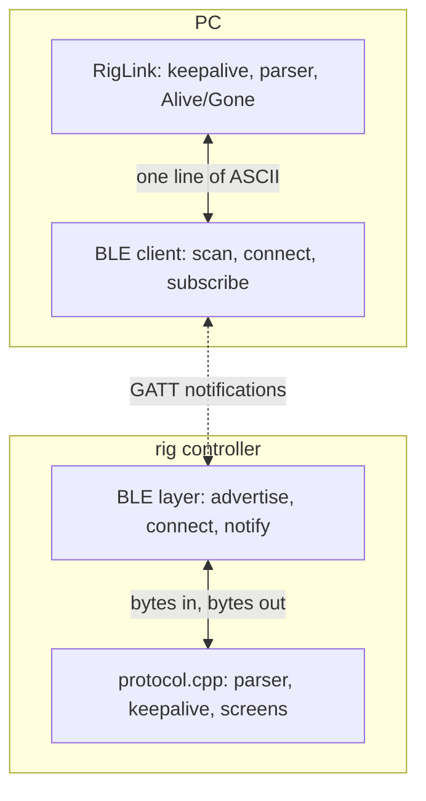

# Rig transport: the wire that carries the same language

> Chinese version: [rig-transport-zh.md](rig-transport-zh.md). This file is the source of truth.

> Owner: @FrozenYty · Revisit when: a transport, a BLE state or a timeout is added

The rig and the PC already agree on a language: line-oriented ASCII, `CMD` in one direction and `EVT` in the
other, with `Alive`/`Gone` and the five screens written out in
[rig-state-machine-en.md](rig-state-machine-en.md). This document is about the **wire** that carries that
language, and only the wire: how the finished rig reaches the PC with no cable, what each end does when the
wire is not there, and what a person standing in front of the rig sees when it fails.

Two seams already exist and are used rather than replaced. The firmware reaches the wire through
`firmware/main/src/transport.h` and `transport.cpp` and through nothing else; `protocol.cpp` emits and parses
lines without knowing which carrier is under it. On the PC, `server/app/rig/link.py` declares `Transport` as a
`Protocol` and takes an `open_transport` factory. **The transport changes; the language does not.** No line,
no state and no timing of the protocol moves in this work.

## 1. The constraint, and the consequence

**The site's network is a campus network, and the rig cannot join it.** It is either WPA2-Enterprise or a
browser portal, and both need machinery an ESP32-S3 does not carry: the first wants an 802.1X supplicant with
an identity and a certificate behind it, the second wants a browser to open the portal's page and authenticate.
Neither is a line of configuration; both are a second product living in the firmware, with credentials that
expire and a failure mode that appears only on the day.

| To join this network you need | WPA2-Enterprise | Browser portal | BLE |
|---|---|---|---|
| a network name known in advance | yes | yes — the portal's, which the machine learns from a redirect | none |
| credentials | an identity and a password, or a client certificate | none until the browser is opened | none |
| a browser on the joining device | no | **yes, and the rig has none** | no |
| extra firmware, or a second device | an 802.1X supplicant, a certificate store and a clock that is roughly right | a captive-portal client willing to be redirected and then authenticated | nothing beyond the stack the S3 already ships |
| who else can interfere with the link | the campus RADIUS, DHCP and the access point's own policy | the portal's session lifetime | nobody: the link is between the two devices |
| what the PC needs | a network port | a network port | **a BLE adapter, which has to be checked (§12)** |

So the choice is not a preference between two good options. **BLE is the only one of the three that works
without borrowing machinery the rig does not have**: no network, no SSID, no password, no adapter on the rig's
side, and nothing that an administrator can rotate between the rehearsal and the demonstration. A rig that
needs a certificate or a portal page to be talked to is a rig that stops working when the certificate is
renewed or the portal's page changes, and neither event is one this project controls.

The cost is stated now rather than discovered later: BLE is slower than a cable, its connection setup is
slower still, and it gives the PC one point-to-point link with no routing. None of that matters for a line of
at most forty bytes every two seconds. All of it would matter if the rig ever carried images, which is the
first thing to check before extending this design (§12).

## 2. Two layers, not one

The finished rig has **two** state machines where the serial rig has one, and they must not be merged.

| Layer | Owns | Changes | Its states | It must not know |
|---|---|---|---|---|
| BLE | the connection and the notification subscription | once at power-up, once per drop | the five firmware states of §3, the seven PC states of §6 | what a command means |
| protocol | the keepalive, `Alive`/`Gone`, the parser, the four-second capture timeout | constantly — every two seconds | `Alive` and `Gone` over the five screens | which wire it is on |

The BLE layer changes when the radio gains or loses a peer. The protocol layer changes every time the PC
speaks or stops speaking. Those are different events on different clocks, and writing them as one state is not
a simplification — it is a different product, answering one of two questions with one answer:

- **A PC that stops sending commands has not dropped the connection.** The link layer keeps an idle
  connection alive with empty packets, so the radio still reports a peer while the rig's keepalive rule has
  already declared the PC gone.
- **A connection that drops does not mean the PC is dead.** The PC may be running, watching, and about to
  reconnect within a second; what failed is the radio, not the operator's software.

Merged into one state, a transition has to choose between "reconnect" and "resume talking", and neither
corresponds to anything real: reconnecting to a PC that never left, or resuming a conversation with a radio
that is not there. The rig would either flash `Err0` for a two-second radio hiccup, or keep drawing `Ready` on
a rig nobody can reach.

There is a second reason the two must stay apart: **the serial link never had a carrier signal.** The rig
talks UART through a bridge chip and cannot see whether the cable is plugged in, so liveness has always been a
protocol matter (rig-state-machine-en.md §6). BLE *does* have a carrier: the stack reports a disconnect whether
or not the application is watching. That is a fact the serial rig never had, and the BLE layer is where it
belongs. It is not the protocol's `Gone`, and it does not replace it.



## 3. Firmware: the BLE layer's states and events

Five states. `Idle` and `Advertising` are the only ones with no peer; `Fault` is the only one that does not
recover on its own.

| State | Meaning |
|---|---|
| `Idle` | the stack has not been started, or was torn down after a fault and is not being retried |
| `Advertising` | the stack is up and offering the service; no central is attached |
| `Connected` | a central is attached and has not enabled notifications |
| `Streaming` | notifications are enabled; the protocol rides here |
| `Fault` | the radio did not start, or it has dropped repeatedly; nothing is retried inside this layer |

| # | Event | Source |
|---|---|---|
| F1 | a central connects | radio |
| F2 | the central disconnects | radio |
| F3 | the central enables notifications on the rig's characteristic | radio |
| F4 | the central disables them | radio |
| F5 | a command line arrives and the protocol layer applies it | protocol layer |
| F6 | the connection idle timer expires | timer |
| F7 | the radio fails to initialise | the stack |

F5 is listed here on purpose even though this layer does not parse anything: its cell in §4 is the one that
says a command is **not** a BLE event, and a rule that appears in no cell is a rule nobody can check.
Whether the timer of F6 is running depends on the state, and not on the event.

## 4. Firmware: the transition matrix

Each cell is one of four things: **a target state**; **handled in place**, meaning the event is consumed and
the state does not change, because something happened that is not a transition; **ignored**, meaning the event
cannot move this layer and is not reported; or **rejected**, meaning the state does not change *and* the event
is reported, because the sender has to learn that it was refused. A cell that names a state in bold is the
reason the row exists.

| State \ Event | F1 connect | F2 disconnect | F3 subscribe | F4 unsubscribe | F5 command | F6 idle timeout | F7 init failure |
|---|---|---|---|---|---|---|---|
| `Idle` | ignored | ignored | ignored | ignored | ignored | ignored | **`Fault`** |
| `Advertising` | **`Connected`** | ignored | ignored | ignored | ignored | ignored | **`Fault`** |
| `Connected` | **rejected** | **`Advertising`** | **`Streaming`** | ignored | ignored | **`Advertising`** | **`Fault`** |
| `Streaming` | **rejected** | **`Advertising`** | handled in place | **`Connected`** | handled in place | ignored | **`Fault`** |
| `Fault` | ignored | ignored | ignored | ignored | ignored | ignored | handled in place |

## 5. The rules the matrix encodes

**1. Only one central at a time.** F1 in `Connected` or in `Streaming` is **rejected and reported**. Two
carriers feeding one parser is not a second client: it is two `CMD RESULT` lines for one capture, two
`CMD READY` broadcasts to different peers, and a parser with no way to tell which central is the PC. The
refused central is told rather than ignored, because a client that believes it subscribed will wait for
notifications that are going to somebody else.

**2. A client that connects and never subscribes is dropped after ten seconds.** The timer of F6 is armed by
**F1** and disarmed by **F3**. Without it, one idle client holds the rig and the real PC can never get in,
and the rig looks broken in the only way that is impossible to diagnose from the panel. Ten seconds is five
`cfg::PC_KEEPALIVE_MS` units, the same unit as every other state interval in `config.h`, and it is
deliberately longer than the PC's own five-second subscription timeout (§9) so that in the ordinary failure
the PC's timer fires first and the operator reads a PC-side timeout rather than a rig-side eviction.

**3. A command does not change the BLE state.** F5 in `Streaming` is handled in place: the bytes were handed
over, the protocol layer applied the line, the keepalive is fresh, and the BLE state is untouched. The rule is
trivial and that is exactly why the cell exists — a handshake that reset on every command would drop the
connection every two seconds, and an implementation that treated `CMD PING` as "the client is alive, keep it"
would have re-invented the merge this document forbids.

**4. The idle timer is not a liveness check.** If it also ran in `Streaming`, a PC that stopped sending
commands would be dropped, which is rule 3 contradicted by a timer. A PC that actually crashed is dropped by
the stack's own link supervision timeout, which runs whether or not this layer watches it; the idle timer
exists for the other case — a peer that attached and then did nothing.

**5. A drop storm is a fault, not a retry — but only a drop that interrupts a conversation.** A disconnect **from `Streaming`** lands in `Advertising`, five times. A disconnect from `Connected` is a polite goodbye — the client unsubscribes before it leaves — and is not counted: five ordinary sessions of a person plugging a script in and out must not fault the rig. The fifth such disconnect
inside sixty seconds (thirty keepalives) moves the layer to `Fault` instead. The cell stays `Advertising` and
this rule carries the count, because a state × event table with a counter in every cell stops being readable.
A radio that drops five times a minute is not a link that a sixth attempt will fix, and the PC's own attempt
budget (§7) is the same decision taken from the other end.

**6. `Idle` becomes `Advertising` once, at boot.** It is not in the matrix because it is not an event: nothing
else causes it, no other state can be entered from `Idle`, and a stack that starts successfully has exactly
one thing to do. The alternative — an `init success` column with one non-empty cell — would hide the fact
that this is the only unconditional transition in the layer.

**7. `Fault` is left by a power cycle, not by the stack.** The layer stops retrying, and F7 in `Fault` is
handled in place rather than starting another attempt: a re-init loop inside a radio that has already refused
to start is a loop that turns a dead radio into a slow one, and it hides the fault behind motion. A rig showing
`Err4` needs a person, and that person has two cheap moves — power-cycle it, or flash `rig-serial` (§11).

**8. The protocol layer is untouched.** No new line, no new state, no new timing: `Alive`/`Gone`, the
two-second keepalive, the ten-second offline threshold, the four-second capture timeout and the five screens
all stay exactly as `rig-state-machine-en.md` records them. The only seam that moves is `transport.h`, which
has to be able to say that the radio did not start (§8) — a return value, not a new state machine.

## 6. PC side: the BLE client's states and events

Seven states, and `Failed` is one of them.

| State | Meaning |
|---|---|
| `Disconnected` | no link and none being attempted: before the service starts, or after it stops |
| `Scanning` | looking for the rig's advertisement, up to twenty seconds |
| `Connecting` | a GATT connection is in progress, up to twenty seconds |
| `Subscribing` | connected, waiting for the rig to acknowledge the notification subscription |
| `Streaming` | notifications enabled and arriving; the protocol layer is talking |
| `Reconnecting` | an attempt failed; waiting out the backoff before the next one |
| `Failed` | the attempt budget is spent. **This state exists on purpose** |

| # | Event | Source |
|---|---|---|
| C1 | a link is requested | service or operator |
| C2 | the rig appears in a scan result | radio |
| C3 | the scan window expires with nothing seen | timer |
| C4 | the GATT connection is established | radio |
| C5 | the connection attempt fails, or its timeout expires | radio or timer |
| C6 | the rig acknowledges the subscription | radio |
| C7 | the subscription timeout expires with no acknowledgement | timer |
| C8 | one line arrives from the rig | radio |
| C9 | the link drops: a disconnect, or notifications stop | radio |
| C10 | the backoff timer expires | timer |

C8 is listed for the same reason F5 is: this layer does not parse the line, and its cell says so.

## 7. PC side: the transition matrix

The four kinds of cell are the ones defined in §4. The vocabulary is shared on purpose — the two ends fail
the same way, and a reader who has understood one matrix has understood both.

| State \ Event | C1 request | C2 seen | C3 scan timeout | C4 connected | C5 attempt failed | C6 subscribed | C7 subscribe timeout | C8 line in | C9 link lost | C10 backoff |
|---|---|---|---|---|---|---|---|---|---|---|
| `Disconnected` | **`Scanning`** | ignored | ignored | ignored | ignored | ignored | ignored | ignored | ignored | ignored |
| `Scanning` | handled in place | **`Connecting`** | **`Reconnecting`**, or `Failed` on the fifth | ignored | ignored | ignored | ignored | ignored | ignored | ignored |
| `Connecting` | handled in place | ignored | ignored | **`Subscribing`** | **`Reconnecting`**, or `Failed` on the fifth | ignored | ignored | ignored | ignored | ignored |
| `Subscribing` | handled in place | ignored | ignored | **rejected** | ignored | **`Streaming`** | **`Reconnecting`**, or `Failed` on the fifth | ignored | ignored | ignored |
| `Streaming` | **rejected** | ignored | ignored | **rejected** | ignored | handled in place | ignored | handled in place | **`Reconnecting`** | ignored |
| `Reconnecting` | handled in place | ignored | ignored | ignored | ignored | ignored | ignored | ignored | ignored | **`Scanning`** |
| `Failed` | **`Scanning`** | ignored | ignored | ignored | ignored | ignored | ignored | ignored | ignored | ignored |

**`Failed` is the reason this table has seven rows.** An unbounded reconnect loop makes a broken link look
like a working one: the log fills with attempts, the page says "reconnecting", and no state anywhere ever
admits that this is not going to work. Five attempts — one per backoff value, 1, 2, 4, 8 and 16 seconds — and
then a state that stays put until a person asks again (C1). The rig's `Fault` is the same decision made from
the other end (§5, rule 5).

**Reaching `Streaming` resets the attempt counter, and nothing else does.** A scan that sees nothing, a
connection that times out and a subscription that is never acknowledged all count; a disconnect from
`Streaming` starts a new budget, because that link proved the rig reachable. A rig that connects and
disconnects before subscribing never pays the budget off, which is the honest reading: that rig cannot be
talked to, and five tries is enough evidence.

**`Reconnecting` scans rather than connects.** A dropped link means the rig may be advertising again with a
different connection state, and a scan is the only way to find it; a cached address that is no longer
connectable costs one timeout per attempt and looks identical to a rig that is off.

**The protocol layer does not see any of this.** `RigLink` keeps its own four states and its own two-second
retry, and it never learns that a scan happened. The two are joined at one point only: a transport exists
while the BLE client is `Streaming`, and does not otherwise (§8).

## 8. What the BLE layer hands to the protocol layer

The seam is the one that already exists. The PC's BLE client is a `Transport` factory; the firmware's BLE
layer is the other implementation of `transport.h`. Neither side gets a new conversation.

```python
# The BLE client owns the link and nothing else. RigLink owns the conversation and never learns which
# wire it is on: it calls readline, write and close, exactly as it does for serial.Serial.
client = BleClient(name=RIG_NAME, service=RIG_SERVICE_UUID)  # the state machine of §6 and §7
link = RigLink(open_transport=client.open_transport, on_event=service.on_rig_event)
link.start()  # once, at service start-up; it opens when a transport first exists
```

```cpp
// Firmware, the same seam from the other side. The five calls do not change except for `begin`,
// which gains a result: a radio that did not start has to be reportable (Err4, §10).
namespace transport {
Result begin();  // serial: always Ok. BLE: Failed when the stack will not start.
int available();
int readByte();
void printf(const char* format, ...);
void newline();
}
```

Four consequences, and they are the whole interface contract:

- **`open_transport()` returns a transport only in `Streaming`**, and raises in every other state. The BLE
  layer's `Streaming` is therefore to the PC what `OPEN` is to the serial port, one layer down, and
  `link.py`'s existing invariant — a transport exists if and only if the state is `OPEN` — keeps holding
  without an edit to that file. `RigLink` stays in its own `OPENING` while the client scans, connects and
  backs off; its retry cannot touch the radio, because the factory only looks at a state.
- **`readline()` blocks until a complete line has arrived**, returns `b""` when its wait times out, and raises
  when the subscription ended. That is the contract `rig/link.py` already relies on, and the BLE
  implementation owes it as much as the serial adapter does: a `readline` that returned `b""` for "the link
  is gone" would park the reader thread forever.
- **The BLE layer does not parse and does not keep time.** It carries bytes in both directions and reports
  its own state changes. The parser, the keepalive and the `Alive`/`Gone` rule stay where they are, which is
  the point of §2.
- **The bench tool gains a transport selector.** `scripts/test_rig_link.py --port COM<n> --scan` is how a
  wiring change is tested, and `CMD SCAN` is the only way to see the I2C bus without moving a wire. It has to
  reach the rig over BLE too, or the one tool that tests wiring needs the cable the finished rig does not
  have.

## 9. Timings: what is measured and what is assumed

Every number is either a rule from the firmware, arithmetic, or a choice. **None of them is a stopwatch
reading.** The keepalive is a firmware constant the bench has been run against; everything else is a decision,
or the platform's own word for how long it may take.

| What | Value | Status | Why this number |
|---|---|---|---|
| scan window | 20 s | assumed | a Windows BLE scan can take seconds, and the platform's worst case is the budget rather than a measured mean |
| connect timeout | 20 s | assumed | the same number for the same cause: a Windows BLE connection can genuinely take this long |
| subscription timeout | 5 s | chosen | long enough for a subscription round trip on a loaded link, short enough that a client that will not subscribe does not hold the attempt open |
| rig idle drop before subscription | 10 s | chosen | five keepalives, and longer than the PC's 5 s so that the PC's own timer fires first in the ordinary failure |
| reconnect backoff | 1, 2, 4, 8, 16 s | chosen | doubling from one second, capped below the connect timeout so the last wait is shorter than the attempt it precedes |
| attempts before `Failed` | 5 | chosen | one per backoff value; the fifth failure is the one that stops |
| protocol keepalive | 2 s | fixed by the firmware | `cfg::PC_KEEPALIVE_MS`; the rig treats five missed keepalives as a lost PC. This work does not touch it |
| connect time on this laptop | **not measured** | — | see below |

**One number is missing from the table, and it is the one that cannot be reasoned out: how long a connection
actually takes on the laptop the demonstration will run on.** Everything in the `Status` column is either a
firmware rule, arithmetic or a decision. `P3-38` records a Windows BLE connection taking "anything from one to
twenty seconds", and that sentence is the source of the 20 s — it is a platform observation, not a
measurement of this machine. Nothing in this document has been timed on this laptop, and none of it should be
reported as if it had.

Measuring it is the first thing implementation does, before any of this is built around a number nobody has:
connect, subscribe, disconnect and repeat, five times, on the demonstration laptop, and record the five
times. If the worst case is under five seconds then 20 s is four times the budget it needs and should be cut;
if one connect takes twenty-five then every number here moves and the rehearsal plan has to know it before it
is written. The measurement belongs in the pull request as a table, not in a comment.

The arithmetic the rehearsal needs: one attempt can cost up to forty seconds — a scan that sees the rig and a
connection that then times out — so five attempts plus the backoff sum is a little under four minutes in the
worst case, `5 × 40 + 31 = 231 s`, and about two minutes if the rig is never seen at all, because a scan that
finds nothing does not reach the connect phase. Both are bounds, not predictions.

## 10. What the operator sees when it fails

The rig already numbers its faults, four characters to the width of the panel, and all of them blink at one
hertz: `Err0` a lost link, `Err1` a capture timeout, `Err2` a stray result, `Err3` a broken invariant. A radio
that failed to start is **`Err4`**.

| Failure | Panel | OLED | Window |
|---|---|---|---|
| `Err0` link lost | `Err0`, 1 Hz | `rig-serial`: `OFFLINE` and `CHECK USB CABLE`. `rig-ble`: `OFFLINE` and `NO LINK TO PC` | none |
| `Err1` capture timeout | `Err1`, 1 Hz | `RETAKE`, caption `NO REPLY` | 2 s |
| `Err2` stray result | `Err2`, 1 Hz | the screen that was up, unchanged | 2 s |
| `Err3` invariant violated | `Err3`, 1 Hz | the screen that was up, unchanged | 2 s |
| `Err4` radio dead | `Err4`, 1 Hz | `RADIO FAULT`, then `REFLASH RIG-SERIAL` | none |

**`Err4` exists because `Err0` would be a lie with a plausible face.** A dead radio loses the link in the
ordinary way: ten seconds of silence, the link goes `Gone`, the panel shows `Err0`. So both codes are true at
the same moment, and only one of them tells the operator what to do — waiting for the link to come back is the
correct response to `Err0` and the wrong one to `Err4`. The panel has four characters, so the distinction
costs one digit and no new glyph: `Err4` is `E`, `r`, `r` and `4`, all of them already in the alphabet.

**Both cannot be drawn at once, so `Err4` wins.** A fault overlay outranks every screen
(rig-state-machine-en.md §10), and `Err4` is drawn while the BLE layer is in `Fault`; `Err0` is underneath it
and never appears. That is where the "one keepalive" fault window stops applying: a dead radio is not fixed by
waiting, so the face has no window at all, exactly like `Err0`. `Err1` to `Err3` keep their two seconds.

**The OLED's offline line has to change with the build.** `CHECK USB CABLE` is true in `rig-serial` and false
in `rig-ble`, and a finished rig that tells its operator to check a cable it does not have is worse than a
blank line. `Err4` needs a face it does not have today, because the OLED has no code face: the fault overlay
is the panel's, and for `Err1` to `Err3` the OLED keeps drawing the screen underneath. For `Err4` it cannot —
the screen underneath is `Offline`, which is the wrong story — so the OLED draws the radio fault itself and
one line saying what to do about it.

**On the PC the same failure is a state, not a code.** The rig never sees a PC that cannot reach it, so
`Failed` is logged and shown by the service, and there is no `EVT` line for it: the protocol layer has nothing
to say, which is the separation of §2 working as intended.

## 11. Two build targets

| Target | Wire | What it is for | What it must not become |
|---|---|---|---|
| `rig-serial` | UART0 over the USB cable, exactly as today | bench work, the wiring scans, and the fallback on the day | the build nobody compiles |
| `rig-ble` | the BLE service; no protocol on the UART | the finished rig and the demonstration | the only build |

**The serial build survives as a build target, not as a paragraph.** A misbehaving radio must cost thirty
seconds and one cable rather than the demonstration: flash `rig-serial`, plug the cable in, point the service
at a COM port, and the same service runs. That is only true if the serial build keeps compiling and keeps
being used — which is why it owns bench work, where every wiring change is already tested over the cable. A
fallback that was last compiled three weeks ago is not a fallback; it is a hope.

- **`rig-ble` writes the protocol to BLE and nothing to the UART.** The USB port stays for flashing and for
  the ROM's own output. A build that mirrored the protocol to both wires would be the two-carriers problem of
  §5, one cable away, and it would leave the cable looking like it still works.
- **The two targets share the version string and the whole protocol.** `EVT HELLO` needs no new field to say
  which target is running, because the PC knows which transport it opened. The version is bumped when the wire
  protocol or the panel changes, and this work changes neither.
- **What must not happen:** deleting `rig-serial` once `rig-ble` works on the bench. The fallback's value is
  that it is old code that still runs, and deleting it is a decision to make the demonstration depend on the
  radio.

## 12. What this document does not decide

- **Whether the PC watches `EVT PONG` at all.** The protocol has no PONG watchdog: the rig is obliged to
  answer a ping, and nothing on the PC counts the answers. A rig that stops answering while the connection
  stays up is invisible today over either wire. Adding a watchdog is a protocol-layer change and is not part
  of this work.
- **Pairing and bonding.** Whether the service demands a passkey, and whether the rig stores a bond. A pairing
  prompt during a demonstration is a delay of unknown length, so this needs an answer before the rehearsal,
  not during it.
- **The advertised name and the characteristic UUIDs.** Names, not design: they have to be written down
  somewhere both ends read.
- **Whether a line fits one notification.** The longest line in either direction is under forty bytes, so no
  fragmentation has to be designed; the usable notification size on the real stack still has to be read rather
  than assumed, and it is one of the things the twenty-minute spike measures.
- **Whether the demonstration laptop has a BLE adapter.** Without one, `Failed` at C1 is the honest answer and
  a USB adapter is the fix; either way it has to be known before the rehearsal rather than on the day.
- **What the capture page says when the link is `Failed`.** `P3-24` owns the page's presentation of the two
  link states; this document only says the state exists and is not silent.
