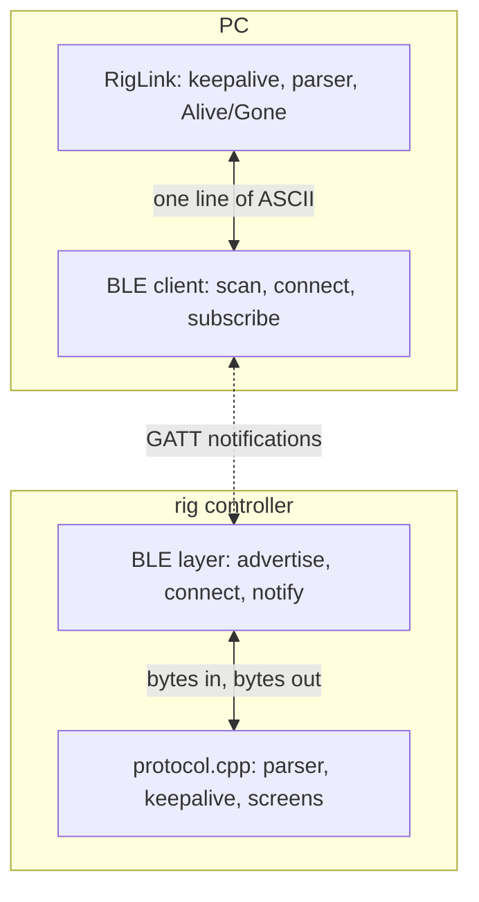

# 装置传输层：承载同一套语言的线

> 本文为 `rig-transport-en.md` 的中文对照版，以英文版为准。

> 维护人：@FrozenYty · 重审时机：新增一种传输、一个 BLE 状态或一个超时

装置与 PC 已经约定了一门语言：行式 ASCII，一个方向是 `CMD`，另一个方向是 `EVT`，`Alive`/`Gone` 与四个屏幕都写在
[rig-state-machine-zh.md](rig-state-machine-zh.md) 里。本文只谈承载这门语言的**线**，而且只谈线：成品装置如何在没有任何
线缆的情况下抵达 PC、线不在时两端各做什么，以及站在装置前面的人看到失败时看到的是什么。

两处接缝已经存在，本文沿用而不是替换它们。固件只透过 `firmware/main/src/transport.h` 与 `transport.cpp` 到达线上，
`protocol.cpp` 收发整行，并不知道下面挂着哪种载体。PC 侧 `server/app/rig/link.py` 把 `Transport` 声明成 `Protocol`，
并接受一个 `open_transport` 工厂。**换的是传输，不是语言。** 本次工作不移动协议的任何一行、任何一个状态、任何一个时序。

## 一、约束与结论

**现场的网络是校园网，装置加入不了。** 它要么是 WPA2-Enterprise，要么是浏览器门户；两者都需要 ESP32-S3 并不具备的
机构：前者要 802.1X 客户端，背后还要有身份和证书；后者要一个浏览器打开门户页面并完成认证。这两者都不是一行配置，
而是住在固件里的第二个产品，凭据会过期，失效方式还偏偏只在当天出现。

| 要加入这个网络，需要 | WPA2-Enterprise | 浏览器门户 | BLE |
|---|---|---|---|
| 事先知道一个网络名 | 要 | 要——门户的那个，由设备从重定向中学到 | 不要 |
| 凭据 | 一个身份加密码，或一张客户端证书 | 打开浏览器之前不需要 | 不要 |
| 加入设备上有浏览器 | 不要 | **要，而装置没有** | 不要 |
| 额外固件，或第二个设备 | 802.1X 客户端、证书存储，以及一个大致正确的时钟 | 一个愿意被重定向、再完成认证的门户客户端 | 除 S3 自带的协议栈之外，什么都不要 |
| 谁还能干扰这条链路 | 校园 RADIUS、DHCP，以及接入点自己的策略 | 门户的会话有效期 | 没有：链路只在两台设备之间 |
| PC 需要什么 | 一个网络口 | 一个网络口 | **一个 BLE 适配器，必须核实（第十二节）** |

所以这不是在两个好方案里挑一个。**三者之中只有 BLE 不需要借来装置本来没有的机构**：不要网络、不要 SSID、不要密码，
装置这一侧不要适配器，也没有任何东西会在彩排与演示之间被管理员轮换掉。一个要靠证书或门户页面才能被对话的装置，
在证书续期或门户改版的那天就会停工，而这两件事都不由本项目控制。

代价现在就写明，而不是日后才发现：BLE 比线缆慢，建链更慢，而且只给 PC 一条点对点链路，没有路由。对每两秒一行、
最长四十字节的东西来说，这些都不重要；如果装置将来要传图像，这些全都重要，那也是扩展本文之前第一件要核实的事
（第十二节）。

## 二、两层，不是一层

成品装置有**两套**状态机，而有线装置只有一套，两者绝不能合并。

| 层 | 负责 | 何时变化 | 它的状态 | 它不该知道 |
|---|---|---|---|---|
| BLE | 连接与通知订阅 | 上电一次，每次掉线一次 | 第三节的五个固件状态、第六节的七个 PC 状态 | 一条命令是什么意思 |
| 协议 | 保活、`Alive`/`Gone`、解析器、四秒抓拍超时 | 持续变化——每两秒一次 | 四个屏幕之上的 `Alive` 与 `Gone` | 自己挂在哪根线上 |

BLE 层在无线电得到或失去对端时变化。协议层在 PC 说话或停止说话时变化。那是不同时钟上的不同事件，把它们写成同一个
状态不是简化，而是另一个产品——用同一个答案回答两个问题中的一个：

- **PC 停止发命令，并不等于连接掉了。** 链路层用空包维持空闲连接，所以无线电仍报有一个对端，而装置的保活规则早已
  判定 PC 不在了。
- **连接掉了，并不等于 PC 死了。** PC 可能还在运行、还在看着，一秒之内就会重连；失败的是无线电，不是操作员的软件。

合成一个状态之后，一次迁移就必须在「重连」和「继续说话」之间做选择，而两者都不对应任何真实的事：去重连一个从未离开的
PC，或者去和一个并不存在的无线电继续对话。装置要么为一个两秒的无线电抖动闪一个故障码，要么在一个谁也够不到的装置上
一直画着 `Ready`。

还有第二个理由必须分开：**串口链路从来没有载波信号。** 装置透过桥接芯片说 UART，看不见线有没有插着，所以「还活着」
一直是协议的事（rig-state-machine-zh.md 第六节）。BLE 确有载波：无论应用层看不看，协议栈都会报告断链。那是串口装置
从未有过的事实，它属于 BLE 层。它不是协议层的 `Gone`，也不替代它。



## 三、固件：BLE 层的状态与事件

五个状态。`Idle` 与 `Advertising` 是仅有的两个没有对端的状态，`Fault` 是唯一不会自行恢复的状态。

| 状态 | 含义 |
|---|---|
| `Idle` | 协议栈尚未启动，或在一次故障之后被拆掉、且不再重试 |
| `Advertising` | 协议栈已起，正在广播服务；没有中心设备附着 |
| `Connected` | 有一个中心设备附着，但尚未启用通知 |
| `Streaming` | 通知已启用；协议就跑在这里 |
| `Fault` | 无线电没有起来，或反复掉线；本层不再重试任何东西 |

| # | 事件 | 来源 |
|---|---|---|
| F1 | 一个中心设备连接 | 无线电 |
| F2 | 该中心设备断开 | 无线电 |
| F3 | 该中心设备启用装置特征上的通知 | 无线电 |
| F4 | 该中心设备关掉通知 | 无线电 |
| F5 | 一整行命令到达，并由协议层应用 | 协议层 |
| F6 | 连接空闲计时器到期 | 计时器 |
| F7 | 无线电初始化失败 | 协议栈 |

F5 列在这里是有意的，尽管本层并不解析任何东西：它在第四节的单元格正是那句「命令不是 BLE 事件」，而一条不出现在任何
单元格里的规则，没有人能检查。F6 的计时器是否在跑取决于状态，而不取决于事件。

## 四、固件：迁移矩阵

每个单元格是四者之一：**一个目标状态**；**就地处理**，指事件被消费、状态不变，因为发生了某件事，但那不是一次迁移；
**忽略**，指事件移动不了本层，也不上报；**拒绝**，指状态不变、*并且*上报，因为发送方必须知道自己被拒了。单元格里加粗
写出状态的地方，就是该行存在的理由。

| 状态 \ 事件 | F1 连接 | F2 断开 | F3 订阅 | F4 退订 | F5 命令 | F6 空闲超时 | F7 初始化失败 |
|---|---|---|---|---|---|---|---|
| `Idle` | 忽略 | 忽略 | 忽略 | 忽略 | 忽略 | 忽略 | **`Fault`** |
| `Advertising` | **`Connected`** | 忽略 | 忽略 | 忽略 | 忽略 | 忽略 | **`Fault`** |
| `Connected` | **拒绝** | **`Advertising`** | **`Streaming`** | 忽略 | 忽略 | **`Advertising`** | **`Fault`** |
| `Streaming` | **拒绝** | **`Advertising`** | 就地处理 | **`Connected`** | 就地处理 | 忽略 | **`Fault`** |
| `Fault` | 忽略 | 忽略 | 忽略 | 忽略 | 忽略 | 忽略 | 就地处理 |

## 五、矩阵编码的规则

**1. 同一时刻只允许一个中心设备。** `Connected` 或 `Streaming` 里的 F1 一律**拒绝并上报**。两个载体喂一个解析器不是
多了个客户端：而是一次抓拍收到两行 `CMD RESULT`、一次 `CMD READY` 广播给两个不同的对端，以及一个分辨不出哪个中心
设备才是 PC 的解析器。被拒的中心设备要被告知而不是被忽略，因为一个自以为订阅成功的客户端，会一直等那些正发给别人的
通知。

**2. 连上却从不订阅的客户端，十秒后会被踢掉。** F6 的计时器由 **F1** 装填、由 **F3** 解除。没有它，一个空闲客户端就能
占住装置，真正的 PC 永远进不来，而装置会以一种在面板上无法诊断的方式看起来像坏了。十秒是五个 `cfg::PC_KEEPALIVE_MS`
单位，与 `config.h` 里其他所有状态区间同一把尺子；它刻意长于 PC 自己那五秒的订阅超时（第九节），这样在通常的失败里
先响的是 PC 的计时器，操作员读到的是 PC 侧超时，而不是装置侧清场。

**3. 一条命令不改变 BLE 状态。** `Streaming` 里的 F5 就地处理：字节已经交出去，协议层应用了这一行，保活刷新了，
BLE 状态纹丝不动。这条规则平淡无奇，而这正是该单元格存在的理由——一个每条命令都重置的握手会每两秒掉一次线，而一个把
`CMD PING` 理解成「客户端还活着，留住它」的实现，等于把本文禁止的那个合并重新发明了一遍。

**4. 空闲计时器不是存活探测。** 如果它在 `Streaming` 里也跑，一个停止发命令的 PC 就会被踢掉，那是规则 3 被计时器
推翻了。真正崩掉的 PC 由协议栈自己的链路监督超时踢掉，无论本层看不看它；空闲计时器只为另一种情形存在——一个连上来
什么都不做的对端。

**5. 连续掉线是故障，不是重试——但只有打断对话的掉线才算。** **从 `Streaming`** 断开才落到 `Advertising`，五次。从 `Connected` 断开是礼貌的告别——客户端离开前会先退订——不计入：一个人把脚本插上又拔下，五次正常会话不该让装置进 `Fault`。六十秒（三十个保活）之内的第五次断开改落 `Fault`。
单元格里仍写 `Advertising`，计数由这条规则承担，因为一张每个格子里都塞着计数器的状态 × 事件表就不再可读了。每分钟掉
五次的无线电，不是第六次尝试能修好的链路；PC 自己的尝试预算（第七节）是从另一头做出的同一个决定。

**6. `Idle` 只在开机时变成一次 `Advertising`。** 它不在矩阵里，因为它不是事件：没有别的东西能导致它，从 `Idle` 也进
不了任何别的状态，而一个启动成功的协议栈只有这一件事可做。另一种写法——加一列 `init success`，只有一个非空格子——
反而会掩盖一个事实：这是本层唯一一次无条件迁移。

**7. 离开 `Fault` 靠断电，不靠协议栈。** 本层停止重试，且 `Fault` 里的 F7 是就地处理而不是再起一次：在一个已经拒绝
启动的无线电里做重新初始化循环，只是把一个死掉的无线电变成一个很慢的，并用动作把故障盖住。显示 `Err4` 的装置需要
一个人，而那个人有两个便宜的动作——断电重启，或者刷回 `rig-serial`（第十一节）。

**8. 协议层原封不动。** 不新增行、不新增状态、不新增时序：`Alive`/`Gone`、两秒保活、十秒离线阈值、四秒抓拍超时与
四个屏幕，全都保持 `rig-state-machine-zh.md` 记录的样子。唯一会动的接缝是 `transport.h`，它必须能说出「无线电没起来」
（第八节）——那是一个返回值，不是一套新状态机。

## 六、PC 侧：BLE 客户端的状态与事件

七个状态，`Failed` 是其中之一。

| 状态 | 含义 |
|---|---|
| `Disconnected` | 没有链路，也没有正在尝试的链路：服务启动之前，或停止之后 |
| `Scanning` | 正在找装置的广播，最多二十秒 |
| `Connecting` | GATT 连接正在进行，最多二十秒 |
| `Subscribing` | 已连接，正在等装置确认通知订阅 |
| `Streaming` | 通知已启用并在到达；协议层正在对话 |
| `Reconnecting` | 一次尝试失败，正在等退避时间过去 |
| `Failed` | 尝试预算用完。**这个状态是刻意存在的** |

| # | 事件 | 来源 |
|---|---|---|
| C1 | 请求建立链路 | 服务或操作员 |
| C2 | 扫描结果里出现了装置 | 无线电 |
| C3 | 扫描窗口到期，什么也没看到 | 计时器 |
| C4 | GATT 连接已建立 | 无线电 |
| C5 | 连接尝试失败，或它的超时到期 | 无线电或计时器 |
| C6 | 装置确认了订阅 | 无线电 |
| C7 | 订阅超时到期，没有收到确认 | 计时器 |
| C8 | 从装置到达了一行 | 无线电 |
| C9 | 链路掉了：断开，或通知停止 | 无线电 |
| C10 | 退避计时器到期 | 计时器 |

C8 列在这里的理由与 F5 相同：本层不解析这一行，单元格就是这么说的。

## 七、PC 侧：迁移矩阵

四种单元格就是第四节定义的四种。这套词汇刻意共用——两端以同样的方式失败，读懂了一张矩阵的读者，两张都读懂了。

| 状态 \ 事件 | C1 请求 | C2 看到 | C3 扫描超时 | C4 已连接 | C5 尝试失败 | C6 已订阅 | C7 订阅超时 | C8 行到达 | C9 链路丢失 | C10 退避到期 |
|---|---|---|---|---|---|---|---|---|---|---|
| `Disconnected` | **`Scanning`** | 忽略 | 忽略 | 忽略 | 忽略 | 忽略 | 忽略 | 忽略 | 忽略 | 忽略 |
| `Scanning` | 就地处理 | **`Connecting`** | **`Reconnecting`**，第五次则 `Failed` | 忽略 | 忽略 | 忽略 | 忽略 | 忽略 | 忽略 | 忽略 |
| `Connecting` | 就地处理 | 忽略 | 忽略 | **`Subscribing`** | **`Reconnecting`**，第五次则 `Failed` | 忽略 | 忽略 | 忽略 | 忽略 | 忽略 |
| `Subscribing` | 就地处理 | 忽略 | 忽略 | **拒绝** | 忽略 | **`Streaming`** | **`Reconnecting`**，第五次则 `Failed` | 忽略 | 忽略 | 忽略 |
| `Streaming` | **拒绝** | 忽略 | 忽略 | **拒绝** | 忽略 | 就地处理 | 忽略 | 就地处理 | **`Reconnecting`** | 忽略 |
| `Reconnecting` | 就地处理 | 忽略 | 忽略 | 忽略 | 忽略 | 忽略 | 忽略 | 忽略 | 忽略 | **`Scanning`** |
| `Failed` | **`Scanning`** | 忽略 | 忽略 | 忽略 | 忽略 | 忽略 | 忽略 | 忽略 | 忽略 | 忽略 |

**`Failed` 就是这张表要有七行的理由。** 没有边界的重连循环会让一条坏链路看起来像一条好链路：日志里全是尝试，页面
一直写着「正在重连」，而任何地方都没有一个状态承认这事成不了。五次尝试——每个退避值一次，1、2、4、8、16 秒——然后
是一个不动的状态，直到有人再问一次（C1）。装置的 `Fault` 是从另一头做出的同一个决定（第五节规则 5）。

**只有到达 `Streaming` 才清零尝试计数，别的都不算。** 扫不到东西、连接超时、订阅始终没有确认，三者都计数；从
`Streaming` 断开则重新开始一个预算，因为那条链路已经证明装置够得到。一个连上又在订阅前断开的装置永远还不清预算，
而这正是诚实的读法：那个装置无法被对话，五次就够作证了。

**`Reconnecting` 重新扫描，而不是重连。** 链路掉了意味着装置可能带着不同的连接状态重新广播，而扫描是唯一找得到它的
方式；一个缓存下来、已经连不上的地址，每次尝试都要付一次超时，看起来和一个关着的装置一模一样。

**协议层看不到这一切。** `RigLink` 保留自己的四个状态和自己的两秒重试，它从不知道发生过扫描。两者只在一个点上相连：
BLE 客户端处于 `Streaming` 时传输存在，否则不存在（第八节）。

## 八、BLE 层交给协议层的东西

接缝就是已经存在的那一个。PC 侧的 BLE 客户端是一个 `Transport` 工厂；固件侧的 BLE 层是 `transport.h` 的另一个实现。
两边都没有多出一场对话。

```python
# The BLE client owns the link and nothing else. RigLink owns the conversation and never learns which
# wire it is on: it calls readline, write and close, exactly as it does for serial.Serial.
client = BleClient(name=RIG_NAME, service=RIG_SERVICE_UUID)  # the state machine of §6 and §7
link = RigLink(open_transport=client.open_transport, on_event=service.on_rig_event)
link.start()  # once, at service start-up; it opens when a transport first exists
```

```cpp
// Firmware, the same seam from the other side. The five calls do not change except for `begin`,
// which gains a result: a radio that did not start has to be reportable (Err4, §10).
namespace transport {
Result begin();  // serial: always Ok. BLE: Failed when the stack will not start.
int available();
int readByte();
void printf(const char* format, ...);
void newline();
}
```

四条后果，也就是接口契约的全部：

- **`open_transport()` 只在 `Streaming` 时返回传输**，其他任何状态都抛异常。于是 BLE 层的 `Streaming` 对 PC 而言，就是
  下一层里的那个 `OPEN`；`link.py` 已有的不变量——传输存在当且仅当状态是 `OPEN`——不必改那个文件就能继续成立。
  `RigLink` 在客户端扫描、连接、退避的整个过程中待在自己的 `OPENING` 里；它的重试碰不到无线电，因为工厂只是看一眼
  状态。
- **`readline()` 阻塞到整行到达**，等待超时返回 `b""`，订阅结束时抛异常。那正是 `rig/link.py` 已经依赖的契约，BLE
  实现欠它的和串口适配器一样多：一个把「链路没了」返回成 `b""` 的 `readline`，会让读线程永远停在那儿。
- **BLE 层不解析，也不计时。** 它在两个方向上搬运字节，并报告自己的状态变化。解析器、保活与 `Alive`/`Gone` 规则留在
  原地，那正是第二节的要点。
- **台架工具要加一个传输选择。** `scripts/test_rig_link.py --port COM<n> --scan` 是检查接线改动的方式，而 `CMD SCAN`
  是不动一根线就能看到 I2C 总线的唯一办法。它也必须能透过 BLE 够到装置，否则唯一测试接线的工具，需要的正是成品
  装置没有的那根线。

## 九、时序：哪些是测的，哪些是假设的

每个数字要么是固件的规则、要么是算术、要么是一个选择。**没有一个是从秒表上读下来的。** 保活是台架已经按它跑过的
固件常量，其余全都是决定，或者是平台自己给出的「最长可能要多久」。

| 项目 | 数值 | 性质 | 为什么是这个数 |
|---|---|---|---|
| 扫描窗口 | 20 秒 | 假设 | Windows 上的 BLE 扫描可能要好几秒，预算是平台的较差情况，而不是测出来的均值 |
| 连接超时 | 20 秒 | 假设 | 同一个数，同一个理由：Windows 上的 BLE 连接确实可能这么久 |
| 订阅超时 | 5 秒 | 选择 | 够一次订阅往返在繁忙链路上完成，又短到一个不肯订阅的客户端占不住这次尝试 |
| 订阅前装置踢空闲客户端 | 10 秒 | 选择 | 五个保活，且长于 PC 的 5 秒，以便通常的失败里先响的是 PC 的计时器 |
| 重连退避 | 1、2、4、8、16 秒 | 选择 | 从一秒开始翻倍，上限低于连接超时，让最后一次等待短于它后面的那次尝试 |
| `Failed` 之前的尝试次数 | 5 | 选择 | 每个退避值一次；第五次失败就是停下的那一次 |
| 协议保活 | 2 秒 | 由固件固定 | `cfg::PC_KEEPALIVE_MS`；装置把漏掉五个保活当作 PC 丢失。本次工作不动它 |
| 这台笔记本上的建链时间 | **未测量** | — | 见下文 |

**表里缺一个数字，而它恰恰是推不出来的那一个：演示要用的那台笔记本上，一次连接到底要多久。** `性质` 这一列的每一项
要么是固件规则、要么是算术、要么是一个决定。`P3-38` 记着 Windows 上的 BLE 连接「从一秒到二十秒不等」，20 秒就是从
那句话来的——那是对平台的观察，不是对这台机器的测量。本文没有任何一项在这台笔记本上计过时，也没有任何一项应当被
当作计过时来汇报。

测量它是实现阶段的第一件事，早于照着一个人人都没有的数字去设计任何东西：在演示笔记本上连接、订阅、断开，重复五次，
把五个时间记下来。如果最差也在五秒以内，那么 20 秒是它所需预算的四倍，应当砍掉；如果一次连接要二十五秒，那么这里
每一个数字都要动，而彩排计划必须在写下来之前就知道这件事。测量结果应当以一张表的形式进 PR，而不是进一句注释。

彩排需要的算术：一次尝试最多四十秒——扫描看到了装置，随后的连接却超时——所以五次尝试加上退避之和，最差情况略低于
四分钟，`5 × 40 + 31 = 231 s`；如果连装置都始终没看到，则约两分钟，因为什么都没扫到的扫描不会走到连接阶段。两者都是
上界，不是预测。

## 十、失败时操作员看到什么

装置已经给故障编了号，四个字符正好铺满面板，而且全都按一赫兹闪：`Err1` 抓拍超时、`Err2` 野结果、
`Err3` 不变量被违反。无线电没能起来，是 **`Err4`**。**`Err0` 已退役，编号不再复用**：它曾表示链路丢失，
而一条只是安静的链路已经不再是一张脸。

| 故障 | 面板 | OLED | 窗口 |
|---|---|---|---|
| `Err1` 抓拍超时 | `Err1`，1 Hz | `RETAKE`，说明文字为 `NO REPLY` | 2 秒 |
| `Err2` 野结果 | `Err2`，1 Hz | 原本那个屏幕，不变 | 2 秒 |
| `Err3` 不变量被违反 | `Err3`，1 Hz | 原本那个屏幕，不变 | 2 秒 |
| `Err4` 无线电已死 | `Err4`，1 Hz | `RADIO FAULT`，然后是 `REFLASH RIG-SERIAL` | 无 |

**上电时 OLED 一个都不画，因为一个都不为真。** 没有人在听，就没有故障可报，所以 OLED 写 `WAITING`——
与 `RADIO FAULT` 由同一个 `drawStatusFace` 画出，只换标题、没有动画——面板画 `APP` 与旋转的第四位；那就是表现层
的 `Pairing` 脸（`docs/rig-state-machine-zh.md` 第十一节）。第一次连接也不再像刚才那一下按键起了作用那样把面板
翻成 `READY`：面板本来画的就是一台在等待的装置，变的只是脸。**`Pairing` 也包括连上但还没订阅的那段窗口**，因为
`Live` 键在 BLE 层的 `Streaming` 上而不是连接上：已经连接但还没打开通知的中心设备听不到 `EVT TRIGGER`，在那里
按键会启动一次没人收到的采集，再为一个从未听到触发的 PC 报 `NO REPLY`。那段窗口里的拒绝是可见的——玻璃上是
`WAITING` 和 `APP`——这正是拒绝可以接受的原因。**之后安静下来的订阅者是另一件事**：它在 `Live`，留在装置自己的
屏幕上，按键会采集，沉默持续时由 `Err1` 报告。**串口构建没有载波信号**（第二节），所以 `rig-serial`
以 `Live` 起步，永远不显示 `WAITING`，也没有链路脸。

**`Err4` 之所以存在，是因为链路结束不再算故障。** 死掉的无线电一开始看起来与安静的同伴一模一样：没有命令到达，
十秒计时置上 `Gone`。但安静的同伴在等下一次开口，而死掉的无线电永远不会回答——所以两者不能共用一张脸，而需要
行动的那一个必须说出来。面板只有四个字符，所以这个区别只花一个数字，不花一个新字形：`Err4` 就是 `E`、`r`、`r`
和 `4`，全都已经在字母表里。

**`Err4` 压过任何屏幕。** 故障覆盖层压过装置自己的屏幕（rig-state-machine-zh.md 第十节），而 `Err4` 在 BLE 层
处于 `Fault` 期间一直画。这里也正是「一个保活」的故障窗口不再适用的地方：死掉的无线电不是等出来的，所以这个
面孔根本没有窗口。`Err1` 到 `Err3` 仍保留各自的两秒。

**OLED 的正文文案必须随构建变化。** `CHECK USB CABLE` 在 `rig-serial` 里为真，在 `rig-ble` 里为假；一台成品装置让
操作员去检查一根它根本没有的线，比留一行空白更糟。`Err4` 还需要一个它今天没有的面孔，因为 OLED 没有代码面孔：故障
覆盖层是面板的，而 `Err1` 到 `Err3` 期间 OLED 继续画下面的屏幕。`Err4` 做不到这一点——下面没有一个正确的屏幕——
所以 OLED 自己画无线电故障，再加一行说明该做什么。

**在 PC 上，同一次失败是一个状态，不是一个码。** 装置从来见不到一个够不到它的 PC，所以 `Failed` 由服务记日志并显示，
而没有对应的 `EVT` 行：协议层无话可说，那正是第二节的分离在按设计工作。

## 十一、两个构建目标

| 目标 | 线 | 用途 | 它绝不能变成 |
|---|---|---|---|
| `rig-serial` | 走 USB 线的 UART0，与今天完全一致 | 台架工作、接线扫描，以及当天的回退 | 没人再编译的那个构建 |
| `rig-ble` | BLE 服务；UART 上没有协议 | 成品装置与演示 | 唯一的构建 |

**串口构建作为构建目标活下来，而不是作为一段话。** 一台不听话的无线电，代价必须是三十秒加一根线，而不是整场演示：
刷 `rig-serial`、插上线、把服务指向一个 COM 口，同一个服务照样跑。这只有在串口构建持续可编译、持续被使用时才成立
——所以它担着台架工作，而每一处接线改动本来就是在线上测的。一个三周前最后一次编译的回退不是回退，是许愿。

- **`rig-ble` 把协议写到 BLE，不写到 UART。** USB 口留给刷机与 ROM 自己的输出。一个把协议同时镜像到两根线上的构建，
  就是第五节禁止的两载体问题，只隔着一根线，而且它会让那根线看起来还管用。
- **两个目标共用版本号与整套协议。** `EVT HELLO` 不需要新字段来说明跑的是哪个目标，因为 PC 知道自己打开的是哪种传输。
  版本在线上协议或面板发生变化时才升，而本次工作两者都没改。
- **绝不能发生的事：** `rig-ble` 在台架上跑通之后，把 `rig-serial` 删掉。回退的价值就在于它是仍然能跑的老代码，删掉它
  等于决定让演示依赖那台无线电。

## 十二、本文没有决定的事

- **PC 到底监不监听 `EVT PONG`。** 协议里没有 PONG 看门狗：装置有义务回答 ping，而 PC 上没有任何东西数这些回答。
  一个连接还在、却不再应答的装置，今天在两种线上都不可见。加看门狗是协议层的改动，不属于本次工作。
- **配对与绑定。** 服务是否要求配对码，装置是否保存绑定。演示中途弹出的配对提示是一段长度未知的延误，所以这件事
  要在彩排之前有答案，而不是在彩排中间。
- **广播名与特征 UUID。** 它们是名字而不是设计：总得写在两端都读的某个地方。
- **一行是否装得进一个通知。** 两个方向上最长的一行都在四十字节以内，所以不必设计分片；但真实协议栈上可用的通知
  长度仍要读出来，而不是假设，那也是二十分钟 spike 要测的事项之一。
- **演示用笔记本有没有 BLE 适配器。** 没有的话，C1 处进 `Failed` 就是诚实的答案，一个 USB 适配器就是解法；无论如何
  这件事要在彩排前知道，而不是当天。
- **链路处于 `Failed` 时采集页说什么。** `P3-24` 负责页面如何呈现那两个链路状态；本文只负责说这个状态存在，且不会
  沉默。
