# Requirements traceability matrix

> Chinese version: [traceability-zh.md](traceability-zh.md). This file is the source of truth.
>
> Owner: @chemflowers · Revisit when: a screen or an element is added or removed, or a status changes

Every screen of the prototype, element by element, traced to the requirement it serves in `srs-en.md` table 3-1. One row per UI element: a title, an input, a button. Each row points at a numbered callout on that screen's screenshot, so a reviewer can find the element on the picture instead of trusting the words.

## 1. Cover

| Field | Value |
|---|---|
| Project | AquaVision — underwater species detection and monitoring |
| Document | Requirements traceability matrix |
| Version | 1.4 |
| Based on | `srs-en.md` (SRS-PRJ14-V1.13-2026), table 3-1 and the page list in §5.2 |
| Screens | 13, one figure each |
| Author | Sun Jianheng (@chemflowers) |
| Reviewer | Yao Tianyu (@FrozenYty) |
| Date | 2026-11-11 |

## 2. Change history

| Version | Date | Author | Change |
|---|---|---|---|
| 1.0 | 2026-11-09 | Sun Jianheng | First version: 13 screens, 106 rows, one annotated screenshot per screen |
| 1.1 | 2026-11-10 | Sun Jianheng | P-10 gains the counting-basis row (TM-082): 107 rows |
| 1.2 | 2026-11-10 | Yao Tianyu, Sun Jianheng | Page names follow SRS V1.11 §5.2 (#122); the image-browser and result-detail templates and figures are renamed (#127) |
| 1.3 | 2026-11-11 | Sun Jianheng | P-07 gains the zoom row (TM-062), so the ids after it shift by one: 108 rows (#137); TM-056 points at the CSV export button (#138) |
| 1.4 | 2026-11-11 | Sun Jianheng | Every in-progress row reviewed against the real server: 17 rows move to Done in COD (TM-041, TM-047, TM-048, TM-058 to TM-068, TM-074, TM-105, TM-106, numbered as in this version); the UT column is filled where a test runs the element's logic; two elements SRS §5.2 lists but the pages lack get rows of their own (Recent jobs on P-02, Version compare and rollback on P-07): 110 rows |

## 3. How to read it

- **Figure N, callout M** points at the red numbered circle M on figure N. Callouts are numbered in reading order within each screen; a row with no callout describes an element the requirement asks for that is not on screen.
- **Screenshots show the prototype in demo mode** (`?mock=1`). The status columns describe the system against the real server: an element that only works on mock data is not counted as done.
- **PD** — screen design exists and was reviewed in the prototype walkthrough. **COD** — coded and checked against the real server; the revision history says when. **UT** — Done when an automated test runs the element's own logic and checks the result (`tests/test_review_canvas.py`, `tests/test_result_csv.py`); In progress when a test only checks it from the source text (`tests/test_page_names.py`, `tests/test_live_socket.py`). Server tests cover the routes behind many rows, but they do not exercise the element, so they are not counted here.
- **Assignee** builds the element; **owner** answers for the screen.

| Status | Meaning |
|---|---|
| Done | finished and checked |
| In progress | built, but runs on mock data only or waits on another lane |
| Not started | not built |

## 4. Matrix

### 4.1 P-01 Sign-in (figure 1)

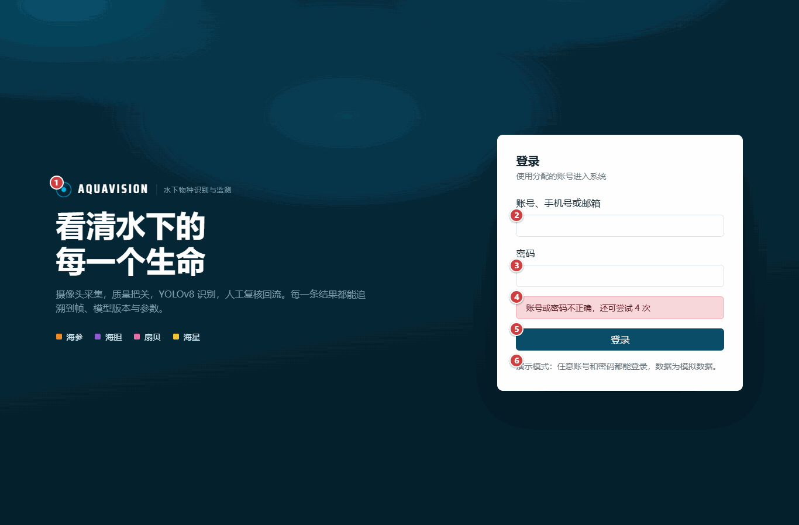

| No. | Screen | Area | Control | Detail | Requirement | PD | COD | UT | Assignee | Owner |
|---|---|---|---|---|---|---|---|---|---|---|
| TM-001 | P-01 Sign-in | header | Brand mark | See figure 1, callout 1. Product name and sonar mark. | FR-M1-01 | Done | Done | Not started | Sun Jianheng | Yao Tianyu |
| TM-002 | P-01 Sign-in | form | Account input | See figure 1, callout 2. Accepts a username, phone number or e-mail; required. | FR-M1-01 | Done | Done | Not started | Sun Jianheng | Yao Tianyu |
| TM-003 | P-01 Sign-in | form | Password input | See figure 1, callout 3. Masked input; cleared after a refusal. | FR-M1-01 | Done | Done | Not started | Sun Jianheng | Yao Tianyu |
| TM-004 | P-01 Sign-in | form | Refusal message | See figure 1, callout 4. Shows the server's own sentence, including attempts left and lockout time. Example text in the screenshot. | FR-M1-01 | Done | Done | Not started | Sun Jianheng | Yao Tianyu |
| TM-005 | P-01 Sign-in | actions | Sign-in button | See figure 1, callout 5. Calls POST /api/auth/login, stores the token, returns to the page the user came from. | FR-M1-01 | Done | Done | Not started | Sun Jianheng | Yao Tianyu |
| TM-006 | P-01 Sign-in | content | Help line | See figure 1, callout 6. In demo mode it says any account signs in (as in the screenshot); with a server it says an administrator resets passwords. | FR-M1-03 | Done | Done | Not started | Sun Jianheng | Yao Tianyu |
| TM-007 | P-01 Sign-in | form | Graphic captcha | Figure 1, no callout: not on screen. Required by the SRS; the endpoint takes none, so no field is shown. | FR-M1-01 | Done | Not started | Not started | Sun Jianheng | Yao Tianyu |

### 4.2 P-02 Running overview (and the shared shell) (figure 2)

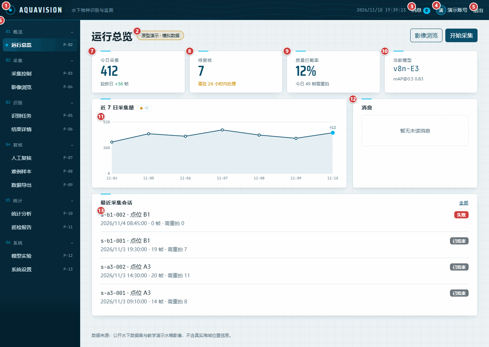

| No. | Screen | Area | Control | Detail | Requirement | PD | COD | UT | Assignee | Owner |
|---|---|---|---|---|---|---|---|---|---|---|
| TM-008 | P-02 Running overview (and the shared shell) | header | Brand link | See figure 2, callout 1. Returns to the running overview from any page. | FR-M1-01 | Done | Done | Not started | Sun Jianheng | Yao Tianyu |
| TM-009 | P-02 Running overview (and the shared shell) | header | Demo-data badge | See figure 2, callout 2. Shown on every page while the tab runs on mock data. | FR-M1-01 | Done | Done | Not started | Sun Jianheng | Yao Tianyu |
| TM-010 | P-02 Running overview (and the shared shell) | header | Messages link | See figure 2, callout 3. Opens the messages tab of system settings. | FR-M8-02 | Done | Done | Not started | Sun Jianheng | Yao Tianyu |
| TM-011 | P-02 Running overview (and the shared shell) | header | Signed-in user | See figure 2, callout 4. Name of the signed-in account. | FR-M1-01 | Done | Done | Not started | Sun Jianheng | Yao Tianyu |
| TM-012 | P-02 Running overview (and the shared shell) | header | Sign-out link | See figure 2, callout 5. Clears the session and returns to the sign-in page. | FR-M1-01 | Done | Done | Not started | Sun Jianheng | Yao Tianyu |
| TM-013 | P-02 Running overview (and the shared shell) | header | Main menu | See figure 2, callout 6. Twelve pages in SRS order, grouped by business domain (sign-in has no menu entry); the current page is highlighted. Not yet filtered by role. | FR-M1-02 | Done | In progress | In progress | Sun Jianheng | Yao Tianyu |
| TM-014 | P-02 Running overview (and the shared shell) | content | Frames today | See figure 2, callout 7. Today's frame count from the daily trend. | FR-M5-01 | Done | Done | Not started | Sun Jianheng | Yao Tianyu |
| TM-015 | P-02 Running overview (and the shared shell) | content | Pending review | See figure 2, callout 8. No route counts pending reviews yet; the card says so. | FR-M4-01 | Done | In progress | Not started | Sun Jianheng | Yao Tianyu |
| TM-016 | P-02 Running overview (and the shared shell) | content | Rejection rate | See figure 2, callout 9. Seven-day rejection rate from the quality route. | FR-M2-03 | Done | Done | Not started | Sun Jianheng | Yao Tianyu |
| TM-017 | P-02 Running overview (and the shared shell) | content | Current model | See figure 2, callout 10. Version and mAP@0.5 of the model online now. | FR-M6-01 | Done | Done | Not started | Sun Jianheng | Yao Tianyu |
| TM-018 | P-02 Running overview (and the shared shell) | content | Seven-day trend | See figure 2, callout 11. Frames per day. | FR-M5-03 | Done | Done | Not started | Sun Jianheng | Yao Tianyu |
| TM-019 | P-02 Running overview (and the shared shell) | content | Messages card | See figure 2, callout 12. Static text for now; not yet wired to the messages route. | FR-M8-02 | Done | In progress | Not started | Sun Jianheng | Yao Tianyu |
| TM-020 | P-02 Running overview (and the shared shell) | content | Recent sessions | See figure 2, callout 13. Last four capture sessions with frame and retake counts. | FR-M2-04 | Done | Done | Not started | Sun Jianheng | Yao Tianyu |
| TM-021 | P-02 Running overview (and the shared shell) | content | Recent jobs | Figure 2, no callout: not on screen. Listed for this page in SRS §5.2; the page shows recent capture sessions but not recent detection jobs. | FR-M3-02 | Not started | Not started | Not started | Sun Jianheng | Yao Tianyu |

### 4.3 P-03 Capture control (figure 3)

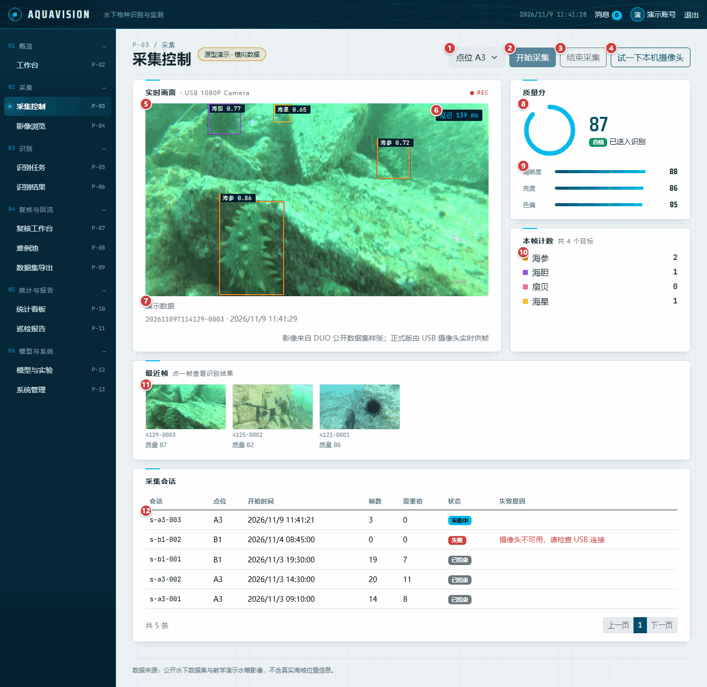

| No. | Screen | Area | Control | Detail | Requirement | PD | COD | UT | Assignee | Owner |
|---|---|---|---|---|---|---|---|---|---|---|
| TM-022 | P-03 Capture control | actions | Site selector | See figure 3, callout 1. Site for the session. | FR-M2-01 | Done | Done | Not started | Sun Jianheng | Yao Tianyu |
| TM-023 | P-03 Capture control | actions | Start button | See figure 3, callout 2. Opens a session and starts the live feed. | FR-M2-01, FR-M2-02 | Done | Done | Not started | Sun Jianheng | Yao Tianyu |
| TM-024 | P-03 Capture control | actions | End capture button | See figure 3, callout 3. Stops the feed and closes the session. | FR-M2-01 | Done | Done | Not started | Sun Jianheng | Yao Tianyu |
| TM-025 | P-03 Capture control | actions | Laptop camera | See figure 3, callout 4. Shows the laptop camera without boxes; not yet checked with a real camera. | FR-M2-01 | Done | In progress | Not started | Sun Jianheng | Yao Tianyu |
| TM-026 | P-03 Capture control | content | Live picture | See figure 3, callout 5. Frames with detection boxes; needs the server's socket and detection to show real detections. | FR-M3-01 | Done | In progress | In progress | Sun Jianheng | Yao Tianyu |
| TM-027 | P-03 Capture control | content | Latency | See figure 3, callout 6. Server latency over the socket, frame age when polling. | FR-M3-01 | Done | In progress | Not started | Sun Jianheng | Yao Tianyu |
| TM-028 | P-03 Capture control | content | Feed mode | See figure 3, callout 7. States whether the page uses the socket, polling or demo data. | FR-M2-02 | Done | Done | Not started | Sun Jianheng | Yao Tianyu |
| TM-029 | P-03 Capture control | content | Quality ring | See figure 3, callout 8. Score of the newest frame; amber with a retake notice below 60. | FR-M2-03 | Done | Done | Not started | Sun Jianheng | Yao Tianyu |
| TM-030 | P-03 Capture control | content | Quality components | See figure 3, callout 9. Sharpness, brightness and colour cast when the source sends them. | FR-M2-03 | Done | Done | Not started | Sun Jianheng | Yao Tianyu |
| TM-031 | P-03 Capture control | content | Per-class count | See figure 3, callout 10. Boxes per class on the current frame. | FR-M3-04 | Done | In progress | Not started | Sun Jianheng | Yao Tianyu |
| TM-032 | P-03 Capture control | content | Recent frames | See figure 3, callout 11. Last eight frames; each opens the result detail. | FR-M2-04 | Done | Done | Not started | Sun Jianheng | Yao Tianyu |
| TM-033 | P-03 Capture control | content | Session table | See figure 3, callout 12. Sessions with start time, frames and retakes. | FR-M2-04 | Done | Done | Not started | Sun Jianheng | Yao Tianyu |

### 4.4 P-04 Image browser (figure 4)

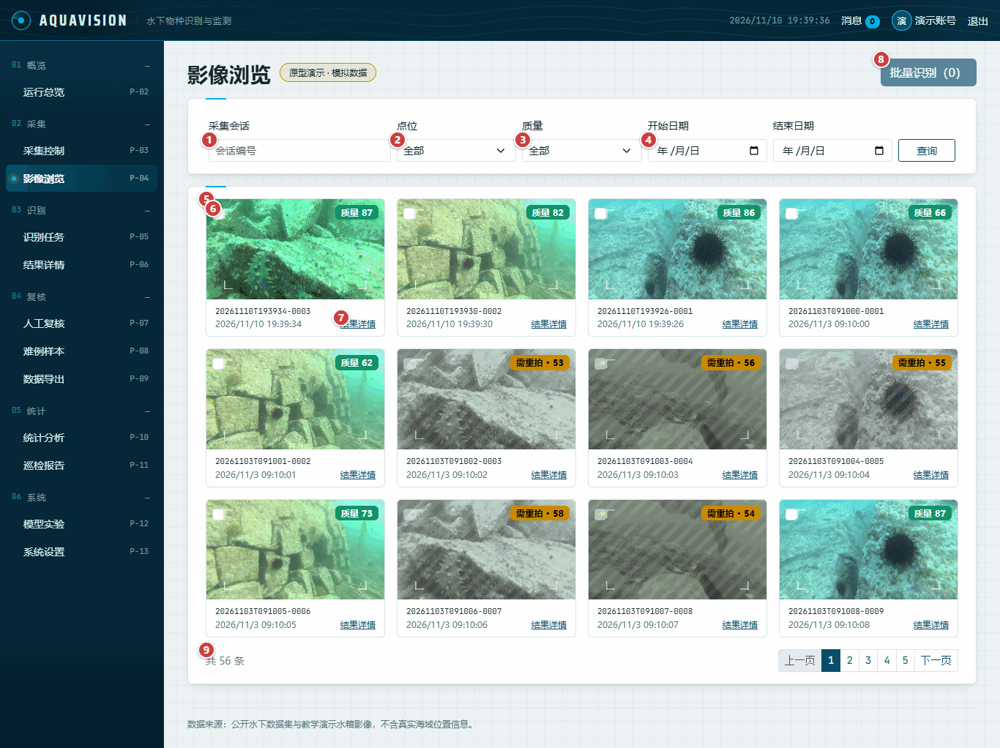

| No. | Screen | Area | Control | Detail | Requirement | PD | COD | UT | Assignee | Owner |
|---|---|---|---|---|---|---|---|---|---|---|
| TM-034 | P-04 Image browser | form | Session filter | See figure 4, callout 1. Filters by session id. | FR-M2-04 | Done | Done | Not started | Sun Jianheng | Yao Tianyu |
| TM-035 | P-04 Image browser | form | Site filter | See figure 4, callout 2. Filters by site. | FR-M2-04 | Done | Done | Not started | Sun Jianheng | Yao Tianyu |
| TM-036 | P-04 Image browser | form | Quality filter | See figure 4, callout 3. Passed or needs retake. | FR-M2-03 | Done | Done | Not started | Sun Jianheng | Yao Tianyu |
| TM-037 | P-04 Image browser | form | Date range | See figure 4, callout 4. Start and end dates, inclusive. | FR-M2-04 | Done | Done | Not started | Sun Jianheng | Yao Tianyu |
| TM-038 | P-04 Image browser | content | Frame tile | See figure 4, callout 5. Picture, quality badge, frame id and time; a placeholder when the server sends no picture. | FR-M2-04 | Done | Done | Not started | Sun Jianheng | Yao Tianyu |
| TM-039 | P-04 Image browser | content | Selection box | See figure 4, callout 6. Selects a frame for batch detection; retake frames cannot be selected. | FR-M3-02 | Done | Done | Not started | Sun Jianheng | Yao Tianyu |
| TM-040 | P-04 Image browser | content | Result link | See figure 4, callout 7. Opens the result detail. | FR-M3-04 | Done | Done | Not started | Sun Jianheng | Yao Tianyu |
| TM-041 | P-04 Image browser | actions | Batch detection | See figure 4, callout 8. Creates a detection task for the selected frames. | FR-M3-02 | Done | Done | Not started | Sun Jianheng | Yao Tianyu |
| TM-042 | P-04 Image browser | content | Pagination | See figure 4, callout 9. Twelve frames per page. | FR-M2-04 | Done | Done | Not started | Sun Jianheng | Yao Tianyu |

### 4.5 P-05 Detection jobs (figure 5)

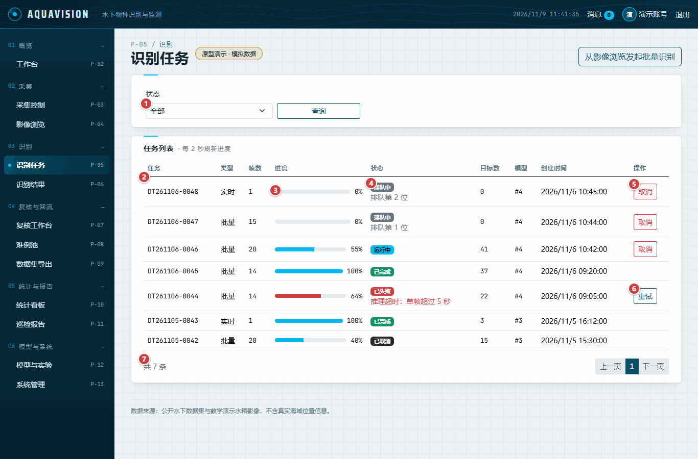

| No. | Screen | Area | Control | Detail | Requirement | PD | COD | UT | Assignee | Owner |
|---|---|---|---|---|---|---|---|---|---|---|
| TM-043 | P-05 Detection jobs | form | Status filter | See figure 5, callout 1. Queued, running, done, failed or cancelled. | FR-M3-02 | Done | Done | Not started | Sun Jianheng | Yao Tianyu |
| TM-044 | P-05 Detection jobs | content | Task code | See figure 5, callout 2. Task code, type and frame count. | FR-M3-02 | Done | Done | Not started | Sun Jianheng | Yao Tianyu |
| TM-045 | P-05 Detection jobs | content | Progress | See figure 5, callout 3. Progress in percent; refreshed every two seconds while a task moves. | FR-M3-02 | Done | Done | Not started | Sun Jianheng | Yao Tianyu |
| TM-046 | P-05 Detection jobs | content | Status and queue | See figure 5, callout 4. Status, queue position and failure reason. | FR-M3-02 | Done | Done | Not started | Sun Jianheng | Yao Tianyu |
| TM-047 | P-05 Detection jobs | actions | Cancel | See figure 5, callout 5. Cancels a queued or running task after a confirmation. | FR-M3-02 | Done | Done | Not started | Sun Jianheng | Yao Tianyu |
| TM-048 | P-05 Detection jobs | actions | Retry | See figure 5, callout 6. Re-queues a failed task. | FR-M3-02 | Done | Done | Not started | Sun Jianheng | Yao Tianyu |
| TM-049 | P-05 Detection jobs | content | Pagination | See figure 5, callout 7. Eight tasks per page. | FR-M3-02 | Done | Done | Not started | Sun Jianheng | Yao Tianyu |

### 4.6 P-06 Result detail (figure 6)

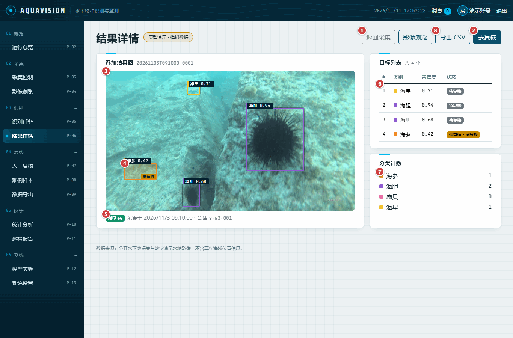

| No. | Screen | Area | Control | Detail | Requirement | PD | COD | UT | Assignee | Owner |
|---|---|---|---|---|---|---|---|---|---|---|
| TM-050 | P-06 Result detail | actions | Back to capture | See figure 6, callout 1. Returns to the capture page. | FR-M3-04 | Done | Done | Not started | Sun Jianheng | Yao Tianyu |
| TM-051 | P-06 Result detail | actions | Go to review | See figure 6, callout 2. Opens this frame in manual review. | FR-M4-01 | Done | Done | Not started | Sun Jianheng | Yao Tianyu |
| TM-052 | P-06 Result detail | content | Result picture | See figure 6, callout 3. Frame with its boxes; a labelled placeholder while no route serves the picture. | FR-M3-01, FR-M3-04 | Done | In progress | Not started | Sun Jianheng | Yao Tianyu |
| TM-053 | P-06 Result detail | content | Low-confidence box | See figure 6, callout 4. Translucent fill and a review tag, never colour alone. | FR-M3-04 | Done | Done | Not started | Sun Jianheng | Yao Tianyu |
| TM-054 | P-06 Result detail | content | Frame facts | See figure 6, callout 5. Quality, capture time and session. | FR-M2-03 | Done | Done | Not started | Sun Jianheng | Yao Tianyu |
| TM-055 | P-06 Result detail | content | Object list | See figure 6, callout 6. Class, confidence and review status per box; hovering a row lights its box. | FR-M3-04 | Done | Done | Not started | Sun Jianheng | Yao Tianyu |
| TM-056 | P-06 Result detail | content | Per-class count | See figure 6, callout 7. Boxes per class. | FR-M3-04 | Done | Done | Not started | Sun Jianheng | Yao Tianyu |
| TM-057 | P-06 Result detail | actions | Export results | See figure 6, callout 8. Exports the boxes listed on this page as CSV, one row per box: UTF-8 with a byte-order mark so Excel shows Chinese class names; an empty result says so and makes no file. JSON and annotated images are not built yet. | FR-M3-05 | Done | In progress | Done | Sun Jianheng | Yao Tianyu |

### 4.7 P-07 Manual review (figure 7)

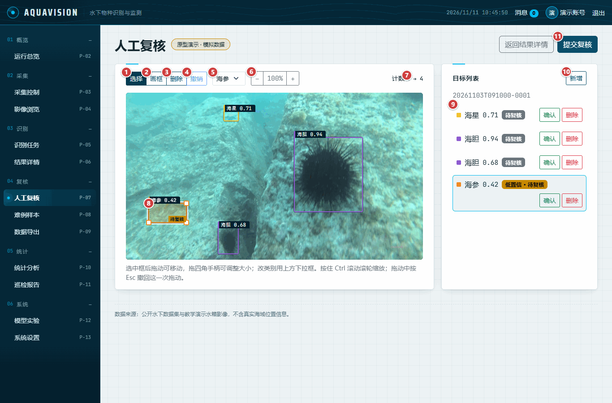

| No. | Screen | Area | Control | Detail | Requirement | PD | COD | UT | Assignee | Owner |
|---|---|---|---|---|---|---|---|---|---|---|
| TM-058 | P-07 Manual review | actions | Select tool | See figure 7, callout 1. Select and move boxes. | FR-M4-01 | Done | Done | Done | Sun Jianheng | Yao Tianyu |
| TM-059 | P-07 Manual review | actions | Draw tool | See figure 7, callout 2. Drag to draw a new box. | FR-M4-01 | Done | Done | Done | Sun Jianheng | Yao Tianyu |
| TM-060 | P-07 Manual review | actions | Delete tool | See figure 7, callout 3. Deletes the selected box. | FR-M4-01 | Done | Done | Not started | Sun Jianheng | Yao Tianyu |
| TM-061 | P-07 Manual review | actions | Undo | See figure 7, callout 4. Undoes the last step (one step only). | FR-M4-02 | Done | Done | Not started | Sun Jianheng | Yao Tianyu |
| TM-062 | P-07 Manual review | actions | Class selector | See figure 7, callout 5. Relabels the selected box. | FR-M4-01 | Done | Done | Not started | Sun Jianheng | Yao Tianyu |
| TM-063 | P-07 Manual review | actions | Zoom | See figure 7, callout 6. 50% to 400%; the picture and the boxes scale together, and Ctrl + wheel zooms at the pointer. Pointer positions go through one tested function at every zoom level. | FR-M4-01 | Done | Done | Done | Sun Jianheng | Yao Tianyu |
| TM-064 | P-07 Manual review | actions | Count change | See figure 7, callout 7. Count before and after the edits. | FR-M4-02 | Done | Done | Not started | Sun Jianheng | Yao Tianyu |
| TM-065 | P-07 Manual review | content | Selected box | See figure 7, callout 8. Four corner handles; drag the body to move, a corner to resize. | FR-M4-01 | Done | Done | Done | Sun Jianheng | Yao Tianyu |
| TM-066 | P-07 Manual review | content | Object row | See figure 7, callout 9. Confirm or delete a box; clicking selects it on the canvas. | FR-M4-01 | Done | Done | Not started | Sun Jianheng | Yao Tianyu |
| TM-067 | P-07 Manual review | actions | Add box | See figure 7, callout 10. Switches to the draw tool. | FR-M4-01 | Done | Done | Not started | Sun Jianheng | Yao Tianyu |
| TM-068 | P-07 Manual review | actions | Submit review | See figure 7, callout 11. Posts the full box list; the server refuses frames that have no detection yet. | FR-M4-01, FR-M4-02 | Done | Done | Not started | Sun Jianheng | Yao Tianyu |
| TM-069 | P-07 Manual review | actions | Version compare and rollback | Figure 7, no callout: not on screen. Listed for this page in SRS §5.2. The server stores each submit as a new version and returns its number, but has no route to list a frame's versions or to roll back, so the page has neither (blocked on lane B). | FR-M4-02 | Not started | Not started | Not started | Sun Jianheng | Yao Tianyu |

### 4.8 P-08 Hard samples (figure 8)

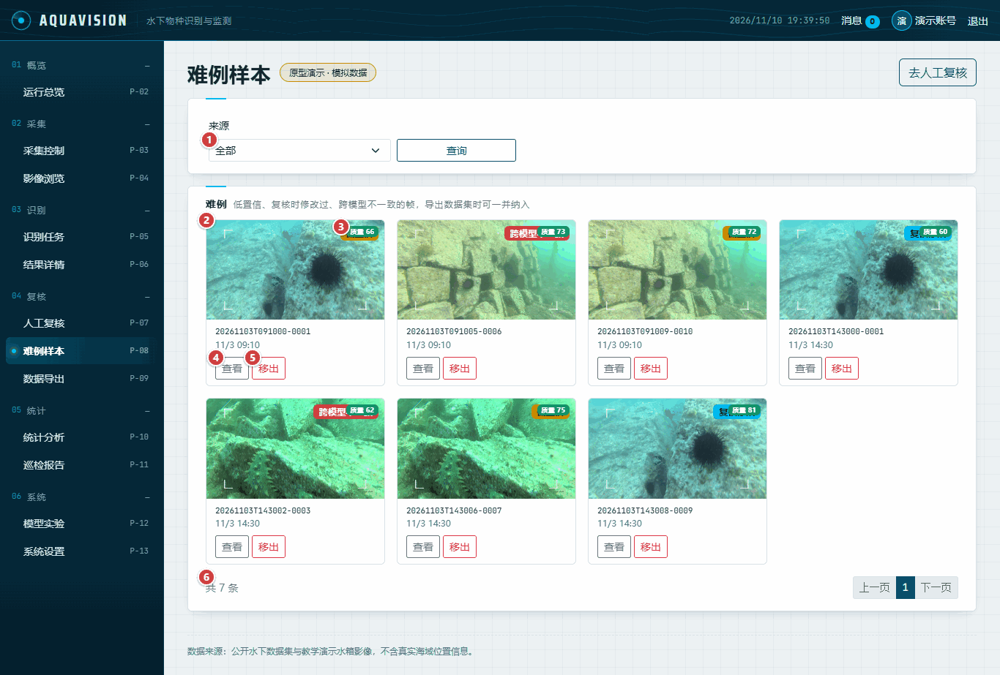

| No. | Screen | Area | Control | Detail | Requirement | PD | COD | UT | Assignee | Owner |
|---|---|---|---|---|---|---|---|---|---|---|
| TM-070 | P-08 Hard samples | form | Source filter | See figure 8, callout 1. Low confidence, modified in review, or models disagree. | FR-M4-03 | Done | Done | Not started | Sun Jianheng | Yao Tianyu |
| TM-071 | P-08 Hard samples | content | Sample tile | See figure 8, callout 2. Frame, quality and capture time. | FR-M4-03 | Done | Done | Not started | Sun Jianheng | Yao Tianyu |
| TM-072 | P-08 Hard samples | content | Source badge | See figure 8, callout 3. Why the frame is a hard sample. | FR-M4-03 | Done | Done | Not started | Sun Jianheng | Yao Tianyu |
| TM-073 | P-08 Hard samples | actions | View | See figure 8, callout 4. Opens the result detail. | FR-M4-03 | Done | Done | Not started | Sun Jianheng | Yao Tianyu |
| TM-074 | P-08 Hard samples | actions | Remove | See figure 8, callout 5. Removes the frame from the hard samples after a confirmation. | FR-M4-03 | Done | Done | Not started | Sun Jianheng | Yao Tianyu |
| TM-075 | P-08 Hard samples | content | Pagination | See figure 8, callout 6. Eight samples per page. | FR-M4-03 | Done | Done | Not started | Sun Jianheng | Yao Tianyu |

### 4.9 P-09 Data export (figure 9)

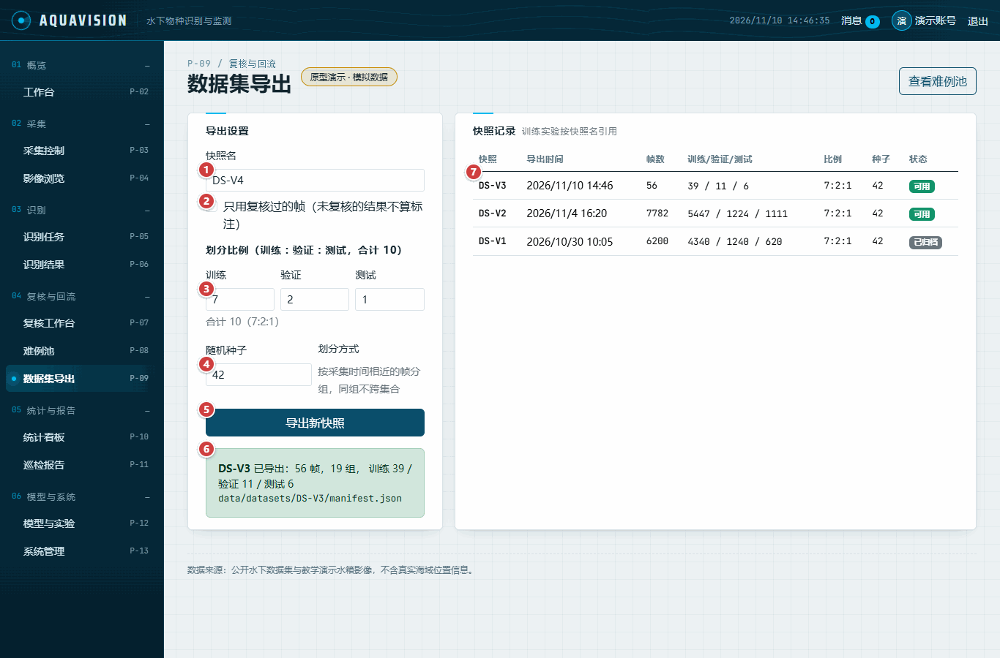

| No. | Screen | Area | Control | Detail | Requirement | PD | COD | UT | Assignee | Owner |
|---|---|---|---|---|---|---|---|---|---|---|
| TM-076 | P-09 Data export | form | Snapshot name | See figure 9, callout 1. DS- name; the next free version is suggested. | FR-M4-04 | Done | Done | Not started | Sun Jianheng | Yao Tianyu |
| TM-077 | P-09 Data export | form | Reviewed only | See figure 9, callout 2. Unreviewed results are not labels. | FR-M4-04 | Done | Done | Not started | Sun Jianheng | Yao Tianyu |
| TM-078 | P-09 Data export | form | Split ratio | See figure 9, callout 3. Train, validation and test in tenths; must add up to 10. | FR-M4-04 | Done | Done | Not started | Sun Jianheng | Yao Tianyu |
| TM-079 | P-09 Data export | form | Random seed | See figure 9, callout 4. Same frames and seed give the same split. | FR-M4-04 | Done | Done | Not started | Sun Jianheng | Yao Tianyu |
| TM-080 | P-09 Data export | actions | Export | See figure 9, callout 5. Creates the snapshot and its manifest. | FR-M4-04 | Done | Done | Not started | Sun Jianheng | Yao Tianyu |
| TM-081 | P-09 Data export | content | Export result | See figure 9, callout 6. Frames, groups, split counts and manifest path as the server returns them. | FR-M4-04 | Done | Done | Not started | Sun Jianheng | Yao Tianyu |
| TM-082 | P-09 Data export | content | Snapshot history | See figure 9, callout 7. Every snapshot; rows whose splits do not add up are flagged. | FR-M4-04 | Done | Done | Not started | Sun Jianheng | Yao Tianyu |

### 4.10 P-10 Statistics (figure 10)

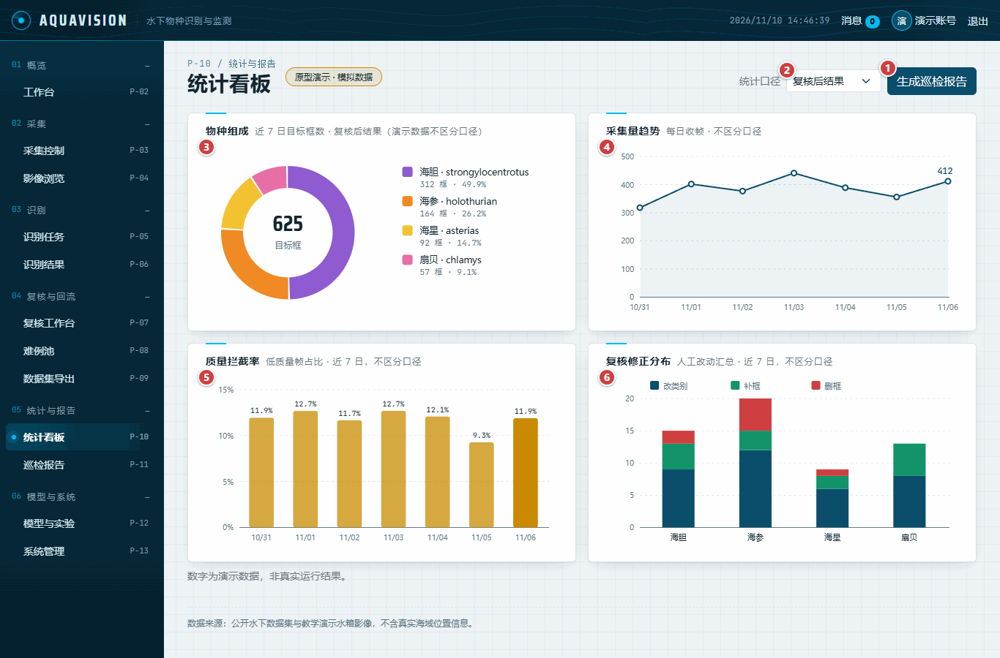

| No. | Screen | Area | Control | Detail | Requirement | PD | COD | UT | Assignee | Owner |
|---|---|---|---|---|---|---|---|---|---|---|
| TM-083 | P-10 Statistics | actions | Report link | See figure 10, callout 1. Opens the inspection report page. | FR-M5-04 | Done | Done | Not started | Sun Jianheng | Yao Tianyu |
| TM-084 | P-10 Statistics | actions | Counting basis | See figure 10, callout 2. Switches the species chart between reviewed and raw results; its caption changes with it. The other charts do not depend on it. | FR-M5-01 | Done | In progress | Not started | Sun Jianheng | Yao Tianyu |
| TM-085 | P-10 Statistics | content | Species composition | See figure 10, callout 3. Boxes per class over seven days. | FR-M5-01 | Done | Done | Not started | Sun Jianheng | Yao Tianyu |
| TM-086 | P-10 Statistics | content | Capture trend | See figure 10, callout 4. Frames per day. | FR-M5-03 | Done | Done | Not started | Sun Jianheng | Yao Tianyu |
| TM-087 | P-10 Statistics | content | Rejection by day | See figure 10, callout 5. Per-day bars in the prototype; the server returns totals only, stated in words. | FR-M2-03 | Done | In progress | Not started | Sun Jianheng | Yao Tianyu |
| TM-088 | P-10 Statistics | content | Review corrections | See figure 10, callout 6. Per-class stack in the prototype; the server returns totals only. | FR-M4-02 | Done | In progress | Not started | Sun Jianheng | Yao Tianyu |
| TM-089 | P-10 Statistics | content | Site heat map | Figure 10, no callout: not on screen. Site density and ranking are not built yet. | FR-M5-02 | Done | Not started | Not started | Sun Jianheng | Yao Tianyu |

### 4.11 P-11 Inspection reports (figure 11)

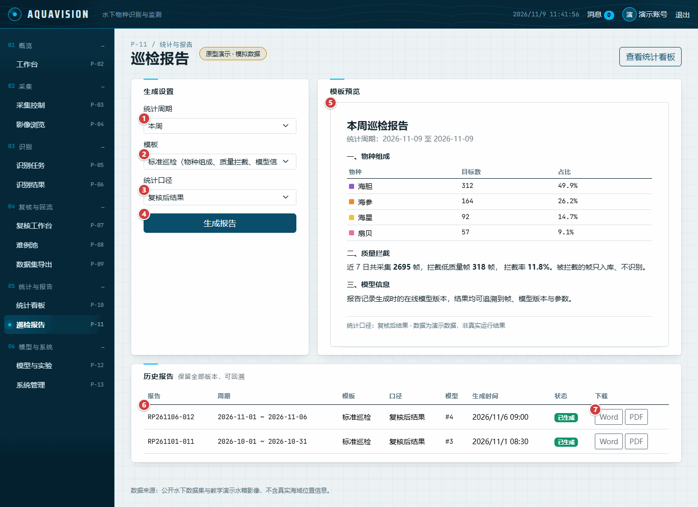

| No. | Screen | Area | Control | Detail | Requirement | PD | COD | UT | Assignee | Owner |
|---|---|---|---|---|---|---|---|---|---|---|
| TM-090 | P-11 Inspection reports | form | Period | See figure 11, callout 1. This week, this month or a custom range. | FR-M5-04 | Done | Done | Not started | Sun Jianheng | Yao Tianyu |
| TM-091 | P-11 Inspection reports | form | Template | See figure 11, callout 2. Standard or brief. | FR-M5-04 | Done | Done | Not started | Sun Jianheng | Yao Tianyu |
| TM-092 | P-11 Inspection reports | form | Counting basis | See figure 11, callout 3. Reviewed or raw results. | FR-M5-04 | Done | Done | Not started | Sun Jianheng | Yao Tianyu |
| TM-093 | P-11 Inspection reports | actions | Generate | See figure 11, callout 4. Generates the report on the server. | FR-M5-04 | Done | Done | Not started | Sun Jianheng | Yao Tianyu |
| TM-094 | P-11 Inspection reports | content | Preview | See figure 11, callout 5. Species composition, rejection and model information from the statistics routes. | FR-M5-01, FR-M5-04 | Done | Done | Not started | Sun Jianheng | Yao Tianyu |
| TM-095 | P-11 Inspection reports | content | Report history | See figure 11, callout 6. Every generated report and its status. | FR-M5-04 | Done | Done | Not started | Sun Jianheng | Yao Tianyu |
| TM-096 | P-11 Inspection reports | actions | Download | See figure 11, callout 7. No download route yet; the button says so. | FR-M5-04 | Done | Not started | Not started | Sun Jianheng | Yao Tianyu |

### 4.12 P-12 Model experiments (figure 12)

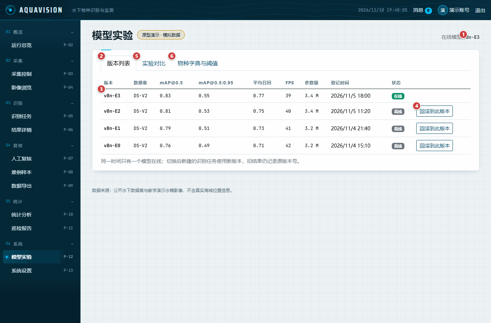

| No. | Screen | Area | Control | Detail | Requirement | PD | COD | UT | Assignee | Owner |
|---|---|---|---|---|---|---|---|---|---|---|
| TM-097 | P-12 Model experiments | header | Online model | See figure 12, callout 1. The single online version, or none. | FR-M6-02 | Done | Done | Not started | Sun Jianheng | Yao Tianyu |
| TM-098 | P-12 Model experiments | actions | Versions tab | See figure 12, callout 2. Model versions with metrics. | FR-M6-01 | Done | Done | Not started | Sun Jianheng | Yao Tianyu |
| TM-099 | P-12 Model experiments | content | Version row | See figure 12, callout 3. Dataset, mAP@0.5, mAP@0.5:0.95, recall, FPS, parameters. | FR-M6-01 | Done | Done | Not started | Sun Jianheng | Yao Tianyu |
| TM-100 | P-12 Model experiments | actions | Activate or roll back | See figure 12, callout 4. Switches the online model after a confirmation. | FR-M6-02 | Done | In progress | Not started | Sun Jianheng | Yao Tianyu |
| TM-101 | P-12 Model experiments | actions | Experiments tab | See figure 12, callout 5. Ablation table with the change against the baseline (shown after switching). | FR-M6-03 | Done | Done | Not started | Sun Jianheng | Yao Tianyu |
| TM-102 | P-12 Model experiments | actions | Species tab | See figure 12, callout 6. Per-class threshold and statistics flag, saved per row (shown after switching). | FR-M6-04 | Done | Done | Not started | Sun Jianheng | Yao Tianyu |

### 4.13 P-13 System settings (figure 13)

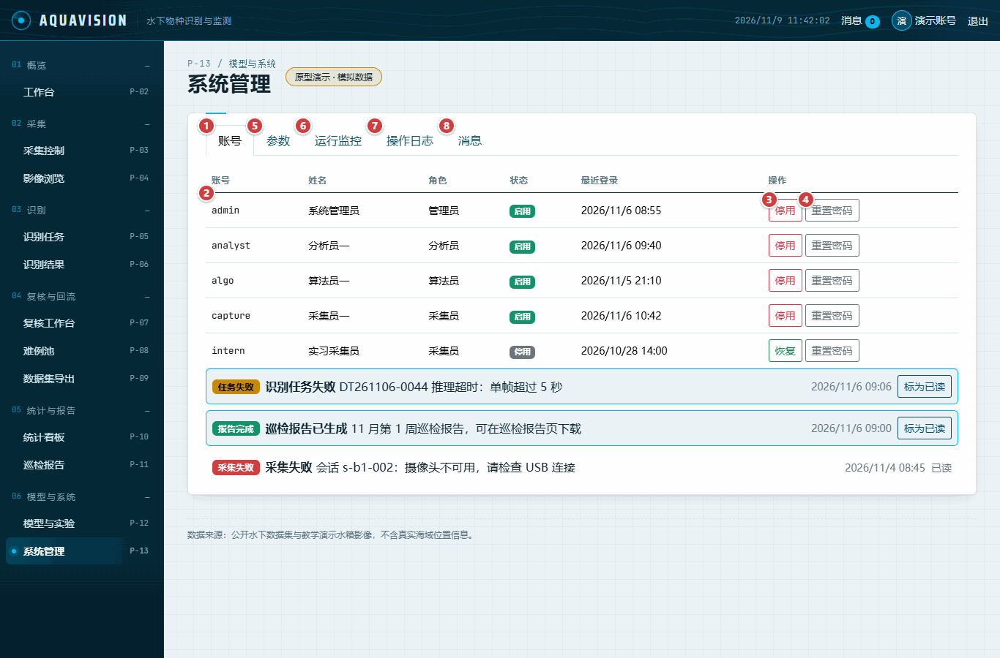

| No. | Screen | Area | Control | Detail | Requirement | PD | COD | UT | Assignee | Owner |
|---|---|---|---|---|---|---|---|---|---|---|
| TM-103 | P-13 System settings | actions | Accounts tab | See figure 13, callout 1. Accounts with role, status and last sign-in. | FR-M1-03 | Done | Done | Not started | Sun Jianheng | Yao Tianyu |
| TM-104 | P-13 System settings | content | Account row | See figure 13, callout 2. One account. | FR-M1-03 | Done | Done | Not started | Sun Jianheng | Yao Tianyu |
| TM-105 | P-13 System settings | actions | Disable or restore | See figure 13, callout 3. Changes the account status after a confirmation. | FR-M1-03 | Done | Done | Not started | Sun Jianheng | Yao Tianyu |
| TM-106 | P-13 System settings | actions | Reset password | See figure 13, callout 4. Sets a temporary password of at least eight characters. | FR-M1-03 | Done | Done | Not started | Sun Jianheng | Yao Tianyu |
| TM-107 | P-13 System settings | actions | Parameters tab | See figure 13, callout 5. Retention, concurrency, interval, quality threshold, camera (shown after switching). | FR-M7-01 | Done | Done | Not started | Sun Jianheng | Yao Tianyu |
| TM-108 | P-13 System settings | actions | Monitoring tab | See figure 13, callout 6. Queue, stored frames, disk and concurrency, refreshed every 30 s (shown after switching). | FR-M8-01 | Done | Done | Not started | Sun Jianheng | Yao Tianyu |
| TM-109 | P-13 System settings | actions | Operation log tab | See figure 13, callout 7. Audit trail filtered by module (shown after switching). | FR-M1-04 | Done | Done | Not started | Sun Jianheng | Yao Tianyu |
| TM-110 | P-13 System settings | actions | Messages tab | See figure 13, callout 8. In-app messages with mark-as-read (shown after switching). | FR-M8-02 | Done | Done | Not started | Sun Jianheng | Yao Tianyu |

## 5. Coverage

| Screen | Template | Rows | COD done | COD in progress | COD not started |
|---|---|---|---|---|---|
| P-01 Sign-in | `login.html` | 7 | 6 | 0 | 1 |
| P-02 Running overview (and the shared shell) | `home.html` | 14 | 10 | 3 | 1 |
| P-03 Capture control | `capture.html` | 12 | 8 | 4 | 0 |
| P-04 Image browser | `image-browser.html` | 9 | 9 | 0 | 0 |
| P-05 Detection jobs | `tasks.html` | 7 | 7 | 0 | 0 |
| P-06 Result detail | `result-detail.html` | 8 | 6 | 2 | 0 |
| P-07 Manual review | `review.html` | 12 | 11 | 0 | 1 |
| P-08 Hard samples | `hard-samples.html` | 6 | 6 | 0 | 0 |
| P-09 Data export | `dataset-export.html` | 7 | 7 | 0 | 0 |
| P-10 Statistics | `stats.html` | 7 | 3 | 3 | 1 |
| P-11 Inspection reports | `reports.html` | 7 | 6 | 0 | 1 |
| P-12 Model experiments | `models.html` | 6 | 5 | 1 | 0 |
| P-13 System settings | `admin.html` | 8 | 8 | 0 | 0 |

Requirements in table 3-1 and the rows that cite them. A requirement with no row has no screen element in the prototype; the reason is given.

| Requirement | Name | Rows |
|---|---|---|
| FR-M1-01 | Sign-in and session | TM-001, TM-002, TM-003, TM-004, TM-005, TM-007, TM-008, TM-009, TM-011, TM-012 |
| FR-M1-02 | Roles and permissions | TM-013 |
| FR-M1-03 | Account management and reset | TM-006, TM-103, TM-104, TM-105, TM-106 |
| FR-M1-04 | Operation log and audit | TM-109 |
| FR-M2-01 | Single-frame capture and registration | TM-022, TM-023, TM-024, TM-025 |
| FR-M2-02 | Scheduled and continuous capture | TM-023, TM-028 |
| FR-M2-03 | Quality scoring and retake | TM-016, TM-029, TM-030, TM-036, TM-054, TM-087 |
| FR-M2-04 | Batch and image search | TM-020, TM-032, TM-033, TM-034, TM-035, TM-037, TM-038, TM-042 |
| FR-M2-05 | Retention and cleanup | none — no screen: retention runs on the server |
| FR-M3-01 | Immediate detection | TM-026, TM-027, TM-052 |
| FR-M3-02 | Batch detection and queue | TM-021, TM-039, TM-041, TM-043, TM-044, TM-045, TM-046, TM-047, TM-048, TM-049 |
| FR-M3-03 | Detection parameters | none — no screen yet: detection parameters are fixed per task on the server |
| FR-M3-04 | Result browsing and counting | TM-031, TM-040, TM-050, TM-052, TM-053, TM-055, TM-056 |
| FR-M3-05 | Export | TM-057 |
| FR-M4-01 | Review bench | TM-015, TM-051, TM-058, TM-059, TM-060, TM-062, TM-063, TM-065, TM-066, TM-067, TM-068 |
| FR-M4-02 | Review trail and versions | TM-061, TM-064, TM-068, TM-069, TM-088 |
| FR-M4-03 | Hard-example set | TM-070, TM-071, TM-072, TM-073, TM-074, TM-075 |
| FR-M4-04 | Dataset export | TM-076, TM-077, TM-078, TM-079, TM-080, TM-081, TM-082 |
| FR-M5-01 | Species composition | TM-014, TM-084, TM-085, TM-094 |
| FR-M5-02 | Site and time distribution | TM-089 |
| FR-M5-03 | Trend and comparison | TM-018, TM-086 |
| FR-M5-04 | Inspection report | TM-083, TM-090, TM-091, TM-092, TM-093, TM-094, TM-095, TM-096 |
| FR-M6-01 | Version registration | TM-017, TM-098, TM-099 |
| FR-M6-02 | Activation and rollback | TM-097, TM-100 |
| FR-M6-03 | Experiments and metric comparison | TM-101 |
| FR-M6-04 | Species dictionary and thresholds | TM-102 |
| FR-M7-01 | System parameters | TM-107 |
| FR-M8-01 | Runtime monitoring | TM-108 |
| FR-M8-02 | Messages and alerts | TM-010, TM-019, TM-110 |
