# 需求跟踪矩阵

> 本文为 `traceability-en.md` 的中文对照版，以英文版为准。
>
> 维护人：@chemflowers · 重审时机：界面或元素有增删、或状态变化时

原型的每一个界面，逐个元素追踪到它服务的需求（`srs-zh.md` 表 3-1）。一行一个 UI 元素：标题、输入框、按钮各占一行。每行指向该界面截图上的编号图标，评审能在图上直接找到元素，而不必相信文字描述。

## 一、封面

| 项目 | 内容 |
|---|---|
| 项目 | AquaVision 水下物种识别与监测系统 |
| 文档 | 需求跟踪矩阵 |
| 版本 | 1.4 |
| 依据 | `srs-zh.md`（SRS-PRJ14-V1.11-2026）表 3-1 与 5.2 页面清单 |
| 界面数 | 13，每个界面一张图 |
| 编写 | 孙健恒（@chemflowers） |
| 审核 | 姚天宇（@FrozenYty） |
| 日期 | 2026-11-11 |

## 二、变更履历

| 版本 | 日期 | 修改人 | 内容 |
|---|---|---|---|
| 1.0 | 2026-11-09 | 孙健恒 | 首版：13 个界面、106 行，每个界面一张标注截图 |
| 1.1 | 2026-11-10 | 孙健恒 | P-10 增加统计口径一行（TM-082）：107 行 |
| 1.2 | 2026-11-10 | 姚天宇、孙健恒 | 页面名称改为 SRS V1.11 §5.2 的名称（#122）；影像浏览与结果详情的模板和插图改名（#127） |
| 1.3 | 2026-11-11 | 孙健恒 | P-07 增加缩放一行（TM-062），其后编号顺延一位：108 行（#137）；TM-056 指向 CSV 导出按钮（#138） |
| 1.4 | 2026-11-11 | 孙健恒 | 逐行复查进行中的元素并对真实服务端验证：17 行的 COD 改为完成（TM-041、TM-047、TM-048、TM-058 至 TM-068、TM-074、TM-105、TM-106，按本版编号）；UT 列按实际运行元素逻辑的测试填写；SRS §5.2 列出而页面缺少的两项各增一行（P-02 最近任务、P-07 版本对比与回滚）：110 行 |

## 三、阅读方法

- **参照图 N，图标 M** 指图 N 上编号为 M 的红色圆形图标。每个界面内按阅读顺序编号；没有图标的行，描述的是需求要求、但画面上还没有的元素。
- **截图为演示模式下的原型**（`?mock=1`）。状态列描述的是连接真实服务端时的情况：只能在模拟数据上运行的元素不算完成。
- **PD**——界面设计已完成并在原型走查中评审过。**COD**——已编码，并对真实服务端验证过，验证日期见变更履历。**UT**——有自动化测试实际运行该元素的逻辑并检查结果，记为完成（`tests/test_review_canvas.py`、`tests/test_result_csv.py`）；测试只从源码文本上检查该元素，记为进行中（`tests/test_page_names.py`、`tests/test_live_socket.py`）。服务端测试覆盖了许多行背后的接口，但不运行界面元素本身，因此不计入此列。
- **担当者**负责实现该元素；**责任者**对该界面负责。

| 状态 | 含义 |
|---|---|
| 完成 | 已完成并验证 |
| 进行中 | 已实现，但只能在模拟数据上运行，或等待其他车道 |
| 未着手 | 尚未实现 |

## 四、矩阵

### 4.1 P-01 登录（图 1）

| 编号 | 大分类（界面） | 中分类 | 小分类（控件） | 详细说明 | 需求 | PD | COD | UT | 担当者 | 责任者 |
|---|---|---|---|---|---|---|---|---|---|---|
| TM-001 | P-01 登录 | 页头 | 系统标识 | 参照图 1，图标 1。产品名称与声呐标志。 | FR-M1-01 | 完成 | 完成 | 未着手 | 孙健恒 | 姚天宇 |
| TM-002 | P-01 登录 | 表单 | 账号输入框 | 参照图 1，图标 2。可输入账号、手机号或邮箱，必填。 | FR-M1-01 | 完成 | 完成 | 未着手 | 孙健恒 | 姚天宇 |
| TM-003 | P-01 登录 | 表单 | 密码输入框 | 参照图 1，图标 3。掩码输入；被拒后自动清空。 | FR-M1-01 | 完成 | 完成 | 未着手 | 孙健恒 | 姚天宇 |
| TM-004 | P-01 登录 | 表单 | 拒绝提示 | 参照图 1，图标 4。显示服务端原话，含剩余次数与锁定时间。截图中为示例文字。 | FR-M1-01 | 完成 | 完成 | 未着手 | 孙健恒 | 姚天宇 |
| TM-005 | P-01 登录 | 操作 | 登录按钮 | 参照图 1，图标 5。调用 POST /api/auth/login，保存令牌，回到来源页面。 | FR-M1-01 | 完成 | 完成 | 未着手 | 孙健恒 | 姚天宇 |
| TM-006 | P-01 登录 | 内容 | 提示行 | 参照图 1，图标 6。演示模式下说明任意账号可登录（如截图）；连接服务端时说明忘记密码由管理员重置。 | FR-M1-03 | 完成 | 完成 | 未着手 | 孙健恒 | 姚天宇 |
| TM-007 | P-01 登录 | 表单 | 图形验证码 | 图 1，无图标：未出现在画面中。SRS 要求；接口不接收验证码，因此页面不显示该项。 | FR-M1-01 | 完成 | 未着手 | 未着手 | 孙健恒 | 姚天宇 |

### 4.2 P-02 运行总览（含公共外壳）（图 2）

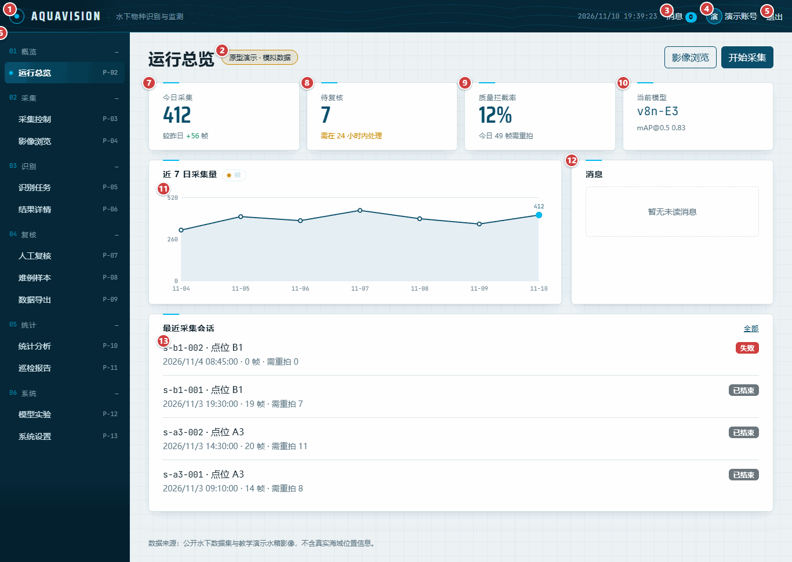

| 编号 | 大分类（界面） | 中分类 | 小分类（控件） | 详细说明 | 需求 | PD | COD | UT | 担当者 | 责任者 |
|---|---|---|---|---|---|---|---|---|---|---|
| TM-008 | P-02 运行总览（含公共外壳） | 页头 | 系统标识 | 参照图 2，图标 1。从任何页面回到运行总览。 | FR-M1-01 | 完成 | 完成 | 未着手 | 孙健恒 | 姚天宇 |
| TM-009 | P-02 运行总览（含公共外壳） | 页头 | 模拟数据角标 | 参照图 2，图标 2。标签页使用模拟数据时在每页显示。 | FR-M1-01 | 完成 | 完成 | 未着手 | 孙健恒 | 姚天宇 |
| TM-010 | P-02 运行总览（含公共外壳） | 页头 | 消息入口 | 参照图 2，图标 3。打开系统设置的消息标签页。 | FR-M8-02 | 完成 | 完成 | 未着手 | 孙健恒 | 姚天宇 |
| TM-011 | P-02 运行总览（含公共外壳） | 页头 | 当前用户 | 参照图 2，图标 4。当前登录账号的姓名。 | FR-M1-01 | 完成 | 完成 | 未着手 | 孙健恒 | 姚天宇 |
| TM-012 | P-02 运行总览（含公共外壳） | 页头 | 退出 | 参照图 2，图标 5。清除会话并回到登录页。 | FR-M1-01 | 完成 | 完成 | 未着手 | 孙健恒 | 姚天宇 |
| TM-013 | P-02 运行总览（含公共外壳） | 页头 | 主菜单 | 参照图 2，图标 6。按 SRS 顺序与业务域分组列出十二页（登录页没有菜单项），当前页高亮。尚未按角色过滤。 | FR-M1-02 | 完成 | 进行中 | 进行中 | 孙健恒 | 姚天宇 |
| TM-014 | P-02 运行总览（含公共外壳） | 内容 | 今日采集 | 参照图 2，图标 7。来自每日趋势的今日帧数。 | FR-M5-01 | 完成 | 完成 | 未着手 | 孙健恒 | 姚天宇 |
| TM-015 | P-02 运行总览（含公共外壳） | 内容 | 待复核 | 参照图 2，图标 8。暂无统计待复核数的接口，卡片如实说明。 | FR-M4-01 | 完成 | 进行中 | 未着手 | 孙健恒 | 姚天宇 |
| TM-016 | P-02 运行总览（含公共外壳） | 内容 | 质量拦截率 | 参照图 2，图标 9。来自质量接口的近 7 日拦截率。 | FR-M2-03 | 完成 | 完成 | 未着手 | 孙健恒 | 姚天宇 |
| TM-017 | P-02 运行总览（含公共外壳） | 内容 | 当前模型 | 参照图 2，图标 10。当前在线模型的版本与 mAP@0.5。 | FR-M6-01 | 完成 | 完成 | 未着手 | 孙健恒 | 姚天宇 |
| TM-018 | P-02 运行总览（含公共外壳） | 内容 | 近 7 日采集量 | 参照图 2，图标 11。每日采集帧数。 | FR-M5-03 | 完成 | 完成 | 未着手 | 孙健恒 | 姚天宇 |
| TM-019 | P-02 运行总览（含公共外壳） | 内容 | 消息卡片 | 参照图 2，图标 12。目前为静态文字，尚未接入消息接口。 | FR-M8-02 | 完成 | 进行中 | 未着手 | 孙健恒 | 姚天宇 |
| TM-020 | P-02 运行总览（含公共外壳） | 内容 | 最近采集会话 | 参照图 2，图标 13。最近四个采集会话及帧数、需重拍数。 | FR-M2-04 | 完成 | 完成 | 未着手 | 孙健恒 | 姚天宇 |
| TM-021 | P-02 运行总览（含公共外壳） | 内容 | 最近任务 | 图 2，无图标：未出现在画面中。SRS §5.2 为本页列出；页面显示最近采集会话，但没有显示最近识别任务。 | FR-M3-02 | 未着手 | 未着手 | 未着手 | 孙健恒 | 姚天宇 |

### 4.3 P-03 采集控制（图 3）

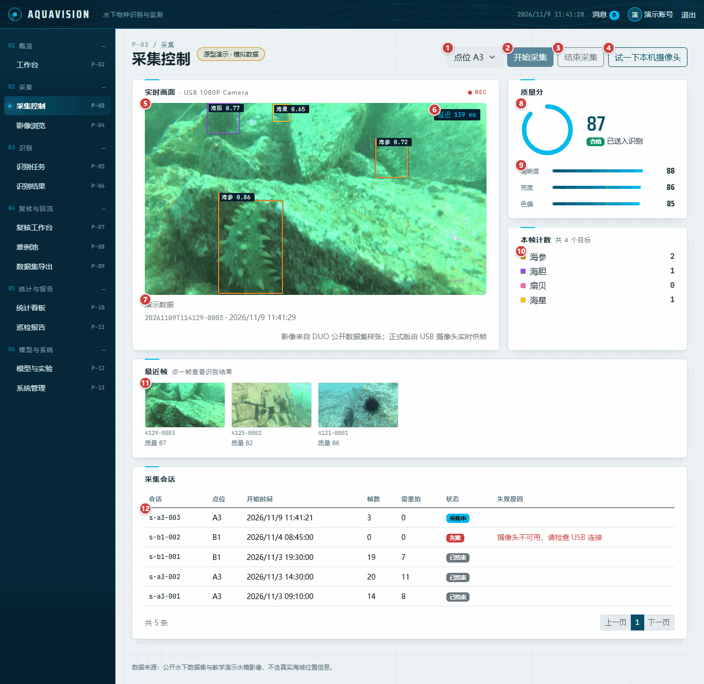

| 编号 | 大分类（界面） | 中分类 | 小分类（控件） | 详细说明 | 需求 | PD | COD | UT | 担当者 | 责任者 |
|---|---|---|---|---|---|---|---|---|---|---|
| TM-022 | P-03 采集控制 | 操作 | 点位选择 | 参照图 3，图标 1。本次会话的点位。 | FR-M2-01 | 完成 | 完成 | 未着手 | 孙健恒 | 姚天宇 |
| TM-023 | P-03 采集控制 | 操作 | 开始采集 | 参照图 3，图标 2。打开会话并启动实时画面。 | FR-M2-01、FR-M2-02 | 完成 | 完成 | 未着手 | 孙健恒 | 姚天宇 |
| TM-024 | P-03 采集控制 | 操作 | 结束采集 | 参照图 3，图标 3。停止画面并关闭会话。 | FR-M2-01 | 完成 | 完成 | 未着手 | 孙健恒 | 姚天宇 |
| TM-025 | P-03 采集控制 | 操作 | 试一下本机摄像头 | 参照图 3，图标 4。显示本机摄像头画面、不叠框；尚未在真实摄像头上验证。 | FR-M2-01 | 完成 | 进行中 | 未着手 | 孙健恒 | 姚天宇 |
| TM-026 | P-03 采集控制 | 内容 | 实时画面 | 参照图 3，图标 5。带检测框的画面；显示真实检测需要服务端实时通道与识别。 | FR-M3-01 | 完成 | 进行中 | 进行中 | 孙健恒 | 姚天宇 |
| TM-027 | P-03 采集控制 | 内容 | 延迟 | 参照图 3，图标 6。实时通道下为服务端延迟，轮询时为帧的时长。 | FR-M3-01 | 完成 | 进行中 | 未着手 | 孙健恒 | 姚天宇 |
| TM-028 | P-03 采集控制 | 内容 | 连接方式 | 参照图 3，图标 7。说明当前是实时通道、轮询还是演示数据。 | FR-M2-02 | 完成 | 完成 | 未着手 | 孙健恒 | 姚天宇 |
| TM-029 | P-03 采集控制 | 内容 | 质量分环 | 参照图 3，图标 8。最新帧的质量分；低于 60 变黄并提示需重拍。 | FR-M2-03 | 完成 | 完成 | 未着手 | 孙健恒 | 姚天宇 |
| TM-030 | P-03 采集控制 | 内容 | 质量分项 | 参照图 3，图标 9。数据源提供时显示清晰度、亮度、色偏。 | FR-M2-03 | 完成 | 完成 | 未着手 | 孙健恒 | 姚天宇 |
| TM-031 | P-03 采集控制 | 内容 | 本帧计数 | 参照图 3，图标 10。当前帧各类别的目标数。 | FR-M3-04 | 完成 | 进行中 | 未着手 | 孙健恒 | 姚天宇 |
| TM-032 | P-03 采集控制 | 内容 | 最近帧 | 参照图 3，图标 11。最近八帧，点击进入结果详情。 | FR-M2-04 | 完成 | 完成 | 未着手 | 孙健恒 | 姚天宇 |
| TM-033 | P-03 采集控制 | 内容 | 采集会话 | 参照图 3，图标 12。会话的开始时间、帧数与需重拍数。 | FR-M2-04 | 完成 | 完成 | 未着手 | 孙健恒 | 姚天宇 |

### 4.4 P-04 影像浏览（图 4）

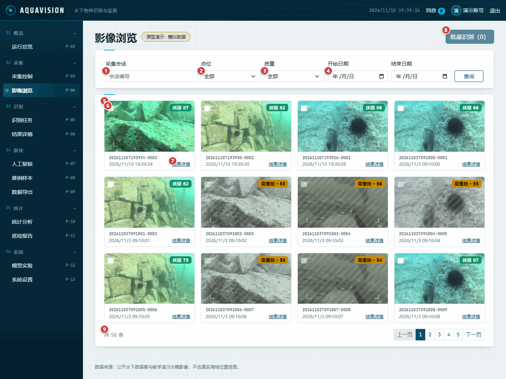

| 编号 | 大分类（界面） | 中分类 | 小分类（控件） | 详细说明 | 需求 | PD | COD | UT | 担当者 | 责任者 |
|---|---|---|---|---|---|---|---|---|---|---|
| TM-034 | P-04 影像浏览 | 表单 | 会话筛选 | 参照图 4，图标 1。按会话编号筛选。 | FR-M2-04 | 完成 | 完成 | 未着手 | 孙健恒 | 姚天宇 |
| TM-035 | P-04 影像浏览 | 表单 | 点位筛选 | 参照图 4，图标 2。按点位筛选。 | FR-M2-04 | 完成 | 完成 | 未着手 | 孙健恒 | 姚天宇 |
| TM-036 | P-04 影像浏览 | 表单 | 质量筛选 | 参照图 4，图标 3。合格或需重拍。 | FR-M2-03 | 完成 | 完成 | 未着手 | 孙健恒 | 姚天宇 |
| TM-037 | P-04 影像浏览 | 表单 | 日期范围 | 参照图 4，图标 4。开始与结束日期，含两端。 | FR-M2-04 | 完成 | 完成 | 未着手 | 孙健恒 | 姚天宇 |
| TM-038 | P-04 影像浏览 | 内容 | 帧缩略图 | 参照图 4，图标 5。画面、质量标签、帧号与时间；服务端无图像时显示占位。 | FR-M2-04 | 完成 | 完成 | 未着手 | 孙健恒 | 姚天宇 |
| TM-039 | P-04 影像浏览 | 内容 | 选择框 | 参照图 4，图标 6。选择帧发起批量识别；需重拍的帧不可选。 | FR-M3-02 | 完成 | 完成 | 未着手 | 孙健恒 | 姚天宇 |
| TM-040 | P-04 影像浏览 | 内容 | 结果详情链接 | 参照图 4，图标 7。进入结果详情。 | FR-M3-04 | 完成 | 完成 | 未着手 | 孙健恒 | 姚天宇 |
| TM-041 | P-04 影像浏览 | 操作 | 批量识别 | 参照图 4，图标 8。为所选帧创建识别任务。 | FR-M3-02 | 完成 | 完成 | 未着手 | 孙健恒 | 姚天宇 |
| TM-042 | P-04 影像浏览 | 内容 | 分页 | 参照图 4，图标 9。每页十二帧。 | FR-M2-04 | 完成 | 完成 | 未着手 | 孙健恒 | 姚天宇 |

### 4.5 P-05 识别任务（图 5）

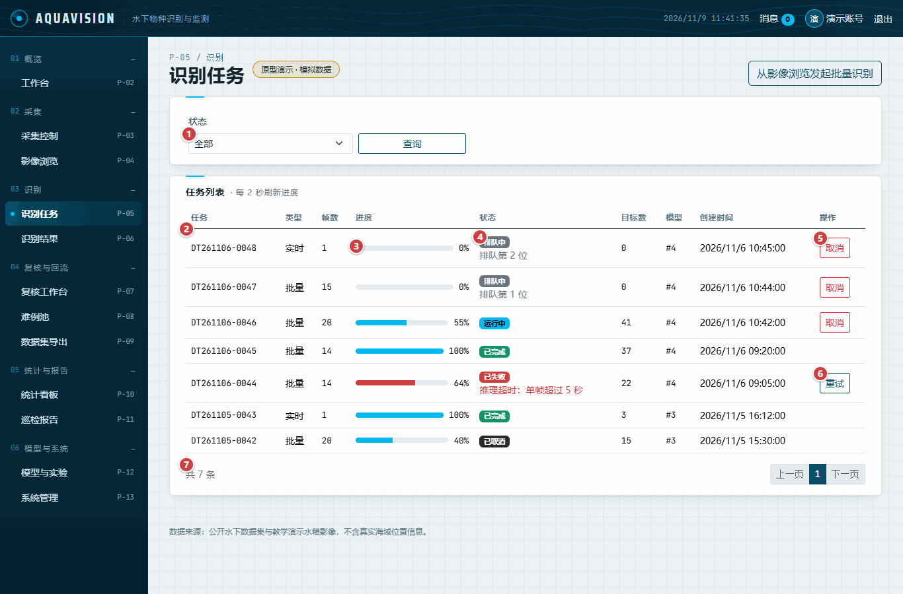

| 编号 | 大分类（界面） | 中分类 | 小分类（控件） | 详细说明 | 需求 | PD | COD | UT | 担当者 | 责任者 |
|---|---|---|---|---|---|---|---|---|---|---|
| TM-043 | P-05 识别任务 | 表单 | 状态筛选 | 参照图 5，图标 1。排队中、运行中、已完成、已失败、已取消。 | FR-M3-02 | 完成 | 完成 | 未着手 | 孙健恒 | 姚天宇 |
| TM-044 | P-05 识别任务 | 内容 | 任务编号 | 参照图 5，图标 2。任务编号、类型与帧数。 | FR-M3-02 | 完成 | 完成 | 未着手 | 孙健恒 | 姚天宇 |
| TM-045 | P-05 识别任务 | 内容 | 进度 | 参照图 5，图标 3。进度百分比；有任务在跑时每 2 秒刷新。 | FR-M3-02 | 完成 | 完成 | 未着手 | 孙健恒 | 姚天宇 |
| TM-046 | P-05 识别任务 | 内容 | 状态与排队位置 | 参照图 5，图标 4。状态、排队位置与失败原因。 | FR-M3-02 | 完成 | 完成 | 未着手 | 孙健恒 | 姚天宇 |
| TM-047 | P-05 识别任务 | 操作 | 取消 | 参照图 5，图标 5。确认后取消排队中或运行中的任务。 | FR-M3-02 | 完成 | 完成 | 未着手 | 孙健恒 | 姚天宇 |
| TM-048 | P-05 识别任务 | 操作 | 重试 | 参照图 5，图标 6。将失败任务重新排队。 | FR-M3-02 | 完成 | 完成 | 未着手 | 孙健恒 | 姚天宇 |
| TM-049 | P-05 识别任务 | 内容 | 分页 | 参照图 5，图标 7。每页八个任务。 | FR-M3-02 | 完成 | 完成 | 未着手 | 孙健恒 | 姚天宇 |

### 4.6 P-06 结果详情（图 6）

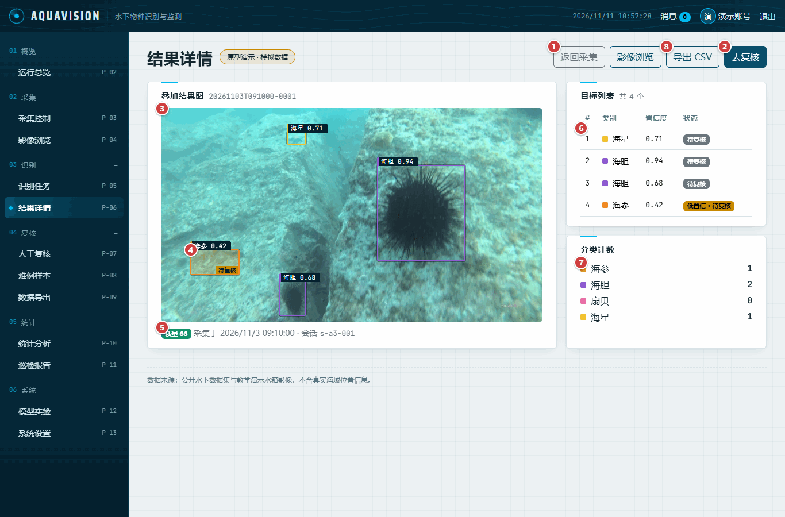

| 编号 | 大分类（界面） | 中分类 | 小分类（控件） | 详细说明 | 需求 | PD | COD | UT | 担当者 | 责任者 |
|---|---|---|---|---|---|---|---|---|---|---|
| TM-050 | P-06 结果详情 | 操作 | 返回采集 | 参照图 6，图标 1。回到采集控制页。 | FR-M3-04 | 完成 | 完成 | 未着手 | 孙健恒 | 姚天宇 |
| TM-051 | P-06 结果详情 | 操作 | 去复核 | 参照图 6，图标 2。在人工复核打开本帧。 | FR-M4-01 | 完成 | 完成 | 未着手 | 孙健恒 | 姚天宇 |
| TM-052 | P-06 结果详情 | 内容 | 叠加结果图 | 参照图 6，图标 3。带检测框的帧；服务端提供图像前显示带说明的占位。 | FR-M3-01、FR-M3-04 | 完成 | 进行中 | 未着手 | 孙健恒 | 姚天宇 |
| TM-053 | P-06 结果详情 | 内容 | 低置信框 | 参照图 6，图标 4。半透明填充加待复核角标，不只靠颜色区分。 | FR-M3-04 | 完成 | 完成 | 未着手 | 孙健恒 | 姚天宇 |
| TM-054 | P-06 结果详情 | 内容 | 帧信息 | 参照图 6，图标 5。质量、采集时间与会话。 | FR-M2-03 | 完成 | 完成 | 未着手 | 孙健恒 | 姚天宇 |
| TM-055 | P-06 结果详情 | 内容 | 目标列表 | 参照图 6，图标 6。每个框的类别、置信度与复核状态；悬停时高亮对应框。 | FR-M3-04 | 完成 | 完成 | 未着手 | 孙健恒 | 姚天宇 |
| TM-056 | P-06 结果详情 | 内容 | 分类计数 | 参照图 6，图标 7。各类别目标数。 | FR-M3-04 | 完成 | 完成 | 未着手 | 孙健恒 | 姚天宇 |
| TM-057 | P-06 结果详情 | 操作 | 结果导出 | 参照图 6，图标 8。把本页列出的框导出为 CSV，每个框一行：UTF-8 带字节顺序标记，Excel 能正确显示中文类别名；没有结果时给出提示，不生成文件。JSON 与标注图导出尚未实现。 | FR-M3-05 | 完成 | 进行中 | 完成 | 孙健恒 | 姚天宇 |

### 4.7 P-07 人工复核（图 7）

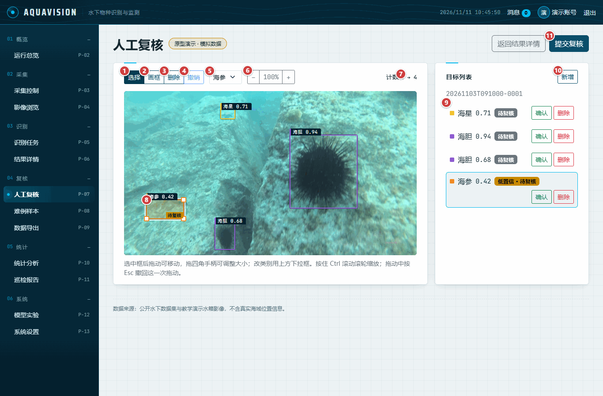

| 编号 | 大分类（界面） | 中分类 | 小分类（控件） | 详细说明 | 需求 | PD | COD | UT | 担当者 | 责任者 |
|---|---|---|---|---|---|---|---|---|---|---|
| TM-058 | P-07 人工复核 | 操作 | 选择 | 参照图 7，图标 1。选择并拖动框。 | FR-M4-01 | 完成 | 完成 | 完成 | 孙健恒 | 姚天宇 |
| TM-059 | P-07 人工复核 | 操作 | 画框 | 参照图 7，图标 2。拖动画出新框。 | FR-M4-01 | 完成 | 完成 | 完成 | 孙健恒 | 姚天宇 |
| TM-060 | P-07 人工复核 | 操作 | 删除 | 参照图 7，图标 3。删除选中的框。 | FR-M4-01 | 完成 | 完成 | 未着手 | 孙健恒 | 姚天宇 |
| TM-061 | P-07 人工复核 | 操作 | 撤销 | 参照图 7，图标 4。撤销上一步（仅一步）。 | FR-M4-02 | 完成 | 完成 | 未着手 | 孙健恒 | 姚天宇 |
| TM-062 | P-07 人工复核 | 操作 | 类别下拉 | 参照图 7，图标 5。修改选中框的类别。 | FR-M4-01 | 完成 | 完成 | 未着手 | 孙健恒 | 姚天宇 |
| TM-063 | P-07 人工复核 | 操作 | 缩放 | 参照图 7，图标 6。50% 至 400%；画面与框同步缩放，按住 Ctrl 滚动滚轮以指针为中心缩放。任何缩放比例下，指针位置都经同一个经过测试的函数换算。 | FR-M4-01 | 完成 | 完成 | 完成 | 孙健恒 | 姚天宇 |
| TM-064 | P-07 人工复核 | 操作 | 计数变化 | 参照图 7，图标 7。修改前后的目标数。 | FR-M4-02 | 完成 | 完成 | 未着手 | 孙健恒 | 姚天宇 |
| TM-065 | P-07 人工复核 | 内容 | 选中框 | 参照图 7，图标 8。四角手柄；拖框身移动，拖角调整大小。 | FR-M4-01 | 完成 | 完成 | 完成 | 孙健恒 | 姚天宇 |
| TM-066 | P-07 人工复核 | 内容 | 目标行 | 参照图 7，图标 9。确认或删除框；点击在画布上选中。 | FR-M4-01 | 完成 | 完成 | 未着手 | 孙健恒 | 姚天宇 |
| TM-067 | P-07 人工复核 | 操作 | 新增 | 参照图 7，图标 10。切换到画框。 | FR-M4-01 | 完成 | 完成 | 未着手 | 孙健恒 | 姚天宇 |
| TM-068 | P-07 人工复核 | 操作 | 提交复核 | 参照图 7，图标 11。提交完整框列表；服务端拒绝尚无识别结果的帧。 | FR-M4-01、FR-M4-02 | 完成 | 完成 | 未着手 | 孙健恒 | 姚天宇 |
| TM-069 | P-07 人工复核 | 操作 | 版本对比与回滚 | 图 7，无图标：未出现在画面中。SRS §5.2 为本页列出。服务端把每次提交存为新版本并返回版本号，但没有列出帧的各版本、也没有回滚的接口，因此页面两者都没有（等待 B 线）。 | FR-M4-02 | 未着手 | 未着手 | 未着手 | 孙健恒 | 姚天宇 |

### 4.8 P-08 难例样本（图 8）

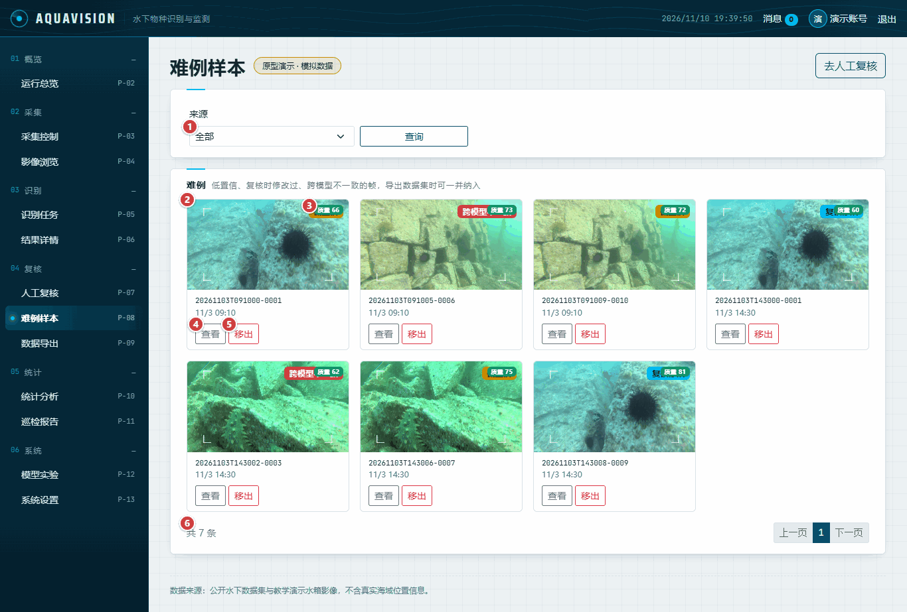

| 编号 | 大分类（界面） | 中分类 | 小分类（控件） | 详细说明 | 需求 | PD | COD | UT | 担当者 | 责任者 |
|---|---|---|---|---|---|---|---|---|---|---|
| TM-070 | P-08 难例样本 | 表单 | 来源筛选 | 参照图 8，图标 1。低置信、复核修改、跨模型不一致。 | FR-M4-03 | 完成 | 完成 | 未着手 | 孙健恒 | 姚天宇 |
| TM-071 | P-08 难例样本 | 内容 | 难例卡片 | 参照图 8，图标 2。帧、质量与采集时间。 | FR-M4-03 | 完成 | 完成 | 未着手 | 孙健恒 | 姚天宇 |
| TM-072 | P-08 难例样本 | 内容 | 来源标签 | 参照图 8，图标 3。该帧成为难例样本的原因。 | FR-M4-03 | 完成 | 完成 | 未着手 | 孙健恒 | 姚天宇 |
| TM-073 | P-08 难例样本 | 操作 | 查看 | 参照图 8，图标 4。进入结果详情。 | FR-M4-03 | 完成 | 完成 | 未着手 | 孙健恒 | 姚天宇 |
| TM-074 | P-08 难例样本 | 操作 | 移出 | 参照图 8，图标 5。确认后移出难例样本。 | FR-M4-03 | 完成 | 完成 | 未着手 | 孙健恒 | 姚天宇 |
| TM-075 | P-08 难例样本 | 内容 | 分页 | 参照图 8，图标 6。每页八个难例。 | FR-M4-03 | 完成 | 完成 | 未着手 | 孙健恒 | 姚天宇 |

### 4.9 P-09 数据导出（图 9）

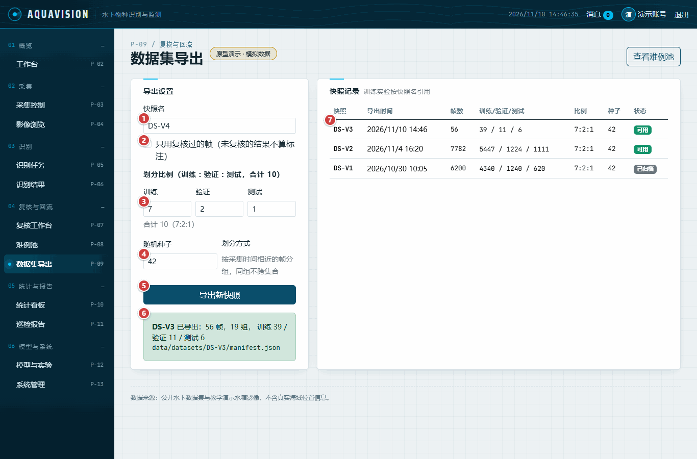

| 编号 | 大分类（界面） | 中分类 | 小分类（控件） | 详细说明 | 需求 | PD | COD | UT | 担当者 | 责任者 |
|---|---|---|---|---|---|---|---|---|---|---|
| TM-076 | P-09 数据导出 | 表单 | 快照名 | 参照图 9，图标 1。以 DS- 开头的名称，自动建议下一个版本号。 | FR-M4-04 | 完成 | 完成 | 未着手 | 孙健恒 | 姚天宇 |
| TM-077 | P-09 数据导出 | 表单 | 只用复核过的帧 | 参照图 9，图标 2。未复核的结果不算标注。 | FR-M4-04 | 完成 | 完成 | 未着手 | 孙健恒 | 姚天宇 |
| TM-078 | P-09 数据导出 | 表单 | 划分比例 | 参照图 9，图标 3。训练、验证、测试，按十分计，合计须为 10。 | FR-M4-04 | 完成 | 完成 | 未着手 | 孙健恒 | 姚天宇 |
| TM-079 | P-09 数据导出 | 表单 | 随机种子 | 参照图 9，图标 4。同样的帧和种子得到同样的划分。 | FR-M4-04 | 完成 | 完成 | 未着手 | 孙健恒 | 姚天宇 |
| TM-080 | P-09 数据导出 | 操作 | 导出新快照 | 参照图 9，图标 5。生成快照与清单文件。 | FR-M4-04 | 完成 | 完成 | 未着手 | 孙健恒 | 姚天宇 |
| TM-081 | P-09 数据导出 | 内容 | 导出结果 | 参照图 9，图标 6。按服务端返回显示帧数、组数、划分数与清单路径。 | FR-M4-04 | 完成 | 完成 | 未着手 | 孙健恒 | 姚天宇 |
| TM-082 | P-09 数据导出 | 内容 | 快照记录 | 参照图 9，图标 7。全部快照；划分合计与总数不符的行会被标出。 | FR-M4-04 | 完成 | 完成 | 未着手 | 孙健恒 | 姚天宇 |

### 4.10 P-10 统计分析（图 10）

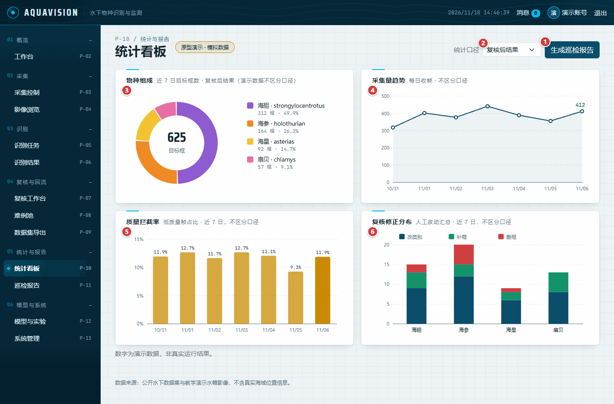

| 编号 | 大分类（界面） | 中分类 | 小分类（控件） | 详细说明 | 需求 | PD | COD | UT | 担当者 | 责任者 |
|---|---|---|---|---|---|---|---|---|---|---|
| TM-083 | P-10 统计分析 | 操作 | 生成巡检报告 | 参照图 10，图标 1。进入巡检报告页。 | FR-M5-04 | 完成 | 完成 | 未着手 | 孙健恒 | 姚天宇 |
| TM-084 | P-10 统计分析 | 操作 | 统计口径 | 参照图 10，图标 2。切换物种组成图的统计口径，图注同步变化；其他图不随口径变化。 | FR-M5-01 | 完成 | 进行中 | 未着手 | 孙健恒 | 姚天宇 |
| TM-085 | P-10 统计分析 | 内容 | 物种组成 | 参照图 10，图标 3。近 7 日各类别目标数。 | FR-M5-01 | 完成 | 完成 | 未着手 | 孙健恒 | 姚天宇 |
| TM-086 | P-10 统计分析 | 内容 | 采集量趋势 | 参照图 10，图标 4。每日采集帧数。 | FR-M5-03 | 完成 | 完成 | 未着手 | 孙健恒 | 姚天宇 |
| TM-087 | P-10 统计分析 | 内容 | 质量拦截率 | 参照图 10，图标 5。原型为按日柱图；服务端只返回汇总，以文字说明。 | FR-M2-03 | 完成 | 进行中 | 未着手 | 孙健恒 | 姚天宇 |
| TM-088 | P-10 统计分析 | 内容 | 复核修正分布 | 参照图 10，图标 6。原型为按类别堆叠；服务端只返回汇总。 | FR-M4-02 | 完成 | 进行中 | 未着手 | 孙健恒 | 姚天宇 |
| TM-089 | P-10 统计分析 | 内容 | 点位热力图 | 图 10，无图标：未出现在画面中。点位密度与排行尚未实现。 | FR-M5-02 | 完成 | 未着手 | 未着手 | 孙健恒 | 姚天宇 |

### 4.11 P-11 巡检报告（图 11）

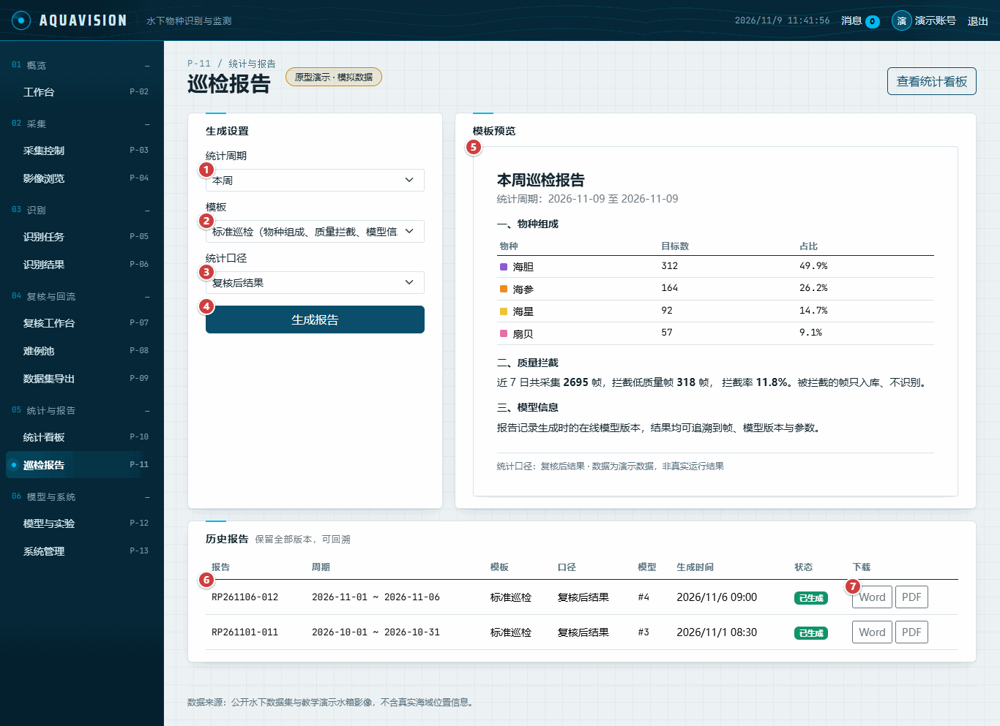

| 编号 | 大分类（界面） | 中分类 | 小分类（控件） | 详细说明 | 需求 | PD | COD | UT | 担当者 | 责任者 |
|---|---|---|---|---|---|---|---|---|---|---|
| TM-090 | P-11 巡检报告 | 表单 | 统计周期 | 参照图 11，图标 1。本周、本月或自定义范围。 | FR-M5-04 | 完成 | 完成 | 未着手 | 孙健恒 | 姚天宇 |
| TM-091 | P-11 巡检报告 | 表单 | 模板 | 参照图 11，图标 2。标准巡检或简版。 | FR-M5-04 | 完成 | 完成 | 未着手 | 孙健恒 | 姚天宇 |
| TM-092 | P-11 巡检报告 | 表单 | 统计口径 | 参照图 11，图标 3。复核后或原始识别结果。 | FR-M5-04 | 完成 | 完成 | 未着手 | 孙健恒 | 姚天宇 |
| TM-093 | P-11 巡检报告 | 操作 | 生成报告 | 参照图 11，图标 4。在服务端生成报告。 | FR-M5-04 | 完成 | 完成 | 未着手 | 孙健恒 | 姚天宇 |
| TM-094 | P-11 巡检报告 | 内容 | 模板预览 | 参照图 11，图标 5。来自统计接口的物种组成、质量拦截与模型信息。 | FR-M5-01、FR-M5-04 | 完成 | 完成 | 未着手 | 孙健恒 | 姚天宇 |
| TM-095 | P-11 巡检报告 | 内容 | 历史报告 | 参照图 11，图标 6。全部已生成报告及状态。 | FR-M5-04 | 完成 | 完成 | 未着手 | 孙健恒 | 姚天宇 |
| TM-096 | P-11 巡检报告 | 操作 | 下载 | 参照图 11，图标 7。暂无下载接口，按钮如实提示。 | FR-M5-04 | 完成 | 未着手 | 未着手 | 孙健恒 | 姚天宇 |

### 4.12 P-12 模型实验（图 12）

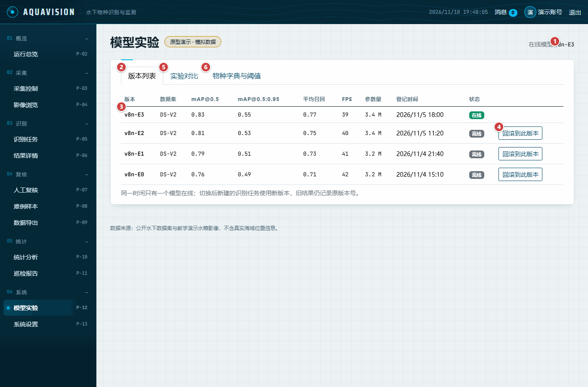

| 编号 | 大分类（界面） | 中分类 | 小分类（控件） | 详细说明 | 需求 | PD | COD | UT | 担当者 | 责任者 |
|---|---|---|---|---|---|---|---|---|---|---|
| TM-097 | P-12 模型实验 | 页头 | 在线模型 | 参照图 12，图标 1。唯一在线的版本，或无。 | FR-M6-02 | 完成 | 完成 | 未着手 | 孙健恒 | 姚天宇 |
| TM-098 | P-12 模型实验 | 操作 | 版本列表 | 参照图 12，图标 2。模型版本及指标。 | FR-M6-01 | 完成 | 完成 | 未着手 | 孙健恒 | 姚天宇 |
| TM-099 | P-12 模型实验 | 内容 | 版本行 | 参照图 12，图标 3。数据集、mAP@0.5、mAP@0.5:0.95、召回、FPS、参数量。 | FR-M6-01 | 完成 | 完成 | 未着手 | 孙健恒 | 姚天宇 |
| TM-100 | P-12 模型实验 | 操作 | 上线或回滚 | 参照图 12，图标 4。确认后切换在线模型。 | FR-M6-02 | 完成 | 进行中 | 未着手 | 孙健恒 | 姚天宇 |
| TM-101 | P-12 模型实验 | 操作 | 实验对比 | 参照图 12，图标 5。消融表与相对基线的变化（切换后显示）。 | FR-M6-03 | 完成 | 完成 | 未着手 | 孙健恒 | 姚天宇 |
| TM-102 | P-12 模型实验 | 操作 | 物种字典与阈值 | 参照图 12，图标 6。分类别阈值与是否计入统计，逐行保存（切换后显示）。 | FR-M6-04 | 完成 | 完成 | 未着手 | 孙健恒 | 姚天宇 |

### 4.13 P-13 系统设置（图 13）

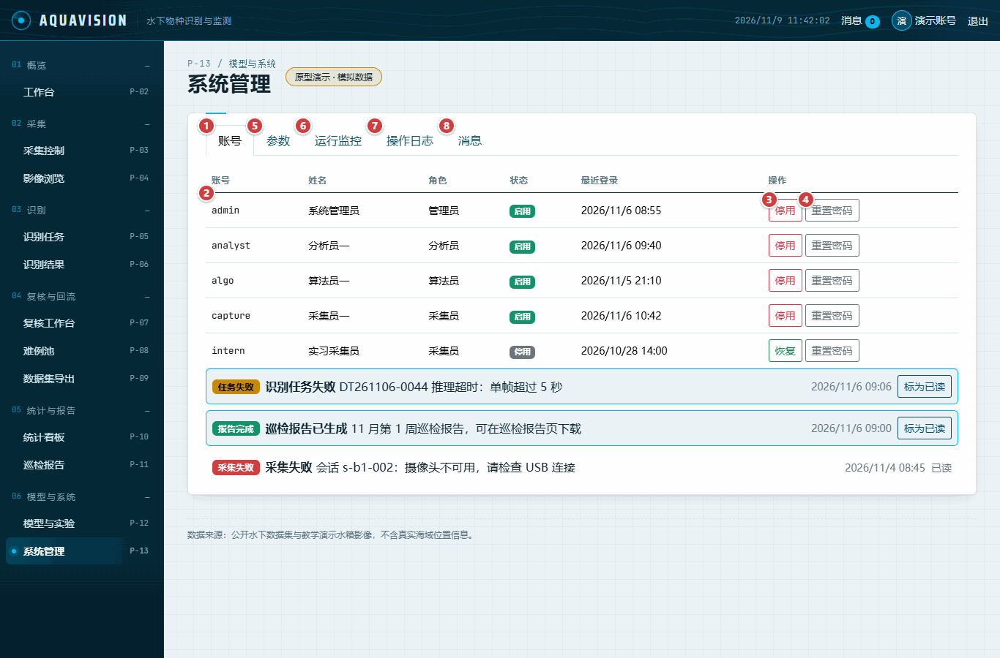

| 编号 | 大分类（界面） | 中分类 | 小分类（控件） | 详细说明 | 需求 | PD | COD | UT | 担当者 | 责任者 |
|---|---|---|---|---|---|---|---|---|---|---|
| TM-103 | P-13 系统设置 | 操作 | 账号 | 参照图 13，图标 1。账号、角色、状态与最近登录。 | FR-M1-03 | 完成 | 完成 | 未着手 | 孙健恒 | 姚天宇 |
| TM-104 | P-13 系统设置 | 内容 | 账号行 | 参照图 13，图标 2。一个账号。 | FR-M1-03 | 完成 | 完成 | 未着手 | 孙健恒 | 姚天宇 |
| TM-105 | P-13 系统设置 | 操作 | 停用或恢复 | 参照图 13，图标 3。确认后修改账号状态。 | FR-M1-03 | 完成 | 完成 | 未着手 | 孙健恒 | 姚天宇 |
| TM-106 | P-13 系统设置 | 操作 | 重置密码 | 参照图 13，图标 4。设置至少 8 位的临时密码。 | FR-M1-03 | 完成 | 完成 | 未着手 | 孙健恒 | 姚天宇 |
| TM-107 | P-13 系统设置 | 操作 | 参数 | 参照图 13，图标 5。保留天数、并发、间隔、质量阈值、摄像头（切换后显示）。 | FR-M7-01 | 完成 | 完成 | 未着手 | 孙健恒 | 姚天宇 |
| TM-108 | P-13 系统设置 | 操作 | 运行监控 | 参照图 13，图标 6。队列、已入库帧、磁盘与并发，每 30 秒刷新（切换后显示）。 | FR-M8-01 | 完成 | 完成 | 未着手 | 孙健恒 | 姚天宇 |
| TM-109 | P-13 系统设置 | 操作 | 操作日志 | 参照图 13，图标 7。按模块筛选的审计记录（切换后显示）。 | FR-M1-04 | 完成 | 完成 | 未着手 | 孙健恒 | 姚天宇 |
| TM-110 | P-13 系统设置 | 操作 | 消息 | 参照图 13，图标 8。站内消息与标为已读（切换后显示）。 | FR-M8-02 | 完成 | 完成 | 未着手 | 孙健恒 | 姚天宇 |

## 五、覆盖检查

| 界面 | 模板 | 行数 | COD 完成 | COD 进行中 | COD 未着手 |
|---|---|---|---|---|---|
| P-01 登录 | `login.html` | 7 | 6 | 0 | 1 |
| P-02 运行总览（含公共外壳） | `home.html` | 14 | 10 | 3 | 1 |
| P-03 采集控制 | `capture.html` | 12 | 8 | 4 | 0 |
| P-04 影像浏览 | `image-browser.html` | 9 | 9 | 0 | 0 |
| P-05 识别任务 | `tasks.html` | 7 | 7 | 0 | 0 |
| P-06 结果详情 | `result-detail.html` | 8 | 6 | 2 | 0 |
| P-07 人工复核 | `review.html` | 12 | 11 | 0 | 1 |
| P-08 难例样本 | `hard-samples.html` | 6 | 6 | 0 | 0 |
| P-09 数据导出 | `dataset-export.html` | 7 | 7 | 0 | 0 |
| P-10 统计分析 | `stats.html` | 7 | 3 | 3 | 1 |
| P-11 巡检报告 | `reports.html` | 7 | 6 | 0 | 1 |
| P-12 模型实验 | `models.html` | 6 | 5 | 1 | 0 |
| P-13 系统设置 | `admin.html` | 8 | 8 | 0 | 0 |

表 3-1 中的需求及引用它们的行。没有对应行的需求，说明原型中没有该需求的界面元素，并给出原因。

| 需求 | 名称 | 行 |
|---|---|---|
| FR-M1-01 | 登录与会话 | TM-001、TM-002、TM-003、TM-004、TM-005、TM-007、TM-008、TM-009、TM-011、TM-012 |
| FR-M1-02 | 角色与权限控制 | TM-013 |
| FR-M1-03 | 账号管理与重置 | TM-006、TM-103、TM-104、TM-105、TM-106 |
| FR-M1-04 | 操作日志与审计 | TM-109 |
| FR-M2-01 | 单帧采集与入库 | TM-022、TM-023、TM-024、TM-025 |
| FR-M2-02 | 定时巡拍与连续采集 | TM-023、TM-028 |
| FR-M2-03 | 图像质量判定与重拍 | TM-016、TM-029、TM-030、TM-036、TM-054、TM-087 |
| FR-M2-04 | 采集批次与影像检索 | TM-020、TM-032、TM-033、TM-034、TM-035、TM-037、TM-038、TM-042 |
| FR-M2-05 | 存储策略与清理 | 无——无界面：清理在服务端执行 |
| FR-M3-01 | 即时识别 | TM-026、TM-027、TM-052 |
| FR-M3-02 | 批量识别与队列 | TM-021、TM-039、TM-041、TM-043、TM-044、TM-045、TM-046、TM-047、TM-048、TM-049 |
| FR-M3-03 | 识别参数配置 | 无——暂无界面：识别参数随任务在服务端固定 |
| FR-M3-04 | 结果浏览与计数 | TM-031、TM-040、TM-050、TM-052、TM-053、TM-055、TM-056 |
| FR-M3-05 | 结果导出 | TM-057 |
| FR-M4-01 | 复核工作台 | TM-015、TM-051、TM-058、TM-059、TM-060、TM-062、TM-063、TM-065、TM-066、TM-067、TM-068 |
| FR-M4-02 | 复核留痕与版本 | TM-061、TM-064、TM-068、TM-069、TM-088 |
| FR-M4-03 | 难例样本集 | TM-070、TM-071、TM-072、TM-073、TM-074、TM-075 |
| FR-M4-04 | 数据集导出 | TM-076、TM-077、TM-078、TM-079、TM-080、TM-081、TM-082 |
| FR-M5-01 | 物种组成统计 | TM-014、TM-084、TM-085、TM-094 |
| FR-M5-02 | 点位与时间分布 | TM-089 |
| FR-M5-03 | 趋势与同比环比 | TM-018、TM-086 |
| FR-M5-04 | 巡检报告生成 | TM-083、TM-090、TM-091、TM-092、TM-093、TM-094、TM-095、TM-096 |
| FR-M6-01 | 模型版本登记 | TM-017、TM-098、TM-099 |
| FR-M6-02 | 上线与回滚 | TM-097、TM-100 |
| FR-M6-03 | 实验记录与指标对比 | TM-101 |
| FR-M6-04 | 物种字典与分类别阈值 | TM-102 |
| FR-M7-01 | 系统参数配置 | TM-107 |
| FR-M8-01 | 运行监控 | TM-108 |
| FR-M8-02 | 站内消息与异常提醒 | TM-010、TM-019、TM-110 |
